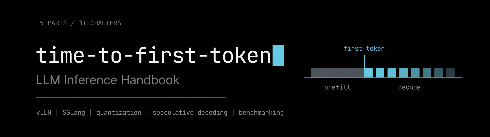

<p align="center">
  
</p>

[](https://github.com/tdccccc/time-to-first-token/actions/workflows/pages.yml) · [在线阅读（GitHub Pages）](https://tdccccc.github.io/time-to-first-token/)

# 边做边学 LLM 推理服务：交付一个真实的推理服务

> **在线阅读**：[tdccccc.github.io/time-to-first-token](https://tdccccc.github.io/time-to-first-token/)。本 README 是站点内容的单页源稿，章节编号与站点一致；站点构建时按章切分，并补上目录、笔记与进度。

一本按 5 部分、31 章组织的书，给想真正跑起 LLM 推理、而不只是读一读的工程师。全书围绕同一个产物：一个 OpenAI 兼容的推理服务——部署到租来的 GPU 上，做埋点、压测到 1000+ 并发，用量化和投机解码优化，在前面放一个成本感知的路由器，最后把它作为一份可复现的 benchmark 发表出来。

另一种做法是做十七个互不相干的小实验，大部分时间都花在搭环境上。一个不断长大的服务能覆盖同样的知识点，最后你手里还留下一个能拿得出手的东西。

> **本 fork 的改进**（相对上游 [patchy631/time-to-first-token](https://github.com/patchy631/time-to-first-token)）
>
> - **中文版**：主 README 翻译成中文，章节结构、做/读/略读标记与 GPU 成本说明全部保留；英文原文保存在 [docs/original-README.md](docs/original-README.md)。
> - **全书结构**：本书扩展为 5 部分、31 章，见 [docs/MODULES.md](docs/MODULES.md)。第二部分是推理框架；第一部分是基础与度量，第三部分是算子优化，第四部分是国产芯片适配，第五部分是跨芯片综合项目。
> - **算子与国产芯片**：新增第三部分算子优化与第四部分国产芯片适配（各 6 章），补上原路线图没有的两条线：自己写 kernel 并接进推理引擎、国产品牌芯片上跑通同一模型。
> - **第 15 章加深**：新增第 15 章：大规模集群 PD 优化——Mooncake 的 KV 中心架构、跨节点 KV 池、KV 传输账、池配比与容错。论文一律作选读，核心内容写进正文。
> - **TensorRT-LLM 一章**：第 18 章是可选的一章，讲编译式推理引擎 TensorRT-LLM 的架构、部署、量化、投机解码与解耦式服务，最后产出一份三引擎（vLLM / SGLang / TensorRT-LLM）对比报告。这一章引用的论文一律标为选读，正文直接给出深度总结。
> - **论文变选读**：每篇论文的核心思想、核心逻辑、关键机制和关键数字都已在正文对应章节写成详细总结，读完全文是可选的加深步骤；第 17 章养成阅读习惯的部分仍按原设计直接读论文。
> - **原项目授权与出处不变**：本仓库沿用上游的 CC BY 4.0 协议，原作者与原仓库链接见文末。

---

## 适合谁

你应该熟悉 Python、了解 Transformer 的架构、会用命令行。不需要有 serving、Kubernetes 或 CUDA 的经验。

如果你已经了解某个主题，标记为**略读**的节可以压缩。**做**的节不要压缩，它们才是重点。

## 学完之后你将得到什么

- 一套你自己配置、埋点、调优过的推理服务
- Grafana 看板，展示 TTFT（首 token 延迟）、token 间延迟、吞吐、排队深度和每次请求的成本
- 一个压测工具，能稳定地打出 1000+ 并发
- FP16、FP8、INT4、投机解码、KV 淘汰等多个变体的 benchmark 数据
- 一个按成本、延迟、质量选后端、带每请求 token 预算的路由器
- 一份发表出来的 benchmark 写作，版本固定、命令可复现
- 一张五模型对照表：总参数、激活参数、KV 状态三者如何脱钩，第三/第四部分的优化清单按模型查
- （可选第 15 章）一张大规模集群 PD 架构图、KV 传输账表与“信号→动作→验证方法”策略表
- （可选第 18 章）一份三引擎对比报告：同一硬件、同一模型、同一负载下 vLLM、SGLang、TensorRT-LLM 的 TTFT 与吞吐对比，外加选型指南

## 全书结构

| 部分 | 章节 | 主题 |
|---|---|---|
| 第一部分 基础与度量 | 1–5 | Roofline、四个度量、profiling、压测脚本、第一份基线 |
| 第二部分 推理框架 | 6–18 | 心智模型、vLLM、SGLang、量化、投机解码、解耦、路由器、发表 |
| 第三部分 算子优化 | 19–24 | CUDA/Triton、fused attention、量化 matmul、CUTLASS、接回引擎 |
| 第四部分 国产芯片适配 | 25–30 | 软件栈地图、CANN/AscendC、跑通、算子覆盖、移植、精度报告 |
| 第五部分 综合项目 | 31 | 跨芯片推理优化报告 |

---

## 章节为什么按这个顺序

这个顺序是刻意排的，和大多数人写清单的方式不一样。背后有五个决定。

**Roofline 模型放在最前面。** 后面每一次优化，都是同一张图上的一个移动。量化打的是解码阶段受显存带宽限制的问题；连续批处理把算术强度往计算上限推；投机解码用便宜的 FLOPs（在显存带宽受限的情况下 FLOPs 是便宜的）换更少的顺序访存；解耦式部署（disaggregation）存在，是因为 prefill 受计算限制、解码受带宽限制，两者在一块 GPU 上打架。没有这个模型，后面就是一袋子技巧。

**度量先于优化。** 埋点在第 9 章，压测在第 11 章，远在调优旋钮之前。没有它们，后面的一切都无法验证；一份公开的 benchmark，大部分就是一个可信的度量工具加一个模型。

**PagedAttention 和连续批处理不值得自己重写。** vLLM 已经实现了这两者，分块 prefill（chunked prefill）是 vLLM 和 SGLang 默认的调度策略。重写它们，不如读懂 block manager 和调度器，直到你能从代码讲清楚：为什么显存浪费能降到 4% 以下，为什么 GPU 在请求之间不再空转。

**路由器放在单位经济学旁边。** 一个按成本、延迟、质量选后端的路由器，是唯一一个把“多少钱”和“延迟预算”写进代码的组件。同一章学经济学，读到的东西会变成路由策略，而不是一篇你点头同意的博客。

**端侧部署是可选的，放在最后。** ONNX Runtime、WebLLM 是客户端和嵌入式运行时，和前面的数据中心那套几乎没有共同的操作面。TensorRT-LLM 不属于这一类：它是一台数据中心推理引擎，只是走编译式路线，所以单独放进可选的第 18 章，而不是和端侧工具并列。

---

## 环境准备

### GPU

7–8B 的模型大约需要一块 24GB 显卡。按半小时租，用完关机。

| 服务商 | 适合 |
|---|---|
| [RunPod](https://www.runpod.io) | 按秒计费，开机器快 |
| [Modal](https://modal.com) | Serverless，最适合跑 benchmark 扫描脚本 |
| [Lambda](https://lambda.ai) / [vast.ai](https://vast.ai) | 按需和市场价 GPU，便宜 |
| [Colab](https://colab.research.google.com) | 纯 Python 的练习，不用部署服务 |

第 1–5 章、第 9 章大部分、第 12 章的讲座、第 16 章全部阅读都不需要 GPU。把租卡集中在动手的那几章。只有两类实验必须用 H100：第 11 章的 1000 并发测试，以及第 14 章如果你真的要跑解耦式部署。第 15 章的多节点实测需要多卡集群，租不到就只做部署验证、性能对比待补测。

### 需要安装的工具

```bash
pip install vllm
pip install guidellm
pip install sglang
```

另外还需要 Docker（跑 Prometheus 和 Grafana），以及第 14 章用的 `kind` 或一个小的托管集群。

第 18 章另外需要 TensorRT-LLM：优先用 [NGC 预编译容器](https://nvidia.github.io/TensorRT-LLM/installation/installation-guide.html)（`nvcr.io/nvidia/tensorrt-llm/release:<版本>`，以安装指南里的版本标签为准），或按同一指南用 pip 安装。装之前先核对[支持的硬件](https://nvidia.github.io/TensorRT-LLM/supported-hardware.html)：文档列出的最老架构是 Ampere A100，FP8 权重需要 Hopper 或更新。

---

## 章节正文

> 下面是 31 章的正文源稿；站点构建时按章切分。

图例：**读**表示背景输入，**做**表示要动手产出，**略读**表示可快速过。论文标记为**选读**：正文已有详细总结，读原文是可选的加深步骤。

---

### 第 6 章：心智模型

**本章目标。** 拿到一个 kernel 或一次请求，能估出计算、搬运、启动三项时间，判断它在等哪一项，并按区间排出优化顺序。

第 1 章算过 7B 模型 decode 的账：面对 7 ms 的搬运时间，把算力翻倍，总时间几乎不动。那次判断的是“模型 + 硬件”这个组合落在 Roofline 的哪一侧；具体到一个 kernel 或一次请求变慢，问题更细——它是在等计算、等显存搬运，还是在等启动与同步？

本章把第 1 章的上限换成一条判断流程。6.1 补上第三种区间——启动与同步，给出三项时间的比较方法；6.2 用算子融合说明“省搬运”与“省计算”是两套动作；6.3 落到 GPU 的执行与存储层级，解释搬运为什么经常是最大项；6.4 把算术强度用在一个完整请求上；6.5 换目标模型手算一遍。

#### 第 1 节 · 三种区间：一个 kernel 慢，先问它在等什么

对一个 kernel，先算出三项时间——算得多久、搬得多久、启动与同步要多久——取最大的一项，就能说出它落在哪个区间。Horace He 在 [Making Deep Learning Go Brrrr From First Principles](https://horace.io/brrr_intro.html)（Horace He）里把这三样东西画成三个区间。

三个区间是同一张时间账里的三个候选最大值：计算受限（compute-bound）、显存带宽受限（memory-bound）、开销受限（overhead-bound，kernel 太小时的启动与同步）。运行时间约等于最大的那个。优化之前先问 kernel 在等什么，等错了对象，优化就是反方向。

先把第 1 章的 Roofline 拿过来当尺子，不重新推导。Roofline 的两个量是算术强度与脊点（ridge point）：算术强度低于脊点的 kernel，搬运那一项更大，落在带宽区间；高于脊点的，计算那一项更大。以 A100 80GB 为例，FP16 稠密算力约 312 TFLOPS，HBM 带宽约 2 TB/s，脊点是 312 ÷ 2 = 156 FLOP/字节。脊点是硬件给的，算术强度是 kernel 给的，两者一比，区间就定下来了。

7B 模型，FP16，batch=1，每生成一个 token 要把全部权重读一遍：70 亿参数 × 2 字节 = 14 GB；计算量约 2 × 70 亿 = 14 GFLOP。算术强度是 14 GFLOP ÷ 14 GB = 1 FLOP/字节，离脊点 156 差了 156 倍。算时间：14 GFLOP ÷ 312 TFLOPS ≈ 0.045 ms；搬时间：14 GB ÷ 2 TB/s = 7 ms。搬运时间是计算时间的 156 倍，解码落在带宽区间，理论上限约 143 token/s（2 TB/s ÷ 14 GB）。计算再快一倍，总时间只从 7.045 ms 变成 7.023 ms——瓶颈那一项没变，总时间就不会变。

第三个区间是启动与同步，针对很小的 kernel。搬运时间可以小到微秒以下：一个 1 MB 的张量在 2 TB/s 的带宽下，搬运只要 1 MB ÷ 2 TB/s = 0.5 微秒。kernel 启动本身也要花时间（微秒量级），张量小到搬运时间与启动时间差不多时，总时间就由启动开销说了算，算力与带宽再高都帮不上忙。判断办法是先算搬运时间，再与启动开销比。

一个容易犯的判断错误是把“FLOPs 高”当成“一定更快”。FLOPs 只量了计算那一项，运行时间取的是三项里的最大值。算术强度只有 1 的 kernel，FLOPs 再高也只是在缩短那 0.045 ms，7 ms 的搬运时间纹丝不动。看 kernel 先看它在哪个区间，再看区间里那一项能不能动；顺序反过来，看到的就全是假优化。

prefill 是反例。输入 512 个 token 的 prefill，总计算量约 7.24 TFLOP（权重部分 7.17 TFLOP，注意力约 0.069 TFLOP），搬运约 14 GB：计算时间 7.24 TFLOP ÷ 312 TFLOPS ≈ 23.2 ms，搬运时间 7.0 ms，计算是三项里最大的，落在计算区间。同样一块卡、同一组权重，解码落在带宽区间、prefill 落在计算区间，分界不在硬件上，在算术强度上：prefill 的算术强度是 7.24 TFLOP ÷ 14 GB ≈ 517 FLOP/字节，越过了 156 的脊点；解码的算术强度是 1，离脊点差了 156 倍。判断区间的方法只有一句：算出算术强度，跟脊点比。比完再决定优化方向——带宽区间少搬运（量化、融合、复用），计算区间少算或算得更密（稀疏、低精度计算、更好的 tiling），启动区间少启动（融合、CUDA Graph 一类把多次启动合成一次的办法）。三个区间对应三套不同的优化清单，拿错清单，优化就做在了错的地方。

“运行时间约等于三项里的最大值”这句话本身是近似，不是定理。真实 kernel 里计算与搬运可以部分重叠（一个 warp 等访存时，调度器可以让另一个 warp 先算），启动开销也可以与执行重叠，所以实测时间经常比三项里的最大值小一点。但重叠省掉的只是三项之间的缝隙，省不掉最大那一项本身。解码的 7 ms 搬运时间，再怎么重叠也绕不过去——14 GB 数据必须从 HBM 走到 SM，一字节都不能少。近似模型的作用是在动手之前算出瓶颈在哪，精确的数要靠第 11 章的压测量出来。

开销区间还有一个不用仪器的判断办法：把 kernel 的输入放大 10 倍，看时间涨不涨。时间跟着涨 10 倍，瓶颈在计算或搬运；时间基本不动，瓶颈在启动开销——输入放大了，固定开销一分没变，总时间当然不动。一个小 kernel 的账：4096 个 FP32 数，一共 16 KB，搬运时间是 16 KB ÷ 2 TB/s = 0.008 微秒，计算时间同样可以忽略，剩下的启动开销（微秒量级）就是总时间。把输入放大 10 倍到 160 KB，搬运时间变成 0.08 微秒，总时间还是启动开销说了算。这个诊断不用 profiler：改一个数、看时间跟不跟，就能把开销区间筛出来。推理服务里这类小 kernel 很多：RMSNorm、激活函数、采样里的逐元素操作，单个看都微不足道，串在一起时启动开销会一笔一笔累加——第 8 章读 vLLM 调度器时，留意它怎么把小操作批量化，思路与融合一脉相承。

三个区间也是后面章节的路标。第 12 章的量化打的是带宽区间：权重从 FP16 压到 INT8，14 GB 变成 7 GB，搬运时间直接减半。第 10 章的连续批处理打的是算术强度：批越大，权重被复用的次数越多，解码的点越往脊点靠近。第 13 章的投机解码打的是时间账的结构：用便宜的 FLOPs（带宽区间里 FLOPs 是便宜的）换更少的顺序访存步数。这些优化都遵循同一条顺序：先定位区间，再动对应那一项。

#### 第 2 节 · 算子融合：给带宽受限的 kernel 加 FLOPs，为什么没用

给带宽受限的 kernel 加 FLOPs 没有用，算子融合省的也不是 FLOPs，是搬运。这两句话是同一个算术模型的两面。解码的算术强度是 1 FLOP/字节，脊点是 156 FLOP/字节，两者之间隔着 156 倍。这个空隙的意思是，FLOPs 可以翻 156 倍，计算时间才追得上搬运时间。翻 10 倍试试：计算量从 14 GFLOP 变成 140 GFLOP，计算时间从 0.045 ms 变成 0.45 ms，搬运时间还是 7 ms，总时间还是 7 ms——多花的 FLOPs 全落在那个本来就空闲的 0.045 ms 里。给带宽受限的 kernel 加 FLOPs 没有用，原因就在这里：加的 FLOPs 落在非瓶颈那一项上，总时间取最大值，加多少都白加。反过来也一样：在计算区间里，省搬运也没用，瓶颈不在那里。

融合的做法很直接：两个 kernel 之间要经过 HBM 的中间结果，融成一个 kernel 之后就不用经过 HBM 了。三个逐元素操作串在一个 1 GB 的激活张量上（FP16，约 5 亿个元素）：不融合时，每个操作各读 1 GB、各写 1 GB，三个操作一共搬运 3 × 2 GB = 6 GB，在 2 TB/s 的带宽下要 3 ms；融成一个 kernel 之后，只读一次、只写一次，搬运 2 GB，只要 1 ms，省了 2 ms，速度是原来的 3 倍。省下来的 2 ms 全是少走的 HBM，FLOPs 一点没变——三个操作的计算量本来就不大，融合前它们就不是瓶颈。融合的账按字节算，不按 FLOPs 算：每少一次中间结果的 HBM 往返，就少一笔搬运时间。

融合还有第二笔账，落在启动区间。三个 kernel 是三次启动，融成一个是一次启动，启动开销省了两次。小 kernel 串在一起时，这笔账可能比搬运的账还大：每个 kernel 的搬运时间只有零点几微秒，启动开销反倒是主要成本，融合之后只付一次。两笔账合起来，融合的收益才完整：大张量上省搬运，小 kernel 上省启动。判断融合值不值，先看中间结果多大、kernel 多小。

融合的边界也要说清：不是所有操作都能融。前提是中间结果能放在片上存储里（寄存器、shared memory），放不下的还是得回 HBM，融了也白融；两个操作之间有全局同步（比如要等所有 block 都算完才能继续），融成一个 kernel 就做不到了。融合不是把代码拼在一起，是把数据流重新排布，让中间结果不落 HBM——排不下的，就别硬融。

另一个容易混的点是“融合等于少算”。融合前后的 FLOPs 完全一样，少的是 HBM 的读写次数与 kernel 的启动次数。把融合说成“少算”，是把时间账里的三项混成了一项；分开算，融合省的是搬运与开销，不是计算。

融合最有名的例子在 attention 里，它就是第 23 章要讲的 FlashAttention 的出发点。标准 attention 在 prefill 时要把分数矩阵 S 与概率矩阵 P 写回 HBM：输入 4096 个 token，S 是 4096 × 4096 个 FP32 数，一共 1677 万个元素，约 64 MiB；P 同样大小。不融合时，S 写一次、读一次，P 写一次、读一次，四遍一共 256 MiB，在 2 TB/s 的带宽下要 0.134 ms——这只是一层，32 层加起来是 4.29 ms。融合之后，S 与 P 只活在片上存储里，算完就用、用完就扔，HBM 上这四遍全省了。输入 1024 个 token 时，S 只有 4 MiB，四遍 32 层一共 0.27 ms，融合的收益小得多——融合省多少，取决于中间结果有多大。4.29 ms 与 0.27 ms 的对比，就是“先算中间结果大小，再决定融不融”的判断方法。

融合也有不划算的时候，两种情况最常见。第一种，kernel 本来就在计算区间：融合省的是搬运，计算区间的瓶颈是计算，搬运省下来，总时间基本不动——判断方法还是先看区间，再决定融不融。第二种，融合之后寄存器不够用了：融进来的操作要在片上多留几份中间结果，寄存器一紧张，SM 里同时能住的 warp 就少，延迟隐藏变差，省下的搬运时间可能被多出来的等待时间吃掉。融合的收益要净算：省下的 HBM 往返减去多占的片上资源带来的损失，净收益为正才融。这也是融合经常要配合 profiling 看的原因：第 3 章的工具对照里，`ncu` 能读出单个 kernel 的占用率与访存效率，融合前后的对比要落在这些读数上，而不是凭感觉。

融合的收益也要按张量大小分档，同一招在不同尺寸上值不同的钱。GEMM 的 epilogue（尾部逐元素操作）是个反例：输出 512 × 4096 个 FP16 数，一共 4 MiB，不融合时多读多写一遍是 8 MiB，在 2 TB/s 下只要 0.004 ms，融了也只省 0.004 ms——张量太小，收益可以忽略。跟 attention 的 S/P 对比：4096 长度下四遍 256 MiB，省 0.134 ms 一层、4.29 ms 全模型；1024 长度下四遍 32 层一共 0.27 ms；512 × 4096 的 epilogue 只省 0.004 ms。三个数排在一起，判断标准就出来了：中间结果以 MiB 计，融合才值得动手；以 KiB 计，融合的收益还不如省下的代码复杂度。先算中间结果的大小，再决定融不融。

回过头再看“加 FLOPs 没有用”这句话，它其实分两面。带宽区间里加 FLOPs 没有用，因为 FLOPs 落在非瓶颈那一项上；但反过来，带宽区间里的 FLOPs 是便宜的——便宜到可以拿来换别的东西。第 13 章的投机解码就是这笔交易：用一个小模型多算几步（多花 FLOPs），换大模型少做几次顺序访存（少付搬运时间）。同一句话换个方向读就成了优化策略：瓶颈那一项上的资源是贵的，非瓶颈那一项上的资源是便宜的，优化就是拿便宜的换贵的。结论因此不是“FLOPs 没用”，而是“FLOPs 在带宽区间里是便宜货币，花它去买搬运时间的减少，才是划算的交易”。

#### 第 3 节 · GPU 是怎么执行的：线程、block 与显存层级

一次 kernel 启动的数据流向，要放回执行模型里才看得清；后面所有“为什么慢”的判断，也都要落到它上面。GPU 上最小的执行单位是线程（thread），一个线程算一小块：一个输出元素，或一行的一部分。线程按三层组织：thread 是最小执行单位，各自有私有寄存器；block 是一组线程，通常 128 或 256 个，共享一块 shared memory，block 内可以同步；grid 是所有 block 的集合，block 之间只通过 global memory 通信。为什么分三层？因为同步有成本：同一 block 内的线程可以互相等待、共享一块高速存储；跨 block 的线程只能走 global memory，代价高得多。block 就是“便宜协作”与“昂贵协作”的分界线，程序的结构要顺着这条线组织。

硬件实际执行的单位不是线程，是 warp（一组 32 个线程，同一 warp 的 32 个线程在同一条指令上锁步执行，即单指令多线程 SIMT）。“锁步”的意思是，同一时刻，warp 里的 32 个线程执行同一条指令，只是各自手里的数据不同。好处是硬件不用给 32 个线程各配一套取指与解码逻辑，一套指令流带 32 份数据，面积与功耗都省下来了。代价也在这里：32 个线程想走不同的路，硬件只能让两条路轮流走，每条路执行时另一半线程空等。这就是分化（divergence），读 kernel 时看到 warp 内分支，先问受影响的 warp 占多少、分支里的路走了多久，再下结论。

一个 block 会被分到一个 SM（流式多处理器）上跑，SM 里的 warp 调度器每次挑一个就绪的 warp 发一条指令。block 是调度与共享的边界：同一个 block 的线程住在同一个 SM 上，才能共享它的 shared memory 和同步原语；跨 block 的线程不在同一个 SM 上，只能走 global memory。block 大小通常取 128 或 256 个线程，换算成 warp 是 4 个或 8 个——128 ÷ 32 = 4，256 ÷ 32 = 8。这个换算在调占用率时会反复用到：warp 数是调度器手里的牌，牌太少，一个 warp 等访存时就没牌可打。

数据在三层存储之间怎么走，决定了优化的方向：

| 层 | 大小 | 速度 | 谁可见 |
|---|---|---|---|
| global memory（HBM） | 几 GB 到几十 GB | 慢，读一次几百个周期 | 所有线程 |
| shared memory | 每个 block 几十 KB | 快，读一次几十个周期 | 同一 block 内 |
| register | 每个线程几十个 | 最快 | 仅本线程 |

为什么分三层？因为存储做不到又大又快：global memory 大但慢，register 快但小。分层就是把常用的放得近、少用的放得远，代价是程序员要自己管数据放哪一层。同一个数据反复用，就不要每次都去 global memory 取，先搬进 shared memory；一个数据只用一次，放寄存器里用完就扔。只有一层存储的话，要么容量小到装不下权重，要么速度慢到所有计算都得等它。分层是硬件在物理限制下的妥协，kernel 程序员的工作就是在这个妥协里把数据放对位置。

执行模型与显存层级合起来，解码的 7 ms 就有了落点：每生成一个 token，14 GB 权重从 HBM 读进 SM，经过 shared memory 与寄存器，只做 14 GFLOP 的计算就扔掉——数据只用一次，没有复用，搬运时间就成了总时间。数据搬运占主导，不是某个 kernel 写得不好，是执行模型与数据复用程度共同决定的；这是 6.4 的引子。

线程数与 block 数要靠算术定下来。向量加法，100 万个元素，block 取 256 个线程：需要 1000000 ÷ 256 = 3906.25，向上取整是 3907 个 block。前 3906 个 block 是满的（3906 × 256 = 999936），最后一个 block 只有 64 个线程有对应的元素，活跃比例是 64 ÷ 256 = 25%，剩下的 192 个线程靠边界判断直接返回。这个 25% 就是“凑不成整数倍”付的代价：只影响最后一个 block，全局看微不足道，但边界判断不能省——省了它，多出来的线程就会越界写内存。grid 与 block 的乘积要覆盖全部输出，覆盖的算术必须自己验算，差一个 block 就会漏算一整片输出。

访存还有一条容易被忽略的规则：同一个 warp 里的 32 个线程，最好读连续的地址。硬件搬运的单位不是一个 float，是一段连续的字节：32 个线程各读一个 FP32 数、地址连续时，一共 128 字节，一次搬运就能拿完；32 个线程的地址各隔 32 个 float 时，按 32 字节一个扇区算，要搬 32 个扇区、一共 1024 字节，真正用上的还是那 128 字节，8 倍带宽浪费在没用的字节上。这条规则叫合并访存（coalescing），账也是按字节算的：搬运时间按实际搬运的字节数算，不是按用上的字节数算。读 kernel 时，看到线程下标与访存地址的对应关系，先问同一个 warp 的地址连不连续；不连续的访存，带宽账上要乘一个浪费倍数。

延迟隐藏是执行模型的最后一块拼图。HBM 读一次要几百个周期，SM 不会干等：一个 warp 发出访存请求、等数据时，warp 调度器会挑另一个就绪的 warp 发指令，计算与等待重叠起来。这就是 block 里 warp 数不能太少的原因：warp 是调度器手里的牌，牌太少，一个 warp 等访存时就没牌可打，SM 空转；牌够多，等待就被别的 warp 的计算盖住了。占用率（occupancy）量的就是这副牌够不够：寄存器用得太多、shared memory 占得太多，SM 里同时能住的 warp 就少，延迟隐藏变差。执行模型、显存层级、延迟隐藏，三者合起来才是“GPU 是怎么执行的”完整答案：线程分工、数据放哪、等待时谁来顶上，缺一块，性能分析就缺一块。

#### 第 4 节 · 数据搬运为什么占主导：算术强度与 Roofline 的应用

同一个字节被复用了几次，决定了它在 Roofline 上的位置。把 decode 与 prefill 放在一起看：decode 每生成一个 token，搬运 14 GB 权重，只做 14 GFLOP；prefill 输入 512 个 token，搬运同样约 14 GB，却做约 7.24 TFLOP。同一组权重、同一块卡，搬运量基本不变，计算量差 500 多倍——“数据搬运占主导”说的是 decode 这一边。为什么搬运量不变？权重只读一遍：prefill 的 512 个 token 共享同一份权重读入，计算量随 token 数增长，搬运量不增长；decode 一次只生成一个 token，权重读一遍只换来一个 token 的计算量。

第 1 章的 Roofline 在这里只用结论：decode 的算术强度约 1，落在带宽斜线一侧；prefill 的算术强度约等于 prompt 的 token 数，短 prompt 仍可能受带宽限制，越过约 156 的脊点后才受计算限制。两端的分界不在模型大小，而在一个字节的数据被复用了多少次。

6.1 用 512 这一个点定出分界，128 与 1024 的点留给 6.5 完整算；这里只定判断顺序：先估计算术强度，再和脊点比较，最后用 profiling 或压测验证。

“数据搬运占主导”还有第二层意思：搬运不仅占时间，还占优化的优先级。解码的优化清单按这个逻辑排：量化把权重从 14 GB 压到 7 GB，搬运时间直接减半；KV 缓存的读写、批处理把算术强度往脊点推，都是在搬运那一项上做文章。反过来，在解码上堆算力、换更快的计算单元，动的是 0.045 ms 那一项，基本没用。优化的顺序是瓶颈的顺序：先看 Roofline 上点落在哪一边，再决定动哪一项。

选卡时最常见的误读是“显存大就等于跑得快”。显存容量决定模型装不装得下，显存带宽决定解码跑得快不快。一块显存很大、带宽很低的卡，7B 模型装得下，解码还是慢——7 ms 的搬运时间是带宽定的，不是容量定的。选卡时，容量与带宽是两个分开的数，各自回答不同的问题。

把两个阶段拼成一次请求：prefill 只付一次，decode 每生成一个 token 都要付一次。输出越长，decode 在总延迟里的占比越高，用户感受到的延迟绝大部分是解码的搬运时间。这就是 TTFT 与 ITL 要分开报的原因：TTFT 基本是 prefill 的时间，ITL 基本是 decode 每步的时间，两个数落在 Roofline 的两边，压成一个“延迟”就把结论毁了。第 2 章的度量对照表就是为这个准备的：四个数各量各的，混报等于没报。

“数据搬运占主导”还有一层历史背景：硬件的计算能力长得比显存带宽快，脊点一直在往右移——同样一个 kernel，算术强度不变，几年前的卡上可能落在计算区间，放到今天的卡上就落进带宽区间。结论是方法论上的：优化的重心要跟着脊点走，越往后，少搬运的优化越值钱，多算的优化越不值钱。搬运是越来越贵的资源，计算是越来越便宜的资源，拿便宜的换贵的，是后面各章优化的共同逻辑。

手算时核对三处最容易错的地方：一次乘加算 2 个 FLOPs，漏了这个 2，计算量就少一半；权重字节数是参数量乘位宽，FP16 是 2 字节，INT8 是 1 字节；KV 缓存按层数、KV 头数、头维、位宽逐项乘，再乘 token 数，缺一项结果就差几倍。算完反向验算一遍数量级：decode 的算术强度应在 1 附近，prefill 应在 prompt 长度附近，对不上就回头查这三处。

#### 第 5 节 · 手算目标模型：prefill 与 decode 各落在哪

目标模型的数要自己算一遍，算完才知道结论能不能立住。模型用 6.1 一直在算的 7B FP16、A100 80GB（312 TFLOPS，2 TB/s）；如果你要服务的模型是 8B，数字跟着变、结论不变：8B 权重是 80 亿 × 2 字节 = 16 GB，计算量是 2 × 80 亿 = 16 GFLOP，算术强度还是 16 ÷ 16 = 1 FLOP/字节。参数量与权重字节数同步涨，商不变——算术强度对模型规模不敏感，它敏感的是每个字节被复用了几次。

先算解码，batch=1，每生成一个 token。权重搬运 14 GB，计算 14 GFLOP，算术强度 1 FLOP/字节。算时间：14 GFLOP ÷ 312 TFLOPS ≈ 0.045 ms；搬时间：14 GB ÷ 2 TB/s = 7 ms。结论：解码受带宽限制，理论上限约 143 token/s。再把 KV 缓存的账补上：以 Mistral-7B 为例（32 层、8 个 KV 头、头维 128、FP16），每个 token 的 KV 是 32 × 2 × 8 × 128 × 2 字节 = 128 KiB；上下文 1024 个 token 时 KV 一共 128 MiB（约 0.134 GB），只占权重 14 GB 的约 1%；上下文 4096 时是 512 MiB（约 0.537 GB），约占 3.8%。短上下文里 KV 可以忽略，长上下文里它会把解码的搬运时间再往上推一点，但改变不了“带宽限制”的结论——KV 再长，权重那 14 GB 还在那里。

再算 prefill，batch=1，权重只读一遍。输入 128 个 token：权重部分计算量 2 × 70 亿 × 128 = 1.79 TFLOP，注意力约 0.004 TFLOP，总计约 1.80 TFLOP，搬运约 14 GB，算术强度约 128 FLOP/字节，计算 5.8 ms、搬运 7.0 ms，还在带宽区间。输入 512 个 token：权重部分 7.17 TFLOP，注意力约 0.069 TFLOP（约 1.0%），总计约 7.24 TFLOP，算术强度约 517 FLOP/字节，计算 23.2 ms、搬运 7.0 ms，落在计算区间。输入 1024 个 token：总计约 14.61 TFLOP，算术强度约 1044 FLOP/字节，计算 46.8 ms、搬运 7.1 ms，计算限制更明显。三个数排在一起，规律就出来了：prefill 的算术强度约等于 prompt 长度，交叉点在输入约 156 个 token 的地方——短 prompt 的 prefill 和解码一样受带宽限制，长 prompt 的 prefill 受计算限制。prefill 与 decode 不是两种模型，是同一个算术强度公式的两个取值。

最后算批处理的影响，它直接连着第 10 章的连续批处理。解码 batch=8、上下文 1024：计算量 8 × 14 GFLOP = 112 GFLOP，搬运是权重 14 GB 加 8 份 KV（8 × 128 MiB = 1 GiB ≈ 1.07 GB），一共约 15.07 GB，算术强度约 112 GFLOP ÷ 15.07 GB ≈ 7.4 FLOP/字节，还是带宽限制，吞吐约 1061 token/s。只算权重时，batch=8 的上限是 8 ÷ 7 ms ≈ 1143 token/s；把 8 份 KV 的 1.07 GB 算进去，搬运时间从 7.0 ms 涨到 7.5 ms，上限降到约 1061 token/s——两个数差约 7%，差的就是 KV 搬运。batch 增大到 32 时，计算量是 448 GFLOP，搬运是权重 14 GB 加 32 份 KV（32 × 128 MiB = 4 GiB ≈ 4.29 GB），一共 18.3 GB，算术强度约 448 GFLOP ÷ 18.3 GB ≈ 24.5 FLOP/字节，吞吐约 3498 token/s。批越大，权重被复用的次数越多，算术强度越高，吞吐跟着涨——代价是 KV 搬运也跟着涨，32 路的 KV 每步要读约 4.29 GB，算术强度的涨幅会被 KV 拖住。批处理把解码往脊点推，但推不到脊点：权重 14 GB 是每步都要付的固定成本，KV 是随批数与上下文长的可变成本，两者加起来，解码的算术强度在现实批大小下仍远低于 156。

把三个结论写在一页纸上：解码受带宽限制（算术强度 1，搬运是计算的 156 倍）；prefill 短则受带宽限制、长则受计算限制（交叉点约 156 个 token）；批处理抬高解码的算术强度，但 KV 搬运会拖住涨幅。这一页纸后面各章都会用到：第 12 章的量化打的是解码的带宽限制，第 13 章的投机解码用便宜的 FLOPs 换更少的顺序访存，第 14 章的解耦式部署存在，是因为 prefill 与 decode 落在 Roofline 的两边。这三个数定了，后面各章的优化清单才有依据。

长上下文是解码账上最后一个变量。上下文 8192 个 token 时，每个 token 的 KV 还是 128 KiB，KV 总量是 8192 × 128 KiB = 1 GiB（约 1.07 GB）；解码每步的搬运变成权重 14 GB 加 KV 1.07 GB，一共约 15.1 GB，算术强度从 1 降到约 0.93，搬运时间从 7.0 ms 涨到约 7.5 ms。KV 越长，解码越慢，但慢的幅度是渐进的：上下文翻 8 倍（1024 到 8192），搬运时间只涨约 7%——权重那 14 GB 的固定成本摆在那里，KV 在短上下文里只是零头。长上下文优化的账也是这么算的：KV 压缩、KV 淘汰、PagedAttention 这类技术，省的是 KV 那一项，省不掉权重那一项；上下文短的时候，它们的收益本来就不大，上下文长到 KV 与权重可比的时候，收益才显出来。判断一个优化值不值，先算它动的那一项占总时间的几成，占比小的优化，收益天花板就在那里。

算完之后要验算。单位先统一：GB 与 GiB 混用会差约 7%，本章的数按十进制 GB 算（7B 权重约 13 GiB，写作 14 GB），KV 的 MiB 与 GB 换算要写清。再拿 8B 模型验算边界：输入 512 个 token，权重部分计算量 2 × 80 亿 × 512 = 8.19 TFLOP，搬运 16 GB，算术强度是 8.19 TFLOP ÷ 16 GB ≈ 512，计算 8.19 TFLOP ÷ 312 TFLOPS ≈ 26.3 ms、搬运 8 ms，同样落在计算区间，结论与 7B 一致。数量级与三处易错项的核对按 6.4 的方法做：decode 的算术强度应在 1 附近，prefill 应在 prompt 长度附近；对不上就回头查乘加的 2 倍、位宽的字节数、KV 的层数×头数×头维×位宽。三个检查点都通过，这一页纸才算站得住；通不过的数不要凑，标出来、回头重算——错的数比空着的数更有害。

三种区间对应三套动作：计算区间调 tiling、低精度与少算；带宽区间调量化、融合与复用；启动区间调融合、CUDA Graph 与合并启动。判断顺序只有一条：先算算术强度，跟脊点比；小 kernel 再与启动开销比一次。最大的一项定了，才动对应那一项——顺序反过来，优化就落在非瓶颈上，数字不会动。

**延伸**：[Making Deep Learning Go Brrrr From First Principles](https://horace.io/brrr_intro.html)（Horace He，三区间与融合）、[Stanford CS336 第 5 讲：GPUs](https://www.youtube.com/watch?v=6OBtO9niT00)（Percy Liang、Tatsunori Hashimoto，执行模型与显存层级，[讲义](https://github.com/stanford-cs336/spring2025-lectures)）、[Transformer Inference Arithmetic](https://kipp.ly/transformer-inference-arithmetic/)（kipply，同一套算术的文字版）、[Databricks：LLM Inference Performance Engineering](https://www.databricks.com/blog/llm-inference-performance-engineering-best-practices)（prefill 与 decode 的划分）。

### 第 7 章：模型架构

第 6 章把一次 kernel 或一次请求拆成计算、搬运、启动三项，回答的是“它在等什么”。落到一个具体服务上，第一个要换的变量是模型：层数、KV 头数、专家数、注意力类型不同，每 token 的存储、计算与读写就换一套账。

**本章目标。** 拿到一个模型的配置，能算出它每 token 的 KV 状态、参数量与 prefill/decode 计算量，并据此排出优化的先后。

本章的模型规格、算例与数字按李博杰《深入理解 AI Infra》第 2 章中文原版复核：引用保留原书编号（例题 2-x、表 2-x、练习 2-x），本章不重新测量；无法复核的数标“未核实”。引用该书章节时写“该书第 N 章”，与本书章号区分；中文原版与英文社区翻译不一致时，以中文原版为准。

7.1 先走完 Qwen3-8B 的一层前向，把 M（存储量）、F（运算量）、R（读写量）拆到每一项；7.2 只看 KV，比较查询头共享与潜变量压缩各改了什么；7.3 看稀疏专家，解释总参数与单 token 激活参数为什么能差一个数量级；7.4 把窗口、压缩、索引、递推、混合几条省 KV 路线放在同一张表上；7.5 用五个模型同条件对照，把账翻成优化清单。

#### 第 1 节 · 从一个 token 到一层前向：M、F、R 从哪来

Qwen3-8B 约 8.19B 参数，BF16 权重 16,381,470,720 字节，约 16.38 GB（15.26 GiB）。8192 个 token 的 prefill（预填充，把整段输入一次算完并写入 KV 缓存）共 133.59 TFLOPs，已有 8192 上下文再补 1 个 token 的 decode（解码，逐 token 生成并复用已有 KV）共 19.97 GFLOPs，相差约 6690 倍。把 6690 倍拆成线性项与注意力项，才知道它从哪来。

计数口径先定下来：一次乘加计 2 FLOPs；BF16 每元素 2 字节；GB 是 10^9 字节，GiB 是 2^30 字节。记 B 为请求数，S 为已有上下文长度，P 为本次每条请求输入 token 数，m=BP 为本次参与计算的 token 总数；普通 decode 时 P=1，故 m=B；m_out 为实际执行词表投影的 token 数，只取每条请求末尾 token 时 m_out=B。

token（词元在序列中的一次出现）先变成一个向量：词嵌入（把 token 编号映射为向量的查找表）按 ID 查行，每个 token 取出 4096 维向量；m 个 token 的向量按行排成 m×4096 的矩阵 X。查行不计 FLOPs，但词表权重常驻：嵌入与输出头各 151,936×4096，两份共 1,244,659,712 个参数。

一层由注意力（在 token 之间选择并汇总信息）与前馈网络 FFN（对每个 token 分别做特征变换）交替组成，子层之间有残差连接与归一化。先算例题 2-1：一层的参数量与运算量。单个投影的通用公式是 N_W=kn，F=2mkn，M_W=b_W·kn（k 输入宽度，n 输出宽度，b_W 每参数字节数）。

Qwen3-8B 的层内配置是隐藏维度 d=4096，FFN 中间维度 f=12288，32 个 Q 头（查询头）与 8 个 KV 头（供查询使用的键、值头），头维 128。注意力四个投影：查询 W_q 与输出 W_o 各 4096×4096，键 W_k 与值 W_v 各 4096×1024，参数量 N_proj=2×4096²+2×4096×1024=41,943,040。FFN 的 SwiGLU（带门控的前馈结构）有 gate、up、down 三个矩阵，各 4096×12288，参数量 N_FFN=3×4096×12288=150,994,944。每层线性部分的运算量 F_linear=2m×(41,943,040+150,994,944)=385,875,968m；m=1 时 36 层线性共 13.89 GFLOPs。

分项加总验算整模型：两份词表 1,244,659,712 加 36 层每层 192,937,984，合计 8,190,427,136 个参数，约 8.19B。BF16 权重总数折合 8,190,735,360 个参数，比分项和多 308,224 个，那是归一化权重：36 层各 2 个 4096 维 RMSNorm（均方根归一化）、终层 1 个 4096 维 Norm、每层 Q、K 各 1 个 128 维 QK Norm（查询与键归一化），36×2×4096＋4096＋36×2×128＝308,224。FFN 是每层参数的大头：150,994,944÷192,937,984≈78%，短上下文计算也主要花在这里。

注意力内部先分清三条线：同一个 token 的输入经不同投影产生查询 Q（提出“当前需要什么信息”）、键 K（与查询计算匹配分数）、值 V（被选中后汇总到输出的信息）。Q 总宽 4096（32×128），K 与 V 各宽 1024（8×128），所以 W_q 是 [4096,4096]，W_k 与 W_v 各是 [4096,1024]。32 个 Q 头共用 8 个 KV 头，每 4 个 Q 头共用一个 KV 头，这就是 GQA（Grouped-Query Attention，分组查询注意力：Q 头分组，每组共享一组 K、V）。共享减少的是每 token 保存的份数，查询头仍各自评分。

QK Norm 与 RoPE（旋转位置编码）在点积前做：先归一化、加旋转，再算 QK^T（查询与键的点积矩阵），除以头维的平方根，经 Softmax 把分数变成加权系数，再对 V 加权求和；各头结果拼接后经 W_o 回到 4096 维。

注意力算多少，取决于查询—键配对数 N_pair（每层合计的有效因果配对数，不含头数）。输入 P 个新 token、已有 S 个上下文 token 时，第 i 个新 token 可访问 S+i 个 token，i 从 1 到 P，加起来是一个长方形加一个三角形：N_pair=B(PS+P(P+1)/2)。手算一个小例子：B=1，S=2，P=3，三个新查询分别能访问 3、4、5 个 token，3+4+5=12；公式给 1×(3×2+3×4/2)=6+6=12。

每个配对上，一个 Q 头的 QK^T 点积约需 2d_h FLOPs，AV（用注意力权重汇总值向量）又约需 2d_h FLOPs；合计所有 Q 头，F_attn=4×n_Q×d_h×N_pair=4×32×128×N_pair=16,384×N_pair，头数已经折进 16,384 这个系数。因果掩码（屏蔽当前 token 之后的信息）只限制信息来源，不要求逐个执行；同一层不同位置只要上一层完成就能并行，深度方向仍有依赖。

整模型的矩阵量是 F_matrix=36×(385,875,968m+16,384×N_pair)+2×m_out×4096×151936。

先算 prefill：B=1，S=0，P=8192，m=8192，N_pair=8192×8193/2=33,558,528。线性 36×385,875,968×8192=113,799,453,474,816 FLOPs，约 113.80 TFLOPs；注意力 36×16,384×33,558,528=19,793,625,219,072 FLOPs，约 19.79 TFLOPs；词表头只处理最后一个 token，m_out=1，2×4096×151,936=1,244,659,712 FLOPs，约 1.24 GFLOPs；合计约 133.59 TFLOPs。

再算 decode：B=1，S=8192，P=1，m=1，N_pair=8193。线性 36×385,875,968=13,891,534,848 FLOPs，约 13.89 GFLOPs；注意力 36×16,384×8193=4,832,428,032 FLOPs，约 4.83 GFLOPs；词表头仍是 1.24 GFLOPs；合计约 19.97 GFLOPs。prefill 与 decode 的 6690 倍，线性部分是 m 从 1 到 8192 的 8192 倍，注意力部分是 N_pair 从 8193 到 33,558,528 的 4096 倍。

m 相同，F 也可以不同。m=8 有两条路：一条请求 prefill 8 个新 token（S=0，P=8，N_pair=36），线性 111.13 GFLOPs、注意力 0.021 GFLOPs、词表头 1.24 GFLOPs，合计约 112.40 GFLOPs；8 条请求各 decode 1 个 token（B=8，S=8192，P=1，m=8，N_pair=65,544），线性仍是 111.13 GFLOPs，注意力变成 38.66 GFLOPs，词表头 8×1.24=9.96 GFLOPs，合计约 159.75 GFLOPs。同样的 m，总 F 差约 47 GFLOPs，差额几乎全在注意力：N_pair 从 36 涨到 65,544，约 1820 倍。

再换一个 m=4096 的拆法：B=4、S=4096、P=1024 时 N_pair=18,876,416，注意力约 11.13 TFLOPs；B=1、S=4096、P=4096 时 N_pair=25,167,872，注意力约 14.84 TFLOPs。两种拆法的长方形部分相同（16,777,216 个配对），只有三角形部分随每条请求的新增长度变短而变小；线性都是约 56.90 TFLOPs，总 F 约 68.03 对 71.74 TFLOPs。m 只管投影与 FFN 的行数，N_pair 还要看 S 与 P 的拆分；F 由 m 与 N_pair 共同决定，参数量只是账里的一项。参数更多、计算反而更少的情形，要等 7.3 的稀疏专家。

M 是另一本账。权重常驻约 16.38 GB，一次前向里每层投影与 FFN 的矩阵都要读到，这是 R 里最大的一笔固定开销。KV（每个上下文 token 保存的键和值，供后续查询读取）每个 token 的单价 c_KV=2×36×8×128×2=147,456 字节=144 KiB：2 份键值乘 36 层、8 个 KV 头、128 头维、2 字节。H=8192 个 token 对应 147,456×8192=1,207,959,552 字节=1.125 GiB，每新增一个 token 追加 144 KiB。

R 的结构从例题 2-2 看：每批共享权重读取 R_W=15,136,811,008 字节（不含嵌入与输出头），上下文读取是 B×c_KV×H；两者相等时的 batch 临界 B*=R_W/(c_KV·H)。H=8192 时 15,136,811,008÷1,207,959,552≈12.53，取整为 13；H=2048 时 B*≈50.12，取整为 51。例题 2-3 把 R 累计起来看：S=0、P=8192、G=1025（n_d=1024 次 decode），累计读取旧 KV 的 token 次为 n_d·H+n_d(n_d−1)/2=1024×8192+1024×1023/2=8,912,384，乘以 147,456 字节约 1224 GiB；生成期间只新增 1024×147,456 字节=144 MiB KV，结束时共保存 9216×147,456 字节约 1.27 GiB。累计读取约是最终存储的 967 倍：已经进入上下文的 token，后面的每次 decode 都要再读一遍。

decode 一步的算术强度约 1.22 FLOP/字节（19.97 GFLOPs÷16.35 GB，其中主干权重 15.14 GB（不含词表头）、8K KV 1.21 GB），落在第 1 章 Roofline 的带宽一边。

F 的两项各有各的增长方式：线性跟 m 走，注意力跟 N_pair 走。M 的两项各有各的寿命：权重常驻，KV 随上下文长。R 的两项各有各的复用：权重批内共享，KV 每步重读。7.2 接着问 KV 那一项：每个 token 到底存了什么，144 KiB 是怎么按层、按头、按字节乘出来的。

#### 第 2 节 · MHA/GQA 的 KV 共享与 MLA：每个 token 的 KV 到底存多少

7.1 算出 Qwen3-8B 每个 token 的 KV 是 144 KiB，8192 个 token 攒下来是 1.125 GiB。这 144 KiB 里哪些是必须花的，哪些是结构选出来的，要看四个乘数：2（K 和 V）×层数×KV 头数×头宽×每元素字节数。Llama-3.1-8B 的 KV 是 128 KiB/token，Qwen3-8B 是 144 KiB/token，差的 16 KiB 正好是层数差：Llama 32 层、Qwen 36 层，每层每 token 2×8×128×2=4096 字节=4 KiB，4 层×4 KiB=16 KiB。8192 个 token 时，Llama 存 1 GiB，Qwen 存 1.125 GiB。

MHA（Multi-Head Attention，多头注意力：每个 Q 头拥有独立的 K、V 头）与 MQA（Multi-Query Attention，多查询注意力：所有 Q 头共用一组 K、V）是 KV 共享的两个端点，GQA 在两者之间，三者的区别只在一处：每个 token 的 K、V 存几份。共享减少的是每个 token 保存的 K、V 份数，上下文 token 的数量不变——8192 个 token 还是 8192 个，省的是每个 token 背后的副本数。

拿该书 §2.3.1 的四个查询头单层例子手算：头宽 128，BF16 每元素 2 字节，每 token 每层，MHA 存 4 份，2×4×128×2=2048 字节=2 KiB；GQA 分两组存 2 份，1 KiB；MQA 存 1 份，0.5 KiB。8192 个 token、单层：MHA 16 MiB，GQA 8 MiB，MQA 4 MiB。四个 Q 头仍可给同一段上下文打出四组不同的分数：共享的是上下文表示，查询本身没有合并。

把同样的账算到 Qwen3-8B：32 个 Q 头、8 个 KV 头，每 4 个 Q 头共用一组 KV，36 层、头宽 128、BF16，每 token 147,456 字节=144 KiB，8192 个 token 是 1.125 GiB。两个极端摆在旁边：给每个 Q 头单独存 KV，容量是现在的 4 倍，每 token 576 KiB，8192 个 token 是 4.5 GiB；全部 Q 头共享一组 KV，容量是 1/8，每 token 18 KiB，8192 个 token 是 144 MiB。GQA 的 1.125 GiB 夹在中间。

共享改变什么、不改变什么，要分开算。改变的是 KV 投影参数与 KV 容量，都按组数减：Qwen3-8B 的 K 投影每层 4096×1024=4,194,304 个参数，K、V 两个投影每层 8,388,608 个，36 层共 301,989,888 个，约 3.02 亿。不改变的是交互运算量：QK^T 与 AV 仍按 32 个 Q 头累计。

把 KV 头从 8 改成 4（Q 头仍是 32 个），三样东西分开验算。容量：每 token 从 147,456 字节降到 73,728 字节=72 KiB，8192 个 token 从 1.125 GiB 降到 0.5625 GiB。KV 投影参数：全模型从 301,989,888 个降到 150,994,944 个，省 1.51 亿个，BF16 下 288 MiB 权重。交互运算量：每步 decode、上下文 8192 时，每层 QK^T 是 2×32×128×8192=67,108,864 FLOPs，AV 同量，每层约 134.2 MFLOP，36 层约 4.83 GFLOP——KV 头数减半前后，这个数一点没变。每步的 KV 投影运算量倒是变了：新 token 的 K、V 投影每层 2×4096×1024×2=16,777,216 FLOPs，36 层约 604 MFLOP，减半后约 302 MFLOP；与 4.83 GFLOP 的交互量比，这是小头。

省下来的 KV 直接变成能多装的请求：假如一块卡留给 KV 的预算是 9 GiB，8192 上下文的请求，GQA 配置能装 9÷1.125=8 个，KV 头减半后能装 9÷0.5625=16 个。第 8 章的 PagedAttention（分页注意力，把 KV 按页管理、按需分配）接手的就是这笔账：分页的对象是 KV，KV 变薄，同一份显存预算能装的请求就变多。

GQA、MQA 靠减少 KV 组数省空间，MLA（Multi-head Latent Attention，多头潜变量注意力：先把 K、V 压到低维潜变量、再按需展开）靠降低上下文表示的维度省空间。做法是先把输入投影为低维潜变量 c，再通过上投影得到用于注意力的 K、V，生成时只保存 c。设键的上投影为 U_k，上下文潜变量按行组成矩阵 c，展开键为 K=cU_k；矩阵乘法的结合律给出 qK^T=q(cU_k)^T=(qU_k^T)c^T。左边先为每个上下文 token 恢复键，右边先变换当前查询，再直接与潜变量点积。V 同理：先汇总低维向量，再上投影恢复输出维度。原来针对每个上下文 token 执行的升维，改成针对当前查询和汇总结果执行。

拿 Kimi K3 的 Gated MLA（门控多头潜变量注意力）把账算到底。紧凑路径每个 token 保存 512 维潜变量，再加参与 QK^T 点积的 64 维额外分支，共 576 维。Kimi K3 的全部 MLA 层用 NoPE（No Position Encoding，不施加位置编码）：查询和键都不施加 RoPE，位置信息由 KDA 层的递推门控与衰减提供；参考实现仍投影并缓存这 64 维分支，只是不对它做旋转。24 个 MLA 层、8192 个 token、BF16 下，每 token 是 24×576×2=27,648 字节=27 KiB，8192 个 token 是 216 MiB。展开缓存要先恢复各头 K、V 再保存，同样的 8192 个 token 约 11.25 GiB，每 token 约 1.40625 MiB；11,520÷216=53.33，紧凑是展开的 1/53.3。换到 512 个 token，紧凑是 13.5 MiB，展开是 720 MiB，比值仍是 53.33：比值不随长度变，变的是绝对量。

紧凑表示仍随上下文长度增长。每个 token 还是要存一份 576 维潜变量，点积还是要对每个上下文 token 做一次；MLA 省的是每个 token 的表示宽度，不是把“随长度增长”这件事省掉。短上下文里，qU_k^T 那一次查询变换的开销摊不薄，紧凑路径的优势会打折；长上下文里，省下的读取量按 token 数累计，优势才展开。判断 MLA 是否划算，先问上下文有多长，再问省下的读取够不够付查询变换的账。

常见误解是“KV 容量降到四分之一，注意力计算量也会同比下降”。Qwen3-8B 从 MHA 换到 GQA，容量确实从 4.5 GiB 降到 1.125 GiB，但 32 个 Q 头仍分别评分，QK^T 与 AV 的 4.83 GFLOP 一步没少；少的是 KV 投影参数、KV 容量与每步的 KV 读取。MLA 的误解是同一类：MLA 改变上下文宽度，也改变上投影的执行位置，但点积仍要对每个上下文 token 做，长度涨，存储与点积运算量跟着涨。容量、投影参数、交互运算量三样分开算，才不会把“存得少”当成“算得少”。

KV 省下来之后，第 8 章的 PagedAttention 与第 10 章的 RadixAttention 是另一种省法：一个按页分配、一个按前缀复用；第 21 章的 FlashAttention 算的是注意力本身的 IO，MLA 把要读的宽度从各头 K、V 换成低维潜变量，IO 的账要重算。GQA 与 MLA 改变的是存与读，不是注意力的点积次数；后面每一条省 KV 路线都按这个标尺判断。上下文状态省完了，轮到权重：每个 token 是不是必须用全部参数。7.3 处理这个问题。

#### 第 3 节 · MoE：每个 token 只用一小撮参数，权重账却照单全收

Qwen3.6-35B-A3B（下文简称 Qwen3.6）的名字里装着两个数：35B 指总参数约 350 亿，A3B 指每 token 激活约 30 亿。文本主干 40 层，隐藏维度 2048；每层 256 个路由专家，每 token 选 8 个，专家中间维度 512，另有共享专家。专家仍是 gate、up、down 三个矩阵，一个路由专家的参数是 3×2048×512=3,145,728 个，BF16 存为 6 MiB。每层全部路由专家占 256×6 MiB=1536 MiB，即 1.5 GiB；一个 token 选中的 8 个专家占 8×6 MiB=48 MiB。保存的账与执行的账从这里分叉：每层要存 1.5 GiB 专家权重，一个 token 只执行其中 48 MiB 对应的计算。

路由（按分数决定每个 token 去哪些专家）分四步：算路由分数，按 top-k（取分数最高的 k 个）选专家，把 token 送入选中专家，再按路由权重合并输出；有共享专家时另有一条所有 token 都参与的分支。记单个专家有 N_e 个参数，路由专家总数为 E，每 token 选中数为 k_top，则每层保存 E×N_e 个路由专家参数，单 token 执行的专家矩阵工作约 2×k_top×N_e。增大 E 扩充的是可选择的参数集合；只有选中数或专家尺寸增加，才会直接增加单 token 运算。

Qwen3.6 每 token 选中的路由参数是 8×3,145,728×40 层=1,006,632,960，约 1.01B；再加注意力投影约 1.28B、共享专家约 0.13B、末端词表头约 0.51B（只对每条请求的末尾 token 执行），连同路由评分与归一化约 0.02B，分项加总约 2.95B。A3B 的“3B”是名义规模（该书表 2-2），不是分项加总的精确数。算总账：全部文本参数约 34.66B，其中路由专家是 40×256×3,145,728=32,212,254,720，约 32.212B，占总参数约 93%，BF16 权重约 69.321 GB。这就是 MoE（Mixture of Experts，混合专家：把前馈网络拆成多个子网络，每个 token 只走其中几个）的基本形状：一个模型 93% 的参数是专家，单个 token 却只碰其中 8/256，参数的大头是容量，不是工作量。

一批 token 同时路由时，还要看它们落到多少个不同的专家上。设专家 e 实际收到 t_e 个 token，则该专家矩阵运算量为 6×t_e×2048×512；整层路由专家矩阵运算量 F_expert=2×N_e×Σt_e=2×N_e×B×k_top，其中 B 是批内请求数；权重读取量 R_expert=b_W×N_e×U，其中 b_W 是每参数字节数，U 是本批实际访问的不同专家数。第一式按分派的总行数累计，第二式按实际读入的不同权重累计。

例题 2-4 完整算一遍。B=64 条请求各执行一步 decode，每条请求本次输入一个 token，m=64；每个 token 选 8 个专家，总共 512 次 token 到专家的分派。均匀分派时，512 次分派铺到 256 个专家，每个专家平均收到 2 个 token，本批访问全部路由专家，U=256；集中分派到同一组 8 个专家时，每个专家收到 64 个 token，本批只访问 8 份专家权重，U=8。运算量先算：均匀时单个专家做 6×2×2048×512=12,582,912 FLOPs，256 个专家合计约 3.22 GFLOP；集中时单个专家做 6×64×2048×512=402,653,184 FLOPs，8 个专家合计同样约 3.22 GFLOP。两边都是 512 次分派，运算量相同。再算读取量：均匀时每层读 256×6 MiB=1.5 GiB，集中时每层读 8×6 MiB=48 MiB，相差 32 倍；40 层累加，全部路由专家保存 60 GiB，集中路由每批读的权重只有 40×48 MiB=1.875 GiB，同样相差 32 倍。差别来自每份权重供多少输入行使用：均匀时每个专家处理 2 个 token，集中时 64 个 token，同一份权重参与的计算量增至 32 倍，理想权重访问量便降到 1/32。与此同时，原来要执行许多输入只有 2 行的矩阵乘法，现在只需执行少数输入为 64 行的矩阵乘法——小矩阵算术强度低、启动开销占比高，路由分布同时改了权重复用与计算效率这两笔账。

同一组数还能回答一个更大的问题：参数 4 倍多，单 token 计算为什么反而更少。同条件 decode，已有 8192 上下文，B=1：Qwen3.6 约 7.33 GFLOPs，小于 Qwen3-8B 的约 20.0 GFLOPs。Qwen3.6 总参数约 34.66B，Qwen3-8B 约 8.19B，前者是后者的 34.66÷8.19≈4.23 倍；单 token 计算量却是 7.33÷20.0≈0.37 倍。拆开看：Qwen3.6 一个 token 的路由专家工作是每层 2×8×3,145,728=50,331,648 FLOPs，40 层合计约 2.01 GFLOP，只占 7.33 GFLOPs 的约四分之一多一点；剩下的来自共享分支、注意力与词表投影。总参数长在保存的一侧，单 token 计算长在执行的一侧，两侧之间隔着路由的 top-k 选择。

共享专家与潜空间（把表示先投影到更低维度再计算）是另外两种改专家账的办法。DeepSeek V4-Flash 每层 256 个路由专家，每 token 选 6 个，另有 1 个共享专家；路由专家中间维度 2048。单专家的 gate/up 是 [t_e,4096]×[4096,2048]，down 从 2048 变回 4096，三个投影合计 3×4096×2048=25,165,824 个参数。共享专家处理全部 m 个 token，路由专家只处理分派的 t_e 个；一层专家矩阵运算量=2×m×N_s+2×Σt_e×N_e，N_s 是共享专家参数。单步 decode 里 m=B，prefill 则要累计各请求本次处理的全部 token。运算量是这两部分之和，容量却要保存全部 256 个路由专家和共享分支。路由方式也有两种：DeepSeek V4-Flash 前三层用哈希路由（按 token 的哈希值确定专家，不看当前表示），后续用评分路由（根据当前表示算分数再选专家）——前者省了算分数的步骤，后者按内容选专家。

Kimi K3 每个 MoE 层 896 个路由专家，每 token 选 16 个；输入先从 7168 维主干投影到 3584 维潜空间，再经中间维度 3072 的专家变换，合并后投影回主干，共享专家直接处理主干表示。单专家参数是 3×3584×3072=33,030,144 个，BF16 存为 63 MiB；每 token 每层选中的 16 个专家做 2×16×33,030,144=1,056,964,608 FLOPs，约 1.06 GFLOP；进出潜空间的两次投影各是 7168×3584=25,690,112 个参数，运算量合计 2×2×7168×3584=102,760,448，约 0.10 GFLOP。潜空间压小了每个专家，代价是每 token 每层固定多付约 0.10 GFLOP 的投影工作。

专家放在哪里，是另一笔独立的账。如果专家分布在不同的卡上，就要把输入 token 发到专家所在的卡，算完再把结果合并，通信量因此取决于专家放在哪里、输入保存在哪里。这就是专家并行（把不同专家放到不同设备上并行执行）的代价：它把一部分计算换成了跨卡通信，划不划算要看路由分布与放置方式。这类问题在第 14 章出现过，只是主角换了：那里讲 Mooncake 与 SGLang 的 PD 解耦（把 prefill 与 decode 拆到不同实例）时，KV 在哪决定请求往哪送，Conductor 估算候选节点的 TTFT（Time to First Token，首 token 延迟）=排队时间+prefill 计算时间+KV 传输时间，调度器围着 KV 的位置和取回成本做决策；第 15 章算 KV 跨节点搬运的账，并把 prefill 与 decode 拆成两套独立 release。专家放置是同一类问题：权重在哪，token 就要往哪送，送多少、走哪条互联、等多久，都是放置方式的函数。该书把这条线留给后面：该书第 6 章讲多卡划分，该书第 9 章讲 CPU/GPU 放置，以及把注意力与 FFN 交给不同资源的 AF 分离（Attention-FFN 分离）。边界要说清：第 14、15 章讲的是 KV 的搬运与放置，没有讲专家并行，那里的 connector 配置（NixlConnector、MooncakeConnector）是 KV 传输的选型，不能直接套到专家放置上；专家放哪张卡、路由的 token 怎么分流，是该书第 6 章与第 9 章的材料，本节只把问题与算账方法立起来。

常见误解是“参数更多，每个 token 的计算量就一定更大”。总参数决定的是容量，是模型能存下多少专家、多少种表示；选中专家、注意力类型与调用形状决定的是当前工作。Qwen3.6 的对照就是反例：总参数是 Qwen3-8B 的 4.23 倍，单 token 计算只有 0.37 倍。例题 2-4 的账也要读全：它算的是理想读取量 R_expert=b_W×N_e×U，均匀与集中都是人为设定的极端，真实路由的 U 落在两者之间，实际读取量还要看路由分布、放置与通信开销，那是该书第 6 章与第 9 章接着要算的数。

最后做一道练习 2-6 的变形：Qwen3.6 一层，专家总数减半（256→128），中间维度加倍（512→1024），每 token 选中数减半（8→4），总参数与单 token 运算量变不变。先算单个专家：新 N_e=3×2048×1024=6,291,456 个参数，BF16 存为 12 MiB，是原来的 2 倍。再算每层总参数：128×6,291,456=805,306,368，与原来 256×3,145,728 完全相等。再算单 token 工作：2×4×6,291,456=50,331,648，与原来 2×8×3,145,728 完全相等。批运算量也一样：B=64 时新分派总数 64×4=256 次，F=2×6,291,456×256=3,221,225,472，约 3.22 GFLOP，与原来相同。读取量也一样：均匀分派时每个专家收到 256÷128=2 个 token，读 128×12 MiB=1.5 GiB；集中到同一组 4 个专家时每个专家收到 64 个 token，读 4×12 MiB=48 MiB，相差仍是 32 倍。结论是“专家数”本身不是成本，成本由 E×N_e 与 k_top×N_e 这两个乘积决定：只改其中一项，账才会动；按比例一起改，账可以纹丝不动。

权重账到此讲完：总参数、激活参数、读取量，三笔账各有各的算法。69.321 GB 的 BF16 权重不只是显存里的数字，它是第 16 章单位经济账里的成本项——多出来的专家要占显存、占带宽、占预算。上下文账也还有别的省法：7.2 省的是已经存下来的状态，窗口、压缩、递推省的是状态本身的产生方式，7.4 从这里接过去。

#### 第 4 节 · 窗口、压缩、索引、递推：其余省 KV 路线的取舍

7.2 讲了 GQA 与 MLA，按宽度省 KV；本节把其余路线一次讲清：窗口、压缩、索引、递推、混合。标尺统一为每请求 8192 个上下文 token、一次 decode 读多少：第一列是全局历史每 token 的平均存储增量，第二列是 8192 个 token 下全局历史总量，第三列是一次 decode 里注意力 KV 与索引的逻辑读取量；固定状态另计。

| 模型与缓存路径 | 平均增长（B/token） | 8K 全局历史（MiB） | 每次 decode 读（MiB） |
| --- | --- | --- | --- |
| Qwen3-8B，BF16 GQA | 147,456 | 1,152 | 1,152 |
| Qwen3-32B，BF16 GQA | 262,144 | 2,048 | 2,048 |
| Qwen3-30B-A3B，BF16 GQA | 98,304 | 768 | 768 |
| Qwen3-235B-A22B，BF16 GQA | 192,512 | 1,504 | 1,504 |
| Qwen3.5-397B-A17B，全注意力部分 | 30,720 | 240 | 240 |
| Qwen3.6，全注意力部分 | 20,480 | 160 | 160 |
| Kimi K3，紧凑 MLA 路径 | 27,648 | 216 | 216 |
| DeepSeek V4-Flash，生产混合格式 | 3,514.25 | 27.455 | 12.556 |
| DeepSeek V4.1 Flash，生产混合格式 | 890 | 6.953 | 11.375 |

先看两端：Qwen3-8B 每 token 存 147,456 字节，8192 个 token 是 147,456×8192÷1,048,576=1,152 MiB，一次 decode 也读 1,152 MiB，存多少读多少；V4.1 Flash 生产混合格式每 token 平均只增 890 字节，全局历史 6.953 MiB，一次 decode 仍读 11.375 MiB，读的比存的多。存量与读量是两本账，省存量不等于省读量。口径先说清：V4-Flash 另有一套 BF16 参考格式，同一 8192 上下文下全局历史 53.75 MiB、窗口 5.375 MiB、一次查询读 27.625 MiB；表里的 27.455 MiB 与 12.556 MiB 是生产混合格式，两套口径不要混用。

三个对象先分清，混了后面几笔账都会算错。局部滑动窗口注意力（Sliding-Window Attention，SWA）直接读最近一段位置，窗口长 128 时较早位置退出窗口。全局主 KV 是供主注意力读取的长期表示，可能已合并多个位置，“全局”说它覆盖较长历史，不表示每次都读全部条目。索引 K 是用于检索的另一份较小表示：先用它给条目打分，主注意力再读选中的主 KV；筛选本身也要读索引表示并算分数，不能只统计最后选中的主注意力状态，索引扫描的账要单独算。

先算 DeepSeek V4-Flash 一个 CSA（压缩稀疏注意力，先压缩再索引选取）层在 8192 上下文下长什么样。V4-Flash 共 43 个主干层，隐藏维度 4096，64 个注意力头，每头 512 维；查询从 4096 维投影到 1024 维再得到 64×512 维查询，共享 KV 从 4096 维投影到 512 维，输出用分 8 组的低秩投影。两种压缩注意力：CSA 压缩比 4，HCA（高压缩注意力，把更多位置汇成更粗的条目）压缩比 128；层数是 2 个纯窗口层、21 个 CSA 层、20 个 HCA 层，窗口 128。CSA 每 4 个新 token 生成一条记录，8192 个 token 时条目数是 8192÷4=2048 条；每条含 512 维主注意力状态与 128 维索引条目。BF16 参考格式下主注意力状态是 2048×512×2÷1,048,576=2 MiB，索引是 2048×128×2÷1,048,576=0.5 MiB，窗口是 128×512×2÷1,048,576=0.125 MiB。主注意力一次最多选 512 个压缩条目，合计 512×512×2÷1,048,576=0.5 MiB，但索引扫描仍需处理全部 2048 个索引条目。HCA 层是另一档：8192÷128=64 个已生成条目，主注意力状态只有 64×512×2÷1,048,576=0.0625 MiB，不用 top-k 索引，读取全部已完成的粗粒度条目。

把 43 层相加：2 个纯窗口层各 0.125 MiB，21 个 CSA 层各 2+0.5+0.125=2.625 MiB，20 个 HCA 层各 0.0625+0.125=0.1875 MiB，合计 2×0.125+21×2.625+20×0.1875=59.125 MiB；另有该书给出的约 11.641 MiB FP32 压缩器缓冲，合计约 70.8 MiB。最后一次查询的读取量：CSA 层每层读窗口 0.125+选中 0.5+索引扫描 0.5=1.125 MiB，21 层是 23.625 MiB；HCA 层每层 0.1875 MiB，20 层是 3.75 MiB；纯窗口层 2×0.125=0.25 MiB；合计 27.625 MiB。存 70.8 MiB、读 27.625 MiB，对照 Qwen3-8B 的存 1,152 MiB、读 1,152 MiB：存量压下来约 16 倍，读量压下来约 42 倍，索引扫描与窗口是每步都要付的固定开销。

压缩还有自己的节奏：新 token 到达时先更新当前压缩块，累计到压缩比才生成一条长期条目，CSA 每 4 个 token 完成一块，HCA 每 128 个 token 完成一块，处理到第 128 个 token 时两种块可能同时完成。V4-Flash 的 CSA 有个细节：每 4 个新 token 生成一条记录，但采用相邻块重叠，除首块的边界处理外，一条记录用两组不同投影汇总相邻两块共 8 个 token 的信息，每个 token 还使用学习得到的逐通道权重；V4.1 的 CSA2（第二版 CSA）取消了这种重叠。压缩比描述的是输出条目数，不一定等于一个条目的全部输入范围；看到“压缩比 4”就以为一条记录只含 4 个 token 的信息，会把重叠那一半漏掉。压缩器缓冲那 11.641 MiB 就是为这种分块节奏付的暂存空间：块没完成之前，信息既不在长期条目里，也不能丢，只能先存在缓冲里。

窗口、压缩、索引各有短板，递推走第四条路：不存条目，只改写一张固定大小的关联表。线性注意力的更新式是 S_t=S_{t-1}+k_t·v_t^T，输出是 o_t=q_t^T·S_t，其中 k_t 是当前 token 的键向量，v_t 是值向量，q_t 是查询向量，S_t 是累积的键值关联矩阵。键宽 d_k、值宽 d_v 时，状态始终是 d_k×d_v 个元素，处理整段序列的运算量随序列长度线性增长；状态不长了，代价是历史被汇成一张表，再也拆不回逐个 token。KDA（Kimi Delta Attention，门控递推注意力）在简单累加之外加了门控（决定保留多少旧信息的开关）与 delta 更新（按当前预测误差写修正量）：每次更新不只写入新信息，还用当前键检验既有状态的预测，据此写入修正，衰减门决定旧信息留多少。Kimi K3 每个 KDA 层 96 个头，每头递推矩阵 128×128，FP32 下单层是 96×128×128×4÷1,048,576=6 MiB，69 层是 414 MiB；一次 decode 读旧矩阵、融合新信息并写回，理想读写总量是 414×2=828 MiB，不随上下文长度增长。短上下文时这 828 MiB 是一笔显著的固定开销，长上下文时它避免了扫描量随 token 数持续增加。decode 用单步递推；prefill 可以用块式算法并行计算再在块间传递状态，块内中间量与块间状态会占临时空间，只看最终递推状态的大小，无法预测 prefill 期间的内存峰值。

真实模型把几条路线混在一起用，状态由固定部分与随上下文增长的部分共同组成。Kimi K3 共 93 层，69 个 KDA 层加 24 个 MLA 层；8192 上下文、紧凑 BF16 MLA 加 FP32 递推加 BF16 短卷积槽位（沿序列方向混合相邻几个位置的输入，槽位保存下一步更新要用的近期输入）三项分别是 216+414+19.4=649.4 MiB；若用展开缓存，MLA 一项就变成 11.25 GiB，紧凑与展开之间差了约 53 倍。Qwen3.6 是另一种混合：30 个线性注意力层加 10 个完整注意力层，每请求每上下文 token 的全局 KV 为 20 KiB，另有 60 MiB 固定 FP32 递推状态与 1.875 MiB BF16 短卷积槽位；8192 个 token 时全局 KV 是 20×8192÷1024=160 MiB，三项合计 160+60+1.875=221.875 MiB。容量模型写成一式两行：M_state(H)=M_fixed+c_state×H，交点 H*=M_fixed÷c_state，其中 H 是上下文 token 数，M_fixed 是固定状态，c_state 是每 token 增加的状态字节数。Qwen3.6 的固定部分是 60+1.875=61.875 MiB，每 token 20 KiB，交点是 61.875×1024÷20=3168；Kimi K3 紧凑表示每 token 27 KiB，固定部分是 414+19.40625=433.406 MiB，交点是 433.406×1024÷27≈16,437，约 16.4K 个 token。低于交点时缩短上下文省不了多少空间，远高于交点时减小每 token 表示宽度更有效。拿 256 MiB 预算验算一次：Qwen3.6 最多能存 (256−61.875)×1024÷20=9939.2，向下取整 9939 个 token；Kimi K3 的固定部分 433.406 MiB 本身已超过 256 MiB，上下文缩到零也装不下——预算小于固定状态时，缩短上下文无济于事。

DeepSeek V4.1 Flash 把省 KV 的思路再推一步：不只压缩，还让多层共享同一份全局缓存，并把精度压得更低。CED（把上下文表示的构建与后续查询分开的架构）把 40 层文本主干分成前 20 层因果编码器加后 20 层解码器，解码器要的全局 KV 由编码器末层表示投影生成；解码器每层局部 SWA 仍依赖该层自己的输入表示，所以要把提示末尾最多 128 个 token 的编码器输出送入解码器构建局部状态，这一步叫末尾窗口重放；开始逐 token 生成后，新 token 依次经过编码器和解码器的全部 40 层。只有 4 层拥有独立全局 KV：第 2、8、14 层每两个 token 生成一条压缩记录（2:1），第 20 层每个 token 生成一条记录，其余全局注意力层共享这些缓存。主记录 512 个值用 FP4（每个值占 4 位的浮点格式），每条占 512÷2+512÷16=288 字节；索引记录占 128÷2+128÷32=68 字节；全局 KV 平均增量是 (3÷2+1)×(288+68)=890 B/token。对照 V4-Flash：21×(584+68)÷4+20×584÷128=3514.25 B/token，相差 3514.25÷890≈3.95 倍。局部窗口每层最多 128 条记录，每条 FP8（每个值占 1 字节的浮点格式）加 scale 占 528 字节，40 层合计 40×128×528÷1,048,576=2.578 MiB。

增长节奏也算一遍：全局缓存从偶数长度到下一个奇数长度只增 356 字节，即第 20 层每 token 一条的记录；到下一个偶数长度时，第 2、8、14 层的三个 2:1 压缩器各再完成一条记录，本步合计增加 4×356=1,424 字节；窗口填满后容量不再增长，但每步仍写入 40×528=21,120 字节——容量不涨不等于写入停了，覆盖旧槽位也是写。共享还改变了各层选条目的方式：V4.1 的 CSA2 把 38 个全局注意力层分成三种模式：Full 层完整执行生成全局 KV、索引、选取和注意力的流程，Reindex 层共享 KV、用自己的索引查询重新选取 top-k，Reuse 层连同所选缓存条目一起复用；4 个 Full、4 个 Reindex、30 个 Reuse，另 2 层仅用 SWA。解码器首个 Full 层扫描全局，选出最多 2048×8=16,384 个候选条目，这个集合叫候选池（可供注意力检索的缓存条目集合）；后续 Reindex 层只在池内各自选取最多 512 个条目。算例：131,072 个全局条目按每块 8 个分成 131,072÷8=16,384 块，首个 Full 层为所有条目评分、以块内最高分作块分数，选出 2048 块形成 16,384 个候选，该层仍从全局分数选 top-512。候选池让后续层的搜索量有了上限，也使首轮筛选影响后续选择：某个条目一旦落在候选池之外，本次查询的后续 Reindex 层便无法再选入该条目。跨层共享主要减少重复保存的空间：8K 生产混合格式下 V4-Flash 与 V4.1 Flash 一次 decode 的注意力 KV 与索引逻辑读取量分别是 12.556 与 11.375 MiB，读量只差约 1.2 MiB，省空间的做法不一定省读量。

把 V4-Flash 的上下文从 8192 增至 16384，BF16 参考格式，保存条目数、索引扫描条目数、选中条目上限各怎么变。CSA 条目数是 16384÷4=4096 条，翻了一倍；每层主注意力状态变成 4096×512×2÷1,048,576=4 MiB，索引变成 4096×128×2÷1,048,576=1 MiB，窗口仍是 0.125 MiB；索引扫描条目数跟着翻倍到 4096 条；选中条目上限仍是 512 条，合计仍是 0.5 MiB，一点没变。HCA 条目数是 16384÷128=128 条，主注意力状态是 128×512×2÷1,048,576=0.125 MiB。43 层三项合计：21 个 CSA 层各 4+1+0.125=5.125 MiB，20 个 HCA 层各 0.125+0.125=0.25 MiB，2 个纯窗口层各 0.125 MiB，合计 21×5.125+20×0.25+2×0.125=112.875 MiB，比 8192 时的 59.125 MiB 接近翻倍。一次查询的读取量：CSA 层每层读窗口 0.125+选中 0.5+索引扫描 1.0=1.625 MiB，21 层是 34.125 MiB；HCA 层每层 0.25 MiB，20 层是 5 MiB；纯窗口层 0.25 MiB；合计 39.375 MiB。三者不按同一比例增长：保存条目数随上下文线性涨，索引扫描跟着保存条目数涨，选中上限是模型定的常数 512，与上下文无关。压缩器缓冲在 16384 下的取值该书未给，这里不外推，标未核实；43 层合计 70.8 MiB 那个数只在 8192 下成立。

两个常见误解要分开拆。第一句：“状态大小固定，访问开销就可以忽略”。KDA 的 414 MiB 状态大小固定，一次 decode 仍要读旧矩阵、融合新信息并写回，理想读写总量 828 MiB，一分不少；固定说的是容量不随上下文长，访问是每步都要付的读加写。prefill 还可能产生临时块状态，只看最终递推状态的大小，会低估 prefill 期间的内存占用峰值。第二句：“选中条目少，索引扫描就少”。CSA 一次主注意力最多只读 512 个压缩条目，合计 0.5 MiB，可索引扫描仍要处理全部 2048 个索引条目；选中是结果，扫描是过程，过程的量由保存的条目数定，结果的量由 top-k 定，两者各算各的账。容量、选中读量、索引扫描、递推读写、压缩器缓冲，五笔账各有各的增长规律，混成一笔就会得出“省了存量就省了一切”的错觉。

五条路线省的是不同的东西：窗口省保留范围，只留最近一段；压缩省条目数，多个位置汇成一条；索引省每次读取的条目数，代价是先付一次全量扫描；递推省增长本身，状态大小固定，代价是历史拆不回逐个 token，每步还要读写整张矩阵；混合省重复，把固定部分与逐 token 部分拼成一条容量曲线，用交点决定优化该打哪一边。省 KV 不是少算注意力，是少存、少读历史表示；查询变换、索引打分、压缩器更新、递推融合这些新增的工作都要另算。第 8 章的 PagedAttention 与第 10 章的 RadixAttention 是另一种省法：一个按页分配、一个按前缀复用；第 21 章的 FlashAttention 算的是注意力本身的 IO 账，索引扫描也是 IO，读索引条目的字节数要跟读 KV 的字节数加在同一边。按宽度省的 GQA 与 MLA 在 7.2，按范围、条目、增长方式省的窗口、压缩、索引、递推、混合在本节；7.5 把五个模型放在同一组条件下比一次，存量、读量、固定状态三笔账并排，落到一份优化清单上。

#### 第 5 节 · 五模型同条件对照：架构选择如何改写优化清单

五个模型放在同一组条件下：总参数从 8.19B 到 2.78T，差约 340 倍（2779.485÷8.191≈339.3），但这个倍数不是单步计算的倍数，也不是显存的倍数。

先看总体架构（该书 §2.5/§2.6 的表 2-A）：

| 模型 | 总参数 | 层数 / d | 注意力 | 前馈 |
|---|---|---|---|---|
| DeepSeek V4.1 Flash | 约 551.57B＋196.93B Engram | 40（20＋20）/ 5120 | 2 SWA（滑动窗口注意力）＋38 CSA2（第二版压缩稀疏注意力） | 40 层 MoE（混合专家），384 路由专家，选 6，计算宽度 5120，中间宽度 2304，共享专家 2304 |
| Qwen3-8B | 8.19B | 36 / 4096 | 36 GQA（分组查询注意力） | 稠密 SwiGLU（带门控的前馈结构），中间宽度 12288 |
| Qwen3.6-35B-A3B | 34.66B | 40 / 2048 | 30 线性＋10 全注意力 | 40 层 MoE，256 专家，选 8，计算宽度 2048，中间宽度 512，共享专家 512 |
| DeepSeek V4-Flash | 284.33B | 43 / 4096 | 2 窗口＋21 CSA＋20 HCA（高压缩注意力） | 43 层 MoE，256 专家，选 6，计算宽度 4096，中间宽度 2048，共享专家 2048 |
| Kimi K3 | 2.78T | 93 / 7168 | 69 KDA（门控递推注意力）＋24 MLA（多头潜变量注意力） | 首层稠密＋92 层 MoE，896 专家，选 16，计算宽度 3584，中间宽度 3072，共享专家合计 6144 |

三处细节会影响后面的账。Qwen3.6 的名字里，35B 是总参数、A3B 是每 token 激活参数，两者差一个数量级，是 MoE 把容量与工作量分开的标记。V4.1 的跨层连接是 Single-Pass mHC（流形约束超连接），共 4 路，每层沿用上一层算出的输入混合系数，残差状态只需读取一遍，省的是一次重复读。Kimi K3 的首层是中间维度 33792 的稠密 FFN，后续层才用 3072 的路由专家，不能把它当成普通 MoE 层。V4.1 与 V4-Flash 只差一个版本号，结构却差很多：一个是 CED 加 Engram，一个是 mHC 加 HCA，对照要按结构分，不要按名字分。

再看参数构成（该书表 2-B，单位是十亿个逻辑参数，六列依次是嵌入与输出头、注意力投影、稠密或共享 FFN、路由专家、Engram、其他）：

| 模型 | 嵌入与输出头 | 注意力投影 | 稠密/共享 FFN | 路由专家 | Engram | 其他 |
|---|---|---|---|---|---|---|
| DeepSeek V4.1 Flash | 1.324 | 5.126 | 1.416 | 543.582 | 196.929 | 0.118 |
| Qwen3-8B | 1.245 | 1.510 | 5.436 | 0 | 0 | 小于 0.001 |
| Qwen3.6-35B-A3B | 1.017 | 1.283 | 0.126 | 32.212 | 0 | 0.022 |
| DeepSeek V4-Flash | 1.059 | 5.085 | 1.082 | 277.025 | 0 | 0.081 |
| Kimi K3 | 2.349 | 36.180 | 12.882 | 2722.741 | 0 | 5.333 |

验算合计：V4.1 是 748.495，与 551.57 加 196.93 的 748.50 对得上；Qwen3-8B 是 8.191；Qwen3.6 是 34.660；V4-Flash 是 284.332；Kimi K3 是 2779.485。占比才是这张表要读的：Qwen3.6 的路由专家是 32.212÷34.66≈92.9%，V4-Flash 是 277.025÷284.33≈97.4%，Kimi K3 是 2722.741÷2779.485≈98.0%。Qwen3.6、V4-Flash、Kimi K3 的路由专家都占九成以上参数，参数的大头在专家里，单 token 只走其中一小撮。稠密的 Qwen3-8B 相反：稠密 FFN 5.436 占 8.191 的约 66.4%，注意力投影占约 18.4%，每个 token 要把这两份全走一遍。V4.1 的路由专家占 543.582÷748.495≈72.6%，因为 Engram 占了 26.3%；把 Engram 从分母里拿掉，主干 551.57B 中路由专家仍占约 98.6%。读它的账不能只看 MoE 那部分。

表 2-C 的对照是：保存的权重多 4 倍，一次 8K prefill 的计算量反而更少。条件是 B=1，prefill 取 S=0、P=8192，decode 取 S=8192、P=1，词表头只处理末尾 token。Qwen3.6 的权重约 69.321 GB，Qwen3-8B 是 16.38 GB，比值约 4.23；8K prefill 的矩阵运算量，Qwen3.6 是 52.09 TFLOPs，Qwen3-8B 是 133.59 TFLOPs，比值约 0.39——权重多存 4 倍多，8K prefill 的计算量反而只有对手的约 39%。机制在 7.3 的激活参数账里：Qwen3.6 每 token 只激活 256 个专家里的 8 个，激活参数约 30 亿；Qwen3-8B 每 token 走全部约 81.9 亿参数。权重总量管显存占用与加载量，激活量管单步计算量，MoE 把这两个量拆开了。推论要写准：Qwen3.6 的清单上，“权重放哪、怎么切、怎么预取”变重了，因为权重是 4.23 倍；“单步算力够不够”变轻了，因为 8K prefill 只有 0.39 倍（单 token decode 是 0.37 倍）。两个方向相反，清单不能只写一句“模型变大了所以都要加强”。

统一精度与 checkpoint 文件大小是两回事。V4-Flash 主干约 2843 亿个逻辑参数，统一 BF16 约 568.7 GB；Kimi K3 文本主干约 2.78 万亿参数。实际 checkpoint 文件里，V4-Flash 主干约 156.02 GB，Kimi K3 文本约 1559.97 GB。统一精度反映参数规模，文件大小反映实际存储格式，混在一起会得出“V4-Flash 只有 156 GB 所以很小”的错觉。

表 2-D 是 V4.1 的 CED 对 prefill 账的改写，8K 输入，单位 TFLOPs：参考全层前向合计 282.386，CED 加末尾窗口重放是 143.947，省了 138.439，约一半，比值约 1.96。省的量几乎全在解码器一侧：20 层编码器从 142.139 降到 141.727，只省 0.412，约 0.29%；解码器共享全局 KV 与索引键投影是 0.044；20 层解码器的查询与前馈等计算从 140.202 降到 2.175，省了 138.027，相当于把这一项压到原来的 1/64.46；末尾 token 的词表头是 0.001，可以忽略。原因在 7.4 的末尾窗口重放：编码器处理全部输入，解码器只重放末尾窗口内的位置，长提示里解码器的大量位置被跳过了。第 14、15 章讲 PD 解耦与 Mooncake 时，配比按“prefill 重、decode 轻”算；CED 把 prefill 内部的解码器计算压掉 64 倍之后，prefill 侧的算力需求、P 节点与 D 节点的配比、KV 传输的量都要重算，旧配比不能直接沿用。

表 2-E 是 1M 外推对照，1M 指 1,048,575 个历史位置加当前查询，上下文交互与状态分 8K 与 1M 两档：

| 模型 | 8K 状态（GiB） | 1M 状态（GiB） | 8K 交互（GFLOPs） | 1M 交互（GFLOPs） |
|---|---|---|---|---|
| Qwen3-8B | 1.125 | 144 | 4.83 | 618.48 |
| Qwen3.6 | 0.217 | 20.060 | 1.34 | 171.80 |
| DeepSeek V4-Flash | 0.069 | 6.735 | 3.00 | 113.80 |
| DeepSeek V4.1 Flash | 0.029 | 3.138 | 3.66 | 25.23 |
| Kimi K3（紧凑 MLA） | 0.634 | 27.423 | 41.08 | 5257.04 |

Qwen3-8B 的状态从 1.125 GiB 涨到 144 GiB，交互从 4.83 GFLOPs 涨到 618.48 GFLOPs；V4.1 的状态从 0.029 GiB 涨到 3.138 GiB，交互从 3.66 GFLOPs 涨到 25.23 GFLOPs。1M 这一档：状态是 144÷3.138≈45.89，约 46 倍；交互是 618.48÷25.23≈24.51，约 24.5 倍。从 8K 到 1M，Qwen3-8B 的状态与交互都涨了 128 倍，因为 GQA 的 KV 状态与注意力交互都正比于上下文长度；V4.1 的状态涨了约 108.2 倍，交互只涨了约 6.89 倍——交互的增长被 CED 的结构压住了，状态的增长没被完全压住，两者不再同步。Kimi K3 在 1M 下的交互是 5257.04 GFLOPs，是 V4.1 的约 208.4 倍；状态是 27.423 GiB，是 V4.1 的约 8.74 倍。MLA 把 KV 压得很瘦（7.2 算过每 token 只有 27,648 B），但 1M 下的交互计算仍是五个模型里最贵的——省 KV 显存与省交互计算是两笔分开的账，不能互相代替。

1M 完整单步矩阵工作：V4.1 是 57.49 GFLOPs，V4-Flash 是 140.34 GFLOPs，Kimi K3 是 5465.40 GFLOPs；200K 时 V4.1 是 40.21 GFLOPs，V4-Flash 是 50.48 GFLOPs。这些数与表 2-E 里的“上下文交互”不是同一口径，不要直接比。外推必须注明：Qwen3-8B 与 Qwen3.6 的发布配置分别只支持 40,960 与 262,144 个位置，1M 行是按同一结构外推、用于比较增长规律，不是发布配置能跑到的长度。

该书 §2.5 的几组机制解释了上面几张表的数值结构。稠密主干的参数量大致正比于 L×d²，L 是层数，d 是隐藏维度，Kimi K3 的 93 层乘 7168 维就是它 2.78T 的结构来源。专家粒度是一组不变式：单层路由专家总参数是 3Edf，E 是专家数，d 是计算宽度，f 是中间宽度；单 token 的专家运算量是 6×k_top×d×f。专家数减半、中间维度加倍、选中数减半时，两者都不变——变的不是总量，是矩阵的形状：专家变少变宽，单个矩阵变大；专家变多变窄，单个矩阵变小、数量变多。第 19 章讲 GEMM 与 tiling 时，矩阵形状决定分块的划法；专家粒度一变，tiling 的权衡跟着变。

mHC 的混合投影是另一笔计算量：DeepSeek V4-Flash 保存 4 路残差状态，每路 4096 维；处理 8192 个输入 token 时混合投影约 555 GFLOPs，平均每个 token 约 67.75 MFLOPs，非矩阵运算约 149 GFLOPs；Sinkhorn 迭代（交替归一化矩阵的行和与列和）把残差混合矩阵的行和与列和归一化到接近 1。MTP（多 token 预测）：DeepSeek V4-Flash 单个 token（B=1、P=1）一次辅助预测约 1.80 GFLOPs，其中共享词表头约 1.06 GFLOPs，占约 58.9%。推测解码（speculative decoding，先用小模型起草多个 token，再由大模型一次验证）的收益条件是平均每轮有效输出数 ḡ 大于（草稿时间 T_s 加验证时间 T_v）除以普通解码时间 T_d，即 ḡ>(T_s+T_v)/T_d：普通 decode 20 ms、草稿与验证合计 30 ms、平均每轮 2 个有效输出时，每输出分摊 15 ms，比 20 ms 快；平均每轮只有 1 个有效输出时，每输出分摊 30 ms，比普通 decode 还慢，推测解码反而亏了。

RTX 4090 上 B_max 的 4K/8K/16K 三档手算，是练习 2-7 的前半部分。公式是该书 §2.6.2 的容量公式：B_max=⌊(M_device−M_weight−M_workspace)/M_state/request⌋，M_device 是设备显存，M_weight 是权重占用，M_workspace 是工作区预留，M_state/request 是每请求的状态，⌊⌋指向下取整。RTX 4090 是 24 GB，约 22.35 GiB；Qwen3-8B 的 BF16 权重是 16,381,470,720 字节，约 15.256 GiB；工作区预留 2 GiB；剩下约 5.095 GiB。8K 每请求状态 1.125 GiB，5.095÷1.125≈4.53，向下取整 4 条；4K 时每请求状态减半为 0.5625 GiB，5.095÷0.5625≈9.06，是 9 条；16K 时翻倍为 2.25 GiB，5.095÷2.25≈2.26，是 2 条。按 4K、8K、16K 排是 9、4、2：上下文翻倍，容量不是精确减半，因为权重与工作区那 17.256 GiB 是固定扣除的，分母变了，分子里的固定部分没变——这个“固定扣除”最容易被忽略。同一公式换到 70B 模型：BF16 权重 141.107 GB，8-bit 分组量化 73.726 GB，8K 的 BF16 KV 是 2.5 GiB，4-bit 方案约 39.500 GB；把这套权重与 KV 放到 80 GB 的 H100 SXM 上，预留 2 GiB，8-bit 方案剩约 3.84 GiB，8K 请求放 1 条，4-bit 方案剩约 35.72 GiB，8K 请求放 14 条，上下文从 8K 增至 32K 时 4-bit 降到 3 条。235B 的 BF16 权重约 470 GB，超过 8 张 RTX 4090 合计 192 GB，缺口 278 GB；一台 HGX 的 8 张 H100 SXM 合计 640 GB，扣权重后约剩 170 GB。B_max 与权重位宽直接进成本公式，这是第 16 章的账：容量翻倍不只是“多接请求”，它是单位成本公式里的分母。

该书 §2.6.3 的同请求对照换了一个口径：S=0、P=128、G=4、B=1，最终保存 131 个位置，完整请求矩阵运算量，单位 TFLOPs。V4.1 是 4.14（CED 加末尾窗口重放，候选集内索引）；Qwen3-8B 是 1.83（有效因果注意力）；Qwen3.6 是 0.66（矩形全注意力与块式线性分支）；V4-Flash 是 3.40（有效主注意力与参考索引）；Kimi K3 是 27.16（紧凑 MLA 与块式 KDA，decode 用递推 KDA）。Kimi K3 是 Qwen3.6 的约 41.15 倍，是 V4.1 的约 6.56 倍。V4.1 这次只比 Qwen3-8B 贵约 2.26 倍：128 个 token 的输入恰好全部落在解码器重放窗口内，这次短请求没有长提示那种跳过大量解码器位置的收益——CED 的 64 倍节省是长提示的账，短请求不在那个区间里。同一个架构，长短请求的账不一样，对照表要注明条件，否则会得出“CED 没省多少”的错结论。

固定文本对照是同一类口径问题，差别在分词器。8 道短语检索题，Qwen3-8B 的短文对应 523 或 524 个 token、长文 2121 或 2122 个，DeepSeek V4-Flash 的短文对应 501 个、长文 2036 个。短文差 22 到 23 个 token，约 4.2%；长文差 85 到 86 个 token，约 4.0%。同一文本，不同分词器长度不同，差出来的 4% 会直接进 prefill 的计算量与 KV 状态的账。

常见误解是“输入 token 数相同，就能公平比较模型能力”。token 数适合比较资源结构，同文本任务还要固定评分、质量与执行条件，并允许不同分词器产生不同长度。上面那组分词数字就是证据：同一文本，Qwen3-8B 的短文是 523 或 524 个 token，V4-Flash 是 501 个——两个模型读的根本不是同一长度的输入，拿 token 数对齐去比能力，比的是分词器，不是模型。资源结构可以按 token 数比，因为表 2-C、表 2-E 的口径就是按 token 数定的；能力不能，因为能力还要过评分、质量、执行条件这三道关。这张对照表的用途不是给模型排座次，是给优化清单排优先级——排座次要的是能力比较，排优先级要的是资源结构比较。

把五个模型归成四类，清单的优先级就出来了。稠密模型（Qwen3-8B）的瓶颈在通用算子效率，优化要跟 GEMM 形状走，KV 账按每 8K 请求的 GQA 容量单独算。稀疏 MoE（Qwen3.6）把权重放置、切分与预取排到前面，单步算力退后，专家并行与通信的代价用放置账来估。压缩/解耦架构（V4-Flash、V4.1）的 prefill 内部已被 CED 重排，PD 配比与 KV 传输不能沿用旧数，短请求还要检查是否落在重放窗口内。MLA 加递推的 Kimi K3 把 KV 压得很小，但长上下文交互计算是五个模型里最贵的，注意力读模式决定第 21 章的优化重点。

四类模型的共同点是：总参数管显存与放置，激活参数管单步计算，KV 结构管长上下文容量与读取，层间连接管 prefill/decode 配比；四笔账的权重随模型而变，清单没有通用版，只有按模型查的版本。落到后面各章：第 19 章的 tiling 跟专家粒度走，第 21 章的 FlashAttention 跟 MLA 与压缩后的读模式走，第 14、15 章的 PD 配比跟 CED 与候选池走，第 16 章的成本公式跟 B_max 与权重位宽走。第 31 章的跨芯片对照回答“同一模型换一张卡清单怎么变”，与本章的“不同模型清单怎么变”拼在一起，才是完整的优化清单。

总参数、单 token 激活参数、KV 状态三者脱钩，是这一章五模型对照的结论；架构选择决定它们怎么脱钩，优化清单按脱钩之后的样子重排。

**延伸**：李博杰《深入理解 AI Infra》第 2 章（[中文原稿](https://github.com/bojieli/ai-infra-book/blob/main/manuscripts/02-模型架构.md)，[书仓库](https://github.com/bojieli/ai-infra-book)；[英文站](https://bojieli.github.io/ai-infra-book/en/chapter02.html)为社区翻译，数字与公式以中文原版为准）。

### 第 8 章：vLLM——先部署，再读内部实现

一张 80GB 的卡，Llama-3.1-8B 的权重只占 16GB，剩下的显存按说能装很多请求，为什么旧式服务接不了多少？瓶颈不在权重，在 KV 缓存（key-value cache，解码时缓存历史 K/V、避免每步重算的显存区域）的管理方式：旧系统按每个请求的最大长度预留一段连续显存，多数请求用不到那么长，预留的部分从开始到结束都没被写过，却一直占着；请求释放后留下的空洞又常常拼不成下一段连续空间。

PagedAttention 把每个序列的 KV 缓存切成固定大小的 block，用一张 block table 把逻辑 block 映射到不连续的物理 block；用多少、分配多少，浪费只剩最后一个没填满的 block。vLLM 的 V1 调度器再把这些 block 分给随时进出的请求：请求完成就退出，等待队列里的请求下一步就有可能补进来。

**本章目标。** 跑通一个 OpenAI 兼容的 vLLM 服务并保存可复现的启动命令；手算 LLaMA-13B 与 Llama-3.1-8B 的 KV 占用、分页前后的并发数；对着源码说清 block table、调度器与连续批处理如何把省下的显存换成吞吐，并分清论文实测、发布文章口径与本书算例。

#### 第 1 节 · PagedAttention：浪费为什么只剩最后一个 block

PagedAttention 的做法是给每个序列的 KV 缓存发一张 block table：序列按固定大小切成逻辑 block，逻辑 block 通过表映射到不连续的物理 block，用多少、分配多少。图 8-1 画的是这条映射链：左边是序列看到的连续逻辑块，中间是块表，右边是散落在显存里的物理页。

先算一笔账：KV 缓存到底有多大。以 LLaMA-13B 为例，40 层、隐藏维度 5120，FP16 每个数 2 字节。一个 token 在一层里要存 K 和 V 两份，每份 5120 个数，所以一个 token 在一层占 2 × 5120 × 2 = 20,480 字节；40 层就是 40 × 20,480 = 819,200 字节，约 800 KiB。序列长 2048 个 token 时，一个序列的 KV 缓存是 2048 × 819,200 = 1,677,721,600 字节，约 1.68 GB——发布文章说 LLaMA-13B 单个序列的 KV 可达 1.7GB，就是按这个口径算的。KV 缓存不是边角料，它和权重是同一个量级；管不好它，批大小上不去。

旧系统怎么浪费？请求一来，先按最大长度把 KV 显存整段预留好。最大长度通常取 2048 或 4096 个 token，但请求的真实长度事先不知道，多数请求远短于最大值。按最大长度 2048 算：实际长度 512，浪费 (2048 − 512) / 2048 = 75%；实际长度 819，浪费 (2048 − 819) / 2048 ≈ 60%；实际长度 400，浪费 80.5%。发布文章在真实负载上测到的浪费区间是 60–80%，上面三个长度只是把“按最大值预留”的后果算出来，两者不是同一个来源。浪费还有第二个来源：碎片——释放与分配交错之后，空闲显存被切成不连续的小块，拼不成一段完整的 KV 缓存，明明有空闲却装不下新请求。

过度预留是“占了不用”，碎片是“有空却用不上”。前者来自按最大值整段划走，后者来自释放与分配交错后空闲区域不再连续。分页同时处理这两笔：按需分配消灭过度预留，固定大小的 block 让不连续的空洞也能逐个分给新请求。

PagedAttention 借的是操作系统的虚拟内存与分页：block 是页、token 是字节、序列是进程。每个序列的 KV 缓存切成固定大小的 block（vLLM 默认 16 个 token），逻辑 block 通过一张 block table 映射到不连续的物理 block 上。操作系统里进程看到的是连续的虚拟地址，实际页帧散落在物理内存各处，页表负责翻译；这里序列看到的是连续的 token 位置，实际 block 散落在显存各处，block table 负责翻译。翻译本身不省显存，省显存的是“用多少才分配多少”。图里把 block 画成物理页，下面按 block 讲，两者是同一个东西。

为什么浪费只剩最后一个 block？设序列长 L 个 token，block 大小是 16。需要的 block 数是 ceil(L / 16)，占用的槽位是 ceil(L / 16) × 16，浪费的槽位是 ceil(L / 16) × 16 − L。前面所有 block 都是满的，只有最后一个可能没填满，所以浪费的上界是一个 block：不到 16 个 token。拿数走一遍：L = 500，ceil(500 / 16) = 32 个 block，占用 512 个槽位，浪费 12 个 token，12 / 512 = 2.34%。L = 2048，正好 128 个 block，浪费 0。如果最后一个 block 的填充程度在 0 到 15 之间均匀分布，平均浪费 (16 − 1) / 2 = 7.5 个 token；对 500 个 token 的序列，7.5 / 512 ≈ 1.46%。

“不到 4%”要标口径：它是发布文章在真实工作负载上报告的平均浪费，不是每个序列的保证，也不是本书算出来的。序列很短时比例反而难看：L = 100，ceil(100 / 16) = 7 个 block，112 个槽位，浪费 12 个 token，12 / 112 = 10.71%。分页保证的不是“比例永远小于 4%”，是“浪费的上界是一个 block”；序列越长，这个上界相对越小。

把这笔账做到批的层面。一张 80GB 的卡，LLaMA-13B 的 FP16 权重按 13 × 10⁹ × 2 = 26 GB 估算，剩下 54 GB 给 KV。旧系统按最大长度 2048 预留，一个请求占 1,677,721,600 字节，约 1.68 GB，54 GB 只能并行约 54 × 10⁹ / 1,677,721,600 ≈ 32 个请求。分页之后按平均 500 个 token 算，一个请求占 500 × 819,200 = 409,600,000 字节，约 410 MB，54 GB 能并行约 131 个。这是“整卡 80GB 全部可用、忽略碎片与开销、不按 block 对齐”的简化算例，不是实测；按 16 个 token 对齐，500 个 token 实际占 512 个槽位，约 419 MB，容量降到约 128 个。vLLM 还要按 gpu-memory-utilization 预留一部分显存，实际数会更低。算例的用途是看数量级：同一张卡，分页前后的并发数差四倍左右。

既然 block 越小浪费越小，为什么不设成 1 个 token？因为 block table 本身要花钱：block 越小，block 数越多，表越大，分配与查表的次数越多；attention kernel 按 block 读 KV，block 太小，访存的连续性也变差。拿数对比：block 取 64，L = 100 时 ceil(100 / 64) = 2 个 block，128 个槽位，浪费 28 个 token，28 / 128 = 21.9%，比 block 16 时的 10.71% 翻了一倍还多。16 是折中：浪费上界 15 个 token，表又足够小。这是工程折中，不是数学最优解。

还有一个容易混的点：分页不是“把 KV 存到 CPU 上”。分页只解决分配问题，不解决容量问题：物理 block 仍然在 GPU 显存里；vLLM 把 KV 换到 CPU 上是另一套机制（swap），和分页是两回事。把分页理解成“显存不够用就挪到内存”，是把虚拟内存的“页”和操作系统的“换页”混在了一起；PagedAttention 只借了前半句。

#### 第 2 节 · 把服务跑起来：一个命令，全书复用

先算部署的账：7–8B 的模型要多少显存。这里的 8B 指 Llama-3.1-8B（约 8.03B 参数），不是 8.1 的 LLaMA-13B。BF16/FP16 每个参数 2 字节，80 亿参数就是 8 × 10⁹ × 2 = 16 GB 的估算值；实际权重文件约 16.06 GB，量级一样。KV 缓存按 token 算：Llama-3.1-8B 是 32 层，分组查询注意力（GQA，grouped-query attention：多个 query 头共享一组 key/value 头）下每层 8 个 KV 头、头维度 128，一个 token 在一层占 2 × 8 × 128 × 2 = 4096 字节，32 层就是 131,072 字节，128 KiB。8K 上下文的单个序列，KV 是 8192 × 131,072 = 1,073,741,824 字节，约 1.07 GB。Qwen2.5-7B 更省：28 层、每层 4 个 KV 头，一个 token 占 28 × 2 × 4 × 128 × 2 = 57,344 字节，56 KiB，8K 上下文约 0.47 GB。同样一张卡，Qwen 的 KV 只有 Llama 的约 44%，能装约 2.3 倍的序列。

一张 80GB 的卡，权重占 16GB，剩下 64GB 给 KV。按平均序列 500 个 token 算：分页分配下，一个序列占 500 × 131,072 = 65,536,000 字节，约 62.5 MiB，64GB 能并行约 64 × 10⁹ / 65,536,000 ≈ 976 个序列；旧系统按最大长度 2048 预留，一个请求占 2048 × 131,072 = 268,435,456 字节，约 256 MiB，64GB 只能并行约 238 个。这是“整卡 80GB、全部剩余显存都给 KV、忽略碎片与开销、不按 block 对齐”的简化算例，不是实测。vLLM 会按 gpu-memory-utilization 预留一块（常见默认在 0.9 附近，具体以当前版本文档与启动日志为准）：按 0.9 算，72GB 预算减 16GB 权重、再扣工作区，KV 池约 56GB 的上界，同一算例变成约 854 与 208 的上界。按 block 对齐，500 个 token 占 512 个槽位（64 MiB），数字还要再低一点。真数字看启动日志里的 KV cache size 和第 11 章的压测。

为什么强调“OpenAI 兼容接口”，而不只是“把模型跑起来”？因为后面各章的工具都对着这个接口说话：第 4 章的 bench_openai.py、第 9 章的 Grafana 看板、第 11 章的压测脚本，用的都是 /v1/completions 这样的端点。接口不变，工具就不用改；接口跑通，后面的实验台就搭好了。如果只在 Python 里用 model.generate 跑通，第 11 章搭压测时还得回头再包一层服务。

启动命令只有一行：

```bash
vllm serve meta-llama/Llama-3.1-8B-Instruct
```

第一次启动要先下载权重：16GB 的文件，下载时间取决于网络，本书不填这个数。服务起来后看两处：日志里出现服务就绪、端口 8000 已监听；再跑 nvidia-smi 看显存占用。vLLM 启动时会先测量显存并把 KV 池大小定下来，nvidia-smi 里看到显存被占掉一大块是常见现象，不是泄漏；具体划了多少，以日志里的 KV cache 大小为准。gpu-memory-utilization 的默认值随版本变，要用就显式写，别背默认值。

跑起来之后，用 curl 验一下：

```bash
curl http://localhost:8000/v1/completions \
  -H "Content-Type: application/json" \
  -d '{"model": "meta-llama/Llama-3.1-8B-Instruct", "prompt": "Hello", "max_tokens": 16}'
```

返回里有生成的文本，接口就通了。Qwen2.5-7B 的启动命令是把模型名换成 Qwen/Qwen2.5-7B-Instruct，其余不变。

这个命令要存下来：写进一个 shell 脚本或笔记，全书复用。后面各章的实验都是“改一个参数、重新跑这个命令”，命令本身不该每章重新发明。存的时候记下五样东西：启动命令、模型名、端口（默认 8000）、用的是哪张卡、vllm 版本（pip show vllm）。三个月后回来，凭这五行就能原样复现今天的服务。

`--max-model-len` 定的是单个请求最长能到多少 token，默认取模型的最大上下文；Llama-3.1-8B 是 128K 个 token。一个 128K 的请求，KV 上限是 131,072 × 131,072 = 17,179,869,184 字节，17.18 GB（16 GiB）。这是 Llama-3.1-8B 这种 8B GQA 模型的单请求上界，不是 8.1 里 LLaMA-13B 的数：13B 每 token 819,200 字节，同样 128K 会是 107.4 GB，根本放不下。17.18 GB 按 56GB 的 KV 池上界算占约 31%，一条这样的请求能进来，但会挤掉大量并发；如果只做短对话，把它设成 --max-model-len 4096，单请求上限就降到 4096 × 131,072 = 536,870,912 字节，约 0.54 GB。

显存放不下时会发生什么，要分三层看。启动阶段，vLLM 会先做一次显存 profiling，再检查 KV 池能不能装下一个 max-model-len 长度的请求；装不下通常会直接报错，提示增大 gpu-memory-utilization 或减小 max-model-len，不会带着一个装不下的配置硬跑。请求阶段，prompt 加 max_tokens 超过 max-model-len 的请求通常会被拒绝，OpenAI 兼容接口返回 400，报“输入长度超过模型最大上下文”（具体报错文案与拦截位置以当前版本为准）。运行阶段，已准入的请求把 KV 池吃紧时，调度器先抢占（preemption）：V1 默认把被抢占请求的 KV 丢掉、轮到它时重新算（recompute）；换出到 CPU 内存（swap）是另一条路，V1 里只在少数多序列场景保留，具体以当前版本文档为准。抢占和排队都是调度器的正常手段，不是服务坏了；但如果长期靠抢占维持，说明 max-model-len 或并发上限设得超过了这台机器的容量。

这个参数改的是单个请求的天花板，不是直接把批大小定死：分页按实际 token 分配，不会为每个请求预留 max-model-len 那么多；但它决定 KV 池至少要能装下一条最长请求，所以设得过大时，损失的是并发余量，严重时连启动都过不了。

出问题时先查三处：显存不足，换 Qwen2.5-7B（约 7.62B 参数，FP16 约 15.2GB）或调小 --max-model-len；端口被占，换 --port 8001；模型下载失败，先查网络与 Hugging Face 镜像，不用急着改命令本身。三个检查点走完还起不来，再去翻日志——日志的第一行报错通常就是答案。

Llama-3.1-8B-Instruct 还有一个前置条件：它是受限（gated）模型，下载之前要在 Hugging Face 上接受使用许可，并用登录后的 token 拉取；没接受许可直接跑，下载会报 401。Qwen2.5-7B-Instruct 没有这个门槛，第一次部署想少踩一个坑，可以先从 Qwen 起步，命令只换模型名。选哪个模型，账已经算过（Qwen 的 KV 只有 Llama 的约 44%），剩下的是许可与习惯的差别。

服务跑起来之后，先别急着压测：用上面那条 curl 发一个短请求，看返回里的 choices[0].text 有没有生成出文本；通了，再把版本号记下来。同样的命令在新版本上行为可能不一样，复现时先对版本号，再对命令。

“部署就是把模型权重下载下来”只说对了一部分。权重只是 16GB 的文件，服务还包括分词、批处理、KV 分配、生成循环、HTTP 接口；vllm serve 一行命令背后是这整套东西一起启动，只下载权重什么都跑不起来。没有本地 GPU 时，先在云上租一张 24GB 的卡跑同一服务，另加 --max-model-len 32768：按 0.9 的预算算，21.6GB 减 16GB 权重只剩约 5.6GB 给 KV，32K 上下文的单请求 KV 约 4.3GB，能验证接口，不适合压测。

#### 第 3 节 · vLLM V1：调度器为什么能重写

V0 的调度器、KV 管理与模型执行放在同一个引擎循环里，而且把 prefill 与 decode 当成两个阶段：一步要么跑 prefill，要么跑 decode。这个结构在只有基本连续批处理时够用，但 chunked prefill、前缀缓存、推测解码这些功能各自往调度器里加分支，代码越来越难组合；更直接的限制是，长 prompt 的 prefill 会独占一步，decode 请求只能等。

V1 的重写先从调度决策的表示改起：调度器不再输出“这一步是 prefill 批还是 decode 批”，而是输出一个字典 {request_id: num_tokens}，给每个请求分配这一步要算多少 token。提示词 token 和生成的 token 在这个表示里没有区别，chunked prefill、前缀缓存、推测解码都变成“给某个请求多分或少分几个 token”的变体。表示一变，调度器才有可能重写；否则每加一个功能都要在 prefill/decode 两条路径上各改一遍。

第二处改动是把 KV 管理收成一个出口。V1 的 KV 管理器手里是一张空闲 block 池：普通分配、chunked prefill、前缀缓存都从同一个池子里拿 block。调度器只问“够不够”，不问“从哪来”；KV 管理器只答“给几个、还几个”，不问“谁先谁后”。这个分工和 8.4 的调度器与 block manager 是同一条线：决策与记账分开。

第三处改动是在线服务里把 API 服务与引擎核心拆成两个进程。分词、反分词、流式返回这些 CPU 工作留在 API 进程，调度与模型执行在 EngineCore 里循环；两边的重叠让 GPU 不必等 CPU 把上一个请求的文本处理完。V1 发布博客给的吞吐提升最高 1.7 倍（对比 V0；那组对比没有启用多步调度），主要来源就是这类 CPU 开销的下降。这不是把 attention kernel 换得更快——kernel 几乎没变。

Chunked prefill 是这套表示最直接的受益者。Prefill 是把整个 prompt 一次性算完、生成第一个 token；一个 8192 个 token 的 prompt，如果没有 chunked prefill，prefill 要一口气算 8192 个 token 的 attention，decode 请求只能等这一步结束。Chunked prefill 把 prefill 切成块：设一步的 token 预算是 B（举例数字，不是默认值），调度器先给正在 decode 的请求留 token，剩下的预算再给 prefill 块。B = 2048、64 个 decode 请求时，decode 占 64 个 token，prefill 每步最多拿 1984 个，8192 个 token 的 prompt 需要 ceil(8192 / 1984) = 5 步；如果没有 decode 请求，8192 / 2048 = 4 步。decode 占的预算是 64 / 2048 = 3.125%，这就是长 prompt 不再把所有人堵住的算术。V1 里 chunked prefill 默认打开（enable_chunked_prefill 默认为 True，以当前版本文档为准），因为它的收益不是 prefill 本身变快，而是 prefill 不再阻塞别人。

前缀缓存也是 V1 默认打开：两个请求共享一段相同的前缀（比如同样的系统提示词），这段前缀的 KV 只算一次，后到的请求直接复用。复用的单位还是 block：前缀按 block 对齐的部分才能共享，没对齐的最后一块要重算。V1 的前缀缓存用哈希查表加 LRU 淘汰，发布博客说它的开销接近零（命中率 0% 时吞吐下降不到 1%），所以默认打开；8.5 读 block table 时会再碰到“哪些 block 被共享”这件事。

V1 的重写对用户意味着什么？启动命令不变：vllm serve 还是那一行，参数还是那些，变的是服务内部的组织方式。接口稳定，内部可换，所以“先部署、再读实现”的顺序才成立：今天跑起来的命令在 V1 下一样用，8.4 读调度器时读的也是这套新架构。如果 V1 连启动命令都换了，“先部署”的前提就没了。

V1 的两个默认项对压测还有一层影响：前缀缓存与 chunked prefill 默认开，意味着同样的 prompt 前缀在多次请求里只算一次。如果压测用的 prompt 都共享一段长系统提示词，测到的 TTFT 会比真实场景低，因为前缀的 KV 是复用的，不是现算的。压测时要想清楚 prompt 是不是共享前缀，否则数字好看，结论是错的。第 11 章搭压测脚本时会回到这一点。

V1 的改动不改变单步的算术强度，它改变的是 GPU 有多少步在真正干活。第 1 章的 Roofline 回答“一步能多快”，V1 回答“步与步之间空多少”；两个答案乘在一起，才是端到端吞吐的完整账。

读 V1 博客时，先看调度器与 KV 管理的分工图，以及“统一调度器用 {request_id: num_tokens} 表示决策”那一段；博客是 2025 年 1 月的 alpha 发布说明，你装的版本可能更新，默认值以本地版本的文档为准。

#### 第 4 节 · Inside vLLM：调度器与 block manager 是怎么配合的

推理引擎每生成一个 token 是一步。每一步开始前，调度器要做两个决定：哪些请求进这一步，每个请求这一步算多少 token。做这两个决定，调度器看三样东西：token 预算（这一步最多算多少 token）、空闲 block 数（还能装下几个请求的 KV）、以及在跑的序列数上限（max_num_seqs 一类）。前两个是算力账与显存账，第三个是调度器自己的并发上限；显存账由 block manager 给。

Block manager（KV 管理器的记账部分）是 KV 显存的出纳：手里一张空闲 block 池，调度器问“还能进几个请求”，它按“一个新请求现在要几个 block”回答；请求生成完，它把 block 收回来；请求还在跑，它按需一个 block 一个 block 地续。调度器不管 block 具体是哪几号，block manager 不管请求排第几位。

V1 的调度顺序是先 running 队列、再 waiting 队列。对每个正在跑的 decode 请求，调度器先算这一步要生成几个 token（普通 decode 是 1 个，推测解码会更多），调用 allocate_slots 要 block，再从 token 预算里扣掉；running 队列处理完，剩下的预算才给 waiting 队列里的 prefill，按先来先服务切块。这个顺序意味着 decode 的 token 间延迟优先于新请求的 TTFT：新请求要等前面已经进来的请求把这一步的预算和 block 让出来。

allocate_slots 做三件事：算这一步需要几个新 block（先填当前 block 的剩余槽位，再按 16 向上取整）、检查空闲池够不够、够就从池子里取 block 并把请求到 block 的映射记下来。不够时有两种处理：能抢占就抢占一个正在跑的请求，把它的 block 收回来；不能抢占就把这个请求留在 waiting 队列，等下一步。8.1 的“按需分配”落到代码里，就是这三步。

准入判断的算术要亲手算一遍。新请求进来，prefill 阶段就要先占位置：prompt 长 1000 个 token，需要 ceil(1000 / 16) = 63 个 block。空闲池里有 1000 个 block，能进几个这样的请求？1000 // 63 = 15 个，15 × 63 = 945，剩下 55 个 block，不够第 16 个。调度器算的是“空闲 block 数除以每个请求要的 block 数”，不是凭感觉放几个。prompt 越长，单个请求要的 block 越多，同一时间能进来的请求就越少——长 prompt 挤占并发数，机制就在这 63 个 block 里。

Decode 阶段的 block 分配是细水长流的。一个正在跑的请求，每步只生成 1 个 token，KV 每步只长 1 个 token，每 16 步才需要一个新 block；也就是说，block 池的消耗不是一下子发生的，是每 16 步才从池子里取一个。池子里一直在零星地还 block、零星地取 block，调度器每步都能看到最新的空闲数，随时决定放不放新请求进来。

连续批处理（continuous batching）就是这套分工的直接结果。旧的静态批处理是一批请求一起进、一起出，最长的请求没生成完，整批都不能换。算一笔：4 个请求，生成长度分别是 10、50、100、200 个 token。静态批处理下，这批要占 200 步；第 10 步完成后，第一个请求已经没事可干，但它占的批位置要一直空到第 200 步。4 个位置 × 200 步 = 800 个位置·步，其中空转的是 (200 − 10) + (200 − 50) + (200 − 100) + (200 − 200) = 440 个位置·步，55% 的批位置在空转。连续批处理里，第一个请求第 10 步生成完就走，第 11 步新请求补进来，不存在“等整批”的概念。这是算例，不是实测；它量的是批位置的填充率，不是 GPU 利用率。

Paging 与连续批处理是什么关系？连续批处理能成立，是因为 paging 让“新请求随时进来”在显存上成为可能。静态批处理时代，新请求进不来，表面原因是“要等整批结束”，深层原因是显存按最大长度整段预留：一个新请求进来，要先划走一整段 2048 个 token 的位置，这段位置只有等老请求整段释放才有；分页之后，新请求进来只需要几个空闲 block——老请求每生成完一个就还几个 block，空闲 block 是细水长流地出现的，新请求随时都能接上。所以“显存浪费降下来”和“GPU 在请求之间不再空转”是同一套机制的两个面：同一个按需分配，既消灭了预留的浪费，也消灭了等整批的空转。没有分页，连续批处理在显存上站不住；没有连续批处理，分页省下来的显存也换不成吞吐。

显存不够时，调度器还有退路：抢占（preemption）。一个正在跑的请求需要的 block 超过了空闲池，调度器可以把它换出：重算（recompute）是丢掉它的 KV，轮到它时从头再算一遍；换出（swap）是把它的 KV 挪到 CPU 内存里，回来时再挪回来。两种退路都要付代价——重算付计算，换出付搬运——所以调度器平时尽量不走到这一步，宁可让新请求在队列里多等一会儿。V1 默认用重算；换出在 V0 里支持，V1 里只在少数多序列场景保留，具体以当前版本文档为准。排队与抢占是同一笔显存账的两种处理方式：排队是“先不进来”，抢占是“先进来再出去”，选哪个取决于调度器手里的空闲 block 数。

调度器每步的决策顺序可以拿数走一遍：一步预算 2048，正在跑的请求 100 个，decode 占 100 个 token，剩下 1948 个 token 给 prefill；一个 1000 个 token 的 prompt 一步能吃 1000，还剩 948，还能再塞一个 900 个 token 的 prompt。预算是一笔一笔分完的：先到先得，剩多少、给谁，一步一算。这个例子里没有考虑 block 约束，实际还要同时过 8.1 的 block 账：token 预算够、block 不够，新请求进不来；block 够、token 预算不够，新请求也进不来。

排队本身不是故障，是调度器在显存账算不过来时的正常状态。等待队列里有请求在排队，说明 token 预算或空闲 block 数有一个不够了，调度器选择让新请求等着，而不是硬塞进来把正在跑的请求挤出去。第 9 章会把 num_requests_waiting 做成指标，第 11 章的压测会看到它随并发上升；排队是调度器的正常输出，不是服务坏了。

读 Inside vLLM 时，对着两个问题看调度器那一节：调度器每步问 block manager 什么？block manager 每步回答什么？把这两个问题答出来，一步调度的流程就画得出来：调度器先排 running、再排 waiting；每次准入都同时过 token 预算与 block 池两道关。

#### 第 5 节 · 跟着 block table 走一遍：一个请求的 block 怎么被查到

先把查表的算术算清楚，再去看代码。Block 大小是 16 个 token，序列里的第 t 个 token（从 0 数）落在第 t // 16 个逻辑 block 里，块内偏移是 t % 16。拿一个 500 个 token 的序列走一遍：第 499 个 token，逻辑 block 号是 499 // 16 = 31（31 × 16 = 496），块内偏移是 499 % 16 = 3。查表就是一件事：block_table[31] 给出物理 block 号，比如 1042；这个 token 的 K、V 就在物理 block 1042 的第 3 个槽里。查表是 O(1) 的数组下标，没有搜索、没有哈希——block table 的本质就是一张“逻辑 block 号 → 物理 block 号”的数组。

再拿两个数验算，确认公式不是碰巧对上。序列长 1000 个 token，第 999 个 token：逻辑 block 号是 999 // 16 = 62（62 × 16 = 992），块内偏移是 999 % 16 = 7。序列的第 0 个 token：逻辑 block 号是 0 // 16 = 0，块内偏移是 0 % 16 = 0，落在逻辑 block 0 的第 0 个槽里。第一个 token 与最后一个 token 的查表方式完全一样，没有特殊情况——这是固定大小 block 的好处，查表公式与位置无关。

去仓库里找这张表：vLLM 仓库里搜 block_table，看它在哪些文件里出现，再顺着引用找到定义处；从引用最少的文件开始读，先看清数据结构，再看是谁在读写它。逻辑上每个请求有一张自己的表；实现上 V1 把它压成一个二维张量，放在模型输入的批状态里，每个请求一个槽位，另外用 req_to_blocks 记每个请求拿到哪些物理 block。读的时候盯住三件事：表存在哪、什么时候长、什么时候缩。序列每攒满 16 个 token，表里多记一个物理 block 号，同时向 KV 管理器要一个空闲 block；请求结束，表里的物理 block 全还回空闲池。

读代码的第二步是看 block 怎么分配与释放：分配（allocate）与释放（free）成对出现。分配时从空闲池里取一个物理 block，表里多记一个块号；释放时把表里那个块号对应的物理 block 还回池子，表里少一个。表多一个、池子少一个；表少一个、池子多一个——表与池子是同一笔账的两面，对不上就说明代码读漏了。顺着 allocate 与 free 往下找，能看到调度器是在哪一步决定“这个请求可以进来了”：8.4 那笔准入账落到代码里的地方。

Block table 不只记录 block 归属，它还决定 attention kernel 怎么读 KV。没有分页时，attention kernel 按 token 位置连续读 KV：一个序列的 KV 在显存里是一段连续的数组，下标就是位置。有了分页，KV 散落在不连续的物理 block 里，kernel 读 KV 之前要先查 block table：逻辑 block 号换成物理 block 号，再按块内偏移读。访存模式从“连续读”变成了“按表跳读”——这就是为什么 PagedAttention 要改 attention kernel：分页不是只改分配逻辑，它把 kernel 读 KV 的方式也改了。读代码时看到 kernel 里出现 block table 参数，停下来想一想：这一步查表，是在为哪个 token 找物理位置？

共享也在这张表里。并行采样、beam search 这类多输出采样，多个序列的前缀完全相同，它们的 block table 前几个表项指向同一个物理 block，物理 block 上挂一个引用计数，有几个序列指着它，计数就是几。一个序列要往共享的 block 里写新 token 时，先复制一份再写——写时复制（copy-on-write），写的那份是自己的，读的那份还是大家共享的。

引用计数的走法拿数走一遍。Beam search 宽度 4，4 个序列共享 100 个 token 的前缀：不共享要 4 × 100 = 400 个 token 的位置，共享后只要 100 个 token 的物理 block 加引用计数 4，省了 300 个 token 的位置。按 8B 模型每 token 128 KiB 算，省的是 300 × 131,072 = 39,321,600 字节，37.5 MiB。这是按 token 位置算的算例，忽略 block 对齐；按 16 个 token 对齐，实际是 7 个 block（112 个槽位），省的是 3 × 112 = 336 个槽位，42.0 MiB。两个数差的不多，量级一样。

发布文章说这种共享能把并行采样、beam search 的显存开销最多降 55%、吞吐最多升 2.2 倍；论文 §6.3 的实测是 beam search 在 Alpaca 上省 37.6%–55.2%、在 ShareGPT 上省 44.3%–66.3%，相对 Orca 的吞吐提升最高 2.3 倍。三组数各有各的基线，上面 37.5 MiB 是本书算例，不是论文的测量值，不能混在一起。

读代码时容易把“空闲 block 池”和“block table”混成一张全局大表。两者不是一回事：全局只有一张空闲 block 池，表是每个请求自己的。池管的是物理 block 够不够，表管的是逻辑到物理的映射，分工和 8.4 的调度器与 block manager 是同一条线。把“池”和“表”分开，是读这段代码时最容易错、也最关键的一步。

把查表路径压成三句话：“每个请求有一张自己的 block table，逻辑 block 号是 token 下标除以 16 的商；查表就是拿这个商当下标，读出物理 block 号；token 的 K、V 就在那个物理 block 里、下标除以 16 的余数那个槽上。”三句话能覆盖表、查表、读写位置，说明路径已经清楚；写不出来，就回去拿 499 这个数再走一遍。

#### 第 6 节 · 论文选读

8.1 已经把分页的算术算完，这一节回答另一个问题：论文里哪些结论是测出来的，哪些是设计推论；读的时候该信哪一段、该跳哪一段。

论文可以按三段读。§3 把旧系统的浪费拆成预留、内部碎片、外部碎片三类，并用 Fig. 2 给出实测：真实 token 状态只占 KV 显存的 20.4%–38.2%，也就是说 61.8%–79.6% 被浪费，发布文章把它概括成 60–80%。这个数和 8.1 的 75%/60%/80.5% 不是同一类：8.1 是按“最大长度 2048、实际 512/819/400”算出来的规则后果，论文是在 OPT/LLaMA、ShareGPT/Alpaca 负载上测的。两个数能对上量级，但不能互相替代。

§4 是机制：block 是页、token 是字节、序列是进程；block table 把逻辑块映射到物理块；§4.2 的 KV 管理器，加上 §5.2 的 fork/append/free 三个操作，支持并行采样与 beam search，引用计数与写时复制保证共享安全。8.5 的查表路径就是这一段落到代码里的样子。

§6 是测量：2–4 倍吞吐是论文摘要的口径，条件是同等延迟、对比 FasterTransformer 与 Orca；序列越长、模型越大、解码算法越复杂，优势越明显。发布文章另给了一组面向 HF Transformers 与 TGI 的数字：最高 24 倍与 3.5 倍。55% 的显存节省与 2.2 倍吞吐来自发布文章对并行采样/beam search 的说法；论文 §6.3 自己报的是 beam search 在 Alpaca 上 37.6%–55.2%、在 ShareGPT 上 44.3%–66.3% 的显存节省，以及相对 Orca 最高 2.3 倍的吞吐提升。三组数各有各的基线，不能拼成一个“vLLM 快 N 倍”。

读的时候带三个问题：这个数是实测还是设计推论？基线是谁？负载是什么？论文的 20.4%–38.2% 是实测，2–4 倍是对比 FasterTransformer 与 Orca 的端到端吞吐，55% 是 beam search 的共享收益；换一组模型、换一个负载，数就会变。发布文章的 4% 浪费也有同样的边界：它是在发布文章的实测负载上报告的，8.1 已经给出反例——100 个 token 的序列，浪费是 10.71%。

论文没有回答 V1 的问题：它写的是 V0 时代的调度器；chunked prefill、前缀缓存默认开、连续批处理与 paged allocation 的具体配合，都在 8.3–8.5 和 Inside vLLM 里；论文的 fork/append/free 仍然是理解 block 共享的入口。第一遍读 §3、§4.1–4.2、§6.1 与 §6.3；第二遍再对照 8.1 的算例看 §6.2 的端到端曲线。

**延伸**：[vLLM: Easy, Fast, and Cheap LLM Serving with PagedAttention](https://blog.vllm.ai/2023/06/20/vllm.html)（1.7GB、60–80%、不到 4%、24 倍与 3.5 倍、55% 与 2.2 倍的发布文章口径）、[Efficient Memory Management for Large Language Model Serving with PagedAttention](https://arxiv.org/abs/2309.06180)（SOSP 2023，20.4%–38.2%、2–4 倍、37.6%–66.3% 的论文口径）、[vLLM V1: A Major Upgrade to vLLM's Core Architecture](https://blog.vllm.ai/2025/01/27/v1-alpha-release.html) 与 [Intro to vLLM V1](https://www.youtube.com/watch?v=jmzIvQZCLZM)（Michael Goin，Red Hat；统一调度器与 EngineCore）、[Inside vLLM: Anatomy of a High-Throughput Inference System](https://blog.vllm.ai/2025/09/05/anatomy-of-vllm.html)（调度器、KV 管理器与 allocate_slots 的调用链）、[vLLM 官方文档](https://docs.vllm.ai/en/latest/serving/online_serving/)（`vllm serve` 参数与默认值，以当前版本为准）。

### 第 9 章：度量基础设施

**重点。** 先造出“看”的工具，再做优化。这一周之后的所有内容，都是因为这一周才看得清楚。

**形式。** 以文字为主。关于 benchmark 方法论的文字，比现有的任何视频都强。

**产出。** 一个实时 Grafana 看板，在你自己的服务上展示 TTFT、token 间延迟、吞吐和排队深度。

本周的中心思想只有一句话：度量先于优化。没有这一周，后面的一切都无法验证——第 4 周换一个调度策略、第 5 周压到 1000 并发、第 6 周调一个参数，变好还是变坏，全凭感觉。感觉在推理优化里是最不可靠的裁判：同一个改动，TTFT 变好、TPOT 变差是常事，只看一个数的人会得出相反的结论。本周造的不是一个看板，是一套裁判规则：量什么、怎么量、哪个数说了算。规则立住了，后面的每一周都有法可依；规则没立住，后面的每一周都是在凭印象调参。

#### 第 1 节 · 读 vLLM 指标设计：Gauge、直方图与“到底在量什么”

**目标**：读完 [vLLM 指标设计文档](https://docs.vllm.ai/en/latest/design/v1/metrics/)之后，能说出 `num_requests_running`、`num_requests_waiting` 和延迟直方图各自在量什么，并能解释为什么平均延迟一个人说了不算。

**怎么做**（60 分钟）：

先看一组数。假设你跑了 1000 个请求，990 个的端到端延迟是 0.5 秒，9 个是 2 秒，1 个是 20 秒。平均延迟是多少？990 × 0.5 + 9 × 2 + 1 × 20 = 495 + 18 + 20 = 533 秒，除以 1000，平均 0.533 秒。看起来不错，对吧？再看分位数：把 1000 个延迟从小到大排好，第 500 个是 0.5 秒，第 950 个是 0.5 秒，第 990 个还是 0.5 秒——p50、p95、p99 全是 0.5 秒。再往上呢？第 999 个是 2 秒——p99.9 也是 2 秒。那个等了 20 秒的请求，在排好的队里是第 1000 个，也就是最大值本身：p99.9 也把它藏起来了。换句话说，平均数 0.533 秒和 p99 的 0.5 秒一起告诉你“服务很快”，而真实情况是，每 1000 个用户里就有一个等了 20 秒。这个人不是统计噪声，他是一个真实的用户，他的请求真实地等了 20 秒。平均延迟把他藏起来了，p99 藏起来了，p99.9 还是藏起来了——藏他的不是数字本身，是“只看一个汇总数”这个做法。汇总数每往上收一层，就丢一层信息：1000 个延迟收成一个平均数，丢的是分布的形状；分布收成 p99，丢的是最坏的那 1%；连 p99.9 都只能看到第 999 个，最坏的那一个还是看不见。所以度量要解决的第一个问题，不是“算得准不准”，是“信息丢在哪”。直方图就是 vLLM 对这个问题的回答：它不把分布收成一个数，是把分布本身存下来。

这就引出了 vLLM 指标的三种基本类型。先把分类立住，因为后面每一节都要用它：Gauge（仪表盘）、Counter（计数器）、Histogram（直方图）。Gauge 是某一时刻的快照值，可升可降，像汽车仪表盘上的时速；Counter 是只增不减的累计值，像汽车的里程表，只能往前走；Histogram 是把观测值按区间分桶，记录每个桶里落了多少个样本，外加样本总数与总和，像把 1000 个延迟按快慢分进不同的抽屉。三种类型回答的是三种不同的问题：Gauge 回答“现在怎么样”，Counter 回答“到现在为止一共发生了多少”，Histogram 回答“这些观测值长什么样”。把类型搞混，读数就会读错：拿 Counter 当 Gauge 用，会以为一个只增不减的数是“当前状态”；拿 Gauge 的平均值当 Histogram 用，会以为一段时间的平均快照等于真实的延迟分布。

`num_requests_running` 是一个 Gauge，量的是调度器眼下正在执行的请求数。正在执行的意思是：请求已经被调度器选中，正在占用 GPU 做 prefill 或者 decode，还没有完成。`num_requests_waiting` 也是一个 Gauge，量的是已经到达引擎、还没轮到执行的请求数——它们在排队，等调度器在某一次调度里把它们放进运行集合。两个数合起来，才是系统里“活着”的请求全貌：一个请求要么在跑，要么在等，没有第三种状态。文档里还提到了第三个状态 SWAPPED（被换出）：显存不够时，正在跑的请求会被换出去给别的请求让路，之后再调度回来。三个状态加起来，才是对系统负载的完整描述。

为什么 running 和 waiting 要分开量？因为它们指向不同的瓶颈。waiting 在涨、running 不动，说明请求进得来、出不去，瓶颈在调度与执行能力：GPU 已经满了，新请求只能排队。running 在涨、waiting 是 0，说明系统还有余量，来多少接多少。running 和 waiting 同时在涨，说明负载在爬坡，还没到顶。只看其中一个数，判断会走偏：只看 running 高，就断言“系统很忙”，可能错——running 高而 waiting 是 0 的系统，响应很快；只看 waiting 是 0，就断言“系统很闲”，也可能错——waiting 是 0 可能只是因为请求还没来。两个 Gauge 是一对，读数的时候要一起读。类比一下：running 是餐厅里正在吃饭的桌数，waiting 是门口排队的人数。正在吃饭的桌子多，不等于服务差；门口排起长队，才是服务跟不上的信号。排队深度这个产出指标，说的就是 waiting 这条线。

延迟直方图量的是另一类东西：单个请求的耗时分布。vLLM 的 V1 引擎把一串带 `vllm:` 前缀的直方图暴露在 `/metrics` 端点上，其中最常用的四个是 `vllm:time_to_first_token_seconds`（TTFT，首 token 延迟）、`vllm:inter_token_latency_seconds`（token 间延迟）、`vllm:request_time_per_output_token_seconds`（TPOT，单 token 平均耗时）与 `vllm:e2e_request_latency_seconds`（端到端延迟）。每个直方图在 Prometheus 里展开成三组序列：`_bucket`（每个桶里的累计样本数）、`_sum`（全部样本的总和）与 `_count`（样本总数）。平均数就是 `_sum` 除以 `_count`：比如某段时间 `_sum` 是 32 秒、`_count` 是 100，平均延迟就是 32 ÷ 100 = 0.32 秒。分位数则是从 `_bucket` 里读出来的：桶是按延迟区间划的，样本落在哪个区间就计入哪个桶，p50 落在累计样本数第一次过半的那个桶里，p95 落在累计样本数第一次过 95% 的那个桶里。直方图的精度取决于桶划得有多细：桶越细，分位数读得越准；桶太粗，p95 只能读到“落在 0.5 秒到 1 秒这个区间里”。这个取舍是设计文档里埋下的伏笔：直方图存的是分布的形状，不是每个样本的精确值，分位数的读数因此是近似的，近似到哪个精度，看桶的划分。

四个延迟直方图之间有一条分解链，读懂这条链，才能把“慢”定位到具体环节。一个请求的端到端延迟，从到达前端开始算，到最后一个 token 到达客户端为止。它的第一段是排队：请求到达引擎核心、被加进调度队列（QUEUED 事件），到第一次被调度执行（SCHEDULED 事件），这段时间记为 `vllm:request_queue_time_seconds`。第二段是 prefill：从第一次被调度，到第一个 token 生成（NEW_TOKENS 事件），这段时间就是 TTFT 里属于 prefill 的部分。TTFT 本身是从前端收到请求（arrival_time，tokenization 开始时）算到第一个 token，等于排队时间加 prefill 时间：排队 0.5 秒、prefill 0.3 秒，TTFT 就是 0.5 + 0.3 = 0.8 秒。第三段是 decode：从第一个 token 到最后一个 token，token 一个接一个生成，token 间延迟（ITL）量的是相邻两次输出之间的时间间隔，TPOT 量的是整个 decode 阶段摊到每个 token 上的平均时间。TPOT 的定义是一条公式：(端到端延迟 − TTFT) ÷ (输出 token 数 − 1)。拿数走一遍：一个请求端到端 10.5 秒，TTFT 0.5 秒，输出 100 个 token，TPOT = (10.5 − 0.5) ÷ (100 − 1) = 10 ÷ 99 ≈ 0.101 秒。分母减 1，是因为第一个 token 的时间已经算在 TTFT 里了，decode 阶段只产生了后面 99 个 token。

ITL 与 TPOT 是一对容易混淆的兄弟，设计文档特意把它们的区别写清楚了：`vllm:inter_token_latency_seconds` 是每个流式输出事件记一个样本，量的是两次输出之间的真实间隔；`vllm:request_time_per_output_token_seconds` 是每个完成的请求只记一个样本，量的是整个请求的平均值。两种量法在什么情况下会分叉？当一次输出里带了多个 token 的时候——比如推测解码（speculative decoding）一次吐出好几个 token，ITL 记的是“两次输出之间的间隔”，TPOT 记的是“每个 token 的平均时间”，两者不再相等。还有一个边界情况：只生成不超过 1 个 token 的请求，TPOT 记为 0，因为分母是 token 数减 1，再减就没意义了。读数的时候要先问一句：这个数是按事件记的，还是按请求记的？按事件记的数，样本权重跟着事件走；按请求记的数，一个请求只贡献一个样本。权重不同，平均数就不同，混着读会读出一个不存在的结论。

设计文档里还有一句纲领性的话，值得单独拎出来：服务器级指标（server-level metrics）是用来解释请求级指标（request-level metrics）的。running、waiting、KV 缓存占用率这些 Gauge，是服务器的状态；TTFT、TPOT、端到端延迟这些 Histogram，是请求的体验。状态解释体验：p95 延迟突然变差，先看同一时间的 running 与 waiting——waiting 在涨，说明是排队拖慢了 TTFT；waiting 没动、KV 缓存占用率 `vllm:kv_cache_usage_perc` 冲到 0.9（比如 9000 个 block 用了 10000 个里的 9000 个，9000 ÷ 10000 = 0.9），说明是显存吃紧导致了换出与重算。反过来，只看请求级指标，慢就是慢，慢在哪不知道；只看服务器级指标，状态都正常，用户的慢从何而来也不知道。两类指标是一对，一个说“用户感觉到了什么”，一个说“系统当时是什么状态”，合起来才是诊断。

一个常见的误解：“指标越多越好，监控越全越好”。不对。指标多不等于看得清，看得清的意思是：每个数都有明确的定义、明确的读取方法、明确的行动含义。一个不知道 `_bucket` 怎么读的直方图，一个不知道分母是什么的平均数，摆在看板上只是装饰。周一的目标不是把文档里的几十个指标全背下来，是把三类指标的语义、四个延迟的分解链、两类指标的解释关系这三件事弄清楚。弄清楚之后，周四那篇“没有定义的面板删掉”的要求才有落点：删的标准，就是这一节立起来的定义。

**产出**：一份指标笔记，写清 `num_requests_running` 与 `num_requests_waiting` 各自的含义、直方图 `_bucket`/`_sum`/`_count` 的读法、TTFT 的分解式（排队 + prefill），并用周一开头那组 1000 个请求的数回答“只看平均延迟会藏住什么”。

**阅读锚点**：[vLLM 指标设计文档](https://docs.vllm.ai/en/latest/design/v1/metrics/)（本周正文已包含它的核心定义，文档是更深的来源；注意文档里指标名带 `vllm:` 前缀，`vllm:num_requests_running` 与正文里的 `num_requests_running` 是同一个指标）。

#### 第 2 节 · 把监控搭在服务上：Prometheus 抓取与 Grafana

**目标**：按 [Prometheus 和 Grafana 监控文档](https://docs.vllm.ai/en/latest/design/metrics/)，让 Prometheus 抓到你自己的 vLLM 服务的 `/metrics`，并在 Grafana 里对它提第一个问题。

**怎么做**（60 分钟）：

先把抓取的频率算清楚。Prometheus 的入门示例里，全局抓取间隔 `scrape_interval` 写的是 15 秒：每 15 秒向每个目标发一次请求，拉回当时的全部指标。一个目标一天会被抓多少次？一天 86400 秒，除以 15 秒，等于 5760 次。把间隔改成 5 秒，一天就是 86400 ÷ 5 = 17280 次，正好是 15 秒间隔的 3 倍：17280 ÷ 5760 = 3。抓取间隔减到三分之一，抓取次数与存储量就翻 3 倍。反过来，间隔拉长到 60 秒，一天只抓 1440 次，面板上的曲线就变成了一分钟一个点：一次 30 秒的排队尖峰，在 60 秒间隔的采样里可能只留下一个点，甚至完全漏掉。间隔的取舍，就是时间分辨率与存储成本的取舍，没有免费的精度。15 秒这个默认值的意思，是“大多数场景下够用”：它能看清分钟级的变化，看不清秒级的抖动。周三验证面板的时候，这个数会再次出现——面板上的点有多密，取决于这个间隔，不取决于 Grafana 的刷新按钮。

Prometheus 的工作方式是拉（pull），不是推（push）。理解这个方向，是理解整个监控链的前提：vLLM 服务本身不向任何地方发送指标，它只是在 `/metrics` 这个 HTTP 端点上把当前的指标值摆出来，等别人来取。Prometheus 按照 `prometheus.yml` 里 `scrape_configs` 的配置，定期向这个端点发 GET 请求，把返回的文本格式指标存成时间序列。这个“摆出来、等别人取”的模式，有两个直接后果。第一，服务与监控是解耦的：监控挂了，服务照常跑；服务挂了，监控会记录下“目标抓不到”这个事实，而不是跟着一起消失。第二，排障的时候要按拉的方向查：面板上没数，先问 Prometheus 有没有抓到，再问服务有没有暴露，顺序不能反。从 Grafana 开始查的人，会先怀疑查询语句写错了；从 Prometheus 的 Targets 页面开始查的人，第一眼就能看到目标是 UP 还是 DOWN，状态一目了然。Targets 页面的 UP/DOWN，是整个监控链上最便宜的检查点，本周后面每一次“面板不动”的排查，都从这里开始。

搭起来的链条一共有三段：vLLM 服务暴露 `/metrics`，Prometheus 定期抓取并存储，Grafana 向 Prometheus 提查询并画图。三段各有一个要确认的点。第一段，确认服务真的在暴露指标：对服务的 `/metrics` 发一个请求，看返回里有没有 `vllm:num_requests_running` 这样的行。返回里如果只有 Python 进程与 Go 运行时的默认指标、没有 `vllm:` 前缀的行，说明指标暴露还没生效，先查服务的启动方式与版本，而不是去改 Prometheus 的配置。第二段，确认 Prometheus 的配置指对了地方：`scrape_configs` 里要写对服务的地址与端口、`metrics_path` 是 `/metrics`、抓取间隔是你想要的值。地址写错一个端口，Prometheus 抓到的就是别人的服务或者干脆抓不到，而面板上不会告诉你抓错了——它只会安静地画出另一台机器的曲线，或者画出一条直线。第三段，确认 Grafana 连上了 Prometheus 这个数据源：Grafana 本身不存指标，它只是把 PromQL 查询发给 Prometheus、把返回的结果画出来。数据源配错了，面板上所有图一起空白；数据源配对了、查询写错了，只空白一张图。这个“一起空白还是一张空白”的区别，是定位问题在数据源还是在查询的最快方法。

PromQL 是这条链上真正要学的东西，Grafana 的点击界面只是它的外衣。先掌握三个最常用的查询形态。第一个是直接读 Gauge：`vllm:num_requests_running`，返回的就是当前正在执行的请求数，画出来是一条随时间起伏的线。第二个是对 Counter 求速率：`rate(vllm:generation_tokens_total[5m])`，意思是取最近 5 分钟里生成 token 总数的增长，除以时间，得到每秒生成的 token 数。拿数走一遍：某个 60 秒窗口里，`vllm:generation_tokens_total` 从 12000 涨到 18000，增长了 6000 个 token，除以 60 秒，速率就是 6000 ÷ 60 = 100 token/秒。`rate()` 里的 `[5m]` 是窗口：窗口太短，速率抖动大；窗口太长，速率反应慢。5 分钟是个常用的折中，但折中不等于正确——压测时想看秒级的吞吐变化，5 分钟窗口会把变化抹平，这时要把窗口缩短。第三个是对 Histogram 求分位数：`histogram_quantile(0.95, rate(vllm:time_to_first_token_seconds_bucket[5m]))`，意思是取最近 5 分钟里 TTFT 直方图的桶数据，算出 p95。这条查询把周一的直方图知识变成了可执行的动作：`_bucket` 后缀的序列是输入，`rate()` 把累计桶计数变成单位时间的增量，`histogram_quantile()` 再从桶分布里插值出分位数。三个查询形态合起来，覆盖了本周产出看板的大部分面板：状态看 Gauge，吞吐看 Counter 的速率，延迟看 Histogram 的分位数。

一个常见的误解：“Grafana 面板上的数就是服务的实时状态”。不是，面板上的数是 Prometheus 上一次成功抓取时的状态，再经过查询窗口的聚合。抓取间隔 15 秒，意味着面板上的“现在”最老可能是 15 秒之前；查询窗口 5 分钟，意味着 p95 是过去 5 分钟的分布，不是这一秒的分布。把面板读成实时仪表盘的人，会在一次 10 秒的尖峰过去之后，还盯着面板问“为什么还在涨”——答案是面板画的是过去 5 分钟的聚合，尖峰要等窗口滑过去才会消失。反过来，面板上的一条直线也不等于服务没变化：直线可能只是抓取间隔太长、变化发生在两次抓取之间。读面板之前，先问两个数：抓取间隔是多少，查询窗口是多长。两个数都不知道，面板上的曲线就没有时间刻度。

还有一个容易踩的坑：指标名里的 `vllm:` 前缀。Prometheus 的指标名允许冒号，vLLM 的 V1 指标用的就是 `vllm:num_requests_running` 这种带前缀的形式。查询的时候前缀不能省，省了就是另一个不存在的指标，查询返回空，面板空白。反过来，文档里有些地方写的是不带前缀的简称，那是行文里的简写，不是 Prometheus 里的真名。周一列出的指标设计文档里已经提过一次，这里再强调一次，是因为这是一个会在周三浪费半小时的坑：面板空白，先查指标名写全了没有，再查别的。

**产出**：Prometheus 的 Targets 页面上，你的 vLLM 服务显示 UP；Grafana 里能跑通三条查询：`vllm:num_requests_running` 的当前值、`rate(vllm:generation_tokens_total[5m])` 的吞吐、`histogram_quantile(0.95, rate(vllm:time_to_first_token_seconds_bucket[5m]))` 的 TTFT p95。

**阅读锚点**：[Prometheus 和 Grafana 监控文档](https://docs.vllm.ai/en/latest/design/metrics/)（vLLM 官方的监控搭建说明，本周正文已把它的链条与查询讲透，文档是搭建时的对照来源）。

#### 第 3 节 · 导入看板并验证它真的在动

**目标**：导入看板 JSON，确认在少量负载下面板真的在动；抓取配置的问题现在就修好，别等第 5 周 1000 并发的时候再修。

**怎么做**（60 分钟）：

先定一个“动”的标准。什么叫面板在动？不是面板上有线——一条直线也是线。动的意思是：你对服务做一个已知的动作，面板上的数在预期的方向上发生变化，而且变化的幅度与你的动作对得上。拿一个最小的实验走一遍：服务空闲时，`vllm:num_requests_running` 是 0，`vllm:num_requests_waiting` 是 0；同时发 5 个请求，每个请求生成几十个 token，在请求执行的那几秒里，running 应该从 0 升到 5 左右，再随着请求完成落回 0；waiting 在这 5 个请求都被接纳的情况下应该保持 0。发完之后，`vllm:request_success_total` 的计数应该增加了 5，`vllm:generation_tokens_total` 的增长量应该约等于 5 个请求实际生成的 token 总数。这个实验的每一项预期都是可以事先说出来的：发之前，先写下你预期看到什么；发之后，再对照面板看实际发生了什么。预期与实际对上了，看板才是可信的；预期写不出来，面板上的数就只是装饰。

为什么非要在少量负载下验证？因为少量负载是唯一能把“看板坏了”与“服务没负载”分开的场景。空闲的服务上，所有面板都是一条直线——直线可能是对的（确实没请求），也可能是错的（抓取根本没通）。两种情况在空闲时看起来一模一样，分辨的方法只有一个：人为制造一点已知的负载，再看面板跟不跟。5 个请求就是这个已知负载：它足够小，不会把服务压出毛病；又足够大，能让 running、token 计数、延迟直方图这几类面板同时产生可见的变化。验证的逻辑与 M2 里“先跑参考实现再改 kernel”是同一条：没有一个已知的正确答案做对照，改对改错无从判断；没有一个已知的负载做对照，面板真假无从判断。

导入看板 JSON 本身是个机械动作：把 JSON 文件导进 Grafana，选好数据源，面板就出来了。机械动作的价值不在动作本身，在动作之后的那次检查。检查要按面板的类别分三组做。第一组是 Gauge 类面板：running、waiting、KV 缓存占用率 `vllm:kv_cache_usage_perc`。KV 缓存占用率是个 0 到 1 之间的小数：比如 10000 个 block 里用了 9000 个，占用率就是 9000 ÷ 10000 = 0.9，面板上应该显示 90%。发 5 个请求之后，这个数应该有可见的抬升——请求在跑的时候要占 KV block，请求完成之后会释放。抬升多少，取决于请求的 prompt 长度与生成长度，事先算不出精确值，但方向是可以预期的：有请求在跑，占用率就该比空闲时高；请求全跑完了，占用率就该落回去。方向对了，面板就是活的；方向反了或者纹丝不动，就要去查。第二组是 Counter 类面板：成功请求数、生成 token 总数。它们的特征是只增不减：发完 5 个请求，成功数应该正好加 5，token 总数应该加上一笔与生成量相当的数。如果成功数加了 5、token 总数没动，说明 token 计数那条链断了；如果 token 总数动了、成功数没动，说明完成计数的那条链断了。两类 Counter 互相印证，断了哪一条，定位就落在哪一条。第三组是 Histogram 类面板：TTFT 与 TPOT 的分位数。发 5 个请求之后，`_count` 应该增加 5，p50 与 p95 应该从“没有数据”变成有数值。样本只有 5 个的时候，分位数的读数很粗——p95 基本等于 5 个样本里最大的那个——但“有数”与“没数”的区别已经足够验证面板通了。分位数的精度是样本量的问题，留到周五压测的时候再解决；本周只要确认样本流进了直方图。

面板不动的时候，排查要顺着周二那条拉的链条倒着走。先看 Prometheus 的 Targets 页面：目标是 UP 还是 DOWN。DOWN 的意思，是 Prometheus 连不上服务的 `/metrics` 端点，原因无非三种：地址或端口写错了，服务没启动，或者防火墙挡住了。UP 但面板不动，说明抓取通了、查询或者面板本身有问题：先看 Prometheus 里直接查 `vllm:num_requests_running` 有没有返回，再看 Grafana 的查询是不是写错了指标名——最常见的错，就是丢了 `vllm:` 前缀，或者把 `_bucket` 后缀加在了不该加的地方。还有一种更隐蔽的情况：抓取通了、查询对了，但面板上画的是另一台服务的数据。`scrape_configs` 里写错一个端口，抓到的就是隔壁服务的数据，面板看起来一切正常，画的却不是你的服务。防这个坑的方法，是在面板上叠加一个“身份”检查：发 5 个请求之前，先记下面板上的 token 总数，发完之后再看一次——增长量对得上，画的才是你的服务；增长量对不上，先查抓取配置指到了哪台机器。

为什么抓取配置要“现在就修好，别等第 5 周”？算一笔时间账就明白了。第 5 周的压测是 1000 并发，压测本身已经够复杂了：客户端要不要成为瓶颈、请求速率怎么定、结果怎么记，每一项都要花注意力。如果在那个时候才发现抓取配置是错的，压测跑出来的数全是瞎的——要么面板空白，要么画的是错误的数据，而你要在已经很紧的压测时间里，同时修监控、同时重跑压测。修监控的成本在第 3 周是半小时，在第 5 周是半天加一次重跑。更糟的是，第 5 周的压测一旦跑完、结果已经用来做结论了，监控问题才被发现，那结论本身也要跟着推倒重来。监控是压测的前提，不是压测的附属品：前提坏了，后面所有的工作都建立在沙子上。本周花 60 分钟把抓取修好，买的是第 5 周的确定性。

为什么是 5 个请求，不是 1 个？这里有一笔概率账。抓取间隔是 15 秒，一个请求从发起到完成可能只持续 2 秒：Prometheus 每 15 秒才来取一次数，一个 2 秒的请求大概率发生在两次抓取之间，面板上什么都看不到。粗算一下：一次抓取恰好落在某个 2 秒窗口里的概率，大约是 2 ÷ 15 ≈ 0.133，也就是 13% 左右。发 1 个请求，面板有 87% 的概率纹丝不动——不是面板坏了，是请求跑完了抓取还没来。同时发 5 个请求，情况就变了：5 个请求一起跑，running 在 5 附近停留的时间更长，KV 占用抬升的幅度更大，抓取撞上它们的概率也随之变大。5 这个数不是凭感觉定的，它是“少到不压垮服务”与“多到抓取能撞上”之间的折中。反过来，发 500 个请求验证面板，是用压测的力气干验证的活：服务一旦被压出排队，面板上的数就混进了排队的影响，验证“面板通没通”这个简单问题，反而要先排除排队这个干扰因素。验证要的是干净的信号，不是大的信号。

一个常见的误解：“看板导进来了，监控就做完了”。不是。导入只是把别人画好的图摆进了你的 Grafana，图里的查询指向哪个数据源、数据源背后抓的是哪台服务、抓取间隔是多少、面板上的数跟你的动作对不对得上，这些问题导入一个都回答不了。导入的看板是起点，不是终点：终点是“你发 5 个请求，面板按预期动了”这个实验通过。实验没通过，看板再好看也只是别人的看板——它画的是别人服务的数据长什么样，不是你的。

**产出**：一个导入好的 Grafana 看板，外加一份验证记录：发 5 个请求之前与之后，running、waiting、KV 缓存占用率、成功请求数、token 总数、TTFT `_count` 各自的值；抓取配置里发现并修好的问题写下来，修了什么、怎么验证修好了。

**阅读锚点**：本周没有新增的阅读链接——看板 JSON 的导入与验证，用的就是周一的指标定义与周二的监控文档；验证实验里用到的每个指标名，都能在周一的笔记里找到定义。

#### 第 4 节 · 用两篇文章的定义给每个面板补上定义

**目标**：读 [Databricks 性能工程](https://www.databricks.com/blog/llm-inference-performance-engineering-best-practices)与 [NVIDIA benchmarking 基础](https://developer.nvidia.com/blog/llm-benchmarking-fundamental-concepts/)，把它们定义的每个指标对应到看板上的一个面板；没有定义的面板，删掉。

**怎么做**（60 分钟）：

先数清看板上有多少面板、多少个有定义。假设你的看板上有 12 个面板：TTFT、TPOT、端到端延迟、吞吐、排队深度、KV 缓存占用率、成功请求数、prompt token 数、生成 token 数、GPU 利用率、请求成功率、平均延迟。拿着两篇文章的定义逐个对照：前 9 个能在文章里找到对应的定义——TTFT、TPOT、端到端延迟、吞吐、排队时间、KV 缓存占用、成功计数、输入输出 token 分布，都是文章里讲过的概念。后 3 个找不到：GPU 利用率这篇文章没有给出“利用率”的操作定义，请求成功率没有说明成功是怎么判定的，平均延迟没有说明平均的是哪个分布、哪个分位数也没有。12 个面板里 9 个有定义、3 个没有，有定义的比例是 9 ÷ 12 = 0.75，也就是 75%。这一节的任务，就是把那 25% 处理掉：要么补上定义，要么删掉面板。75% 这个数本身不重要，重要的是“每个面板都有定义”这条规则：规则立住了，看板上的每个数都有人能说出它是什么意思；规则没立住，看板上迟早会出现一个没人敢解释的数。

为什么要拿别人的文章来给自己的面板发定义？因为定义不是个人口味，是行业里对同一个词的公共约定。TTFT 这个词，你、Databricks、NVIDIA、Modal 四方说的是不是同一件事，决定了你的数能不能跟别人的数比较。周一的分解链已经给了 TTFT 一个定义：从前端收到请求算到第一个 token，等于排队时间加 prefill 时间。两篇文章的价值，是把这个定义放进更大的概念体系里：它们讲清了 TTFT、TPOT、端到端延迟、吞吐这几个指标之间是什么关系——TTFT 管的是“用户多久看到第一个字”，TPOT 管的是“字一个一个蹦出来的速度”，端到端延迟管的是“整个回答多久讲完”，吞吐管的是“系统一共能接多少活”。四个指标各管一段，没有一个能代替另一个。把四个指标的关系画出来，看板的结构就出来了：看板不是一堆面板的堆积，是这四个问题各配一个面板，外加排队深度与 KV 缓存占用这两个解释变量。面板的组织方式，应该跟着指标的逻辑走，而不是跟着“哪个图好看”走。

对照的方法，是建一张映射表：左列是文章里定义的指标，右列是看板上的面板，一行一行地对。TTFT 对应 `vllm:time_to_first_token_seconds` 的 p50/p95 面板；TPOT 对应 `vllm:request_time_per_output_token_seconds` 的 p50/p95 面板；token 间延迟对应 `vllm:inter_token_latency_seconds` 的面板，周一讲过它与 TPOT 的区别，映射的时候不能把两个面板合并成一个；端到端延迟对应 `vllm:e2e_request_latency_seconds` 的面板；吞吐对应 `rate(vllm:generation_tokens_total[5m])` 的面板，单位是 token/秒，同时要注明它量的是生成 token 的速率，不是请求数；排队深度对应 `vllm:num_requests_waiting` 的面板，排队时间对应 `vllm:request_queue_time_seconds` 的面板——深度与时间是两个量，一个量“排了多少人”，一个量“排了多久”，周一的 Gauge 与 Histogram 分类在这里再次派上用场；KV 缓存占用对应 `vllm:kv_cache_usage_perc` 的面板；成功请求数对应 `vllm:request_success_total` 的面板。映射表建完之后，逐行检查：左列有没有哪一行在右列找不到面板——如果有，说明看板缺了一个该有的视角；右列有没有哪一行在左列找不到定义——如果有，说明看板多了一个没定义的面板。

没有定义的面板，删掉。这个要求听起来粗暴，它的道理值得说透。一个没有定义的面板，害处不在于它占地方，而在于它会参与决策。第 5 周压测的时候，有人指着“GPU 利用率 87%”说“GPU 已经快满了”，另一个人指着同一块面板说“87% 说明还有 13% 的余量”——两个人看的是同一个数，得出的是相反的结论，因为“利用率”这个词没有操作定义：87% 是流式多处理器（SM）忙碌时间的占比，还是显存带宽的占用率，还是某个时间窗口里有 kernel 在跑的比例？三种读法对应三种完全不同的行动：SM 忙，说明算力吃紧；带宽满，说明访存吃紧；kernel 占空比高，可能只是说明 batch 排得满。没有定义，面板上的数就不是证据，是修辞——谁都能拿它支持自己的观点，谁也反驳不了谁。删掉它，不是损失信息，是清除一个会误导决策的噪音。删的标准只有一个：说不出定义，就删；能说出定义，就留下，并把定义写在面板的标题或者描述里，让下一个读面板的人不用猜。

吞吐这个指标值得单独说一句，因为它是最容易在定义上含糊的。吞吐有两种常见的单位：请求数/秒（req/s）与 token/秒（tok/s）。两种单位量的是不同的东西：req/s 量的是系统一共完成了多少个请求，tok/s 量的是系统一共生成了多少个 token。一个生成 10 个 token 的请求与一个生成 1000 个 token 的请求，在 req/s 的账本里都算 1，在 tok/s 的账本里一个算 10、一个算 1000。两种单位没有高下，只有适用场景：谈容量、谈“系统能接多少并发用户”，用 req/s；谈 decode 阶段的生成速度、谈 GPU 的产出效率，用 tok/s。Modal 的文章里特意提醒过：用 token/秒做跨负载比较，会制造一种虚假的等价——不同负载的 token 含金量不同，拿 token 数直接比，等于把长回答与短回答当成了同一种东西。映射表里吞吐那一行，要同时写清单位与适用场景：这个面板量的是哪一种吞吐、它回答的是哪个问题。单位不写清，两个人在同一个面板上读到的就是两个不同的吞吐。

还有一个细节：分位数的选择本身也需要定义。TTFT 面板上画的是 p50 还是 p95？两个数差的不是精度，是承诺的对象：p50 是“一半用户的体验”，p95 是“95% 用户的体验”。拿 p50 当 SLO（服务等级目标），等于只对一半用户做承诺；拿 p95 当 SLO，才是对绝大多数用户的承诺。周一那组 1000 个请求的例子在这里有了落点：平均 0.533 秒、p99 0.5 秒的服务，如果把 p50 写进 SLO，看起来一切正常，而那个等了 20 秒的用户根本不在承诺的覆盖范围里。映射表里每个延迟面板都要注明分位数：p50、p95 还是 p99。分位数不注明，面板上的延迟曲线就没有承诺的含义，只是一条不知道代表谁的线。

一个常见的误解：“面板越多，监控越全面”。不是。面板的数量与监控的质量没有正相关，定义覆盖的完整性才有。12 个面板里 9 个有定义，监控的质量是 9 个面板的质量；12 个面板里 3 个没定义，监控的质量要打折扣——因为那 3 个没定义的面板会在关键时刻被人引用，而引用一个没定义的数，等于用修辞代替证据。全面不是面板多，是“该有的问题都有面板、每个面板都有定义”。这一节做完，看板应该变薄，而不是变厚：删掉的面板不会再误导任何人，留下来的每个面板都能说出自己在量什么。

**产出**：一张映射表（文章定义的指标 → 看板面板 → 查询语句 → 分位数与单位），外加一份删除记录：删了哪几个面板、为什么删、删之前它在误导什么。

**阅读锚点**：[Databricks 性能工程](https://www.databricks.com/blog/llm-inference-performance-engineering-best-practices)与 [NVIDIA benchmarking 基础](https://developer.nvidia.com/blog/llm-benchmarking-fundamental-concepts/)（两篇文章的指标定义是本周映射表的来源；正文已把映射的方法与删除的标准讲透，文章是定义的出处）。

#### 第 5 节 · 扫请求速率：为什么一个点不够，饱和点为什么要丢

**目标**：读 [How to Benchmark LLM Engines](https://modal.com/llm-almanac/how-to-benchmark)（Modal），讲透为什么要扫请求速率而不是只测一个点、为什么饱和点要丢掉，并定出下周压测的扫点方案。

**怎么做**（60 分钟）：

先算一个排队账。Little 定律说，系统里平均的请求数，等于到达速率乘以平均停留时间：L = λ × W。到达速率 λ 是每秒 12 个请求，平均停留时间 W 是 5 秒，系统里平均同时有 12 × 5 = 60 个请求。这 60 个请求里，一部分在跑，一部分在等——周一的 running 与 waiting 加起来，平均就该是 60 左右。Little 定律的厉害之处在于它不问系统内部是怎么工作的：不管是 prefill 慢还是 decode 慢，不管 batch 是大是小，只要系统稳定，三个数之间就是这个关系。它也是一面镜子：实测的 running + waiting 如果长期偏离 λ × W，说明三个数里至少有一个量错了——要么到达速率没量准，要么停留时间没量准，要么系统根本不稳定。扫请求速率的时候，这条定律就是每一点的验算工具：每个速率点上，λ 是你定的，W 是你量的，L 是你数的，三个数对不上，说明这一点的数据有问题，而不是系统有问题。

只测一个点，相当于只给系统拍一张照片。照片能告诉你这个速率下延迟是多少，告诉不了你延迟是怎么随速率变化的——而“怎么变化”才是 benchmark 要回答的问题。Modal 的文章把 benchmark 的两端先定下来：最小延迟与最大吞吐。最小延迟用同步模式测：客户端一次只发一个请求，等它回来再发下一个，系统里永远只有一个请求，没有任何资源争抢，量出来的是系统能给单个请求的最好延迟。最大吞吐用整批模式测：客户端把一整批请求同时发过去，让引擎把请求级并行拉到最大，量出来的是系统一共能完成多少请求。两端定下来之后，中间的地带要用恒定速率模式扫出来：客户端按固定的速率发请求，不等回应，速率从低到高一个点一个点地扫过去。每个点上都收集延迟指标，画出来的就是延迟随速率变化的曲线。这条曲线才是 benchmark 的正文：一个点是曲线上的一个坐标，整条曲线才是系统的行为。

曲线为什么一定是弯的？因为排队。速率低的时候，请求到了就能跑，延迟基本等于单个请求的执行时间，曲线是平的。速率往上走，请求开始偶尔撞上——前一个请求还没跑完，下一个就到了，后到的那个要等一会儿，延迟开始抬头。速率再往上走，撞上的概率越来越大，等待的时间越来越长，曲线开始往上翘。速率超过系统的最大吞吐，曲线就不再是“翘”，是“飞”：到达的比完成的快，多出来的请求只能排队，队伍越排越长，延迟跟着队伍一起长下去。Modal 的文章把这个结论写成了排队论的一条基本结果：到达速率长期高于最大吞吐，队列无界增长，延迟也无界增长，直到系统崩掉。这条结论的含义是，超过最大吞吐之后，延迟不再是系统的属性，是测试持续时间的属性——测得越久，队伍越长，延迟越大。同一个系统，测 60 秒与测 600 秒，饱和点的延迟能差出一个数量级。

饱和点为什么要丢掉？拿数走一遍就明白了。假设系统的最大吞吐是每秒 10 个请求，你按每秒 12 个请求的速率测了 60 秒。每秒多进来 2 个请求，60 秒下来积压了 (12 − 10) × 60 = 120 个请求。队尾那个请求要等前面 120 个请求先跑完：系统每秒完成 10 个，120 个请求要 120 ÷ 10 = 12 秒。于是这个点的 p95 延迟里混进了 12 秒的排队等待——而这 12 秒不是引擎慢，是测试跑得久：同样是每秒 12 个请求，测 30 秒，积压只有 (12 − 10) × 30 = 60 个，队尾等待只有 60 ÷ 10 = 6 秒；测 120 秒，积压 240 个，队尾等待 24 秒。同一个速率、同一个系统，延迟随着测试时长变，变的不是系统，是积压的存量。一个随测试时长变化的数，是没有比较价值的：拿它跟别的引擎比，比的是谁的测试跑得久；拿它跟优化前比，比的是谁的积压攒得多。丢掉饱和点，不是丢掉数据，是丢掉一个量错了的东西——它量的不是引擎的速度，是测试的持续时间。判断一个点是不是饱和点，方法很直接：看 waiting——如果 waiting 在整个测试里一路往上走、没有回落，这个点就是饱和点，它的数据不进结论。

扫点的密度也有讲究。点太稀，曲线的拐点会被漏掉：速率 4 与速率 8 之间，系统可能在速率 6 附近开始排队，两个点之间隔着一个拐点，曲线看起来就是一条直线跳过去。点太密，每个点都要跑够时间才有稳定的分位数，时间成本直线上升。折中的做法，是先粗扫再细扫：先用大步长把整条曲线走一遍，找到延迟开始抬头的区间，再在这个区间里加密扫点，把拐点的位置钉住。拐点的位置，就是系统从“有余量”进入“开始排队”的速率，它是容量规划里最有用的一个数：生产流量的速率如果长期贴着拐点跑，任何一点波动都会把系统推进排队区。扫点的另一个讲究，是每个点要跑够时间：样本太少，分位数不稳——周三讲过，5 个样本的 p95 基本等于最大的那个样本。每个点至少要攒够几百个完成的请求，分位数才有意义；样本量不够的点，宁可不采，也不要采一个抖动的数。

Modal 的文章还给了一个实用的估算经验，值得在这里验算一遍：用 p90 的 TTFT 加上 p90 的 token 间延迟乘以输出 token 数，来估算 p90 的端到端延迟。拿数走一遍：p90 TTFT 是 0.6 秒，p90 token 间延迟是 0.05 秒，输出 100 个 token，估算的 p90 端到端延迟就是 0.6 + 0.05 × 100 = 0.6 + 5 = 5.6 秒。这条经验的道理是，端到端延迟等于 TTFT 加上 decode 阶段的总时间，而 decode 阶段的总时间约等于 token 间延迟乘以 token 数。它是个估算，不是定义：token 间延迟在 decode 过程中不是常数，输出越长、KV 缓存越大，token 间延迟会慢慢变大。用 p90 去乘，乘出来的是一个偏保守的估计。估算的价值在于规划：上线之前，先拿 TTFT 与 token 间延迟的 p90 算一算，端到端延迟大概落在哪个量级，再决定这个配置能不能满足 SLO。精确的数要靠实测，估算的数用来在实测之前先排除那些明显不行的配置。

一个常见的误解：“吞吐越高越好，所以最大吞吐那个点就是最好的配置”。不是。最大吞吐是用整批模式测出来的：所有请求同时到达，引擎把并行拉到最大，代价是单个请求的延迟被拉得很长。没有人会这样跑生产服务——生产服务要的是“在延迟达标的前提下，吞吐尽可能高”。benchmark 的结论因此不是一个数，是一条曲线加一个 SLO：TTFT p95 不超过多少、TPOT p95 不超过多少，在这个约束下系统能撑住的最高速率是多少。这个“约束下的最高速率”，才是容量规划要的答案。只报最大吞吐的人，报的是一个没有约束的数；只报最小延迟的人，报的是一个没有负载的数。两个数单独看都没错，合起来才构成对系统的完整描述。

回到本周的中心思想：度量先于优化。周一的直方图、周二的抓取、周三的验证、周四的定义，全部是为了周五这一节服务的：没有直方图，扫出来的点没有分位数；没有抓取，扫的时候看不到 running 与 waiting；没有验证，扫出来的数不知道真假；没有定义，扫出来的曲线不知道每个点在量什么。反过来，周五的扫点方案也是对前四节的验收：扫一遍，running 与 waiting 的曲线、TTFT 与 TPOT 的分位数、KV 缓存占用率的变化，全部应该按预期出现——任何一个没按预期出现，前四节里就有一个环节没做到位。下周的压测，跑的就是这套扫点方案；本周的产出，就是这套方案本身。

**产出**：一份扫点方案：最小延迟点（同步模式）、最大吞吐点（整批模式）、中间恒定速率的扫点列表与每个点的运行时长、饱和点的判定标准（waiting 一路走高则丢弃）、每个点要记录的指标（TTFT p50/p95、TPOT p50/p95、running、waiting、KV 缓存占用率）。

**阅读锚点**：[How to Benchmark LLM Engines](https://modal.com/llm-almanac/how-to-benchmark)（Modal；最小延迟、最大吞吐、恒定速率扫点的完整方法论，与 p90 估算经验的出处，本周正文已把它的核心逻辑与饱和点丢弃的推导讲透）。

---

**缓冲**：可选：[vLLM Office Hours 21：Production Stack Deep Dive](https://www.youtube.com/watch?v=0ZVu0A4wWQg)，看已部署场景下的可观测性。补课用，不加新内容。

### 第 10 章：SGLang、RadixAttention 与批处理内部

**重点。** 通过对比学设计空间：固定 block 分页 vs 树形前缀复用。

**形式。** 混合。RadixAttention 的讲解来自项目负责人。分块 prefill 只有文字资料。

**产出。** 同一个服务的 SGLang 版本，以及第一份与 vLLM 的前缀复用对比。

#### 第 1 节 · RadixAttention：前缀复用做成一棵树

**目标**：讲清 RadixAttention（基数注意力，一种把 KV 缓存组织成基数树的注意力实现）是怎么复用前缀的，以及它赢在哪些负载上。讲完你能用一笔手算说明：同一个共享 system prompt（系统提示词，固定放在每条请求前面的指令）的负载下，树形复用比固定 block（块）分页省多少 KV，又比完全不共享省多少。

**怎么做**（60 分钟，纯阅读）：

SGLang 的博客说，在前缀很重的负载上，吞吐最高可达 5 倍；论文则称，在 agent（智能体）、推理、few-shot（少样本提示）、JSON 解码、RAG（检索增强生成）、多轮对话等任务上，比当时最先进的推理系统吞吐最高高 6.4 倍。这两个数字都在下方的论文精读块里，本节复用它们，不改任何一个。先把结论摆出来：5 倍与 6.4 倍成立的条件写在定语里——前缀很重。换一个负载，数字就不是这个数字。这一节要回答的正是：什么叫前缀很重，重到什么程度才值得为它换一个引擎。

先算一笔账，这笔账就是 RadixAttention 存在的理由。取 Llama-3.1-8B（80 亿参数）：32 层、8 个 KV 头、头维 128，FP16 精度下每个 token（词元，模型处理文本的最小单位）的 KV 占用是 2（K 与 V 两份）× 32 层 × 8 头 × 128 维 × 2 字节 = 131,072 字节，恰好 128 KiB（0.125 MiB）。128 KiB 这个数后面会反复出现，先把它算熟：2 × 层数 × KV 头数 × 头维 × 字节数，就是每 token 的 KV 字节数，换一个模型只换这几个数。

设一个负载：100 个并发请求共享同一段 1000 个 token 的 system prompt，每个请求再加 50 个 token 的用户输入、生成 100 个 token。每个请求总共 1150 个 token。如果完全不共享，KV 总量是 100 × 1150 × 0.125 MiB = 14,375 MiB，约 14.0 GiB。14,375 MiB 里，system prompt 占了 100 × 1000 × 0.125 MiB = 12,500 MiB——同一个内容被存了 100 份，这就是前缀复用要吃掉的部分。

RadixAttention 的做法，是把所有请求与生成结果的 KV 缓存保留在一棵基数树（radix tree，一种按公共前缀共享节点的树结构，token 序列为键、KV 张量为值）里。树长在 CPU 上，KV 本体按页存在 GPU 上，每页一个 token。为什么每页一个 token？因为树的匹配单位是 token：新请求进来，沿着树走一遍，能匹配多长就复用多长，匹配停在哪，prefill（预填充，把 prompt 一次算成 KV 的阶段）就从哪开始。1000 个 token 的 system prompt，第一个请求算完进树，后面 99 个请求直接命中，prefill 只算各自的 50 个 token 用户输入。手算一下这棵树的账：共享的 1000 个 token 只存一份，125 MiB；每个请求独有的 150 个 token 各存一份，100 × 150 × 0.125 MiB = 1,875 MiB；总共 2,000 MiB，约 1.95 GiB。14,375 MiB 到 2,000 MiB，省了 86.1%。再算 TTFT（首 token 延迟，第一个 token 出来的时间）：命中时每请求的 prefill 从 1050 个 token 降到 50 个，跳过 1000 ÷ 1050 ≈ 95.2% 的 prefill token——prefill 时间近似与 token 数成正比，所以 TTFT 里 prefill 那部分也近似省掉 95%。这个“近似成正比”是手算的前提，真实的 prefill 时间还受 attention 的二次方项与 kernel 启动开销影响，实测数字以第 2 周的压测为准，待补测。

同一个负载换固定 block 分页算一遍，对比就出来了。vLLM 的 PagedAttention（分页注意力）按 block 分配 KV，block 大小通常是 16 个 token；前缀缓存按 block 做哈希匹配，只有整块对上的才能共享。1000 个 token 的共享前缀，62 个整块是 992 个 token，余下 8 个 token 凑不满一块，每请求各存一份。分页的账：共享部分 992 × 0.125 MiB = 124 MiB；每请求独有 8 + 50 + 100 = 158 个 token，100 × 158 × 0.125 MiB = 1,975 MiB；总共 2,099 MiB，约 2.05 GiB。树形 2,000 MiB，分页 2,099 MiB，相差 99 MiB。99 MiB 的构成值得拆开：余下的 8 个 token 每请求多存 1 MiB，100 个请求是 100 MiB，再减去树形多共享的那 8 个 token 的一份 1 MiB。差得不多，但差的性质很清楚：分页的浪费来自对齐粒度——前缀长度不是 block 大小的整数倍，尾巴就共享不了；树形的匹配单位是 token，尾巴也能共享。

差得不多，是不是说明两种方式差不多？看单轮请求，是差不多；看多轮对话，差距就长出来了。多轮对话里前缀一直在变长：第一轮 1000 个 token，第二轮加上上一轮的问答变成 1200 个，第三轮 1400 个，第四轮 1600 个，第五轮 1800 个。树形匹配按 token 走，每一轮的新前缀整段命中；分页每一轮都在末尾留一个凑不满的尾巴，每一轮都多存一份。更关键的是分支：few-shot 里多组示例、并行采样里同一 prompt 开多条生成、前端语言里一个 prompt fork（分叉）出多个分支——这些负载的共享结构本身就是一棵树：一段公共前缀，后面分出多条支路。分页是按请求存的线性结构，分叉得靠整块哈希去碰运气；树是按前缀存的分支结构，分叉就是它的原生形状。类比一下：分页像按页码共享一本书，只能整页整页地借；树像按章节共享一本书，借到哪一节就从哪一节开始，同一章的不同段落还能各借各的。

还有两个机制值得说透，因为它们决定了这棵树在真实服务里能不能一直赢下去。一个是 LRU 淘汰（最近最少使用淘汰，递归淘汰叶子节点）：树长大了要淘汰，淘汰从叶子开始——叶子是没有后代的分支，淘汰它不影响别的请求共享的公共前缀。这句话的反面是：如果淘汰的是中间节点，整条子树都没了，代价大得多，所以淘汰策略要顺着树的结构走。另一个是缓存感知的调度：调度器优先让能命中缓存的请求先跑，命中率就这样被调度抬起来，不只靠请求自己撞运气。树在 CPU 上维护，开销小；匹配发生在 GPU 算之前，查树的时间与 prefill 的时间比起来可以忽略。博客说“没有缓存命中时也没有明显开销”，原因就在这里：没命中时，树只是一次查不到的查找，prefill 该怎么算还怎么算，额外成本只是一次 CPU 上的树遍历。所以 RadixAttention 默认开启——开着不亏，命中了大赚。

一个常见的误解：“前缀缓存命中率越高，引擎越快，所以要想办法把命中率刷上去。”命中率不是引擎的功劳，是负载的性质：单轮短 prompt 的负载，前缀几乎不重叠，命中率天然接近零，再好的树也变不出共享来。5 倍这个数字，是负载前缀很重时才成立的结论，换成单轮短 prompt 的负载，SGLang 与 vLLM 的差距会小得多——周二的对照实验就是为了亲手量出这个差距有多小。反过来，命中率低也不等于树没用：没命中时它不拖后腿，有命中时它直接省掉 95% 的 prefill token，这就是“默认开启”四个字的全部依据。

**产出**：一张手算表（无共享 14,375 MiB、分页 2,099 MiB、树形 2,000 MiB），并用一句话回答“RadixAttention 赢在哪些负载上”。

**阅读锚点**：[RadixAttention and SGLang](https://lmsys.org/blog/2024-01-17-sglang/)。博客里的 5 倍与论文的 6.4 倍是同一结论在两个来源的表述，本节的数字与下方论文精读块一致。


#### 第 2 节 · 同一个服务，换一个引擎

**目标**：把第 2 周跑起来的同一个模型用 SGLang 再部署一遍，并做一次控制变量的对照：唯一变量是引擎。讲完你能说清一次站得住脚的引擎对比要控制哪些变量、测哪两个指标、以及为什么只跑一次请求什么也证明不了。

**怎么做**（60 分钟，动手部署 + 对照）：

先把控制变量的清单定下来，因为对比的结论只在变量受控时才成立。硬件同一台，模型与第 2 周相同，prompt 相同，采样参数相同，并发相同——唯一变量是引擎。清单里的每一项都是一个曾经有人没控制住、然后得出错误结论的坑：硬件不同，快慢可能是卡的差别；prompt 不同，快慢可能是长度的差别；采样参数不同，生成长度不同，吞吐数字直接失去可比性。控制变量不是形式主义，是让“引擎 A 比引擎 B 快”这句话有资格被说出口的前提。

启动命令按官方文档的写法：

```text
python -m sglang.launch_server --model-path <第 8 章同一个模型> --host 0.0.0.0 --port 30000
```

`--model-path` 后面填第 2 周部署过的同一个模型路径或模型名，`--host 0.0.0.0` 让服务监听全部网卡，`--port 30000` 是 SGLang 默认的服务端口。命令的形式已按 SGLang 官方文档核对过，模型路径换成你自己的。服务起来之后先别急着压测，先发一条与第 2 周相同的 prompt，确认输出正常、接口通了——部署的验收是“同一条 prompt 能出结果”，不是“服务启动了”。

测两个指标就够了，测多了反而看不清。TTFT（首 token 延迟）看 prefill 那部分省了多少，吞吐看整条服务在同样并发下能出多少 token。两个指标各回答一个问题：TTFT 回答“前缀复用让第一个 token 来得快了多少”，吞吐回答“前缀复用让整条服务多接了多少请求”。只测 TTFT，会漏掉复用对系统容量的影响；只测吞吐，会漏掉用户最先感知的等待。两个指标缺一不可，原因在周一那笔账里：命中时 prefill token 跳过 95.2%，TTFT 的 prefill 部分近似省掉 95%，省下来的 GPU 时间又变成吞吐——同一个机制在两个指标上各留一个影子。

负载要准备两组，一组前缀很重，一组单轮短 prompt。第一组用周一的手算负载：共享 system prompt 的 100 个并发请求，看 SGLang 与 vLLM 的 TTFT 与吞吐差距；第二组用互不相同的短 prompt，看差距缩到多小。两组负载的对比，才是本周的真正产出：第一组量出 RadixAttention 的上限，第二组量出它的下限。只跑第一组，会以为 SGLang 处处快 5 倍；只跑第二组，会以为换引擎毫无意义。两个数字摆在一起，结论才完整：引擎的差距是负载的函数，不是引擎的常数。

“同一 prompt”要落到操作层面，才算真的控制住了。同一条 prompt，不只是同一段文字：system prompt 的文本相同、用户输入相同、最大生成长度相同、temperature（温度，控制采样随机性的参数）与 top_p 相同。采样参数必须相同，原因在生成长度上：temperature 不同，生成的 token 数就不同，生成长度不同，decode 的时间就不同，吞吐数字直接失去可比性。并发与发送方式也要相同：同一份压测脚本、同一组 prompt、同一个并发数，两个引擎各跑一遍。第 2 周跑过的压测脚本直接复用，不要为 SGLang 另写一份——脚本一换，发送节奏可能跟着变，变量就又多了一个。

两个引擎不要同时跑在同一块卡上。同一块 GPU 的显存装不下两个引擎的权重加 KV 缓存，同时跑只会互相挤，测出来的数字既不是 vLLM 的也不是 SGLang 的。顺序是：先停掉 vLLM 的服务，再起 SGLang，同一台机器、同一块卡、先后跑。每组负载正式测之前，先发几条请求热身：头几条请求里有编译与缓存预热的开销，算进结果里会把两个引擎的差距抹平。每组各跑若干轮，取稳定的中位数再比——单次测量不可信的原因，本周四会讲透，本周先按这个动作做。

两组跑完，把版本与参数一起记下来：SGLang 的版本、vLLM 的版本、模型名、并发数、prompt 集合——第 5 周交叉验证时要靠这些记录复现结果，缺一项，对照就没法重跑。记录的格式不用讲究，能让人按记录重跑一遍就行；写不全的，先写“未核实”，别凭印象补。

结果要按两组负载分开读，因为结论可能不在同一边。第一组前缀很重：按周一的手算，命中时 prefill token 跳过 95.2%，预期 SGLang 的 TTFT 明显更低，吞吐也更高，差距的大小待实测；第二组单轮短 prompt：前缀几乎不重叠，树没有共享可复用，预期两个引擎接近。如果实测正是这个样子，周一的结论就得到了验证：引擎的差距是负载的函数。如果第二组 SGLang 也明显更快，先别下结论，查混杂变量：两个引擎的默认参数可能不一样，比如默认的最大并发请求数、默认的分块 prefill 大小——参数不同，快慢可能是参数的差别，不是引擎的差别。反过来，如果第一组 SGLang 没赢，先查缓存是不是真的命中了：RadixAttention 默认开启，但 system prompt 哪怕差一个 token，前缀匹配就会在那个位置断开——对照用的 prompt 必须逐字节相同，差一个标点，共享就从断点后面全部失效。先查这些，再谈结论。

还有两个实测细节，决定了第一组负载的数字能不能复现。第一，缓存要先跑热：RadixAttention 的树是运行时长出来的，第一轮请求算完，前缀才进树，第二轮相同的请求才能命中。正式测之前，先把第一组负载完整跑一轮热身，让树长起来，再测——否则测到的是冷缓存的数字，复用的收益一点也看不出来。第二，TTFT 要拆开看：TTFT 由排队时间加 prefill 时间组成，前缀复用只缩短 prefill 那部分，排队时间它管不着。并发很高的时候，排队时间占大头，TTFT 的差距会被排队稀释；并发适中的时候，prefill 占大头，差距才看得清楚。两组负载各扫几个并发点，比只测一个并发点更能说明问题——第 5 周会把“扫并发”做成制度，本周先在两个负载组里各取两三个并发点试一遍，看看差距随并发怎么变。

一个常见的误解：“跑通一次，两个引擎各出一次结果，就能比出高下。”一次请求里前缀只出现一次，复用根本没有发生的机会；TTFT 的一次测量里，冷启动、网络抖动、首次编译的噪声都比引擎的真实差距大。对照实验的单位不是一次请求，是一组负载：同一负载、同一并发、各跑若干轮，取稳定的中位数再比。第 5 周会把“扫并发、取中位数、交叉验证”做成制度，本周先养成动作：不拿单次测量的数字下结论。

**产出**：同一负载下 vLLM 与 SGLang 的 TTFT 与吞吐对照表（前缀重负载一组、单轮短 prompt 一组），每组注明硬件、模型、prompt 与并发。

**阅读锚点**：[SGLang](https://docs.sglang.io)。部署细节以官方文档为准，本节的命令形式与文档一致；参数调优留到第 6 周，本周只求“同一模型、同一 prompt、唯一变量是引擎”。

#### 第 3 节 · 听负责人讲 SGLang：语言与运行时协同设计

**目标**：理解 SGLang 的设计为什么是“前端语言与后端运行时协同设计”：它不只把推理引擎做快一点，还给复杂 LLM 程序配了一门语言。讲完你能说清前端那门内嵌于 Python 的 DSL（领域专用语言）解决什么问题，以及 RadixAttention 在后端里处在哪个位置。

**怎么做**（60 分钟，以视频为主）：

先问一个问题：prompt 什么时候不再是一段字符串？多轮对话里，prompt 是上一轮的问答加这一轮的新问题；agent 任务里，prompt 是工具返回的结果加上下一步的指令；结构化输出里，prompt 后面还跟着格式约束——prompt 变成了有控制流、有分支、有并行调用的一段程序。把程序当字符串拼，代价是每一步都要重新算一遍前缀：多轮对话的第 5 轮，前面 4 轮的 KV 全要重算；并行分支里，公共前缀的 KV 每个分支各算一份。前端语言要解决的，就是“prompt 是程序”这个现实；后端运行时要解决的，就是“程序里的公共前缀只算一次”这个要求。两者缺一个，另一半都立不住。

视频里 Lianmin Zheng（SGLang 负责人）的讲解，顺序就是这个因果链：先讲复杂 LLM 程序长什么样，再讲前端语言怎么表达它，最后讲后端怎么执行它。前端是一门内嵌于 Python 的 DSL：`fork` 并行分支、`gen` 生成、`choices` 约束、`run` 执行，可解释执行或编译成数据流图。`fork` 的意思，是一个 prompt 分出多个并行分支——分支共享公共前缀，RadixAttention 的树结构正好是分支的天然容器；`choices` 的意思是生成只能在给定选项里选，后端用压缩有限状态机（一种把输出格式约束编译成状态机的结构）加速结构化输出解码，解码时直接跳过不合格式的 token。前端语言与 RadixAttention 的关系因此是一句整话：语言让公共前缀与分支结构显式化，树让显式化的结构真的被复用。没有语言，树只能靠请求自己撞出共享；没有树，语言表达出来的共享没有地方兑现。

数字的部分与周一、与下方的论文精读块保持一致，不改任何一个：论文称在 agent、推理、few-shot、JSON 解码、RAG、多轮对话等任务上比当时最先进的推理系统吞吐最高高 6.4 倍；博客在 Llama-7B 与 Mixtral-8x7B 上称比 Guidance 和 vLLM 最高高 5 倍。两个数字的适用范围要一起记牢：任务清单里列的 agent、多轮对话、RAG，全是前缀很重的任务——数字成立的条件，与周一的结论是同一句话。看视频的时候可以顺手验证：负责人举的例子是不是都落在“前缀很重”这个范围里，如果是，数字与机制就对上了；如果举了一个单轮短 prompt 的例子还声称有 5 倍，那就要打个问号。

RadixAttention 在后端里的位置，也值得用周一的账再说一遍。树存在 CPU 上，维护开销小；KV 按页存在 GPU 上，每页一个 token；匹配按 token 走，能复用多长就复用多长；LRU 淘汰递归淘汰叶子节点，缓存感知的调度抬高命中率；无缓存命中时也没有明显开销，所以默认开启；与连续批处理、PagedAttention 兼容。这几句每句都对应一个设计取舍：树放 CPU，是因为匹配逻辑不需要 GPU 算力；页按 token 分，是因为匹配单位是 token；默认开启，是因为没命中时不亏。这几句不是功能的罗列，是“前缀复用”这个目标被拆成实现决策之后的样子——读论文与听讲解的时候，对照着这个清单听，哪些决策在视频里提到了，哪些只在论文里，才能听出讲解的取舍。

拿一个具体程序走一遍，语言与树的配合就立住了。设一个多跳问答（multi-hop QA，先检索再推理的问答）：指令部分是一段固定的 system prompt，程序先 `fork` 出三个并行分支，每个分支用不同的检索词去查资料、各生成一段中间答案，最后用 `choices` 从三个候选答案里选一个。没有前端语言的时候，这段程序要写成三次独立的 API 调用：三次调用各带一份完整的 system prompt，每份都要重新算一遍 prefill，三个分支的公共前缀被算了三遍。有了 `fork`，三个分支共享同一段前缀，树里只存一份，prefill 只算一次——语言让“三个分支共享一段前缀”这件事显式化，树让显式化的共享真的被复用。`gen` 与 `choices` 的配合也一样：`gen` 是生成一段文本，`choices` 是把生成限制在给定选项里；选项有限，解码就不用在整个词表上采样，压缩有限状态机把格式约束编译成状态，解码时直接跳过不合格式的 token。

压缩有限状态机值得再展开一句，因为它回答了“结构化输出为什么能快”。JSON 输出里，大量字符是格式本身：`{"key": "` 这种片段，模型没有选择的余地，照着格式写就行。状态机把这些固定片段变成确定性转移——走到这个状态，下一个字符只有一种可能，直接写，不用过模型采样；只有真正需要模型选的地方，比如填 `key` 对应的值，才走模型。类比一下：像填一张已经印好框线的表，框线不用你画，你只填空。没有状态机的时候，模型每个字符都要采样一次，包括那些格式上只有一种写法的字符，算力花在没有选择的地方。前端语言里的 `choices` 约束与后端的压缩有限状态机，是同一件事的两面：语言说“这里只能选这些”，状态机让“只能选这些”在解码时真的少算。

视频与论文的分工也值得说清，因为周三列出的来源有两个。视频给的是设计意图：负责人按因果链讲，为什么需要一门语言、语言长什么样、后端怎么执行；论文给的是机制细节与数字：RadixAttention 的树结构、LRU 淘汰、缓存感知调度，以及那组任务清单上的 6.4 倍。博客则是第三个来源：在 Llama-7B 与 Mixtral-8x7B 上，比 Guidance 和 vLLM 最高高 5 倍。三个来源的数字各有适用范围：博客的 5 倍是对 Guidance 与 vLLM 的对照，论文的 6.4 倍是对“当时最先进的推理系统”的对照，任务清单限定在 agent、推理、few-shot、JSON 解码、RAG、多轮对话这些前缀很重的任务上。引用的时候把对照对象与任务范围一起带上，数字才站得住；只说“5 倍”不说“比谁、在什么任务上”，等于把结论的定语撕掉了。

一个常见的误解：把 SGLang 理解成“一个更快的 vLLM”。快只是结果的一半：vLLM 与 SGLang 在调度与 KV 管理上有共同的祖先（连续批处理、PagedAttention），SGLang 多出来的那一半是编程模型——前端语言把“prompt 是程序”这件事做进了系统里。对照实验里只比 TTFT 与吞吐，会漏掉这一半；要比这一半，得写一段多轮调用或并行分支的程序，看哪边的表达更直接、哪边的公共前缀真的被复用了。本周的产出是服务与对比，编程模型的那一半留到真正写 agent 程序时再验——先知道它在那，比用错了地方强。

**产出**：一份笔记，用一句话说清前端 DSL 解决什么问题，并列出 RadixAttention 在后端里的位置（树、页、淘汰、调度、默认开启各一句）。

**阅读锚点**：[Efficient LLM Inference with SGLang](https://www.youtube.com/watch?v=Ny4xxErgFgQ)（Lianmin Zheng，SGLang 负责人）。论文（选读）：[SGLang，NeurIPS 2024](https://arxiv.org/abs/2312.07104)，核心内容见下方论文精读块——正文已包含它的核心机制，论文是更深的阅读。

#### 第 4 节 · 连续批处理与 Orca：批不再是固定的请求集合

**目标**：讲透迭代级调度（iteration-level scheduling，以一次模型迭代为调度粒度），以及为什么“批”不再是固定的请求集合。讲完你能用一笔手算说明：请求级批处理下，一个短请求会被一个长请求拖慢多少倍。

**怎么做**（60 分钟，读，略读）：

先算一笔账，这笔账就是连续批处理存在的理由。设一个 batch 里 4 个请求的生成长度分别是 10、50、100、500 个 token。请求级批处理（request-level batching，一批里的请求必须等整批跑完才能返回）下，整批要跑 500 轮迭代才算完：10 个 token 的请求在第 10 轮就生成完了，却要等到第 500 轮才能返回，等待时间是自身长度的 500 ÷ 10 = 50 倍。浪费的账也可以按“请求-轮”算：10 个 token 的请求多等 490 轮，50 个 token 的多等 450 轮，100 个 token 的多等 400 轮，500 个 token 的不多等，总共 490 + 450 + 400 = 1340 个请求-轮被白白等掉。1340 这个数不是 GPU 的算力账，是等待的账——GPU 每轮都在算，只是算完的结果送不出去，短请求的答案被锁在整批里。

重尾让这个问题从“有点浪费”变成“主要矛盾”。设 10 个请求里 9 个是 20 个 token 的短请求，1 个是 500 个 token 的长请求，请求级批处理下整批跑 500 轮，9 个短请求各多等 480 轮，总共浪费 9 × 480 = 4320 个请求-轮。真实服务的请求长度分布就是重尾的：大多数请求很短，少数请求很长，长请求出现的概率不高，但只要一个 batch 里混进一个长请求，整批的短请求都要陪它等完。这就是 Orca 总结里“重尾长度假设”的位置——按原文保留这个措辞：正是它让那些数字成立。Orca 的关键数字是 GPT-3 175B 上同等延迟下比 NVIDIA FasterTransformer 吞吐高 36.9 倍，这个数字与下方论文精读块一致；它的成立条件，就是负载的长度分布是重尾的——如果所有请求一样长，请求级批处理与迭代级调度没有区别，36.9 倍也就无从谈起。数字成立的条件写在假设里，读论文先读假设，再读数字。

迭代级调度的解法，是把调度粒度从“一批请求”缩小到“一次模型迭代”。每次只对当前批跑一次迭代，调度器每次迭代都能重组 batch：已完成的请求立即返回，新到的请求立即加入。回到 10、50、100、500 那个 batch：10 个 token 的请求在第 10 轮返回，空出来的位置立刻补进一个新请求；50 个 token 的在第 50 轮返回，100 个 token 的在第 100 轮返回；只有 500 个 token 的那个跑满 500 轮。批的大小与延迟解耦了：batch 里装多少请求，不再决定单个请求要等多久；GPU 不再空等整批，算完一个走一个、来一个加一个。类比一下：请求级批处理像一辆班车，车上所有人必须等最后一个下车才能开门；迭代级调度像流水线上的传送带，零件做完一个取走一个，新的随时放上来。班车的问题不在车慢，在开门的时间被最慢的乘客决定了。

选择性批处理（selective batching，只对一部分算子做批处理）是 Orca 的另一半，值得注意，因为它回答了一个容易被忽略的问题：batch 里的请求长度不一样，attention 怎么算？不同请求的 KV 长度不同，attention 不能像 matmul 那样直接拼成一个大矩阵算。Orca 的做法，是只对能批的算子做批处理，attention 这类与序列长度绑定的算子按请求单独算。调度粒度缩小之后，算子的批处理方式也要跟着变——“每次迭代重组 batch”这句话的另一面，是“每次迭代都要重新决定哪些算子能拼、哪些不能拼”。连续批处理（vLLM 与 SGLang 的默认调度）的源头思想就在这里：调度器每轮都在做两件事，重组 batch 与重组算子。

选择性批处理值得拿一个具体算子走一遍，因为它回答了“长度不一样的请求怎么拼成一个 batch”。线性层（linear，矩阵乘法）可以拼：不同请求的 hidden state（隐藏状态）拼成一个大矩阵，一次 matmul 全算完，长度差异不影响它。attention 不能直接拼：每个请求的 KV 长度不一样，10 个 token 的请求与 500 个 token 的请求，attention 要看的 KV 段长度不同，拼成一个矩阵就对不齐。Orca 的做法，是只对能批的算子做批处理：线性层拼起来算，attention 按请求单独算。调度粒度缩小之后，算子的批处理方式也要跟着变——“每次迭代重组 batch”这句话的另一面，是“每次迭代都要重新决定哪些算子能拼、哪些不能拼”。vLLM 与 SGLang 今天的默认调度就是这条路的后代：调度器每轮从等待队列里补请求进运行集合，跑完一轮就把已完成的请求送走，KV 装不下时已有请求可能被抢占、以后重算。第 5 周压测时盯着 `num_requests_waiting`（等待中的请求数）与抢占看的，就是这台调度器的工作状态——本周先把它的原理记牢，压测时才知道数字后面是哪台机器在动。

批的大小与延迟解耦，是迭代级调度最值得带走的结论，拿周四那组数再验算一遍就能看清。10 个 token 的请求，在请求级批处理下要等 500 轮；在迭代级调度下，第 10 轮就返回，延迟就是它自己的 10 轮，与 batch 里其他请求的长度无关。batch 里装 4 个请求还是 40 个请求，它的延迟都是 10 轮；变的是吞吐——batch 越大，每轮算的请求越多，GPU 越满。延迟由自己的长度决定，吞吐由 batch 的大小决定，两个量不再绑在同一根绳上。 Orca 的 36.9 倍，讲的就是解耦之后的吞吐：在同等延迟下，调度器敢把 batch 装得更大，因为装大不再拖慢短请求。没有解耦的时候，batch 装大等于让短请求陪长请求等，延迟先顶上去，吞吐的上限就被延迟卡住了。

一个常见的误解：把连续批处理理解成“batch 变大了”。batch 变大是静态批处理（static batching，把请求攒够一批再一起跑）的思路，攒批的代价是等待——请求要等一批攒满才开始跑。连续批处理改的不是 batch 的大小，是 batch 的定义：批不再是一组固定的请求，它是一个每轮都在变的集合。大小可以一样，性质完全不同：固定集合里短请求要等长请求，流动集合里短请求随时走。这个区别，就是本周四要带走的一句话：批不再是固定的请求集合。

**产出**：一份手算（10/50/100/500 与 9 短 1 长两组数字），并用一句话回答“为什么批不再是固定的请求集合”。

**阅读锚点**：[Continuous batching](https://www.anyscale.com/blog/continuous-batching-llm-inference)（Anyscale），然后（选读）[Orca，OSDI 2022](https://www.usenix.org/conference/osdi22/presentation/yu)，核心内容见下方论文精读块。重点是迭代级调度和重尾长度假设——正是它让那些数字成立。

#### 第 5 节 · Sarathi-Serve：分块 prefill 与无停顿调度

**目标**：讲透分块 prefill（chunked prefill，把一个 prefill 请求切成等大的 chunk）与无停顿调度（stall-free scheduling，加新请求进 batch 时不暂停正在进行的 decode），以及为什么分块 prefill 成了 vLLM 与 SGLang 两个引擎的默认策略。

**怎么做**（60 分钟，读）：

先把矛盾说清楚。prefill 算满、decode 算不满：prefill 一次要算整个 prompt 的 attention，算力吃得饱；decode 每轮只生成一个 token，算力吃不饱。两个阶段拼在一起跑，问题是互相拖累：一个长 prompt 的 prefill 插进来，正在 decode 的请求要等它算完才能继续，延迟被 prefill 顶上去；反过来，decode 独占 GPU 时算力又空着，吞吐上不去。吞吐与延迟的权衡，根子就在这里：prefill 与 decode 对 GPU 的需求不一样，硬拼在一个 batch 里，谁都要迁就谁。

分块 prefill 的解法，是把一个 prefill 请求切成等大的 chunk。拿一组数走一遍：一个 2048 个 token 的 prefill 请求，chunk 大小 512 个 token，切成 2048 ÷ 512 = 4 个 chunk。没有分块时，一个 decode 请求最坏要等整个 2048 个 token 的 prefill 算完；分块之后，它最坏只等一个 512 个 token 的 chunk，等待降到原来的 512 ÷ 2048 = 1/4。这个 1/4 的前提是 prefill 时间近似与 token 数成正比——与周一的 TTFT 手算同一个前提，真实时间还受 attention 二次方项影响，实测以第 5 周的压测为准，待补测。切成 chunk 之后，调度器可以把每个 chunk 与尽可能多的 decode 拼成一个 batch：这叫 decode-maximal 批处理（每个 batch 由一个 prefill chunk 加尽可能多的 decode 组成，让 decode“搭便车”）。搭便车的意思是，decode 搭在 prefill 的 batch 里一起算，成本比单独跑一个纯 decode batch 低一个量级——prefill chunk 已经把 GPU 算力打满了，decode 只是顺手带上。一个 prefill 请求能切出多个 decode-maximal batch，每一个 chunk 都带一批 decode 走，prefill 算满、decode 也跟着算满，两个阶段不再互相等。

等大的 chunk 还有第二个好处，落在流水线并行上。流水线并行是把模型切成多段、每段放在不同设备上跑，micro-batch（微批次）在各段之间流动；prefill 与 decode 时间不一，micro-batch 的大小就不均匀，快的段等慢的段，气泡就出来了。等大的 chunk 让每个 batch 的计算量近似相等，各段的用时也近似相等，气泡大幅减少。SARATHI 的数字与下方论文精读块一致：LLaMA-13B 加 A6000 上 decode 吞吐最高 10 倍、端到端 1.33 倍；LLaMA-33B 加 A100 上端到端 1.25 倍、decode 吞吐最高 4.25 倍；GPT-3 流水线并行下气泡减少 6.29 倍、端到端 1.91 倍。气泡减少 6.29 倍这个数字，讲的是流水线并行下的收益；decode 吞吐最高 10 倍，讲的是单卡上 decode 搭便车的收益——两个数字的适用范围不同，复用的时候不要混在一起。

无停顿调度是 Sarathi-Serve 在分块 prefill 之上加的一层。问题还是那个权衡：把 prefill 与 decode 混批能提吞吐，但加新请求进 batch 的时候，正在进行的 decode 要不要停下来等？停下来，尾延迟就恶化；不停，batch 的计算量就不均匀，流水线气泡又回来。解法是 chunk 切得近似等大：每个 iteration 的计算量可预测，调度器能在不暂停 decode 的前提下把新请求塞进来——大 batch 提吞吐的同时不恶化尾延迟。逻辑链是四步：chunk 近似等大，计算量可预测；计算量可预测，调度器敢在不暂停的前提下加请求；加请求不暂停，decode 的尾延迟不被 prefill 打断；batch 变大，吞吐上去，尾延迟还在约束里。Sarathi-Serve 的数字与下方论文精读块一致：在尾延迟约束下，Mistral-7B 单 A100 上比 vLLM 服务容量高 2.6 倍；Yi-34B 双 A100 上最高 3.7 倍；Falcon-180B 流水线并行下端到端服务容量最高 5.6 倍。“在尾延迟约束下”这个定语是数字的一部分：不加约束比容量没有意义，约束本身就是比较的前提。

为什么分块 prefill 成了两个引擎的默认策略？答案不在某一个数字上，在它同时解开的两个结上。vLLM 与 SGLang 都要同时做到两件事：prefill 别堵 decode，decode 别饿着。分块 prefill 是同时满足两边的最小机制：切成 chunk，prefill 的粒度变小，堵 decode 的时间变短；chunk 带 decode 搭便车，decode 的算力不再空着。默认策略的意思，是不用调参数就生效：新请求进来，调度器按 chunk 切、按 decode-maximal 拼，用户不用知道背后发生了什么。第 5 周压测时会再遇到它：吞吐曲线的拐点，一部分就来自 chunk 大小与 batch 组成的相互作用——本周先把机制记牢，压测时才知道拐点后面是哪两个量在打架。

chunk 大小的取舍，拿 2048 个 token 的 prefill 再算一组对照就清楚了。chunk 取 512，4 个 chunk，decode 最坏等 1/4 个 prefill；chunk 取 1024，2 个 chunk，decode 最坏等 1/2 个 prefill；chunk 取 2048，等于没分块，decode 等整个 prefill。chunk 越小，decode 等得越短；chunk 越大，prefill 切得越整、调度与 kernel 启动的开销占比越低。取舍的两个方向就是这两句话，没有通用最优值，要按负载实测。

同一个权衡还有另一种解法，值得对照着看：prefill 与 decode 拆分（disaggregation，把 prefill 与 decode 放到不同实例上跑）。拆分是把两个阶段物理上分开，各自独占 GPU，互不干扰；分块 prefill 是把两个阶段在时间上切开，同一个 GPU 上轮流跑。拆分要多一套部署拓扑与 KV 传输，分块只需要调度器改切法——分块 prefill 成了两个引擎默认策略的原因，一半在效果，一半在成本：不用改部署就能生效的解法，才有资格做默认。两种解法不是对错关系，是“改调度”与“改部署”的取舍，理解了这个取舍，第 6 周调优时才知道手里有几张牌。

回头把本周的两条线合起来看：周一的 RadixAttention 让命中前缀的 prefill 直接跳过，周五的分块 prefill 让跳不掉的 prefill 不再按住 decode——两个机制落在同一个 TTFT 上，一个缩短 prefill 本身，一个缩短 prefill 对别人的拖累。周二的对照实验量的是第一条线，周五的机制是第二条线；第 5 周压测时，两条线会同时出现在同一条吞吐曲线上，拐点后面是哪条线在起作用，要靠分开测才能分清。

一个常见的误解：分块 prefill 是为了提吞吐。提吞吐是结果，不是第一动机；第一动机是解耦延迟——让 decode 不再被一个长 prefill 按住。只看吞吐数字的人，会把 chunk 切得越大越好；理解解耦的人，会先看 decode 的尾延迟，再看吞吐。chunk 大小的取舍，本质上是这两个量之间的取舍：chunk 太大，decode 等得久；chunk 太小，prefill 切得碎，调度与 kernel 启动的开销占比上升。最优值没有通用答案，要按负载实测，本周只把取舍的两个方向记下来，数字留给第 5 周与第 6 周的压测。

**产出**：一份手算（2048 个 token 切 4 个 chunk，最坏等待降到 1/4），并用一句话回答“为什么分块 prefill 成了两个引擎的默认策略”。

**阅读锚点**：（选读）[Sarathi-Serve](https://arxiv.org/abs/2403.02310)，关于分块 prefill 和无停顿调度，核心内容见下方论文精读块。这就是分块 prefill 成为两个引擎默认策略的原因。

**缓冲**（补课用，不加新内容）：[SGLang v0.4 零开销调度器](https://lmsys.org/blog/2024-12-04-sglang-v0-4/)，然后用一个共享 system prompt 的负载在两个引擎上各跑一遍，看 TTFT 的差距。

#### 第 6 节 · 论文选读

**SGLang（NeurIPS 2024）**——问题：复杂 LLM 程序（多轮调用、控制流、结构化输入输出）缺少高效的编程与执行系统。核心思想：前端语言与后端运行时协同设计。前端是内嵌于 Python 的 DSL（fork 并行分支、gen 生成、choices 约束、run 执行，可解释执行或编译成数据流图）；后端是 RadixAttention 与压缩有限状态机（结构化输出解码加速）。关键机制：RadixAttention 把 prompt 与生成结果的 KV 缓存保留在一棵基数树里（token 序列为键、KV 张量为值，GPU 上按页存放、每页一个 token），自动做前缀匹配与复用；LRU 淘汰（递归淘汰叶子节点）加缓存感知的调度提升命中率；树结构存在 CPU 上，维护开销小；无缓存命中时也没有明显开销，所以默认开启；与连续批处理、PagedAttention 兼容。关键数字：论文称在 agent、推理、few-shot、JSON 解码、RAG、多轮对话等任务上比当时最先进的推理系统吞吐最高高 6.4 倍；博客在 Llama-7B 与 Mixtral-8x7B 上称比 Guidance 和 vLLM 最高高 5 倍。为什么重要：前缀复用是本周与 vLLM 对比的核心维度；它说明 KV 缓存复用不只是省显存，在前缀很重的负载上直接决定吞吐。原文选读：[arXiv:2312.07104](https://arxiv.org/abs/2312.07104)。

**Orca（OSDI 2022）**——问题：生成式模型按请求级批处理——一批里的请求必须等整批跑完才能返回，先跑完的请求不能提前返回，新到的请求必须等整批跑完；多轮迭代的负载下调度不灵活。核心思想：迭代级调度——以一次模型迭代为调度粒度，每次只对当前批跑一次迭代，调度器每次迭代都能重组 batch；选择性批处理——只对一部分算子做批处理。逻辑链：已完成的请求立即返回、新请求立即加入 → GPU 不再空等整批 → 批大小与延迟解耦。关键数字：GPT-3 175B 上，同等延迟下比 NVIDIA FasterTransformer 吞吐高 36.9 倍。为什么重要：连续批处理（vLLM 与 SGLang 的默认调度）的源头思想；理解它才能理解为什么“批”不再是固定的请求集合。原文选读：[OSDI 2022](https://www.usenix.org/conference/osdi22/presentation/yu)。

**SARATHI（OSDI 2024，分块 prefill 的源头）**——问题：prefill 算满、decode 算不满；流水线并行时 prefill 与 decode 时间不一导致 micro-batch 不均衡、产生气泡。核心思想：分块 prefill（把一个 prefill 请求切成等大的 chunk）加 decode-maximal 批处理（每个 batch 由一个 prefill chunk 加尽可能多的 decode 组成，让 decode“搭便车”）。逻辑链：prefill chunk 把 GPU 算力打满，decode 搭上去的成本比纯 decode batch 低一个量级；一个 prefill 可切出多个 decode-maximal batch；等大的 batch 让流水线各段计算量均匀，气泡大幅减少。关键数字：LLaMA-13B 加 A6000 上 decode 吞吐最高 10 倍、端到端 1.33 倍；LLaMA-33B 加 A100 上端到端 1.25 倍、decode 吞吐最高 4.25 倍；GPT-3 流水线并行下气泡减少 6.29 倍、端到端 1.91 倍。为什么重要：分块 prefill 就是 vLLM 与 SGLang 默认调度策略的来源；它是理解“吞吐与延迟如何兼得”的关键。原文选读：[arXiv:2308.16369](https://arxiv.org/abs/2308.16369)。

**Sarathi-Serve（OSDI 2024）**——问题：把 prefill 与 decode 混批能提吞吐，但会互相拖累延迟——吞吐与延迟的权衡。核心思想：在 SARATHI 的分块 prefill 之上做无停顿调度（stall-free scheduling）：加新请求进 batch 时不暂停正在进行的 decode；batch 保持均匀计算量，减少流水线气泡。逻辑链：chunk 切得近似等大 → 每个 iteration 的计算量可预测 → 调度器能在不暂停 decode 的前提下塞入新请求 → 大 batch 提吞吐的同时不恶化尾延迟。关键数字：在尾延迟约束下，Mistral-7B 单 A100 上比 vLLM 服务容量高 2.6 倍；Yi-34B 双 A100 上最高 3.7 倍；Falcon-180B 流水线并行下端到端服务容量最高 5.6 倍。为什么重要：本周五的落点——分块 prefill 成为两个引擎默认策略的原因；也是第 5 周压测时理解“拐点”的背景。原文选读：[arXiv:2403.02310](https://arxiv.org/abs/2403.02310)。

### 第 11 章：压测到 1000 并发

**重点。** 设计并执行一份可复现的并发扫描，找出吞吐—延迟曲线的拐点，并判断硬件允许时 1000 并发附近的抢占边界。

**形式。** 以文字为主，只用文档和动手。

**产出。** 一份脚本化的并发扫描：至少覆盖从同步基线到拐点后的饱和段；硬件允许时再冲 1000 并发附近，输出 p50、p95、p99，并用两个独立工具交叉验证。

本章的核心问题不是“能不能扛住 1000 并发”，而是“这组模型、长度和硬件下，系统在哪个并发点从‘加并发换吞吐’翻成‘加并发只换排队’”。1000 只是测试上限的一个量级标记，不是合格线。

为此要做四件事：固定负载、扫出曲线、用两个工具核对关键数字、在曲线拐点附近下结论。1000 并发附近的测量放在最后，因为它最贵，也最容易把抢占误当成服务能力。

#### 第 1 节 · 一份 benchmark 长什么样：从同步基线扫到饱和

**目标**：讲清“站得住脚的 benchmark”由哪几条构成，并装好本周的第一个压测工具。讲完你能说出只测一个并发级别为什么不算 benchmark，以及一份报告里必须有哪些数字。

**怎么做**（60 分钟，无 GPU 可做，纯阅读与安装）：

先明确终点：本章要观察 1000 并发附近会发生什么，但有效的压测从 1 开始。1 和 1000 之间不是两个点，而是一条曲线——并发从低到高扫，吞吐与延迟怎样一起变化，才是要记录的对象。只测一个并发级别，比如只在 64 并发下测一次，得到的只是一个点；一个点说明不了系统在轻载时有多快、重载时什么时候垮、垮的时候垮多快。类比一下：只量一个人百米跑一次的成绩，说不出他的体能曲线；要画体能曲线，得让他从慢跑一路跑到力竭，沿途每个速度都记下来。压测也一样，负载要从轻扫到重，沿途每个点都记下来，曲线才有意义。

这条曲线要的第一个工具叫 GuideLLM（一个由 vLLM 项目维护的 LLM 压测与评估工具）。它的打法和很多随手写的压测脚本不一样：随手脚本常常是固定一个并发数，跑一轮，取个平均延迟就交差；GuideLLM 是从同步基线（并发为 1，一次只发一个请求，前一个返回之后再发下一个）开始，一路扫到饱和（再加并发，吞吐也不再涨，延迟只往上走）。同步基线的作用是提供锚点：并发为 1 时系统里没有排队、没有抢占，测到的是单请求本身的延迟；没有这个锚，后面所有“延迟涨了多少”都无从谈起。扫到饱和这个终点同样关键：不扫到饱和，你不知道系统上限在哪，也就不知道你平时跑的负载离上限有多远。读 [GuideLLM 介绍](https://developers.redhat.com/articles/2025/06/20/guidellm-evaluate-llm-deployments-real-world-inference)并安装它，安装来源是 [GuideLLM](https://github.com/vllm-project/guidellm)。

“站得住脚”有四条，每一条都能在报告里检查出来。第一条是扫出曲线，不是报一个点：报告里要有并发从低到高的整条扫描，至少覆盖从同步基线到饱和的范围。第二条是报分位数（percentile，把一组数从小到大排好队之后，处在某个百分比位置上的那个数），而不是只报平均值。第三条是把首 token 延迟（TTFT，time to first token，从发出请求到收到第一个 token 的时间）与 token 间延迟（inter-token latency，相邻两个 token 之间的时间间隔）分开报：前者主要反映 prefill 与排队，后者主要反映 decode 的速度，混在一起报等于把两件不同的事揉成一个数。第四条是不要在饱和抢占点上测：系统已经开始抢占（preemption，KV 缓存装不下，把正在跑的请求赶出去、回头重算）的时候，延迟数字里混进的是重算的代价，不是服务的正常表现，拿它当性能结论是错的。

为什么平均值靠不住？拿一组数走一遍。20 个请求的延迟（毫秒）是 18 个 100，加上 1500 和 2000 各一个。平均值是 (18×100 + 1500 + 2000) ÷ 20 = 5300 ÷ 20 = 265 毫秒。分位数用最常见的取法（nearest-rank：把 p 乘以样本数，向上取整，第几个就是第几个）：p50 是第 ceil(0.5×20) = 第 10 个，100 毫秒；p95 是第 ceil(0.95×20) = 第 19 个，1500 毫秒；p99 是第 ceil(0.99×20) = 第 20 个，2000 毫秒。同一组数，平均值说 265 毫秒，p95 说 1500 毫秒，p95 是平均值的 1500 ÷ 265 ≈ 5.66 倍。平均值把 18 个快请求和 2 个慢请求揉在一起，揉出来的 265 毫秒既不是大多数人的体验（大多数人是 100 毫秒），也不是最惨的人的体验（最惨是 2000 毫秒），它谁都不代表。p95 的意思是：95% 的请求比这个数快，5% 的请求比这个数慢——它直接回答了用户真正关心的问题：我有多大概率会撞上一次很慢的请求。报告里只给平均值，等于把长尾藏起来了；长尾正是线上事故的样子：平时一切正常，偶尔几个请求慢到超时，用户投诉的就是那几个。

TTFT 与 token 间延迟分开报，道理也一样：它们量的是流水线里不同的段。一个请求的端到端时间可以拆成两段：等第一个 token 出来的等待（prefill 加排队），再加之后一个一个 token 吐出来的时间（decode）。设一个请求输出 128 个 token，TTFT 是 200 毫秒，token 间延迟平均 20 毫秒，端到端就是 200 + 127×20 = 200 + 2540 = 2740 毫秒。只报 2740 毫秒，看不出 200 毫秒的等待与 2540 毫秒的生成各占多少，也就不知道优化该往哪使劲：TTFT 高，问题在 prefill 或排队；token 间延迟高，问题在 decode。两段分开报，瓶颈才落得到位置上；合起来报，瓶颈就藏在总数里了。

最容易把轶事当成 benchmark 的做法，是跑一次压测就下结论。跑一次得到的是轶事（anecdote，一次偶然的观测），benchmark 是一套可复现的方法：同样的脚本、同样的负载、同样的环境，换一个人、换一天跑，得到同一条曲线。轶事与 benchmark 的差别不在数字大小，在能不能重跑、能不能辩护。本周的产出之所以要求“脚本化”，就是这个原因：脚本就是方法本身，别人拿到脚本能复现你的曲线，你的结论才站得住。反过来，一份没有脚本、没有负载定义、没有分位数的“压测结果”，别人没法复现，也没法反驳，它看起来像结论，实际上只是你那天跑出来的一个数。

本周的中心思想可以收成一句话：benchmark 测的是曲线，不是点；报的是分位数，不是平均值；拆的是 TTFT 与 token 间延迟，不是端到端总数；避开的是抢占点，不是挑个好看的点。这四条就是后面四节每一节的检查标准：周二的固定长度是在给曲线定负载，周三的交叉验证是在给曲线验真假，周四的拐点是曲线上唯一值得下结论的点，周五的 1000 并发是在曲线最右端看系统垮不垮。每一节做完，都可以回头拿这四条对一遍：曲线扫出来了没有，分位数报了没有，两段延迟分开了没有，测的点是不是抢占点。

可复现还有最后一块拼图：测量条件要写全。一份 benchmark 报告如果只给曲线和分位数，别人还是复现不了——因为曲线是在一组具体条件下跑出来的：哪个模型、哪块卡、引擎是哪个版本、输入输出长度是多少、采样参数是什么、并发是怎么加的。条件缺一项，别人按报告重跑，跑出来的曲线就可能对不上，对不上又分不清是系统变了还是条件变了。本周的脚本要把这些条件钉在一起：模型与版本、硬件、长度、采样参数、并发序列、预热轮数、测量轮数，全部写进同一个脚本或者同一份配置里，报告里附上它。别人拿到脚本与配置，一条命令就能重跑，跑出来的曲线与你的在误差范围内对得上，这份 benchmark 才算立住了。反过来，如果你自己的脚本换一天重跑，曲线都对不上，问题不在系统，在方法——先修方法，再谈结论。

同步基线还有一个容易忽略的用法：它是排障的起点。服务刚搭起来、延迟看着不对劲的时候，先跑并发为 1 的同步基线：基线本身就慢，问题在单请求的处理上，可能是模型加载、可能是 prefill、可能是首 token 的生成；基线正常、并发一上去就慢，问题在排队、调度或者 KV 缓存上。基线把“单请求慢”与“并发起来才慢”切开了，切开之后，排查的范围就缩小了一半。本周先把基线测准，后面几周调优时还会反复用它：每改一个配置，先看基线变没变，再看拐点移没移——基线没变、拐点右移，说明改动提的是容量；基线变好了、拐点没动，说明改动提的是单请求速度。两个量分开看，调优的归因才清楚。

**产出**：GuideLLM 装好，读完介绍，能用一句话说出同步基线与饱和各自在曲线上的位置，并写下本周四条报告标准。

#### 第 2 节 · 固定长度：输入输出定下来，KV 缓存才定下来

**目标**：讲清为什么压测要把输入与输出 token 长度固定，以及固定长度是怎样通过 KV 缓存决定整个结果的。讲完你能算出一个请求占多少 KV 缓存，并能说出长度一变、结果为什么就没法比了。

**怎么做**（60 分钟，需 GPU，服务已跑起来）：

先把工作点钉住：一组输入 512 个 token、输出 128 个 token 的请求，在下面这组假设下占 80 MiB 的 KV 缓存。这组假设要先摆出来：模型是 Llama-3.1-8B，32 层、8 个 KV 头、头维 128，FP16 精度每个数 2 字节。KV 缓存（key-value cache，decode 时把前面算过的 K、V 存下来、避免每步重算的那块显存）里，每个 token 在每一层都要存一份 K 和一份 V：每个 token 是 2（K 与 V 各一份）× 8（KV 头）× 128（头维）× 2 字节 = 4096 字节；32 层就是 32 × 4096 = 131072 字节，正好 128 KiB。128 KiB 这个数是每个 token 的价码：序列每长一个 token，KV 缓存就多 128 KiB。一个请求输入 512 个 token、输出 128 个 token，序列总长 640 个 token，KV 缓存就是 640 × 128 KiB = 81920 KiB = 80 MiB。80 MiB 是一整个请求的价码，输入输出长度定下来，这个价码就定下来了。

这笔账的意义在并发上。32 个这样的请求同时跑，KV 缓存就是 32 × 80 MiB = 2560 MiB = 2.5 GiB；128 个同时跑，就是 128 × 80 MiB = 10240 MiB = 10 GiB。并发数乘以单请求价码，就是系统要为 KV 缓存准备的显存。反过来，显存预算也决定了能同时跑多少请求：如果分给 KV 缓存的预算是 40 GiB，40 GiB ÷ 80 MiB = 512 个请求——第 513 个请求进来，缓存就装不下了。这就是周五要盯着 KV 缓存利用率的原因：利用率走到顶，系统就要开始抢占，而抢占点的延迟数字已经不能当性能结论用了。本节先把算术立住，周五的观测才有尺子。

为什么长度必须固定？因为长度一变，上面整条链都变了。输入长度决定 prefill 的计算量：prefill 要对整个输入做一次前向，输入 2048 个 token 的 prefill 计算量大约是输入 512 个 token 的 4 倍（2048 ÷ 512 = 4），TTFT 跟着变。输出长度决定 decode 的步数：输出 128 个 token 要 decode 128 步，输出 512 个 token 要 decode 512 步，步数差 4 倍，端到端时间跟着变。而 KV 缓存同时受两者影响：输入 512、输出 128 的请求占 80 MiB，输入 2048、输出 512 的请求序列长 2560 个 token，占 2560 × 128 KiB = 327680 KiB = 320 MiB，是前者的 4 倍。三处都变，结果就没法归因：延迟涨了，分不清是 prefill 变重了、decode 步数变多了，还是 KV 缓存挤爆了。固定长度就是控制变量：把长度钉住，延迟的变化才能归因到并发、调度与系统本身，而不是归因到“这次请求的 prompt 恰好更长”。

可变长度还有一个更隐蔽的毛病：它让两次压测不可比。设想两次扫描，一次用的 prompt 平均 128 个 token，另一次平均 2048 个 token，均匀分布下平均长度是 (128 + 2048) ÷ 2 = 1088 个 token。两次扫描的负载根本不是同一种负载，吞吐与延迟的数字差多少都说明不了系统变了还是没变——变的可能是负载本身。Benchmark 的可复现性，第一步就是负载本身可复现：同样的输入长度分布、同样的输出长度，换一天跑还是同一批请求。固定长度是最简单的可复现负载：每个请求输入 512、输出 128，写进脚本，谁跑都一样。真实流量的长度分布当然不是固定的，但那是下一步的事：先在固定长度下把曲线与拐点量准，再去碰真实分布；顺序反过来，真实分布的噪声会把拐点淹掉。

用 [GuideLLM](https://github.com/vllm-project/guidellm)跑一次扫描，输入和输出 token 长度固定。固定长度决定了 KV 缓存大小，也就决定了整个结果——这句话现在可以展开成完整的因果链：长度固定 → 每 token 的 KV 价码固定（本节算例里 128 KiB）→ 单请求 KV 占用固定（80 MiB）→ 给定并发下的 KV 总需求固定（32 并发 2.5 GiB、128 并发 10 GiB）→ 缓存够不够、会不会抢占、拐点出现在哪，都有了确定的答案。长度不定，这条链从第一环就断了，后面每一环都是“看情况”。压测里最怕的就是“看情况”：数字一变，你不知道是系统变了还是负载变了，结论就站不住。

常见的反对意见是“真实流量长度不一，所以压测也该用真实长度”。这句话把两个阶段混在一起了。真实长度分布是最终要回答的问题，固定长度是先把测量方法立住的手段：方法没立住的时候引入真实分布，等于在尺子还没做好的时候就拿它去量东西，量出来的数连自己都复现不了。正确的顺序是先固定、再放开：固定长度下扫出曲线、找到拐点、验明工具，然后再把真实分布加进来，看拐点往哪移。放开的那一步是第 6 周以后的事，本周只做固定长度这一件事，把它做扎实。

输入 512、输出 128 这组数本身没有魔法，它只是一个选定的工作点，选它要有理由。输入 512 个 token 大约是一段中等长度的 prompt：短到 prefill 不至于一开始就把 batch 撑满，长到 prefill 的计算量值得被量出来；输出 128 个 token 够 decode 跑 128 步，token 间延迟的统计量（p50/p95/p99）有足够的样本，不至于被几个 token 的抖动带偏。工作点的选择要记下来、写进脚本：换一组长度，比如输入 2048、输出 512，KV 价码还是每个 token 128 KiB，但单请求占用变成 2560 × 128 KiB = 320 MiB，是 80 MiB 的 4 倍，40 GiB 预算下装得下的请求数从 512 个掉到 40 GiB ÷ 320 MiB = 128 个——拐点与抢占点都会跟着往左移。长度选什么，结论就长什么样，所以长度是报告里必须写明的条件，不是随手填的数字。

KV 缓存的增长方式也值得再看一眼：它不是一次到位的。Prefill 跑完，输入的 512 个 token 先占 512 × 128 KiB = 65536 KiB = 64 MiB；decode 每吐一个 token，缓存再长 128 KiB，128 步之后长到 640 × 128 KiB = 80 MiB。缓存是随着生成一点一点长起来的，请求活得越久、吐得越多，占得越多。这就是为什么输出长度必须固定：输出 128 步的请求在生命末期占 80 MiB，输出 512 步的请求在生命末期占 (512 + 512) × 128 KiB = 131072 KiB = 128 MiB——同一个请求，活得越久越占地方。并发扫描里混进不同输出长度的请求，缓存占用就成了一锅动态变化的数，拐点的位置也跟着晃。固定长度把每个请求的生命长度钉住了，缓存占用才是一张静态的、可算的表。

固定长度还有一个附带的好处：batch 里的请求变得彼此相似。调度器把多个请求拼成一个 batch 一起算，batch 里每个请求占 80 MiB、跑 128 步，调度行为是均匀的、可预测的；长度不一的时候，batch 里长请求与短请求混在一起，短请求先跑完退出、长请求继续占着缓存，batch 的组成每一步都在变，延迟的波动里就混进了 batch 组成变化的噪声。均匀的 batch 量出来的是系统的稳态行为，不均匀的 batch 量出来的是稳态行为加组成噪声——本周要的是前者。等固定长度的曲线扫熟了，再去碰长度不一的真实分布，那时 batch 组成变化带来的波动才有基线可对照：偏离基线多少，就是真实分布带来的额外代价。

**产出**：一次 GuideLLM 扫描（输入输出长度固定），附一张手算表：每 token KV 价码、单请求占用、32 与 128 并发下的总需求。

#### 第 3 节 · 交叉验证：两个工具不一致，是信息，不是问题

**目标**：讲清为什么一份站得住脚的 benchmark 需要两个独立工具，以及结果不一致时该怎么查。讲完你能列出两个工具结果对不上的常见原因，并能按顺序逐个排除。

**怎么做**（60 分钟，需 GPU，服务已跑起来）：

下面用一组**算例**示范比较方法，不是实测记录：同一负载下，GuideLLM 的 p95 记为 820 毫秒，`vllm bench serve` 记为 950 毫秒，两者差 130 毫秒。130 毫秒本身不大，但相对差是 (950 − 820) ÷ 820 × 100% ≈ 15.9%——两个工具对同一系统的同一指标给出了差 15.9% 的答案。这个 15.9% 就是本节要处理的东西：它不是误差棒里可以忽略的抖动，也不是谁对谁错的判决，是一条信息——两个工具在某个地方的测量方式不一样，顺着这个不一样找下去，能找到关于系统或者关于工具本身的真实情况。

先把做法说清楚：在同一个负载上跑 [`vllm bench serve`](https://docs.vllm.ai/en/latest/benchmarking/cli/) 做交叉验证。“同一个负载”是这句话里最要紧的四个字：同样的模型、同样的输入输出长度（周二定下来的那组固定长度）、同样的并发级别、同样的采样参数。负载不同，比较就没有意义——周二的教训在这里重演：长度一变，KV 占用与延迟全变，两个工具的数字差多少都说明不了工具本身。交叉验证的姿势，是把除工具之外的所有变量都钉住，只让工具这一个变量不同；这样数字差出来，差的原因只能在工具身上，或者在工具与系统交互的方式上。

两个工具结果不一致，最常见的几个原因可以按顺序排。第一个是客户端开销不同：压测工具本身也要花时间发请求、收 token、记时间戳，工具自身的开销会混进测到的延迟里。GuideLLM 与 `vllm bench serve` 的客户端实现不同，开销不同，测到的延迟基线就不同。第二个是预热（warmup，正式测量之前先跑几轮、让系统进入稳定状态）不同：服务刚启动时，CUDA 图还没编译、KV 缓存还是空的、显存分配还没稳定，前几轮的延迟天然偏高；一个工具做了充分预热、另一个没做，两者的数字会系统性地差一截。第三个是采样参数不同：温度、top-p、最大输出 token 数这些参数只要有一个没对齐，decode 的步数与计算量就不同，延迟跟着不同。第四个是并发模型不同：一个工具用固定并发（系统里始终保持 N 个在途请求），另一个用固定速率（每秒发 N 个请求），负载形状不一样，排队行为也不一样。第五个是时间戳记的位置不同：一个在收到第一个 token 时记 TTFT，另一个在请求完全返回时才记端到端，两个数字量的是不同的段。

查的顺序也有讲究：先对齐最容易对齐的东西，再怀疑最难怀疑的东西。先核对采样参数与长度：最大输出 token 数、温度、输入长度，三处对不上就先对齐，这一步是纯配置检查，几分钟就能做完。再核对预热与测量轮数：两个工具是不是都预热了、测了多少轮、是不是都取了稳定态的数字。然后看分位数全貌，不只看 p95 一个点：p50 是不是也差 15.9%，还是只有 p95 差得多？如果 p50 几乎一样、只有 p95 差得多，差异集中在长尾，问题可能在排队或偶发的抢占上；如果 p50 与 p95 同比例地差，差异更像是一个系统性的基线偏移，比如客户端开销或者时间戳位置不同。最后才去怀疑工具本身的实现：读它的文档，看它怎么发请求、怎么计时、怎么算分位数。

反问一句：如果两个工具的结果完全一致，是不是就可以放心了？不一定。两个工具一致，可能是系统真的稳定，也可能是两个工具恰好共享了同一个盲点：比如它们都用同样的客户端库发请求，客户端的瓶颈就同时污染了两份结果。交叉验证的价值不在“一致”这个结果本身，在“不一致时有东西可查”：一致只是暂时的放心，不一致才是发现问题的机会。把不一致当成故障去修的人，会为了凑齐数字去调参数、改配置，直到两个工具“对上”为止——对上的数字是调出来的，不是测出来的。正确的做法是把不一致记下来、查下去、写进报告：GuideLLM p95 820 毫秒，`vllm bench serve` p95 950 毫秒，差 130 毫秒，原因查到某一步为止，查不到的写未核实。报告里同时出现两个数字，比只出现一个“调平了”的数字诚实得多，也有用得多：读者看到两个数字，知道测量的不确定度大概在 15.9% 这个量级；只看到一个数字，读者会以为测量是精确的。

交叉验证里最容易走偏的结论是“两个工具结果不一样，至少有一个错了”。两个工具可以同时是对的，只是量的是不同的东西：不同的客户端开销、不同的预热、不同的并发模型、不同的时间戳位置，每一处不同都会让数字不同，而每一份数字在它自己的定义下都是对的。错的不是工具，是把两个不同定义下的数字直接相减、再问“谁错了”这个动作。交叉验证的第一步，是先把两个数字的定义对齐：各自的 p95 是怎么算的（nearest-rank 还是插值）、各自的延迟从哪记到哪、各自的负载是不是同一个。定义对齐之后还差多少，剩下的那个差才是真正的信息。

本周的产出要求“用两个独立工具交叉验证”，独立两个字值得展开：独立的意思是两个工具不共享同一条测量链。`vllm bench serve` 是 vLLM 官方自带的压测命令，与引擎同一套代码、同一批作者；GuideLLM 是独立的压测工具，走自己的客户端与统计逻辑。两个工具出自不同的实现，恰好是交叉验证的前提：如果两个工具共享客户端库，一个库的毛病会同时出现在两份结果里，交叉验证就验不出东西。选工具的时候，独立性本身就是一条标准。

对齐清单可以写成一张表，跑交叉验证之前逐项打勾：模型与权重路径、输入长度、输出长度（最大输出 token 数）、温度与 top-p、并发级别与并发模型（固定并发还是固定速率）、预热轮数、测量轮数、超时设置。八项里任何一项没对齐，差出来的数字都先算在这一项头上，而不是算在工具头上。这张表还有第二个用处：它是报告的一部分。别人看到你的交叉验证结果，第一反应会是“负载真的相同吗”——把对齐表附在报告里，这个问题不用再问一遍。清单越具体，结论越可信；清单含糊，交叉验证的说服力就打折。

还有一种不一致值得单独说：方向反过来的不一致。设想 GuideLLM 的 p95 比 `vllm bench serve` 低 15.9%，但 p50 反而高 5%——两条曲线交叉了。交叉说明差异不在基线（基线差会让所有分位数同向移动），而在长尾：某个工具在高并发下更容易撞上排队或者抢占，或者某个工具的超时与重试策略把最慢的请求处理掉了。分位数交叉的时候，单看 p95 会误判，要把 p50、p95、p99 三个点连起来看形状：形状一样、整体平移，是基线差；形状不一样、尾部张开，是长尾行为差。形状的比较，比单个数字的比较更能定位问题。

查不一致之前，还有一步不能省：先量同一工具跑两遍的波动。同一负载、同一工具，连跑两遍，p95 本身就会抖：系统状态、后台任务、显存碎片，每一处都会让数字浮动。设同一工具两遍的 p95 差 3%，两个工具之间的差是 15.9%，15.9% 远大于 3%，跨工具的差就是真信号；反过来，如果同一工具两遍就差 14%，15.9% 的跨工具差就淹没在波动里了，先修测量的稳定性，再谈工具的差异。波动基线是判断“差多少算差”的尺子，没有这把尺子，15.9% 这个数本身没有意义——它可能很大，也可能只是噪声。跑两遍的成本很低，省掉它，查不一致的时候就会在噪声里打转。

**产出**：同一负载下两份压测结果（GuideLLM 与 `vllm bench serve`），附一张差异记录：p50/p95/p99 各差多少、已排除的原因、未核实的原因。

#### 第 4 节 · 拐点：整条曲线上唯一有意思的点

**目标**：讲清吞吐饱和、延迟恶化的拐点是什么、为什么会出现、为什么它是整条曲线上唯一值得下结论的点。讲完你能从一张扫描表里指认拐点，并能用 Little 定律验算表里数字的自洽性。

**怎么做**（60 分钟，需 GPU，服务已跑起来）：

下面这张表是读曲线用的**算例，不是实测**：数字按 Little 定律配平过，只用来练判断方法；你自己的扫描数字才是结论依据。并发从 1 翻倍扫到 128，吞吐（每秒完成的请求数）与 p95 延迟（毫秒）随并发变化：

| 并发 | 吞吐（请求/秒） | p95 延迟（毫秒） |
|---|---|---|
| 1 | 2.5 | 400 |
| 8 | 18 | 444 |
| 16 | 32 | 500 |
| 32 | 40 | 800 |
| 64 | 44 | 1455 |
| 128 | 45 | 2844 |

先验算这张表的自洽性，用的工具是 Little 定律（Little's law，稳定系统里，在途请求数 = 吞吐 × 平均在系统里待的时间）。并发 1 时，2.5 × 0.400 秒 = 1.0，正好是在途 1 个请求；并发 16 时，32 × 0.500 秒 = 16.0；并发 32 时，40 × 0.800 秒 = 32.0；并发 64 时，44 × 1.455 秒 ≈ 64.0；并发 128 时，45 × 2.844 秒 ≈ 128.0。每一行都对得上，表是自洽的。这个验算动作以后每次读扫描结果都可以做一遍：吞吐乘以延迟应该约等于并发，差得太多，说明吞吐与延迟里至少有一个量得不对，或者系统根本没进入稳定态。

拐点在哪？看吞吐的增量。并发从 16 翻到 32，吞吐从 32 涨到 40，涨了 (40 − 32) ÷ 32 × 100% = 25%；并发从 32 翻到 64，吞吐从 40 涨到 44，只涨了 (44 − 40) ÷ 40 × 100% = 10%。再看延迟的增量：16 到 32，延迟从 500 毫秒涨到 800 毫秒，涨了 (800 − 500) ÷ 500 × 100% = 60%；32 到 64，延迟从 800 毫秒涨到 1455 毫秒，涨了 (1455 − 800) ÷ 800 × 100% ≈ 81.9%。拐点就在 32 附近：32 之前，加并发换吞吐是划算的买卖（吞吐涨 25%，延迟涨 60%，至少吞吐还在涨）；32 之后，加并发换来的吞吐只剩 10%，延迟却多涨 81.9%——买卖不划算了。64 到 128 更明显：吞吐从 44 涨到 45，几乎不动，延迟从 1455 毫秒涨到 2844 毫秒，翻了快一倍。拐点之后，系统每多接一个请求，付出的都是延迟，换回来的吞吐几乎为零。

为什么拐点会出现？因为系统的瓶颈只有一个，而并发加到一定程度，瓶颈就被打满了。拐点之前，系统里有空闲：GPU 还有算力没用上、KV 缓存还有空位、batch 里还能再塞请求，加并发等于把空闲利用起来，吞吐跟着涨，延迟涨得慢。拐点附近，瓶颈被打满了：GPU 的算力到了顶，或者 KV 缓存到了顶，或者 batch 大到再大也没有收益。拐点之后，再加并发，请求不再被更快地处理，只是在排队等着被处理：排队的时间直接加进延迟里，吞吐却不再涨——瓶颈已经满了，多出来的请求只能等。类比一下：一条高速公路，车少的时候多来一辆车，通行量就多一辆，车速几乎不变；车多到路面满了，再多来一辆车，通行量不再涨，所有车的车速一起往下掉。拐点就是路面刚满的那个时刻，之前加车是利用空闲，之后加车是制造拥堵。

[genai-perf](https://github.com/triton-inference-server/perf_analyzer)并发扫描，从 1、2、4 一直到 128——翻倍扫的意义就在这里：翻倍的步子够大，拐点不会藏在两个点之间；从 1 开始扫，同步基线在表里；扫到 128，饱和段也在表里。扫的步子如果太密，比如 1、2、3、4、5 一路扫上去，拐点的位置当然更精确，但跑的轮数太多、时间太长；翻倍扫是精度与成本的折中：先用翻倍扫把拐点框在一个区间里（比如 32 与 64 之间），有需要再在这个区间里加密。扫描的脚本化也在这里落地：并发序列、每档跑多久、每档记哪些分位数，全写进脚本，别人跑同一份脚本，得到同一张表。

拐点为什么是整条曲线上唯一有意思的点？因为曲线上其他点的信息量都很低。拐点左边的点说的是同一件事：系统还有空闲，加并发能换吞吐——知道这一点就够了，具体是 8 并发还是 16 并发，差别只是空闲还剩多少。拐点右边的点说的也是同一件事：系统已经满了，加并发只涨延迟——同样，64 还是 128，差别只是拥堵有多严重。拐点本身说的才是决策用的信息：系统在哪个并发下满了，满之前吞吐最高能到多少，满之后延迟恶化有多快。容量规划（这个服务最多能接多少并发）、降级策略（超过拐点怎么办）、扩容决策（要不要加卡），全都落在拐点上。报 benchmark 的时候，拐点的位置、拐点处的吞吐、拐点处的 p95，就是报告里最值得写进摘要的三行数字；其他点是支撑这三行的证据，不是结论本身。

把“压测”理解成“一直加并发直到系统崩溃”，是常见的误区。吞吐在拐点之后就不涨了，继续加并发测到的不是更高的吞吐，是更长的排队。系统崩了的那个点（请求开始超时、开始抢占、开始报错）也不是拐点，它在拐点右边很远的地方，测它只能说明系统会垮，没人不知道系统会垮。压测的终点是拐点附近再往右一两档，看到吞吐平了、延迟陡了，就够了；再往右扫，是在拿时间换已经知道的结论。

拐点框出来之后，还可以再加密一轮，但加密有讲究。翻倍扫把拐点框在 32 与 64 之间，下一轮就在这个区间里加密：40、48、56 三档跑一遍，看吞吐与延迟在哪一档开始翻脸。加密的意义是把拐点的位置从“32 到 64 之间”收敛到“48 附近”，收敛之后，容量规划的数字就从区间变成了点：系统能接的并发上限大约是 48，留一点余量，线上跑 40 是稳的，跑 56 是在赌。加密的成本是时间：每档都要跑够轮数、取稳定态的数字，档数翻倍时间也翻倍，所以加密只在拐点区间里做，不在整条曲线上做——整条曲线加密是拿时间换已经知道的结论，区间加密才是拿时间换决策用的精度。

读拐点的时候还要同时看 p50 与 p95 的张口程度。拐点之前，p50 与 p95 挨得近：大多数请求与最慢的 5% 差不太多，系统里没有明显的排队分化。拐点附近，p95 先张口：p50 还稳得住，p95 已经往上走了——最慢的那 5% 先撞上了排队。拐点之后，p50 也跟着张口：连中位数请求都开始排队了。这个张口的顺序本身就是信号：p95 先动、p50 后动，说明瓶颈是逐步收紧的；p50 与 p95 一起陡增，说明系统是一下子撞上硬墙的（比如 KV 缓存突然满了、开始抢占）。周四的扫描表里，p50、p95、p99 三列都要记，缺一列，张口的顺序就看不出来。

回头对照第 4 周的 Sarathi-Serve：分块 prefill 之所以重要，正是因为它把拐点往右推了——同样的硬件，decode 搭上 prefill 的便车，吞吐上限更高，拐点出现得更晚。拐点的位置不是硬件的固定属性，是调度策略、batch 组织、KV 管理共同决定的；改调度、改 batch，就是在改拐点的位置。这一层意思留到第 6 周调优时再展开，本周先把拐点认准：会读表、会验算、会指认。

吞吐的单位也要说清，免得以后对不上数。本周的吞吐按“每秒完成的请求数”算：40 请求/秒的意思是每秒完成 40 个请求。输出长度固定时，请求吞吐与 token 吞吐只差一个常数：每个请求输出 128 个 token，40 请求/秒就是 40 × 128 = 5120 token/秒。两个单位可以互相换算，但报告里只能用一个，用两个单位报同一条曲线，读者会对不上数。本周统一用请求/秒，token/秒只在需要跟别人对数的时候换算一下——换算的乘数就是输出长度 128，这个数是周二定下来的工作点，写进报告的条件里。

**产出**：一张 genai-perf 并发扫描表（1、2、4 直到 128），标出拐点位置、拐点处吞吐与 p95，并用 Little 定律验算表中数字的自洽性。

#### 第 5 节 · 冲到 1000 并发以上：只在这节租一台 H100

**目标**：讲清 1000 并发以上会发生什么、盯哪两个信号判断有没有抢占，以及为什么这台卡只租这一节。讲完你能算出给定 KV 预算下装得下多少请求，并能说出抢占发生时延迟数字为什么不能用。

**怎么做**（60 分钟，需租卡，本周唯一需要 H100 的一节）：

先把 1000 并发的显存账算出来：1000 个 11.2 那种请求（输入 512、输出 128，单请求 KV 占用 80 MiB）同时跑，KV 缓存总需求是 1000 × 80 MiB = 80000 MiB = 78.1 GiB。一块 H100 标称 80 GB（约 74.5 GiB），先要装约 16 GB 的模型权重，再留 KV 缓存与运行时空间；78.1 GiB 的 KV 需求已经超过整张卡，更超过扣掉权重后的预算——所以冲到 1000 并发附近，问题不是“会不会抢占”，是“抢占从哪个并发开始、抢占之后系统是什么样子”。反过来算预算：分给 KV 缓存 40 GiB，装得下的请求数是 40 GiB ÷ 80 MiB = 512 个——第 513 个请求进来，缓存就满了。这个 512 与周四那张示意表里的拐点位置（32 附近）是两回事：周四的拐点是吞吐先满了，这里的 512 是缓存先满了；哪个先到，取决于模型、长度与预算，实测时两个都要看。

只在这节课租一台 H100——这句话里藏着本周的成本账。H100 是按小时计费的，前四节做的事（读介绍、装工具、固定长度扫一次、交叉验证、扫到 128 并发）都不需要它：同步基线到 128 并发的曲线，在小卡上也能扫出来，拐点的位置与形状都能看清。1000 并发是唯一需要大卡的动作：要足够大的显存装下足够多的 KV、要足够强的算力撑住足够大的 batch。租卡的原则是只在非租不可的那一步租，租之前把脚本、负载、观测指标全准备好，卡一到手就跑，跑完就释放。本周前四节的准备工作，就是为了让这一节的 60 分钟全花在跑数上，而不是花在调脚本、等安装、对参数上。

跑的时候盯两个信号。第一个是 KV 缓存利用率（KV cache utilization，KV 缓存已用量占预算的比例）：它走到 100% 附近，就是缓存满了的信号。利用率本身不是性能指标，它是容量指标：它告诉你系统离“装不下”还有多远。第二个是 `num_requests_waiting`（vLLM 暴露的指标，正在等待调度的请求数）：它从 0 开始往上爬，说明请求进来了、但调度器暂时没位置给它们，正在排队。两个信号合起来读才有意义：利用率到顶、等待数往上爬，就是抢占正在发生或者马上要发生的样子；利用率还低、等待数已经爬起来了，瓶颈可能不在缓存，而在调度或者别的什么地方——这时候要停下来看，别急着下结论。

抢占（preemption）发生时，延迟数字为什么不能用？因为被抢占的请求要重算：它的 KV 缓存被赶出去之后，重新调度进来时，已经算好的 prefill 与 decode 要全部或者部分重算一遍。重算的时间加进这个请求的延迟里，这个延迟量的是“被赶出去又重算”的代价，不是服务在正常负载下的表现。更麻烦的是，抢占会传染：一个请求被赶出去、重算，占用了本来可以给别的请求用的算力，别的请求跟着变慢，整条延迟分布都被抬高了。在抢占点上测到的 p95，量的是抢占的严重程度，不是系统的服务能力——拿它去跟别人的 benchmark 比，或者拿它去做容量规划，结论都是错的。周一第四条标准“不要在饱和抢占点上测”，落到这一节就是一句操作指令：看到利用率到顶、等待数爬升、延迟陡增，先停下来，记下抢占是从哪个并发开始的，然后退回到抢占开始之前的并发，那才是能报的数字。

跑的时候读 [vLLM 调优策略](https://developers.redhat.com/articles/2026/03/03/practical-strategies-vllm-performance-tuning)。读它不是为了当场调参——当场调参会把“测系统”变成“测你刚改的配置”，曲线就没法复现了。读它是为了看懂跑出来的现象：某个配置为什么会影响 batch 大小、某个参数为什么会影响 KV 分配、某条策略为什么会把拐点往右推。调优策略的文章是地图，压测跑出来的曲线是地形；拿着地图看地形，地形里的每个拐弯都有名字；没有地图，地形就只是一堆数字。这一节的读与跑是同时进行的：跑一轮，看一眼文章里对应的策略，再看下一轮——读是为了解释现象，不是为了打断测量。

收尾的时候，报告里要写清楚三件事。第一，1000 并发以上的扫描表：并发、吞吐、p50/p95/p99、KV 缓存利用率、`num_requests_waiting`，五列缺一不可——前三列是性能，后两列是系统当时的状态，状态列是判断数字能不能用的依据。第二，抢占开始的并发：利用率到顶、等待数爬升、延迟陡增同时出现的那个点，写下来，它是这条曲线的右边界。第三，测量条件：模型、输入输出长度、采样参数、H100 的租用时段与版本，写全——别人按同样的条件才能复现这条曲线。1000 并发这个数本身不是结论，结论是“在这组条件下，拐点在哪、抢占从哪开始、能报的数字到哪为止”。

1000 并发不是考核指标。冲到 1000 并发附近的目的是看到系统在极限下是什么样子：拐点在哪、抢占从哪开始、延迟恶化有多快。扛得住 1000 并发当然好，但更常见、也更有价值的结果是：系统在 300 并发就到拐点了，500 并发就开始抢占了，1000 并发下 p95 已经没法看了。这个结果不是失败，它正是压测要找的东西：系统的边界在哪。不知道边界就敢报“能扛 1000 并发”的人，报的是轶事；知道边界在哪、边界之外的数字不能用的人，报的才是 benchmark。

卡到手之后先别急着冲 1000 并发。租卡的 60 分钟要按顺序花：先在小并发（比如 32）上把整套脚本跑通一遍，确认服务能起来、工具能出数、利用率与 `num_requests_waiting` 两个指标能读到——这一步是在小卡上已经跑通过的流程，换到 H100 上只是换个环境重跑一遍，跑通只需要几分钟。然后按并发阶梯往上扫：128、256、512、1000，每档跑完先看两个信号，再决定下一档跑不跑。利用率已经到顶、等待数已经爬升，下一档就不用跑了——再往上跑，测到的只是更严重的抢占，不是新的信息。释放卡之前再检查一遍：扫描表五列齐了没有，抢占开始的并发写了没有，测量条件写全没有。缺一项，卡释放了就补不回来了——重租一台卡补一个数，是本周最贵的返工。

300 并发到拐点、500 并发开始抢占这两个数是示意，不是实测：它们只是用来说明“边界通常比 1000 来得早”这个形状，真实的边界以你自己的扫描为准。实测的边界落在哪个并发，取决于模型大小、输入输出长度、KV 预算与调度策略——周二算过的账在这里收口：长度一定，单请求占用一定，预算一定，装得下的请求数就是确定的；拐点与抢占点一个由吞吐决定、一个由缓存决定，两个点的位置合起来，才是这台卡、这个模型、这组负载下的完整边界。

两个信号的读数方式也要定下来：每档并发跑完，记下该档结束时 KV 缓存利用率与 `num_requests_waiting` 的读数，连同该档的吞吐与 p50/p95/p99 写进同一行。一档一行，表长出来就是曲线加状态的完整记录：哪一档利用率先到顶、哪一档等待数先爬起来、哪一档延迟先陡增，三件事在表里一目了然。只记性能、不记状态，事后复盘就分不清延迟陡增的那一档到底是拐点还是抢占点；只记状态、不记性能，表就只是一份系统监控，不是 benchmark。五列同行，是这张表的最低要求。

**产出**：一份条件可复现的扫描表（附 KV 缓存利用率与 `num_requests_waiting`），标出拐点和抢占开始的并发；若硬件只支持到饱和段，就写清停止位置和 1000 并发附近的待补测条件。

> **延伸**：把没跑完的档位和缺口写进报告，标清是“未测”还是“测了但不可用”；不要用其它条件的数字补齐。

### 第 12 章：量化取舍

**重点。** 第一个调优旋钮，也是你的压测工具第一次真正派上用场的周。

**形式。** 以视频为主。讲座是入口，论文是深挖。

**产出。** FP8 和 INT4/AWQ 变体，在吞吐和质量代理指标上都与 FP16 基线做了对比。

#### 第 1 节 · 量化到底在量什么：从 FP16 到一张离散的格子

**目标**：说清量化的定义——把连续的 FP16 数值映射到一张离散的格子上——并手算一次对称量化和一次非对称量化，算出舍入误差长什么样。

**怎么做**（60 分钟）：

先算一笔账，这笔账就是整周的出发点。取一个 7B 模型，参数量约 70 亿。FP16 每个参数占 2 字节，权重一共是 70 亿 × 2 字节 = 140 亿字节，约 14 GB。FP8 每个参数占 1 字节，权重约 7 GB。INT4 每个参数占半字节，权重约 3.5 GB。换成 8B 模型，三个数分别是约 16 GB、约 8 GB、约 4 GB。算式摆在这里：FP16 到 FP8，权重减半；FP16 到 INT4，权重只剩四分之一。比例是精确的，2 比 1、4 比 1，因为字节数本身就是 2、1、0.5 的比例。这里说的只是权重本身，不含 KV 缓存、不含激活、不含框架开销，实测的显存占用会比这几个数大，大的那部分要到周四实测里再看。

为什么权重变小会让推理变快？答案在第 1 周的 Roofline 里。解码阶段每生成一个 token，模型要把全部权重从显存读一遍，只做很少的计算。批量为 1 时，每个 token 的计算量约是参数量的 2 倍，即约 140 亿次浮点运算，而要读的权重是约 140 亿字节，算术强度是 140 亿 ÷ 140 亿 = 1 FLOP/byte。这个数落在 Roofline 的带宽受限区：算得再快也没用，时间花在等权重从显存搬过来。反过来，prefill 阶段一个 512 token 的 prompt 要算约 2 × 70 亿 × 512 次运算，只读一次权重，算术强度约 512 FLOP/byte，落在计算受限区。同一个模型，两个阶段落在 Roofline 的两边，这就是第 1 周说的 prefill 等计算、解码等显存。量化打的正是解码这一边：权重从 14 GB 砍到 3.5 GB，解码每步要搬的数据就只剩四分之一，搬运时间在理想情况下也只剩四分之一。理想情况这四个字要留着，因为真实的加速还要扣掉反量化等开销，周四的实测就是去量这个差额。

量化本身的机制并不神秘。FP16 的数值是连续的，INT8 只有 256 个格点，INT4 只有 16 个格点。量化就是给每个 FP16 数找一个最近的格点，记录格点的编号，推理时再把编号乘回近似的 FP16 数使用。格点的位置由两个量决定：缩放因子（scale）和零点（zero point）。对称量化里零点固定在 0，缩放因子由绝对值最大的数决定；非对称量化里格点的两端分别对齐最小值和最大值，零点可以不在 0。

拿一组数走一遍对称 INT8。设一组权重的最大绝对值是 0.8，格点范围是 -127 到 127，缩放因子是 0.8 ÷ 127 ≈ 0.0063。权重 0.4 除以缩放因子得 63.5，取整为 63，反量化是 63 × 0.0063 ≈ 0.3969，误差约 0.0031。权重 -0.32 对应 -51，反量化约 -0.3213，误差约 0.0013。权重 0.05 对应 8，反量化约 0.0504，误差约 -0.0004。误差的量级就是缩放因子的一半左右，不超过约 0.0032。这个例子里误差看起来很小，是因为这组数的分布很均匀。真实权重的麻烦在于分布不均匀：少数几个很大的数会把缩放因子撑大，绝大多数小数的格点就被挤得很粗，误差跟着变大。量化的全部技巧，几乎都是在对付这个“少数大数撑大格子”的问题，周二的三个方法就是三种不同的对付办法。

再走一遍非对称 INT4，看看格点更少时会发生什么。设一组数的范围是 -0.6 到 1.0，INT4 有 16 个格点，编号 0 到 15，缩放因子是 (1.0 − (−0.6)) ÷ 15 ≈ 0.1067。数值 0.2 对应的编号是 (0.2 − (−0.6)) ÷ 0.1067 ≈ 7.5，取整为 8，反量化是 -0.6 + 8 × 0.1067 ≈ 0.2533，误差约 -0.0533。INT8 例子里的误差是千分之几，INT4 这里的误差是百分之几，大了十几倍。格点从 256 个减到 16 个，误差跟着放大，这就是 INT4 便宜的代价。为什么 INT4 还能用？因为误差不是均匀撒在所有权重上的：有些权重对输出的影响大，有些几乎没影响。保护好影响大的那部分，INT4 的质量损失可以控制在可接受的范围，这正是周二 AWQ 要讲的核心。

还有一个区分要先立住：权重量化与激活量化不是一回事。权重是固定的，离线量好一次，推理时反复用；激活是每步现算出来的，分布随输入变化，还会出现个别通道特别大的离群值（outlier）。一个通道的激活比别的通道大几十上百倍时，它一个数就能把整张格子撑大。只量权重不量激活，叫 W4A16 一类的做法（权重 4 位、激活 16 位），解码阶段已经能吃到权重变小的全部好处，因为解码的瓶颈本来就是读权重。既量权重又量激活，省得更多，但要先解决激活的离群值问题。周二的 SmoothQuant 就是为这件事而生的。

一个常见的误解：“量化只是精度换速度”——不对。量化首先是把访存量砍下来，解码阶段访存才是瓶颈。精度损失是付出的代价，访存减少才是拿到的东西。因果链是反的：变快的原因是访存变少，牺牲精度只是为此付出的代价。这条因果链决定了什么时候量化有用、什么时候没用：prefill 阶段受计算限制，权重只读一次，量化省下的搬运分摊到大量计算里，收益很小；解码阶段受带宽限制，权重每步都要读一遍，量化省下的搬运就是省下的时间。第 1 周的 Roofline 在这里不是背景知识，是判断工具：先问这个阶段落在 Roofline 的哪一边，再决定量化值不值得上。

还有一个粒度问题：缩放因子是整层共用一个，还是每个通道各用一个？整层共用一个叫按张量量化（per-tensor），每个通道各用一个叫按通道量化（per-channel）。按张量的代价是格子要迁就整层里最大的那个数，别的通道全跟着变粗；按通道的代价是多存一组缩放因子，推理时每个通道各乘各的。拿两个通道比一下就明白了：通道 A 的最大值是 0.8，通道 B 的最大值是 0.08，共用一个缩放因子时，通道 B 的数全挤在格子的前十分之一里，有效格点只剩约十分之一；各用各的缩放因子时，两个通道都用满各自的格点。权重通常按通道量化，因为多存的那点缩放因子和权重本身的体积比起来微不足道。激活更难按通道处理，因为激活是运行时现算的，通道的分布随输入变，这也是激活量化比权重量化麻烦的又一个原因。

最后把 KV 缓存放进同一笔账里，免得周四量显存时对不上数。短上下文里，权重是显存的大头：4096 token 的 prompt，KV 缓存是 512 MB，权重是 14 GB，KV 只占权重的约 4%。这个比例告诉你，周四量到的显存下降如果远小于权重下降的比例，问题不在权重，而在 KV 缓存、激活或框架预分配的那部分。反过来，上下文越长，KV 的占比越高，到 10 万 token 时它就和权重一个量级了。同一张显存表，短上下文与长上下文的解读完全不同，记录的时候要把 prompt 长度写在表头里。

**阅读锚点**：[MIT 6.5940 第 5 讲：Quantization Part I](https://www.youtube.com/watch?v=TSc_BibWRhM)（Song Han），前半部分。[课程主页](https://hanlab.mit.edu/courses/2024-fall-65940)。

**产出**：一份手算笔记，写出 7B 与 8B 模型在 FP16、FP8、INT4 下的权重字节数与比例，写出解码批量为 1 时的算术强度，并用上面那组数算出一次对称 INT8 与一次非对称 INT4 的缩放因子和舍入误差。

#### 第 2 节 · AWQ、GPTQ、SmoothQuant：三种对付离群值与误差的办法

**目标**：讲清 AWQ、GPTQ、SmoothQuant 各自保护的是什么、付出的代价是什么，并说清为什么它们都出自同一个实验室也不是巧合。

**怎么做**（60 分钟）：

周一留下的那个问题——少数大数撑大格子——有三种不同的解法。先把三者的分工说清楚：AWQ 保护的是重要的权重，GPTQ 补偿的是量化带来的误差，SmoothQuant 搬走的是激活里的离群值。三者对付的不是同一个东西，混在一起谈“哪个方法更好”没有意义，先问你要解决的是权重的问题、误差的问题，还是激活的问题。

AWQ 的全称是 Activation-aware Weight Quantization（激活感知的权重量化）。它的出发点是一个观察：权重的重要性不是均匀的。看一个权重重不重要，不能只看权重本身的大小，要看它乘的那个激活有多大。一个权重本身只有 0.1，但它对应的激活通道每步都是很大的数，这个权重对输出的贡献就很大；反过来，一个权重本身有 0.8，但它对应的激活通道几乎总是接近 0，这个权重就算量坏了，对输出的影响也很小。AWQ 的做法是按激活的大小给权重通道加权：激活大的通道对应的权重，在量化时得到保护，办法是把这组权重先放大一个倍数再量化，推理时再把倍数除回来。放大再量化，相当于给这组权重分配了更细的格子，舍入误差相对变小。代价是缩放因子要跟着权重一起存下来，推理时多一次乘法，但这笔开销和省下的访存比起来很小。类比一下：这像给考试里分值高的题多留检查时间，分值低的题错一点也无妨，保护的分配跟着“影响”走，而不是跟着“数值大小”走。

GPTQ 走的是另一条路：它不挑哪些权重量化得好，量化坏了之后再补。它的思路是逐层、逐列地量化权重，每量完一列，立刻算出这一列的量化误差对后面还没量化的列造成了多大的影响，再把这个误差分摊、补偿到后面的列上。背后的数学工具是海森矩阵（Hessian），也就是损失函数对权重的二阶导数矩阵，它刻画了“这个权重动一点，损失会变多少”。海森矩阵在这里的角色是误差的账本：误差不是只看它自己有多大，还要看它通过哪些权重传导到输出。GPTQ 的补偿是按这本账本来分的，所以它不需要重新训练，也不需要校准数据之外的额外信息，量完一层是一层。它的代价在量化那一刻：逐列补偿的计算量不小，量化一个大模型要花可观的时间，但这是一次性的离线成本，推理时不付。类比一下：AWQ 像考前划重点，GPTQ 像考后改卷时按评分标准逐题找补，前者省在事前，后者补在事后。

SmoothQuant 对付的是激活的离群值。它的观察是：激活里个别通道特别大，但这些大数不是均匀分布在所有通道上的，往往集中在少数几个通道里。直接量化激活，这些通道会把格子撑大，别的通道全跟着遭殃。SmoothQuant 的做法是把离群值从激活搬到权重上：给每个通道选一个平滑系数 s，激活除以 s，权重乘以 s。数学上这是一次等价变换，因为 (x ÷ s) × (w × s) = x × w，矩阵乘法的结果不变；但分布变了：激活的尖峰被压平，权重的分布变陡了一些。权重变陡的代价是可控的，因为权重本身已经有 AWQ、GPTQ 这类办法保护，而激活的尖峰是更难对付的那个。为什么这个变换是合法的？因为线性层的计算是乘加，缩放可以自由地在激活与权重之间挪动，只要乘回去的结果不变。SmoothQuant 就是找到了这个自由度，把难量化的那一端挪到了好量化的那一端。它的代价是权重变得更难量化一点，换来的是激活变得好量化得多，这笔交易划算的前提是激活的离群值确实集中在少数通道上。

为什么这三个方法都出自 MIT 的韩松（Song Han）实验室？这不是巧合，是同一条研究线索的三个分支：这个实验室长期做的事情，是把神经网络的冗余找出来，再把冗余换成效率。AWQ 找的是权重重要性的不均匀，GPTQ 找的是量化误差的可补偿性，SmoothQuant 找的是激活与权重之间可挪动的缩放自由度。三者的共同点是都不靠重新训练来挽回质量，靠的是对误差结构的理解。这也是第 5 讲和第 6 讲要连起来读的原因：第 5 讲讲量化的基本机制，第 6 讲讲这三个方法怎么在基本机制上再进一步。

三者之间还有一个实际的取舍：AWQ 和 GPTQ 都是权重量化方法，解决的是“权重怎么量才准”；SmoothQuant 是权重加激活一起量化的方法，解决的是“激活太难量怎么办”。解码阶段批量为 1 时，瓶颈是读权重，权重量化已经能吃到大部分好处，激活量不量是第二位的事。批量变大、prefill 占比变高时，激活的量和计算量都上来，SmoothQuant 这类方法的价值才跟着上来。选方法之前先问负载长什么样：批量为 1 的解码服务与高并发的混合负载，答案可能不一样。

三者还有一个共同的前提：都需要一点校准数据（calibration data），也就是一小批真实文本，用来观察激活的分布或估计海森矩阵。AWQ 靠它看哪些通道的激活大，GPTQ 靠它估计误差怎么传导，SmoothQuant 靠它找每个通道的平滑系数。校准数据不需要很大，也不需要带标签，但它必须像你的真实负载：如果校准用的全是英文对话，服务跑的却是代码补全，保护的通道就可能保护错地方。校准数据的代表性，是 PTQ 里最容易被忽略的一环，检查点质量出问题时，先问校准数据长什么样，再问算法本身。

分组量化（group-wise quantization）是三者之外的一个通用手法，值得在这里顺带讲透：把一排权重切成若干组，每组各用一个缩放因子。组越小，缩放因子越贴合局部的分布，误差越小；组越大，存缩放因子的开销越小。分组和按通道的区别在于粒度：按通道是一个通道一个缩放因子，分组是把一个通道再切细。AWQ 与 GPTQ 的检查点通常都带分组，分组数是检查点配置文件里的一部分，周四跑检查点时可以在配置里看到它，不用自己设。

三者的失效模式也各不相同，读讲座时可以对照着想。AWQ 的保护建立在“激活大的通道就是重要的通道”这个判断上，如果你的负载里激活分布和校准数据差得很远，保护就可能错位。GPTQ 的补偿建立在海森矩阵估计得准的前提上，校准数据太少或太偏，补偿的方向就会偏。SmoothQuant 的等价变换本身是精确的，风险在变换之后：权重被乘大之后更难量化，如果权重本身的分布已经很陡，搬过来的离群值会让权重量化更糟。三种方法没有哪一种是“上了就稳”，每一种都有自己的前提条件，写对照表的时候要把前提写进去，而不是只写优点。

最后回到选择问题：W4A16（权重 4 位、激活 16 位）与 W8A8（权重与激活都是 8 位）不是同一条路线上的两个点。W4A16 省的是权重访存，解码批量为 1 时收益最大，代价是权重量化误差大，需要 AWQ 或 GPTQ 这类保护；W8A8 省的是权重与激活两边的访存，批量变大、prefill 占比变高时收益更明显，代价是激活的离群值要先处理，SmoothQuant 是为它准备的。周四跑的 FP8 变体属于后一条路线，AWQ 或 GPTQ 检查点属于前一条路线，两张表要分开读，不要拿 W4A16 的吞吐直接去比 W8A8 的吞吐，好像它们在比同一个东西。

**阅读锚点**：读完 MIT 6.5940 第 5 讲，开始第 6 讲，深入 AWQ、GPTQ、SmoothQuant。SmoothQuant 和 AWQ 都是这个实验室的成果。

**产出**：一张三方法对照表，每行写清方法名、保护的对象、核心手法、付出的代价、适用的阶段（解码为主还是 prefill 也受益），并写一句话说明你手头的服务更可能先用哪一个、为什么。

#### 第 3 节 · 读 Lilian Weng 的综述：把你跑的引擎放进量化方法的地图里

**目标**：用一篇综述的量化部分搭一张方法地图，再把你实际跑过的每个引擎放进地图里，写清它实现的到底是哪种方法。

**怎么做**（60 分钟）：

前两节讲的是三个具体方法，这一节要把视野拉开。Lilian Weng 的综述（《LLM Inference Optimization》，2023 年 1 月）有一节专门讲量化，它的好处不在于讲得多深，在于把量化放在推理优化的整张图里：量化旁边是剪枝、蒸馏、投机解码、KV 缓存优化，每种方法的目标都不一样。读综述时要带着一个问题：量化在整张图里占的是哪个位置？答案是：量化是少数几个直接砍访存量的方法，剪枝砍的是参数量，蒸馏换的是更小的模型，投机解码省的是顺序访存的次数。目标不同，方法之间不是替代关系，是叠加关系。一个服务可以同时用量化、投机解码和 KV 缓存优化，因为它们省的是不同的东西。

综述里的量化部分，重点看它怎么分类。常见的分法有三条线：量什么（权重、激活、KV 缓存）、量到几位（FP8、INT8、INT4）、什么时候量（训练后量化，还是量化感知训练）。训练后量化（PTQ，Post-Training Quantization）是不重新训练、直接拿训好的模型来量，AWQ、GPTQ、SmoothQuant 都属于这一类；量化感知训练（QAT，Quantization-Aware Training）是在训练时就模拟量化，让模型自己适应低精度，质量更好但成本高得多。本周只做 PTQ，原因很实际：你手头是现成的开源检查点，没有重新训练的预算，PTQ 是唯一可行的路线。把这个边界写清楚，免得读到 QAT 的段落时误以为本周也要做。

这一节的动手部分是一张映射表：你跑过的每个引擎，实际上实现了其中哪种方法。引擎的名字不等于方法的名字，vLLM 支持 AWQ、GPTQ、FP8 等多种量化格式，同一个引擎在不同检查点下走的是不同的量化路径。表里至少要有四列：引擎、检查点或格式、对应的方法、精度（权重几位、激活几位）。填表的方法是查文档与检查点的配置文件，而不是凭印象写：检查点的配置文件里会写量化格式，引擎文档里会写支持列表，两边对上才算数。对不上的地方，写未核实，不要猜。举个例子：一个标着 AWQ 的检查点，权重是 INT4、激活是 FP16，这就是 W4A16；一个 FP8 变体，权重与激活都是 FP8，这就是 W8A8。写清这几个字母和数字，比写“用了量化”有信息得多。

读综述还有一个容易被忽略的收获：它会提醒你，量化不是唯一能砍访存的办法，KV 缓存量化也在同一节里。解码阶段除了读权重，还要读 KV 缓存，上下文越长，KV 缓存占的访存比例越高。第 8 周（续）里算过一笔账：7B 模型每 token 的 KV 是 128 KB，4096 token 的 prompt 就是 512 MB。512 MB 和 14 GB 的权重比起来还小，但在 10 万 token 的上下文里，KV 缓存会长到约 13.1 GB——这个数是 128 KB 乘以 10 万，约 131 亿字节——和权重一个量级。本周先不管 KV 缓存量化，因为它要到第 7 周的长上下文才真正重要，但要把这个比例关系记在映射表旁边：短上下文时权重是主角，长上下文时 KV 缓存会追上来。

综述里还有一条线值得单独拎出来：激活量化是静态的还是动态的。静态量化是离线定好缩放因子，推理时直接用，速度快，但激活分布一变就可能失配；动态量化是每步现算缩放因子，按当前这批激活的实际分布来定，准，但每步多一次统计开销。两者的取舍和权重量化正好相反：权重是固定的，静态是天然的选择；激活是现算的，静态与动态之间要权衡。读综述时看到“动态”这个词，先问它量的是激活还是权重，再问它付的代价是离线时间还是在线时间。

读这篇综述还要留意它的时间：文章是 2023 年 1 月的，AWQ 的论文是 2023 年 6 月才上 arXiv 的，综述里不可能有 AWQ。GPTQ 与 SmoothQuant 在时间上赶得上，AWQ 赶不上。这不是综述的错，是时间线的事实：综述的地图要拿周二的讲座来补齐，补齐之后地图才是完整的。读旧综述的正确姿势，是把它当作分类框架来用，而不是当作最新方法清单来用：框架不过时，清单会过时。框架是“量什么、量几位、什么时候量”这三条线，清单里的具体方法名，过了两年就要更新。

填映射表的时候，具体操作是这样的：先打开检查点的配置文件，看它写的是什么量化格式与精度；再打开引擎的量化文档，看引擎对这种格式的支持到什么程度；两边对上，再写进表里。vLLM 的量化文档会列出它支持的格式，SGLang 也有自己的支持列表，两个引擎的列表不完全一样，同一个 AWQ 检查点在一个引擎上能跑、在另一个引擎上可能跑不了。表里要留一列写“支持情况”，跑通了写跑通了，没跑通写没跑通、卡在哪一步，不要只写方法名。对不上的地方写未核实：比如检查点配置文件里没写清楚精度，或者文档里的支持列表没有明确写到这个格式，猜一个精度填上去，表就失去意义了。

映射表还有一个用途：它能告诉你哪些对比是公平的、哪些是不公平的。FP16 基线与 AWQ 检查点比，变的是权重量化方法；FP16 基线与 FP8 变体比，变的是权重与激活的精度。两个对比的变量不一样，结论也不能混着说。周五的质量表要按这张映射表来分组：同一组对比里只变一个东西，变了两个东西的对比要单独标出来。实验设计里这叫控制变量，名字听起来像教科书，实际作用很具体：不控制变量，表上的数字就没法归因，没法归因的表写进 benchmark 报告里，读者也没法复现。

读的时候还要想一层叠加关系：量化与别的优化叠加时，收益是相加的，风险也是相加的。一个已经量化的模型再开投机解码，草稿模型本身也可以是量化的，两个优化省的是不同的东西，原则上可以叠加；但两个优化的质量损失也会叠加，草稿模型量坏了，投机解码的接受率会跟着掉。叠加之前先分开量：先量量化单独的效果，再量投机解码单独的效果，最后再量叠加的效果。三张表分开，才知道叠加的那一行里，好处与代价各来自谁。第 7 周讲投机解码时，这张映射表还会再用上，到时候要补一列：每个引擎的投机解码实现与量化实现能不能同时开。

略读的方法也要讲一句：综述很长，本周只读量化那一节，别的节先略过。略读不是跳过，是带着问题去找答案：量化那一节里，哪些段落讲分类、哪些段落讲具体方法、哪些段落讲 KV 缓存。先扫小标题，再读与分类有关的段落，方法细节读到能填进映射表为止。读完合上页面，凭印象写出三条分类线（量什么、量几位、什么时候量），写不出来就是没读进去，回去再读一遍。写映射表本身就是检验：表填不满，说明综述没读透，或者引擎文档没查够，两者缺一不可。

**阅读锚点**：略读 [Lilian Weng 的综述](https://lilianweng.github.io/posts/2023-01-10-inference-optimization/)里的量化部分。

**产出**：一张映射表，列出你跑的每个引擎实际实现的量化方法（引擎、检查点或格式、方法名、权重与激活精度），外加一句话说明 PTQ 与 QAT 的边界，以及 KV 缓存量化的适用条件。

#### 第 4 节 · 跑起来：一个 AWQ 或 GPTQ 检查点，加一个 FP8 变体

**目标**：在与第 5 周完全相同的扫描下，跑一个 AWQ 或 GPTQ 检查点和一个 FP8 变体，记录吞吐和显存，得到一组能和 FP16 基线直接对比的数。

**怎么做**（60 分钟）：

这一节是本周第一次真正派上用场的地方。第 5 周的压测工具——并发扫描、固定输入输出长度、交叉验证——在这里第一次从“量基线”变成“量变化”。量化的对比实验只有一个硬要求：除了量化格式，别的什么都别变。同一个模型家族、同一块卡、同一个并发扫描、同一组输入输出 token 长度、同一个采样设置。变了两个东西，结果就没法归因：吞吐变了，你不知道是量化带来的，还是并发变了带来的。固定输入输出长度还有一个具体原因：第 5 周讲过，固定长度决定了 KV 缓存大小，KV 缓存大小又决定了显存占用和批量上限。长度一变，显存的账就全变了。

先想清楚要记录什么。吞吐是每秒生成的 token 数，显存是服务跑起来之后实际占用的显存量。两个数都要记，缺一个，结论就缺一半：吞吐上去了、显存没下来，说明瓶颈不在访存；显存下来了、吞吐没上去，说明反量化的开销吃掉了省下的搬运。记录的时候还要记下硬件与配置：哪块卡、哪个检查点、权重几位、激活几位、批量多大。没有这些上下文，数字过一周就没法复现，第 9 周写 benchmark 的时候会反过来找你要。

预期是什么？先算理论上限，再看实测离它多远。权重从 FP16 的 14 GB 砍到 INT4 的 3.5 GB，解码每步要搬的数据只剩四分之一，理想情况下搬运时间也只剩四分之一；FP8 的 7 GB 对应的是减半。这个“理想情况”是上限，不是承诺：INT4 推理时要把 4 位权重反量化回 16 位再算，反量化的计算与访存开销会吃掉一部分收益；FP8 的硬件支持程度也因卡而异，不同的卡、不同的引擎，FP8 的实际表现可能差很多。实测的意义就在这里：理论说“最多省这么多”，实测说“实际省了多少”，差额就是反量化与硬件支持的成本。差额本身也是发现，周五的质量表要和这张吞吐显存表放在一起读。

还有一个容易踩的坑：AWQ 与 GPTQ 的检查点不是同一个东西的两个名字。它们是两种不同的量化算法产出的两种检查点，权重数值不一样，质量也不一样。跑 AWQ 检查点时，引擎要按 AWQ 的缩放规则去反量化；跑 GPTQ 检查点时，引擎要按 GPTQ 的规则来。检查点与引擎的搭配要按 vLLM 量化文档里的支持列表来，不要自己拼：文档里写支持的组合才跑，文档里没写的组合，跑出来的数也没有对照意义。

测量的细节也值得展开。吞吐不要只跑一遍就记下来：先跑一段预热（warmup），让 KV 缓存、CUDA 图与显存分配都进入稳定状态，再开始计时；如果启用了 CUDA 图，也要把捕获成本排除在正式计时之外；计时那段跑多遍，记下每次的结果，看波动有多大。波动本身就是信息：如果三次运行的吞吐差很多，说明负载或环境里有没控制住的变量，先找变量，再记数字。第 5 周的扫描输出 p50、p95、p99，量化对比里同样要记延迟分位，而不是只记平均吞吐：一个变体平均吞吐高了，但 p99 延迟恶化了，对在线服务来说可能是更差的选择。吞吐与延迟要一起看，这条规矩从第 5 周沿用下来，到量化这里没有变。

显存的测量也有坑。服务启动后占用的显存，和推理过程中实际用掉的显存，是两个数：框架会预分配一块显存给 KV 缓存，预分配的大小取决于配置，不是取决于当前跑了几个请求。记显存的时候要写清记的是哪个数、是在哪个阶段记的：服务刚启动、预热之后、扫描进行中，三个时点的数可能都不一样。最不容易误读的做法，是记扫描进行中的峰值占用，并注明配置里的 KV 缓存上限。周一那笔账在这里用得上：权重从 14 GB 砍到 3.5 GB，省下的约 10.5 GB 是理论值，实测的显存下降如果远小于这个数，先看 KV 缓存预分配与激活占了多少，再怀疑量化本身。

负面结果也是结果，而且是本周最有价值的结果之一。INT4 的吞吐如果没有比 FP16 快，甚至更慢，不要把它当作实验失败藏起来：反量化的开销超过了省下的搬运，这本身就是一个发现，说明在你的卡、你的引擎、你的批量下，INT4 的账算不过来。FP8 的变体如果在你的卡上跑不起来，或者跑起来比 FP16 还慢，同样要记下来，写清卡的型号与引擎版本。Benchmark 报告里最可信的部分，往往是这些“没按预期走”的行，因为它们证明了实验者没有只挑好看的数字。

FP8 变体本身还有一个选择要做：权重与激活都量到 FP8，还是只量权重。只量权重的 FP8 变体，省的是权重访存，激活还是 FP16，质量损失小；权重与激活都量的 FP8 变体，省得更多，但激活的离群值问题要先过关。vLLM 的量化文档会写它支持哪几种 FP8 配置，选之前先查文档，再决定跑哪一种，跑完在表里写清是哪一种。两种 FP8 变体的数字放在同一行里，表就没法读了。

检查点的选择也有讲究。AWQ 或 GPTQ 检查点要和 FP16 基线是同一个底座模型：底座不同，质量差异里就混进了模型本身的差异，对比就失去了意义。找检查点的时候，先确认底座模型的名字与版本，再确认量化格式与精度，最后确认检查点里带的配置文件与引擎文档里的要求对得上。底座对不上，或者配置文件里缺了缩放因子这类关键信息，跑出来的数没有对照价值，宁可换一个检查点，也不要硬跑一个对不上的。FP8 变体同理：它应该是同一个底座模型的 FP8 版本，而不是另一个模型的 FP8 版本。并发的取法也要和第 5 周一致：第 5 周的扫描是从低并发一路扫到饱和，量化对比里至少要取其中一个已经跑过的并发点，最好是已经找到拐点的那个负载区间。只在低并发下比，量化的收益可能看不出来；只在饱和点比，排队与抢占又会把差异盖住。取第 5 周已经验证过的负载点，对比才有意义。

可复现性是这一节的另一半产出。跑完把启动配置完整记下来：引擎版本、检查点名字与版本、量化格式、并发扫描的输入输出长度、采样设置、硬件型号。记下来的形式不重要，重要的是第 9 周写 benchmark 的时候，别人拿着这份记录能把同样的数跑出来。命令与配置要原样记录，不要事后凭印象重写：一个参数记错，复现的人跑出来的数就对不上，整张表的可信度都会被怀疑。记录的时候顺手把检查点的配置文件也存一份，配置文件里的量化格式与分组信息，是周三那张映射表的证据。

还有一个时间上的安排：第 5 周的扫描是基准，这一节的扫描是对比。两次扫描之间如果隔了很久，环境可能已经变了：引擎升级了、驱动换了、别的进程占了显存。对比之前先把 FP16 基线重跑一遍，确认基线的数和第 5 周的数对得上，再跑量化变体。基线对不上，先找环境变了什么，再跑对比。基线是锚，锚动了，所有的对比都跟着动。这个习惯从本周开始，到第 9 周发表 benchmark 时，会决定你的数字能不能被别人信任。

**阅读锚点**：[vLLM 量化文档](https://docs.vllm.ai/en/latest/features/quantization/)。

**产出**：一张对比表，至少包含 FP16 基线、一个 AWQ 或 GPTQ 检查点、一个 FP8 变体三行，每行记录吞吐与显存，扫描条件与第 5 周相同，并写一句话说明实测与理论上限的差额可能来自哪里。

#### 第 5 节 · 质量表才是决策依据：FP16、FP8、INT4 的同一张固定评测

**目标**：在 FP16、FP8、INT4 上跑同一组固定评测集或困惑度代理指标，产出一张质量对比表，并用它回答“量化到底值不值”。

**怎么做**（60 分钟）：

周四的表回答的是“快了多少”，这一节的表回答的是“付出了多少”。两个表缺一个，决策都做不了：只看加速比，INT4 永远赢；只看质量，FP16 永远赢。真正的决策依据是两张表拼在一起的取舍：INT4 比 FP16 快多少、质量掉了多少，这个交换比值不值。前文那句话要反过来读：“这张表才是决策依据，不是加速比那个数字”——加速比是一个数，质量表是一张表，一个数做不了决策，一张表可以。

先说困惑度（perplexity）这个代理指标。它是语言模型最常用的质量代理：对一段固定文本，模型给每个真实 token 的概率越高，困惑度越低。定义是指数化的平均负对数似然，写出来是 exp(平均负对数似然)。拿一组数走一遍：平均负对数似然是 2.0 时，困惑度是 e 的 2.0 次方，约 7.39；平均负对数似然是 2.1 时，困惑度约 8.17，相对高了约 10.5%。这个换算要自己算一遍，因为它决定了你怎么读表：平均负对数似然差 0.1，困惑度差的不是 0.1，差的是约 10.5%。困惑度是个代理指标，不是下游任务分数：它量的是模型对固定文本的拟合程度，不是回答问题的正确率。代理指标的好处是便宜、稳定、可复现，代价是它和真实任务之间隔了一层。写报告的时候要把这层隔阂写出来，不要把困惑度当成任务分数来汇报。

固定评测集的“固定”二字是全部要求。同一组 prompt、同一个评测集、同一个采样设置，在三个精度下各跑一遍。采样设置尤其要固定：温度、top-p 这些参数一变，输出的随机性就变了，质量差异里就混进了采样噪声。最稳妥的做法是关掉采样随机性，用贪心解码或温度为 0，让同一组输入在三个精度下输出确定的结果。评测集选什么，取决于你手头的服务是干什么的：通用对话服务可以用公开的困惑度评测集，垂直服务应该用自己的真实 prompt。选哪个不重要，重要的是三个精度跑的是同一套，别在中途换题。

读表的时候要看三个数之间的关系，而不是只看 INT4 那一行。FP16 到 FP8，权重减半，质量损失通常很小，因为 FP8 有 256 个格点，误差量级和 FP16 相比没有数量级的变化；FP16 到 INT4，权重只剩四分之一，格点只剩 16 个，质量损失会明显变大。预期的形状是：FP8 那一行离 FP16 很近，INT4 那一行离得较远。如果实测不是这个形状，先怀疑实验：是不是评测集换了、采样没固定、检查点不是同一个模型家族。形状对了，再谈决策：INT4 的加速能不能抵掉它的质量损失？这个问题的答案不在表里，在你的服务里：对延迟敏感、质量有冗余的服务，答案可能是能；对质量敏感、延迟有余量的服务，答案可能是不能。决策的标准要写在表下面，不要只留一张没结论的表。

如果 INT4 的质量掉得比预期厉害，也不要直接下结论说 INT4 不行，先做三步排查：检查点与 FP16 基线是不是同一个底座模型，校准数据与你的负载像不像，检查点配置里的量化格式与引擎文档里的要求对不对得上。三步都对得上，质量还是掉得多，那才是 INT4 在你的负载上确实不划算的证据；三步里任何一步对不上，先修那一步，再重跑质量表。排查的顺序是固定的：先对底座，再对校准数据，最后对配置。这个顺序能省掉很多冤枉路。

最后，把本周的结论收成一句话：量化打的是解码阶段受显存带宽限制的问题，FP16 到 FP8 权重减半、到 INT4 只剩四分之一，解码每步要搬的数据跟着减半、减到四分之一，代价是格点变稀、舍入误差变大，AWQ、GPTQ、SmoothQuant 是三种不同的付代价的方式，值不值要看吞吐表与质量表拼在一起的交换比。这句话里的每个分句，本周都有一节在后面撑着：周一算了字节数与算术强度，周二讲了三种方法，周三把方法放进了地图，周四量了吞吐与显存，周五量了质量。缺了任何一节，这句话都是空话。

困惑度之外，还要补一组下游任务分数，原因在代理指标的定义里：困惑度量的是模型对固定文本的拟合，下游任务量的是模型能不能把事做对。两者通常同向，但不是同一个东西：一个变体的困惑度只差一点点，下游任务分数可能差很多；反过来，困惑度差得明显，下游任务也可能几乎不受影响，取决于任务对精度的敏感程度。做法是选一到两个和你的服务最接近的固定任务，和困惑度放在同一张表里读。任务不用多，多了跑不动；但一个也没有，表就只有代理指标，没有任务分数，结论的底气会弱一截。任务选什么、跑了多少样本，都要写在表头里，样本太少时分数的波动会盖过精度带来的差异。

还有一个统计上的提醒：困惑度的差要放在样本量里看。评测集只有几十条文本时，平均负对数似然差 0.02 可能只是噪声；评测集有几千条时，同样的差才可信。跑之前先定好评测集的大小，跑完不要在结果出来之后再换评测集：先看到 INT4 的分数不好看，再换一套让它好看的评测集，这叫挑数据，表就作废了。正确的做法是评测集在跑之前就定死，三个精度跑同一套，跑完如实记录，哪怕结果不好看。不好看的结果也是结果，周四那节已经说过一次，这里再说一次，因为质量表比吞吐表更容易让人动手脚。

决策的部分要落到纸面上。跑之前先写下你的取舍标准：质量损失在多少以内可以接受，吞吐提升至少多少才值得换。标准写在前面，结果出来之后对照标准做决定，而不是结果出来之后再找理由。举个例子：如果你的标准是“困惑度相对上升不超过 5%，吞吐提升至少 30%”，INT4 的困惑度上升了约 10.5%（平均负对数似然差 0.1 对应的那个换算），它就不符合标准，哪怕它的吞吐翻倍了。这个例子里的 5% 与 30% 是举例用的标准，不是推荐值，你的标准要按自己的服务来定，定完写在表下面。没有预先标准的对比，结论很容易变成“看着还行就上”，这是 benchmark 里最常见的决策失误。

最后是报告的写法。质量表要和周四的吞吐显存表放在同一页，列要对齐：同一行是同一个变体，同一列是同一个指标。表头要写清硬件型号、模型、检查点、评测集、采样设置、跑表日期。日期要写，因为引擎版本与检查点都会变，过一个月再看这张表，没有日期就不知道它对应的是哪个版本。把两张表拼在一起，取舍才看得见：INT4 那一行吞吐最高、质量最低，FP8 那一行居中，FP16 那一行质量最好、吞吐最低。选哪一行，取决于你的服务更缺吞吐还是更缺质量，这个问题的答案在表外面，在你的服务里。

**阅读锚点**：无新增阅读，本节的阅读对象就是周四那张吞吐显存表与本节这张质量表。

**产出**：一张质量对比表，FP16、FP8、INT4 三行，同一组固定评测集或困惑度代理指标，采样设置固定，并写一句话给出你的取舍结论：哪个精度是你的服务当前该用的、为什么。

**缓冲**：补课用，不加新内容。[QLoRA 讲座](https://www.youtube.com/watch?v=fQirE9N5q_Y)（Tim Dettmers，LLM.int8() 和 QLoRA 的作者），然后 [LLM Compressor office hours](https://www.youtube.com/watch?v=WVenRmF4dPY)。

### 第 13 章：投机解码与 KV 淘汰

**重点。** 两个概念上广为人知、实现细节上少有人知的旋钮。

**形式。** 投机解码以视频为主，由写了 vLLM 实现的人来讲；KV 淘汰以文字为主。

#### 第 1 节 · 接受率决定一切：先看方法选择表，再看交叉点

**目标**：读懂 vLLM 投机解码文档里的方法选择表，理解为什么同一套方法在低 QPS（每秒查询数）下最高快 2.8 倍、高 QPS 下反而慢 1.4–1.8 倍，并能用接受率算出任意配置的加速比。

**怎么做**（60 分钟）：

先看数字。vLLM 的 benchmark 文章给出的数是两头的：QPS 为 1 时最高 2.8 倍，高 QPS 时慢 1.4–1.8 倍。这两个数摆在一起，先问一句：同一个功能，怎么会在流量一大就从加速变成减速？答案不在功能本身，在它付出的代价长在什么地方——低 QPS 时那部分代价是闲着的，高 QPS 时它开始跟正常请求抢资源。这一节先把加速比的账算清楚，抢资源的机制留到周三实测时验证。

投机解码（speculative decoding）的结构只有两步，草稿模型先猜、目标模型再验。草稿模型（draft model，通常是目标模型的小版本）自回归地猜出 γ 个 token；目标模型把这 γ 个 token 加上当前位置一次前向全部算完，逐个决定接受还是拒绝；拒绝的位置用目标模型自己的分布重采样，接受的 token 直接采用。关键性质是无损：拒绝采样（rejection sampling）保证了最终输出的分布与只用目标模型采样完全一致，差别只有浮点舍入。所以投机解码不是“用一个差一点的模型糊弄过去”，它是用小模型猜、大模型把关，猜对的部分省掉了大模型逐 token 的前向，猜错的部分大模型纠回来。

加速比取决于草稿预测的接受率（acceptance rate），这句话可以算出来，不必凭感觉。设每个草稿 token 被接受的概率是 α，草稿长度是 γ。产出至少是 1 个 token：哪怕第一个草稿就被拒，目标模型在拒绝位置重采样也会给出 1 个 token，这是兜底。多产出第 k 个 token，要求前 k 个草稿全被接受，概率是 α 的 k 次方。所以每轮期望产出的 token 数是：

```text
E = 1 + α + α² + … + α^γ = (1 − α^(γ+1)) / (1 − α)
```

γ 取 4 时，α 不同，E 差得很大：

| 接受率 α | 每轮期望产出 token（γ=4，草稿免费） | 计入草稿成本后的加速比（草稿每次前向成本为目标的 0.1） |
|---|---|---|
| 0.3 | 1.43 | 1.02 |
| 0.5 | 1.94 | 1.38 |
| 0.6 | 2.31 | 1.65 |
| 0.8 | 3.36 | 2.40 |
| 0.9 | 4.10 | 2.93 |

这张表值得逐行读。α=0.3 时，草稿免费也只能产出 1.43 个 token，计入草稿成本后加速比 1.02，约等于没加速——猜得不准，省下的前向全被草稿自己的前向吃回去了。α 从 0.5 提到 0.8，加速比从 1.38 翻到 2.40；接受率是唯一的杠杆，γ 不是。α=0.5 时 γ=2、4、8 对应的 E 分别是 1.75、1.94、2.00：草稿越拉越长，收益迅速递减，因为越靠后的草稿要连过越多的接受关，α 的高次方衰减得很快，而草稿成本却随 γ 线性增长。盈亏平衡点也可以算：草稿成本系数 c=0.1、γ=4 时，需要 E=1.4 才能打平，解出来 α≈0.29——接受率低于 0.29，投机解码在纯算术上就是亏的。

这里有一个简化要说在明处：公式把每次接受当成独立事件、概率都是 α。真实情况里接受率与位置有关，越靠后的草稿越难接受，而且一次拒绝会截断后面全部草稿。公式的价值是估算尺：它给出的数量级与单调关系是对的——接受率上去加速比上去、草稿拉长收益递减、成本系数上去盈亏线上去；拿它当精确预报就错了，精确的接受率要像周三那样实测。

γ 的选择也可以用同一张表算。α=0.8 时，γ=2、4、8 的 E 分别是 2.44、3.36、4.33；计入草稿成本（c=0.1）后加速比分别是 2.03、2.40、2.40。γ 从 4 拉到 8，E 涨了 0.97，加速比一点没涨——多猜的 4 个 token 全被草稿成本吃掉了。γ 不是越大越好，甜点通常在 3 到 5 之间，具体位置取决于你的 α 与 c；调 γ 之前先测 α，α 不够高时拉长 γ 是在给草稿模型加班。

接受率本身也不是常数，它跟着采样设置走。温度（temperature）越高，目标模型的分布越平、采样越随机，草稿模型越难猜中，加速比越低；贪心解码（greedy decoding，温度为 0）时草稿与目标的确定性输出最容易对齐，接受率最高。同一套投机解码配置，在贪心下与高温采样下是两套不同的加速比——测的时候采样参数要写进记录里，否则两次测量对不上，还以为是服务抖动。EAGLE 在高 QPS 下掉得少也有成本上的原因：它的草稿来自目标模型自身的隐藏状态，不用另跑一个完整的小模型，草稿成本天然低；草稿模型的方法要多跑一个模型，高 QPS 下这笔成本没有地方藏。

方法选择表要当成权衡表读，而不是排行榜。vLLM 文档里的方法选择表分两档评价每个方法：低 QPS（关注延迟）与高 QPS（关注吞吐）。EAGLE（一种用目标模型特征做草稿的方法，见下方论文精读）、MTP（多 token 预测，目标模型原生支持时最强）、草稿模型这三类基于模型的方法，低 QPS 下收益高，高 QPS 下仍有中到高的收益——因为它们要跑额外的模型前向，成本跟着流量走。N-gram（n 元语法，从 prompt 与历史输出里查词组当草稿）与后缀解码（suffix decoding，从历史回复里匹配后缀当草稿）是另一类：低 QPS 下收益只有中低，但文档里对它们的关键评价是“用适度的加速换取高峰期不增加负载”——没有额外的模型前向，高峰期不跟正常请求抢计算。动态投机解码（dynamic speculative decoding）则是按 QPS 波动自适应调整的那一档。读这张表要先问流量形态再问加速比：你的服务平时 QPS 是 1 还是 50，决定了该看表里的哪一列；只看“最高 2.8 倍”那一列做选型，等于默认自己的流量永远在低 QPS 一侧。

一个常见的误解：“2.8 倍是投机解码的速度”。2.8 倍是（某组模型对、某个草稿、QPS=1、某套采样设置）下的一个测量点，换一组条件数就变了。真正值得带走的发现是交叉点的存在：存在一个 QPS，低于它投机解码赢，高于它投机解码输；你的服务跑在哪一侧，决定了这个功能是优化还是负优化。EAGLE 的数可以当参照：它在 LLaMA2-Chat 70B 上延迟加速 2.7–3.5 倍、吞吐翻倍（与下方论文精读块一致）——它赢在接受率，特征层预测比 token 层预测准，接受率上去，加速比跟着上去，印证的还是同一条公式。

**阅读锚点**：[投机解码文档](https://docs.vllm.ai/en/latest/features/speculative_decoding/)里的方法选择表，然后读 [vLLM 的 benchmark 文章](https://blog.vllm.ai/2024/10/17/spec-decode.html)：QPS 为 1 时最高 2.8 倍，但高 QPS 时会慢 1.4–1.8 倍。交叉点才是发现，不是加速比。

**产出**：一页笔记——你选的方法、它在选择表里的两档评价、以及用上面公式算出的、你的草稿在 α=0.5 与 α=0.8 两档下的预期加速比（注明“草稿免费”的假设与计入草稿成本后的数）。

#### 第 2 节 · 四个角色，一条流水线：GPU MODE 第 22 讲前半部分

**目标**：看懂投机解码在 vLLM 里是怎么分工的——提议器、打分器、验证器、草稿模型 worker 各干什么，一轮验证里数据怎么走，并能说出为什么验证可以一次前向算完。

**怎么做**（60 分钟）：

先把四个角色一次说清，再跟一轮验证走一遍。提议器（proposer）负责“猜”：它驱动草稿模型，自回归地生成 γ 个候选 token。打分器（scorer）负责“算”：它驱动目标模型，把 γ 个候选 token 加上当前位置一次前向全部算完，给出每个候选位置上目标模型的 logits（词表上的分数分布）。验证器（verifier）负责“判”：它拿目标模型的分布与草稿模型的分布逐个位置做拒绝采样，决定接受还是拒绝，拒绝的位置重采样。草稿模型 worker 负责“跑”：它真正执行草稿模型的前向，维护草稿模型自己的 KV 缓存（键值缓存），是提议器的执行层。四个角色的分工，是一条流水线：猜、算、判、跑，各管一段。

为什么验证可以一次前向算完？这是理解投机解码最关键的一步。自回归解码慢，是因为下一个 token 依赖上一个 token，token 之间必须串行。但验证这一步里，γ 个候选 token 已经由草稿模型给出来了——目标模型不需要等第 1 个候选的结果再算第 2 个，因为第 2 个候选是什么已经写在纸上了。目标模型把 γ+1 个位置（γ 个候选加当前位置）当成一段已知序列，一次前向并行算完，得到每个位置的分布。这与 prefill（预填充）是同一个并行技巧：第 1 周讲过，prefill 能并行是因为 prompt 全文已知；验证能并行，是因为草稿全文已知。串行的部分只剩草稿模型的 γ 次前向——而草稿模型小，前向便宜，串行 γ 次的代价远小于目标模型串行 γ 次。所以投机解码省的不是计算总量，省的是目标模型串行等待的次数：目标模型从“每 token 一次前向”变成“每轮一次前向”，每轮产出 E 个 token（E 的公式见第 1 节）。

拒绝采样的判定规则值得拿一组数走一遍。设某个位置上，草稿模型给 token X 的概率是 0.6，目标模型给 X 的概率是 0.3：接受 X 的概率是 0.3 ÷ 0.6 = 0.5，抛一半概率的硬币决定。草稿比目标更看好 X，目标只认一半；反过来，如果草稿给 X 的概率是 0.2、目标给 0.5，接受概率是 min(1, 0.5 ÷ 0.2) = 1，一定接受——草稿低估了目标想要的 token，目标照单全收。拒绝时不是简单地丢掉 X 重猜：从“目标分布减去草稿分布再归一化”的残差分布里采样一个替代 token。这个规则保证了最终采出的 token 分布与只用目标模型采样完全一致——投机解码无损的数学根源就在这里。还有一个免费的 token 容易漏掉：如果 γ 个草稿全被接受，目标模型在第 γ+1 个位置上的采样直接采用，不需要再验证——这就是 E 的公式里指数写到 γ+1 的原因，也是 γ=4、α=0.9 时 E 能到 4.10 而不是 4 的原因。

跟一轮验证走一遍，数就有了。取 γ=4、α=0.8：每轮期望产出 3.36 个 token（第 1 节的表）。生成 100 个 token 需要约 100 ÷ 3.36 ≈ 30 轮，也就是 30 次目标模型前向，而不是不用投机解码时的 100 次。代价是每轮 4 次草稿前向，30 轮共 120 次；按草稿每次前向成本为目标的 0.1 折算，相当于 12 次目标前向。总成本约 30 + 12 = 42 次目标前向等价量，对 100 次，加速比约 2.38 倍，与第 1 节表里计入成本后的 2.40 倍对得上（小数差异是取整）。这组数同时说明了草稿模型 worker 为什么要独立：120 次草稿前向有自己的 KV 缓存要维护、有自己的调度要排，它与目标模型不是同一个执行循环里的两段代码，是两个 worker 之间的协作。

一个常见的误解：“验证器是另一个模型”。验证器不是模型，是目标模型一次前向加拒绝采样的那个判定环节；打分器也不是“给候选打分排名”，它是目标模型算出每个候选位置分布的那次前向。四个角色里只有两个模型：目标模型与草稿模型；提议器、打分器、验证器是目标模型与草稿模型之间的三段逻辑分工。把角色与模型混为一谈，后面读 vLLM 的实现代码时会找不到对应关系：代码里是提议器调草稿模型 worker、打分器调目标模型，验证器是纯计算逻辑。

第二个误解是“草稿模型越小越好”。小模型前向便宜，成本系数 c 小，但它与目标模型的分布离得越远，接受率 α 越低；第 1 节的表已经说明了 α 的权重远大于 c——α 从 0.8 掉到 0.5，加速比从 2.40 跌到 1.38，c 再小也补不回来。选草稿模型是在 α 与 c 之间找平衡点：通常是目标模型同系列的小尺寸版本（比如 7B 配 0.5B 或 1B），分布接近、成本又低；跨系列、跨训练数据的草稿，看起来便宜，接受率会先崩掉。EAGLE 走的是另一条路：不另找小模型，直接用目标模型的隐藏状态做草稿，分布天然接近，成本又只有一层小网络——这是它接受率高的结构原因。

草稿模型 worker 还有一笔自己的账：草稿模型也有 KV 缓存要维护，而且它与目标模型跑在同一张卡上。草稿的 KV 随序列变长而增长，vLLM 会给草稿模型单独分配 KV 缓存与前瞻槽位（lookahead slots，即为候选 token 预留的位置）；这笔显存不算在目标模型的 KV 账里，但它真实存在——卡的总显存预算要同时装下目标模型权重、目标模型 KV、草稿模型权重、草稿模型 KV 四笔。草稿模型选得太大，省下的目标前向会被它自己的权重与 KV 占掉一部分显存预算，长上下文场景下这笔账尤其要算：目标模型的 KV 已经很大了，草稿再占一块，能服务的并发就少一块。分工图里画四个角色，资源账里要画四笔显存，两个视角合起来才是完整的实现图。

打分器的那次前向还有一层值得点破：它把 decode 从矩阵乘向量变成了矩阵乘矩阵。没有投机解码时，decode 每步只算 1 个位置，是矩阵乘向量，算术强度低，卡在带宽上；验证时一次算 γ+1 个位置，是矩阵乘矩阵，算术强度高了 γ+1 倍，计算单元终于有活干了。这正是第 1 周 Roofline 的语言：投机解码把 decode 的工作点沿着带宽那条斜线往上推，推到计算那条横线附近——低 QPS 时横线还远，推上去是免费的；高 QPS 时 batch 本来就把工作点推上去了，再推就撞上限。这也是为什么验证的并行技巧与 prefill 是同一个：两者都是把“已知序列一次算完”，把串行等待换成并行计算。

**阅读锚点**：[GPU MODE 第 22 讲：Hacker's Guide to Speculative Decoding in vLLM](https://www.youtube.com/watch?v=9wNAgpX6z_4)（Cade Daniel，Anyscale），前半部分：提议器、打分器、验证器、草稿模型 worker。

**产出**：一张一轮验证的数据流向图（或等价的一段文字）：每轮 γ 次草稿前向、1 次目标前向、E 个产出 token，并用一句话回答“为什么验证可以一次前向算完”。

#### 第 3 节 · 找到你自己的交叉点

**目标**：打开投机解码，在低 QPS 和高 QPS 下分别测 token 间延迟（TPOT，每 token 平均时间），找到你自己的交叉点，并用第 1 周的带宽/计算之分解释它为什么会出现。

**怎么做**（60 分钟）：

实验设计先定好，再动手。两个配置：不开投机解码的基线，与开投机解码的实验组；自变量是 QPS，从 1 开始往上扫（1、2、4、8、16，视你的卡与模型调整）；因变量是 token 间延迟 TPOT，取中位数；控制变量是模型、prompt 集合、输出长度、采样参数（temperature、top_p）全部固定。压测用 M0 的压测脚本（`bench_openai.py`）发请求。只比较 TPOT，不比较端到端延迟——prefill 的时间与投机解码无关，混进端到端里会稀释要测的效应。每个 QPS 点跑到 TPOT 稳定再记数，预热的几轮不算。

扫 QPS 的范围按你的服务定，不必照抄 1 到 16：如果你的服务平时 QPS 在 3 左右，扫到 16 已经足够看到交叉；如果平时就在 20 以上，起点要从 8 开始往上扫。基线与实验组要在同一会话里先后跑、同一套 prompt，防止 GPU 频率与温度漂移造成两组数不在同一基线上。TPOT 只统计 decode 阶段的每 token 时间，不含 prefill——混进 prefill，交叉点会被 TTFT 的分量抹平。每个 QPS 点至少跑三遍取中位数，单次测量的抖动在交叉点附近最容易骗人。

开投机解码的启动方式，按你装的 vLLM 版本核对参数名。当前文档的写法是用 `--speculative-config` 传一个 JSON 对象。不需要额外草稿模型的最轻量起点是 n-gram 方法（从 prompt 与历史输出里查词组当草稿，不跑第二个模型），文档里的例子是：

```text
vllm serve <target-model> \
  --speculative-config '{
    "method": "ngram",
    "num_speculative_tokens": 4,
    "prompt_lookup_min": 2,
    "prompt_lookup_max": 5
  }'
```

用草稿模型的方法，同样传 JSON，`method` 改为 `draft_model`，`model` 填草稿模型，`num_speculative_tokens` 填每轮猜几个（文档里的例子是 5）。先跑 n-gram 这条线：它没有草稿模型成本，测出来的交叉点是“纯验证开销”造成的；再跑草稿模型这条线，对比两条线的交叉点位置——草稿越贵，交叉点越往低 QPS 移，这个对比本身就是第 1 节公式里成本系数 c 的实测版。文档还建议用 `examples/features/speculative_decoding/spec_decode_offline.py` 或 benchmark CLI 做可复现的测量，离线脚本适合先在小规模上把流程跑通。

为什么交叉点一定会出现？回到第 1 周的带宽/计算之分。decode（解码）阶段每生成一个 token，GPU 要把模型权重从 HBM（高带宽显存）读一遍，算术强度低，是带宽 bound（带宽受限）——算得少、搬得多。拿 7B 模型算一笔账：FP16 权重 70 亿参数 × 2 字节 = 14 GB，一次 decode 前向至少搬 14 GB；按 2 TB/s 的有效带宽算，单 token 的时间下限是 14 GB ÷ 2 TB/s = 7 毫秒。QPS=1 时 batch（批）只有 1 个请求，GPU 的计算单元大量空闲：验证前向把 γ+1 个位置一次算完，多出来的计算落在空闲的计算单元上，几乎不花时间；草稿模型的前向也一样，GPU 反正闲着。这就是低 QPS 下 2.8 倍的来源——投机解码花的计算，是别人不要的闲置计算。

QPS 上去之后，同一张卡上并发的请求多了，batch 变大，权重读取被 batch 里的请求分摊，计算量随 batch 线性增长，前向从带宽受限翻转为计算受限。这时验证前向多算的 γ 个位置不再是免费的：它占用的计算单元，本可以用来算别的请求的 token；草稿模型的前向同样要排队；被拒绝的草稿对应的计算全白花了。三笔账一起算，TPOT 反而比不开投机解码更差——vLLM 文章里高 QPS 下慢 1.4–1.8 倍，就是这三笔账的总和。交叉点就是“验证与草稿的额外计算开始跟正常请求抢资源”的那个 QPS。它的位置取决于你的模型大小、草稿大小、卡的计算与带宽配比，所以它必须实测，别人的数只能告诉你它存在。

记数的同时记接受长度：vLLM 提供逐请求的接受率指标。把实测的平均接受长度与第 1 节公式算出的 E 对一遍：两者接近，说明你的流量下草稿行为符合公式的独立性假设；实测明显低于公式，说明接受率随位置衰减得比假设快，γ 该调小。交叉点、接受长度、TPOT 三个数记在一张表里，这张表就是本周的产出。如果扫到 QPS=16 还没看到交叉点，把 QPS 继续往上扫；如果投机解码在你的配置下从头到尾都没赢，记下来，这就是负面结果——本周产出的要求里明确写了“包括负面结果”，没赢的实验与赢了的实验同样算数。

测之前可以先拿公式做一个预测，测完对照预测：假如实测接受率 α=0.7、γ=4，公式给出的 E 是 2.77，计入草稿成本（c=0.1）后预期加速比是 2.77 ÷ 1.4 ≈ 1.98；低 QPS 下实测的 TPOT 比值如果落在 1.9 附近，说明模型、流量、公式三方对得上；如果实测只有 1.3，要查的是你的接受率是不是被高估了，或者草稿成本系数 c 是不是比 0.1 大得多（比如草稿模型与目标模型抢同一张卡、调度开销没算进去）。预测与实测的差距本身就是诊断信息：差距小，机制理解是对的；差距大，说明有没算进去的成本，顺着差距找，比盲目调参快。测之前先把预期写下来：你猜交叉点在哪个 QPS、预期加速比是多少，写下来再测——猜错了才是收获，猜对了只是确认。预期与实测差在哪，差的原因就是这节课真正要学的东西。

n-gram 这条线还有一个流量依赖要记下来：它的草稿来自 prompt 与历史输出里的重复词组，prompt 里重复越多，命中率越高，接受率越高。用代码补全类的 prompt 测，n-gram 的接受率会比用开放式聊天 prompt 测高出一截——不是方法变了，是 prompt 的重复度变了。所以两条线的对比要用同一套 prompt 集合，否则交叉点的移动可能来自 prompt 分布，而不是方法本身。交叉点要报成一个区间而不是一个点：TPOT 曲线在交叉附近本来就有抖动，报“QPS 在 4 到 8 之间翻转”比报“交叉点是 6.2”诚实，也更容易复现。这张表交上去之后，第 1 节的公式就有了你的实测参数：把实测 α 代回公式，下一回换草稿模型之前，先算一遍再决定要不要换——算过再测，比测完再算省一轮实验。

**产出**：一张 TPOT–QPS 对照表（基线 vs 投机解码，至少覆盖 QPS=1 与一个高 QPS 点），标出交叉点所在的 QPS 区间，并用一句话写出机制解释（低 QPS 时花的计算是闲置的，高 QPS 时开始抢资源）。

#### 第 4 节 · 注意力汇：淘汰什么不是随便丢

**目标**：读 StreamingLLM，讲透注意力汇（attention sink）这个现象——它为什么出现、为什么丢掉它窗口注意力会崩、留住它又为什么能稳住，并用 KV 显存算术量出淘汰省下的空间。

**怎么做**（60 分钟）：

先看数字。StreamingLLM 的两个数是：Llama-2、MPT、Falcon、Pythia 在 400 万 token 以上仍能稳定高效建模；流式场景下比滑动窗口重算基线最高快 22.2 倍（与下方论文精读块一致）。这两个数回答的是“淘汰之后还能不能用”：能，而且长到 400 万 token 都不崩。但这两个数成立的前提，是淘汰时留对了东西——留错了，窗口注意力在文本长度超过缓存时性能会崩，这是论文要解决的原始问题。

注意力汇的现象，先从 softmax 的算术说起。Attention 里每个位置的注意力权重是 softmax 的输出，所有位置的权重加起来必须等于 1。这是一个硬约束：哪怕当前 query（查询向量）跟所有 key（键向量）都不匹配，权重也得分出去，分给谁都行，总和必须是 1。模型在训练里学到的解法，是把这部分“无处可去”的权重集中倒在开头的几个 token 上——通常是第一个 token（很多模型里是 BOS，序列开始标记）。这些 token 之所以能当“汇”，是因为它们对所有位置都可见（因果注意力里，开头的 token 是唯一能被后面所有位置看到的 token），而且它们的 value（值向量）被训练得接近无害：权重倒给它们，对输出的干扰最小。打个比方：注意力汇是水槽的下水口，平时不起眼，水满了全靠它泄走；它接住的是“分不出去的注意力质量”，不是内容。

汇是怎么练出来的，值得多说一句。训练里，模型发现把第一个 token 的 key（键向量）训练得与很多 query（查询向量）都有较高的匹配度，就能稳定地吸走一部分权重——这个“吸走”是学出来的行为，不是 softmax 的数学必然。证据在论文的注意力图里：大量注意力头在第一个 token 上有一个稳定的高权重峰，与内容无关。预训练时加一个占位 token 作为专用的汇（下方论文精读块里的细节），等于给模型一个官方下水口，不用再挪用第一个真实 token 来当汇，效果还能进一步提升。理解了这一点，就能理解为什么汇的数量是“几个”而不是“一个”：不同注意力头可能各找各的汇，留 4 个开头 token 是留了余量，留 1 个可能不够。

窗口注意力（只留最近的 KV，丢掉更早的）的问题就在这里。窗口滑过开头之后，汇被丢掉了，softmax 的权重没地方泄，只能分给窗口内真实的 token——这些 token 本不该分到这么多权重，它们的 value 被过度加权，输出表示被污染，模型表现随之崩掉。崩的时机很具体：文本长度还没超过缓存时一切正常，刚超过缓存、汇第一次被滑出窗口，性能就掉下去。

窗口太窄也有自己的代价，与汇无关：近期上下文丢得太多，多轮对话的连贯性会断。汇解决的是“权重没地方泄”的崩，窗口宽度解决的是“近期上下文够不够用”的问题，两者是两笔不同的账：汇留住了，模型不崩；窗口够宽，对话才接得上。窗口宽度没有通用最优值，取决于任务对近期上下文的依赖——多轮对话里上一轮的回答可能还在窗口外，窗口 2048 与 8192 的差别就体现在这里。周五的对照实验测的就是这笔账：窗口翻 4 倍，KV 从约 1.0 GiB 涨到约 4.0 GiB，换来的近期上下文够不够这 3 GiB，要用质量抽查回答，而不是凭感觉定。StreamingLLM 的解法是只改一件事：保留开头几个 token 的 KV（汇），再加最近窗口的 KV，其余淘汰。汇留住了，softmax 的泄洪口还在，窗口注意力基本恢复性能；窗口留住了，近期上下文还在，对话接得上。更关键的是这不需要微调：训练时只用过有限窗口的模型，推理时加上汇就能泛化到无限长度；预训练时加一个占位 token 作为专用的汇，还能进一步提升。

“淘汰什么不是随便丢”，这句话要落在算术上。拿 Llama-2 7B 算 KV（键值缓存）显存：32 层，每层 32 个注意力头、头维 128，K 与 V 各一份，FP16 每数 2 字节——每 token 的 KV 是 2 × 32 × 32 × 128 × 2 = 524,288 字节，约 0.5 MiB。上下文 32K token 时 KV 是 16 GiB；128K token 时是 64 GiB。StreamingLLM 的配置是汇 4 个 token 加窗口 2048 个 token，一共 2052 个 token，KV 约 1.0 GiB——与上下文长度无关。对比一下：32K 上下文下从 16 GiB 压到 1.0 GiB，约 16.0 倍；128K 上下文下从 64 GiB 压到 1.0 GiB，约 63.9 倍。淘汰的收益随上下文变长而变大，因为全量 KV 是 O（上下文长度），窗口 KV 是 O（窗口大小）。这组数是按 Llama-2 7B 的结构算出来的算例，换模型要按它的层数、头数、头维重算，公式不变。同一笔账还能算到每步解码上：32K 上下文全量 KV 是 16 GiB，约 17.2 GB，decode 每步读一遍，按 2 TB/s 的有效带宽算要约 8.6 毫秒——窗口化之后这笔读量只剩约 1.0 GiB，单步约 0.5 毫秒。这个对比留给第 5 节展开，这里先把量级记下来：KV 读量是长上下文 decode 的主要成本，淘汰首先省的是它。

同一条原则可以对照别的淘汰策略理解，不需要另起一节：H2O（heavy-hitter oracle，重击者预言）的做法是按累积注意力分数保留“重击”token——它淘汰的依据是模型实际用得多不多的分数，而不是位置远近。StreamingLLM 按位置留（开头加近期），H2O 按分数留（汇加高分 token），两者在“留住模型真正依赖的 token”这一点上是一致的；窗口注意力按位置丢、连汇一起丢，是唯一会在这一点上犯错的做法。淘汰策略的优劣，不看它丢了多少，只看它留住的是不是模型离不开的。

一个常见的误解：“开头的 token 没内容，所以可以丢”。语义上不重要与功能上不重要是两回事：开头的 token 确实没提供什么内容，但它承担着接住注意力质量的功能；丢掉它，等于拆掉了水槽的下水口。判断一个 token 能不能淘汰，要问它在注意力计算里起什么作用，而不是问它在文本里是什么意思。周五配淘汰策略时，这条就是验收标准：任何配置先问汇留没留，再问窗口多宽。

**阅读锚点**：[StreamingLLM](https://arxiv.org/abs/2309.17453)（Guangxuan Xiao 等，ICLR 2024），核心内容见下方总结；可选视频：[StreamingLLM and DuoAttention](https://www.csail.mit.edu/event/scale-ml-guangxuan-xiao-streamingllm-and-duoattention-efficient-and-effective-long-sequence)（MIT CSAIL）。

**产出**：一段机制说明（汇是什么、为什么丢不得）加一张 KV 显存对照表（32K 与 128K 上下文下，全量 KV vs 汇 4 + 窗口 2048 的 KV），并写下你的淘汰验收标准：汇先留，再谈窗口。

#### 第 5 节 · 长上下文负载与淘汰配置：测显存和 TTFT

**目标**：配一个长上下文负载和一套淘汰策略，测显存与 TTFT（首 token 延迟），并能说出为什么淘汰省下的主要是显存与 TPOT、TTFT 大概率不动。

**怎么做**（60 分钟）：

先把负载与配置定下来，再谈测量。负载是一组长上下文 prompt（提示词）：取 32K、64K、128K 三档（按你的卡能装下的上限调整，装不下 128K 就取 32K 与 64K 两档），每档固定几个 prompt，输出长度固定。淘汰配置取 StreamingLLM 的结构：汇 4 个 token 加窗口，窗口宽度做两个对照值——2048 与 8192。配置要写全：汇几个、窗口多宽、超出窗口的部分怎么淘汰（直接丢，还是按分数留一部分）。只写“开了 StreamingLLM”不算配置，窗口宽度不同，显存与效果都不同；第 4 节的 KV 算术已经说明了为什么窗口宽度是配置里最敏感的数。

测三个量：峰值 KV 显存、TTFT、TPOT。显存的预期可以直接从第 4 节的公式算出来：Llama-2 7B 结构下每 token KV 约 0.5 MiB，32K 上下文全量 KV 是 16 GiB，128K 是 64 GiB；窗口 2048 加汇 4 的配置下，KV 约 1.0 GiB，与上下文长度无关。实测时拿显存监控读峰值，与公式值对一遍：对得上，说明你的配置确实把 KV 压到了窗口大小；对不上，先查是不是别的配置（比如 `max_model_len` 或 KV 缓存预分配）挡在了前面，而不是怀疑公式。

TTFT 是这一节最容易误读的数，要先把预期说清楚。TTFT 主要由 prefill（预填充）决定：prefill 要把整个 prompt 的 token 全部算一遍，计算量随上下文长度增长；KV 淘汰只管推理时留多少 KV，不管 prefill 要算多少 token——除非你用的是窗口化 prefill（流式场景下新 token 只 attend 窗口），否则 TTFT 大概率不动。淘汰配置改了、TTFT 没动，这是预期内的结果，不是实验失败；反过来，如果 TTFT 明显掉了，先查是不是 prompt 长度、batch 或别的配置同时变了，再下结论。TTFT 的对照组应该是“同一 prompt、同一配置、只改窗口宽度”，窗口从 8192 收到 2048，TTFT 该基本不变，变的是显存与 TPOT。

TPOT 的预期可以算出来，因为 decode 阶段每步要读的 KV 变了。还是 Llama-2 7B、2 TB/s 有效带宽的算例：128K 上下文全量 KV 是 64 GiB，约 68.7 GB，单步读一遍要约 34.4 毫秒——只读 KV 就要这么久，TPOT 的下限卡在这里。窗口化之后 KV 约 1.0 GiB，约 1.08 GB，单步读一遍约 0.5 毫秒；这时瓶颈回到权重：FP16 权重 14 GB，单步读一遍约 7 毫秒。TPOT 的下限从约 34.4 毫秒降到约 7 毫秒，降的原因不是计算变快了，是每步要搬的 KV 从 64 GiB 压到了 1 GiB。注意这组数里的带宽 2 TB/s 是算例假设，换卡要重算；但“KV 读量压下去之后瓶颈回到权重”这个结论不依赖带宽的具体数值，只依赖 KV 读量与权重读量的相对大小。

长上下文负载怎么做，要先说清楚，否则测出来的数没法复现。不要用重复文本拼长度：重复文本会抬高 n-gram 一类方法的命中率，也会让注意力分数分布失真，测出来的淘汰效果比真实场景乐观。用真实的长文档——一篇长论文、一章书、一段长对话记录——按 token 数截到 32K、64K、128K 三档，截断点记下来写进测量表。同一档里固定两三个 prompt，不要每档换 prompt，否则长度效应与内容效应混在一起。窗口宽度的两个对照值 2048 与 8192 也要算一笔账再选：窗口 8192 加汇 4 是 8196 个 token，KV 约 4.0 GiB，是 2048 窗口的 4 倍——多花的 3 GiB 换来的是中间位置的事实有更大概率留在窗口里，质量抽查里中间那道题的通过率就是这 3 GiB 的回报。

显存的读数要会拆。峰值显存里有三笔账：权重 14 GB（7B FP16）、KV 缓存、激活与碎片。读峰值时先把权重那 14 GB 减掉，剩下的才是 KV 与激活；只报总峰值，对照公式就对不上——公式算的是 KV，监控读的是全部。TTFT 随长度的变化也可以先预测：prefill 里 attention 部分的计算量随上下文长度平方增长，128K 的 attention 计算量是 32K 的 (128÷32)² = 16 倍；MLP 部分是线性的，所以 TTFT 总体的增长倍数会小于 16，但方向一定是往上。测完把三档 TTFT 排在一起，看增长趋势是不是这个方向：TTFT 在 128K 档没有明显高于 32K 档，先查是不是 prompt 实际长度没截对，而不是直接报结论。

三张表要合起来读，不要各看各的。显存下来了、TPOT 下来了、中间那道题答不上——三件事同时成立，配置就是按设计工作的：淘汰省了显存与延迟，代价是窗口外的事实丢了，这是写进设计里的 trade-off（权衡），不是故障。反过来，中间那道题意外地答上了，先别高兴：查一下那个事实在 prompt 里的实际位置——它可能本来就在窗口里，或者在汇附近，根本没被淘汰过。位置没核对的质量抽查，结论是空的。同样，TPOT 没降也要先看 batch：并发请求一多，权重读取被分摊、计算占比上升，KV 读量不再是瓶颈，窗口再窄也省不出时间——这时该调的是 batch，不是窗口。最后加一个质量抽查，否则显存与延迟的数没有意义。做法是往长上下文里埋两个事实：一个放在开头附近（汇能覆盖的位置），一个放在中间（窄窗口一定会丢的位置），生成结束后问模型这两个事实。埋的事实要设计成答案唯一的短答案——一个人名、一个数字——判对错是二值的，不用主观打分。预期结果是：开头那个答得上，中间那个答不上——这是窗口淘汰的固有行为，不是 bug。把这个预期写下来再测，测完对照：中间那个意外地答上了，说明你的窗口比以为的宽，或者淘汰根本没生效；开头那个答不上，说明汇没留住，配置错了。质量抽查的结论与显存、TTFT、TPOT 记在同一张表里，这张表就是本周的产出。长上下文是淘汰从理论变成现实的地方：理论上谁都知道该留汇，现实里只有测过显存、TTFT 与质量三张表，才知道自己的配置到底留住了什么。

测量表要带上可复现的信息：GPU 型号、vLLM 版本、测量日期写在表头。同一张表三个月后再看，没有这三项就不知道数是在什么条件下测的——版本一换，淘汰策略的默认行为可能就变了。三档上下文的 KV 预期值先写进表里再测：32K 全量 16 GiB、64K 全量 32 GiB、128K 全量 64 GiB，窗口化之后三档都是约 1.0 GiB（窗口 2048）或约 4.0 GiB（窗口 8192）。实测值与预期值并排放在一起，偏差超过一倍就要停下来查配置，而不是先记结论。

**产出**：一套写全的淘汰配置（汇几个、窗口多宽、超出部分怎么淘汰）加一张测量表（32K/64K/128K 三档 × 两个窗口宽度，列是峰值 KV 显存、TTFT、TPOT、质量抽查两题的结果），并写下一句结论：淘汰省下的是显存与 TPOT，TTFT 动不动要看 prefill。

**缓冲**：读完 GPU MODE 第 22 讲的后半部分，然后略读 [speculators](https://github.com/vllm-project/speculators) 和[它的 office hours](https://www.youtube.com/watch?v=2ISAr_JVGLs)。补课用，不加新内容。

#### 第 6 节 · 论文选读

**StreamingLLM（ICLR 2024）**——问题：流式场景（多轮对话）要缓存历史 token 的 KV，显存吃不消；窗口注意力（只留最近的 KV）看似自然，但文本长度超过缓存时性能会崩。核心思想：注意力汇（attention sink）——模型对开头的几个 token 有很强的注意力分数，哪怕它们语义上不重要；只要保留开头 token 的 KV，窗口注意力就能基本恢复性能。逻辑链：发现 attention sink 现象 → 保留开头 token 加最近窗口的 KV → 无需微调，训练时有限窗口的模型能泛化到无限长度；预训练时加一个占位 token 作为专用的 sink，还能进一步提升。关键数字：Llama-2、MPT、Falcon、Pythia 在 400 万 token 以上仍能稳定高效建模；流式场景下比滑动窗口重算基线最高快 22.2 倍。为什么重要：它是本周 KV 淘汰的理论依据——“淘汰什么”不是随便丢，丢了不该丢的会崩、留住 sink 就能稳住。原文选读：[arXiv:2309.17453](https://arxiv.org/abs/2309.17453)。

**EAGLE（arXiv 2024，投机采样的代表性方法）**——问题：自回归解码慢；投机采样能加速，但草稿模型在 token 层面做自回归预测有瓶颈。核心思想：两个观察——（1）在特征层面（倒数第二层）做自回归比在 token 层面更直接；（2）特征层自回归固有的不确定性限制了性能。EAGLE 用“提前一个时间步的 token 序列”消除这种不确定性，让特征预测变精确，且开销很小。逻辑链：草稿模型预测下一特征 → 目标模型一次验证多个 token → 接受的 token 直接采用；特征预测准了，接受率就高，加速比就上去；同时保持生成文本的分布不变。关键数字：LLaMA2-Chat 70B 上延迟加速 2.7–3.5 倍、吞吐翻倍；在 Vicuna、LLaMA2-Chat 全系、Mixtral 8x7B 上验证过。为什么重要：本周投机解码的代表性方法；理解它就理解了“投机解码的加速比取决于草稿预测的接受率”这个关键。本周正文未单独安排 EAGLE 的阅读节，放在这里作为投机解码方法的补充。原文选读：[arXiv:2401.15077](https://arxiv.org/abs/2401.15077)。

### 第 14 章：解耦式服务与 Kubernetes

**重点。** 第 1 周的 prefill/decode 不对称变成一种架构，再加上运行它的运维层。

**形式。** 解耦式部署以视频为主；Kubernetes 以文字为主，它变化太快，视频跟不上。

**产出。** 你的服务跑在 Kubernetes 上，用排队深度而不是 CPU 驱动自动扩缩容。

#### 第 1 节 · 从 Roofline 到解耦：为什么 prefill 与 decode 要拆开

**目标**：用第 1 周的 Roofline（屋顶线模型）把 prefill/decode 的不对称算出来，讲清“互相干扰”在数字上长什么样；读完 DistServe 的报告，能说出 goodput（有效吞吐，在延迟约束内能服务的最大请求速率）为什么要代替裸吞吐做优化目标。

**怎么做**：

先算一笔账，这笔账就是整周的出发点。取 H100 SXM（80GB 版）：FP16 算力峰值 989 TFLOPS，显存带宽 3.35 TB/s。Roofline 的拐点（ridge point，算力线与带宽线的交点）是 989 ÷ 3.35 ≈ 295 FLOPs/byte：一个算子的算术强度（arithmetic intensity，每读一个字节能做的浮点运算数）高于 295，它受计算限制；低于 295，它受带宽限制。拐点是硬件给的，模型与阶段决定你落在哪一边。

模型取第 2 周跑过的 Llama-3.1-8B：8.03B 参数，FP16 权重 16.06 GB；32 层、8 个 KV 头（key/value head，分组查询注意力里共享键值的头）、head 维 128。每个 token 的 KV（键值缓存）是 2 × 32 × 8 × 128 × 2 字节 = 131,072 字节，即 128 KiB。注意这个 128 KiB 是 GQA（分组查询注意力）压缩后的结果：32 个 query 头共享 8 个 KV 头，KV 只有 query 头全存时的四分之一。没有 GQA，这笔账要再乘 4。

prefill（预填充，一次性算完整个 prompt）先算。prompt 长 1000 token，计算量约 2 × 参数量 × token 数 = 2 × 8.03 × 10⁹ × 1000 ≈ 1.61 × 10¹³ FLOPs；访存是权重读一次 16.06 GB，加写 1000 个 token 的 KV（1000 × 128 KiB ≈ 128 MB），共约 16.19 GB。算术强度是 1.61 × 10¹³ ÷ 1.619 × 10¹⁰ ≈ 992 FLOPs/byte，远高于拐点 295——prefill 是计算限制的。换句话说，prefill 的时间花在算上，显存带宽对它来说绰绰有余。

decode（解码，一次生成一个 token）正好反过来。每步只生成 1 个 token，计算量是 2 × 参数量 ≈ 1.61 × 10¹⁰ FLOPs；访存却是权重又要完整读一次 16.06 GB（每个 token 的生成都要把全部权重过一遍），再加读 1000 个 token 的上下文 KV（128 MB），共约 16.19 GB。算术强度是 1.61 × 10¹⁰ ÷ 1.619 × 10¹⁰ ≈ 0.99 FLOPs/byte，不到拐点的零头——decode 是带宽限制的。同一个模型、同一块卡，两个阶段的算术强度差了 1000 倍（992 对 0.99）。第 1 周的结论在这里有了数字形状：prefill 等计算，decode 等显存。

“互相干扰”也可以算出来。decode 一步的时间由带宽定：16.19 GB ÷ 3.35 TB/s ≈ 4.8 ms，单序列的 token 生成速度上限就是 1 ÷ 4.8 ms ≈ 207 token/s。1000 token 的 prefill 在 50% MFU（模型算力利用率，实际达到的算力占峰值的比例）下要 1.61 × 10¹³ ÷ (989 × 10¹² × 0.5) ≈ 32.5 ms；就算跑到峰值也要 16.2 ms。一个正在 decode 的请求，如果排在一个完整 prefill 后面，它的下一个 token 要多等 16–33 ms——TPOT（time per output token，每输出一个 token 的时间）的预算通常只有几十毫秒，一次 prefill 就能把它吃掉大半。prefill 与 decode 拼在同一批 GPU 上，decode 的延迟就被 prefill 的计算量随机拖拽，这就是 DistServe 论文开头说的干扰。

分块 prefill（chunked prefill，把一个 prompt 的 prefill 切成小块，与 decode 步交错执行）是同机部署下的缓解，不是根治。256 token 一块，在 50% MFU 下是 8.3 ms；512 token 一块是 16.6 ms。块越小，单次干扰越小，但代价也能量出来：切成 4 块，权重就要读 4 遍，prefill 的算术强度从 992 掉到约 250，反而跌破了拐点 295——prefill 自己从计算限制变成了带宽限制。切成 2 块（512 token）时算术强度约 498，还在拐点之上。所以分块大小是个权衡：干扰与 prefill 效率各让一步，512 token 左右是个有数字支撑的折中，不是随意设定的默认值。

再看一个常见的想法：加大 batch 能不能把 decode 也推成计算限制？算术强度随 batch 上升，但它有天花板。batch 为 B 时，权重只读一次，KV 却要读 B 份，算术强度是 B × 1.61 × 10¹⁰ ÷ (16.06 GB + B × 128 MB)。上下文 1000 token 时，B 趋向无穷大，算术强度的极限是 1.61 × 10¹⁰ ÷ (1000 × 128 KiB) ≈ 122.5，永远到不了拐点 295——长上下文的 decode 不可能靠加大 batch 变成计算限制。上下文 128 token 时极限是 957，但要 batch 427 才越过拐点；上下文 512 token 时则永远越不过。结论是结构性的：decode 的带宽属性写在 KV 的大小里，不是调参能调掉的。

类比一下：prefill 像批量印刷，一次印完整本书，瓶颈是印刷机的速度；decode 像逐字口述，每说一个字都要把整本字典翻一遍，瓶颈是翻字典的速度。两个工人共用一台机器，一个要算力、一个要带宽，抢的是同一块 GPU 的时间片。第 1 周你是在一张 Roofline 图上看到这件事，第 8 周你要把它变成架构：既然两个阶段要的东西不一样，就让它们住在不同的 GPU 上，各自按自己的瓶颈优化。

DistServe 的回答分三层：拆开消除干扰；按应用的 TTFT（time to first token，首 token 延迟）与 TPOT 要求，分别为两阶段协同优化资源分配与并行策略；按集群带宽放置两阶段，最小化拆分带来的通信。优化目标也换了：goodput——在 TTFT 与 TPOT 约束内能服务的最大请求速率。它与裸吞吐的区别在于，超了延迟约束的请求不算数：一个系统可以靠无限排队把吞吐刷得很高，同时让一半请求超时，goodput 把这种刷法排除在外。论文宣称的关键数字（多服务 7.4 倍请求，或把 SLO 收紧 12.6 倍，同时 90% 以上请求满足延迟约束）见下方论文精读块，那里是原文照搬。

一个常见的误解：“拆开就免费了”。拆开的税是 KV 传输：prefill 算出的 KV 得搬到 decode 那边去。这笔税有多大，周三会算；先把结论放在这里：同机内拆，税可以忽略；跨机拆，税是 TTFT 里一个看得见的零头。解耦不是消灭成本，是把一种成本（干扰）换成另一种成本（传输），再证明后者更小。

**阅读**：[DistServe at OSDI 2024](https://www.youtube.com/watch?v=WwJvecXOeUA)（Yinmin Zhong，报告人）；[论文](https://www.usenix.org/conference/osdi24/presentation/zhong-yinmin)（选读，核心内容见下方总结）。

**产出**：一页推导笔记，写下拐点 295、prefill 算术强度 992、decode 算术强度 0.99、一次完整 prefill 对 decode 的干扰 16–33 ms，以及分块 256 token 时 prefill 跌破拐点的计算，并用一句话回答“为什么 prefill 与 decode 要拆开”。

#### 第 2 节 · Splitwise：decode 为什么不需要 H100

**目标**：讲清“按阶段拆硬件”的逻辑：decode 用便宜卡不是降级，是纠正硬件错配；读完 vLLM 解耦式 prefill 的文档，知道引擎层面怎么把两个阶段拆成两个实例。

**怎么做**：

先看数字。周一算过，decode 一步在 H100 上要 4.8 ms，瓶颈是 16.19 GB 的访存。换成 A100 80GB（FP16 312 TFLOPS，显存带宽约 2 TB/s），同样一步要 16.19 GB ÷ 2 TB/s ≈ 8.1 ms，只慢了 1.68 倍。再看算力用掉了多少：decode 一步的计算量是 1.61 × 10¹⁰ FLOPs，8.1 ms 内做完只需要约 2.0 TFLOPS——A100 有 312 TFLOPS，只用掉了 0.64%；H100 上是 4.8 ms 做完约 3.3 TFLOPS，占 989 TFLOPS 的 0.34%。decode 对算力的需求是个位数 TFLOPS 量级，卡上的算力有几百 TFLOPS。给 decode 配 H100，等于请一位大厨来剥蒜：手艺用不上，工钱照付。

Splitwise（Microsoft，ISCA 2024）的逻辑就是从这个错配出发的，顺序是表征先行、再拆硬件：论文先做了大量实测，证明 decode 阶段用不满最新 GPU 的算力；然后把 prefill 放在高算力卡（H100）上，把 decode 放在降功耗的便宜卡（A100）上；拆开的代价是 KV 要跨机器传，用 GPU 集群里现成的高速背板互联来传；最后按吞吐、成本、功耗三个目标设计集群。论文宣称的结论是吞吐 1.4 倍、成本低 20%——这两个数字的深总结在第 8 周（续）里，这里只讲它在解耦思路里的位置：它是“按阶段拆硬件”这条线的源头，证明了解耦的收益首先来自硬件错配的纠正，不只是调度。

这里要分清两个容易混的量：延迟与吞吐。decode 在 A100 上一步 8.1 ms、H100 上 4.8 ms，这是延迟的账：单个请求的 token 间隔确实变长了 1.68 倍。吞吐的账看带宽：A100 2 TB/s 对 H100 3.35 TB/s，单卡 decode token 吞吐比是 0.6。系统总吞吐能不能上去，取决于省下来的钱能不能多买卡——便宜卡单卡慢，但同样预算能买更多卡，并行度补上单卡的差距，总吞吐反而上去。这正是 Splitwise 按成本与功耗配集群的原因：比较的单位从来不是“一块卡”，是“同样预算/同样功耗下整个集群能吐多少 token”。成本低 20% 是论文实验配置下的系统级结论，读作论文宣称，不是单卡价格对比；单卡价格随市场变，论文的配置锚点不变。

vLLM 把同样的拆法做进了引擎。解耦式 prefill（disaggregated prefill）里，prefill 实例与 decode 实例是两个独立的 vLLM 进程：请求先到 prefill 实例，只算 prompt、产出 KV；KV 通过传输层搬到 decode 实例；decode 实例接手后逐 token 生成，prefill 实例空出来接下一个 prompt。两个实例各自独立扩缩容：prompt 突然变长，加 prefill 实例；输出突然变长，加 decode 实例。文档里这套传输机制叫 KV 连接器（KV Connector），后端可换——传什么（KV）、怎么传（走哪种互联）、两端怎么约定位，引擎都替你包好了，你要配的是“谁是 prefill、谁是 decode”以及它们之间的地址。读文档时抓住这个结构就行：拆分本身不新鲜，新鲜的是引擎把“跨实例传 KV”做成了可配置的基础设施，而不是每个团队自己写一遍。

两池的配比会随负载形状翻转，这正是“各自独立扩缩容”存在的理由。拿两个形状算一下，模型仍是 Llama-3.1-8B、H100、50% MFU。形状 A：prompt 2000 token、输出 200 token。prefill 是 2 × 8.03 × 10⁹ × 2000 ÷ (989 × 10¹² × 0.5) ≈ 65.0 ms；decode 是 200 步，每步读 16.06 GB 权重加 2000 token 上下文 KV，约 4.9 ms 一步，共约 974.5 ms——一个请求占 decode 池的时间是 prefill 池的 15.0 倍。形状 B：prompt 4000 token、输出 20 token。prefill 约 129.9 ms；decode 是 20 步、每步约 5.0 ms，共约 99.0 ms——比值翻过来，prefill 占的时间是 decode 的 1.3 倍（129.9 ÷ 99.0）。同一个服务，负载从“短问长答”变成“长问短答”，瓶颈就从 decode 池挪到了 prefill 池。如果两阶段绑在同一个实例里，配比只能按一种形状定，换个形状就一半资源闲置、一半排队；拆开之后两池按各自的排队情况扩缩，配比跟着负载走。这就是解耦在运维层面的收益：它把“一个固定配比”变成了“两个独立旋钮”。

一个常见的误解：“便宜卡等于降级服务”。降级的意思是用户体验变差，而 decode 的体验由两样东西决定：带宽（步时）与 KV 大小。卡的算力档位对 decode 步时几乎没有影响，影响步时的是显存带宽——A100 的 2 TB/s 对 H100 的 3.35 TB/s，这才是要比较的数。把“算力档位”当成“服务档位”，是把训练时代的直觉搬到了推理上；推理的 decode 阶段，算力档位基本是摆设。

“降功耗 A100”这个细节也值得停一下：降功耗（power capping，把卡的功耗墙调低）压的主要是算力峰值，decode 的瓶颈在带宽不在算力，decode 一步只用掉 0.64% 的算力，功耗墙往下压，decode 的步时几乎不受影响——步时由显存带宽定，算力再降也降不到 0.64% 以下。这正是 Splitwise 敢在 decode 侧降功耗的原因：它降的是 decode 根本用不上的东西，省下来的是实打实的功耗与成本。反过来，prefill 侧不敢降功耗：prefill 是计算限制，功耗墙一压，算力峰值下来，TTFT 直接变长。同一张卡，降功耗在 decode 侧是白捡的节省，在 prefill 侧是直接的伤害——“能不能降功耗”这个问题的答案，取决于这个阶段受什么限制，又回到了周一的 Roofline。

另一个误解：“拆硬件就是 Splitwise 的全部”。拆开之后 KV 跨机器走，传输与放置才是新问题：KV 走哪条链路、走多快、prefill 与 decode 实例放多远，这些决定了拆开划不划算。周一算过干扰的账，周三算传输的账，两笔账加起来才是“拆还是不拆”的完整答案。

**阅读**：（选读）[Splitwise](https://arxiv.org/abs/2311.18677)（Microsoft，ISCA 2024），核心内容见第 8 周（续）的总结；然后读 [vLLM 解耦式 prefill](https://docs.vllm.ai/en/latest/features/disagg_prefill/)。

**产出**：一段话讲清“为什么 decode 用 A100 不亏”（用 0.64% 与 1.68 倍这两个数），加一张文字版的最小拓扑图：请求 → prefill 实例 → KV 传输 → decode 实例 → token 流，并标出两个实例各自独立扩缩容。

#### 第 3 节 · Mooncake 与 SGLang：KV 传输的三种方式

**目标**：比较 DistServe、vLLM、SGLang、Mooncake 各自怎么拆分 prefill 与 decode；把 KV 传输这笔税算清楚，知道它什么时候可以忽略、什么时候会反超。

**怎么做**：

先算传输税。prompt 长 4000 token，KV 是 4000 × 128 KiB = 524 MB。同一台机器内走 NVLink（900 GB/s），搬它要 0.58 ms；跨机器走 400 Gb/s InfiniBand（约 50 GB/s），要 10.5 ms。同一个 prompt 的 prefill 计算在 50% MFU 下要 2 × 8.03 × 10⁹ × 4000 ÷ (989 × 10¹² × 0.5) ≈ 129.9 ms，跨机传输占 TTFT 的比例是 10.5 ÷ 129.9 ≈ 8.1%。1000 token 的 prompt 也一样：KV 131 MB，NVLink 0.15 ms、InfiniBand 2.6 ms，prefill 32.5 ms，占比同样是 8.1% 左右。为什么占比与 prompt 长度无关？传输时间与 prompt 长度成正比（KV 量 ∝ L），prefill 计算时间也与 prompt 长度成正比（FLOPs ∝ L），两者一除，L 消掉了。传输占比只取决于硬件配比：KV 大小 × 算力 × MFU ÷ (2 × 参数量 × 带宽)。这个式子告诉你税什么时候会反超：网络更慢（有效带宽 10 GB/s 时传输要 52 ms，占 TTFT 的 40%），或者 prefill 更快（FP8 或更高 MFU 把 prefill 压到 65 ms，传输占比翻倍）。解耦划不划算，最终是“互联带宽”与“算力”这两样硬件的比值说了算，不是架构图说了算。

三种姿势的差别不在“拆不拆”，而在“KV 当什么”。DistServe（论文路线）把 KV 当成一次性的货物：prefill 实例算完，KV 点对点搬到 decode 实例，搬完两清；放置按集群带宽来，离得近的放一起，税就小。vLLM 的解耦式 prefill 也是点对点：prefill 实例与 decode 实例之间用 KV 连接器传，引擎负责传的动作，KV 本身不留存、不共享。SGLang 的 PD 解耦（PD disaggregation）同样是两个实例加传输，按文档，SGLang 设一个 bootstrap 服务在两端之间交换传输所需的协调信息——谁传给谁、往哪个地址传，两端先对上暗号再动手。三者的共同点是 KV 的生命周期等于一次请求：算出来、搬过去、用完即弃。

Mooncake 换了一个出发点：KV 不是一次性货物，是集群共享的资产。prefill 和 decode 拆到不同的集群；GPU 服务器里闲置的 CPU、DRAM、SSD 拼成一个集群范围的分布式 KV 缓存池（Mooncake Store）；调度器围着 KV 的位置和取回成本做决策。差别体现在前缀命中（prefix hit，请求的前缀与缓存里已有的 KV 相同）上：点对点方案里，前缀命中省的是 prefill 计算；Mooncake 里，前缀命中还改变放置——调度器会把请求送到已有这段前缀的节点，命中率本身成了放置策略的一部分。数字上，50% 前缀命中时，4000 token 的 prefill 只算 2000 token，时间从 129.9 ms 降到 65.0 ms，省下的不只是计算，还有随之缩短的 TTFT。拿一个具体的共享场景走一遍：系统提示词 2000 token，10 个请求各带 2000 token 新内容。没有共享池，prefill 总量是 10 × 4000 = 40000 token，在 50% MFU 下约 1299 ms；系统提示词的 KV 只算一次、后面 9 个请求复用，prefill 总量是 10 × 2000 = 20000 token，约 650 ms，省了一半。省下的 649 ms 是纯计算，不含传输——前缀越长、共享的请求越多，省得越多。这就是共享池的收益模型：它把“每个请求都算一遍的公共部分”变成“算一次、大家复用”，收益与前缀的共享程度成正比。反过来，前缀几乎不重复的负载（每个请求都是全新的长 prompt），池子省不下什么，还多了维护成本——共享池不是对所有负载都划算，它的适用条件是前缀重复率高：系统提示词、多轮对话、RAG（检索增强生成）里反复出现的检索片段，都是典型的高重复场景。Mooncake 已在 Kimi 生产使用，深总结（Conductor 的 TTFT 估算式、256 token 的 KV 块、热块复制与传输引擎细节）在第 8 周（续）里，这里只讲它在解耦思路里的位置：它是 KV 缓存中心学派的开山之作，把 KV 缓存从引擎内部的优化变成了集群一级的共享基础设施。

对照表把四种姿势收在一起：

| 方案 | KV 当什么 | 传输方式 | 调度围着什么转 |
|---|---|---|---|
| DistServe | 一次性货物 | 点对点，按带宽放置 | TTFT 与 TPOT 约束 |
| vLLM 解耦式 prefill | 一次性货物 | 点对点，KV 连接器 | 两池各自独立扩缩容 |
| SGLang PD 解耦 | 一次性货物 | 点对点，bootstrap 服务协调 | 两池各自独立扩缩容 |
| Mooncake | 集群共享资产 | 进出共享 KV 池 | KV 位置与取回成本 |

表里 vLLM 与 SGLang 看起来像，但“像”的是拆分形状，不是实现：两家引擎的传输后端、配置方式与调度细节各不相同，读文档时要按各自的文档来，不要把一家的配置项套到另一家头上。共同点只有一个：它们都把“跨实例传 KV”做成了引擎功能，而不是让用户自己搭。

有两个常见误解。第一，“KV 传输是免费的”：上面算了，跨机是 TTFT 的 8.1%，网络一慢就到 40%；同机内拆税小，是因为 NVLink 快，不是因为传输本身免费。第二，“前缀命中只省计算”：在 Mooncake 这类以 KV 为中心的系统里，前缀命中还决定请求去哪——命中率从“省了多少算力”变成了“调度器往哪送请求”的输入。这就是为什么 Mooncake 的调度器要围着 KV 转：KV 在哪，请求就该去哪。

**阅读**：（选读）[Mooncake](https://arxiv.org/abs/2407.00079)（FAST 2025 最佳论文），核心内容见第 8 周（续）的总结，以 KV 缓存为中心，已在 Kimi 生产使用；然后读 [SGLang PD 解耦](https://docs.sglang.io/docs/advanced_features/pd_disaggregation)。比较每个引擎怎么拆分这两个阶段。

**产出**：一张四方案拆分方式对照表（KV 当什么、传输方式、调度围着什么转），加一张“prompt 长度 × 带宽 → 传输时间占 TTFT 比例”的速算表（用传输占比公式，至少覆盖 NVLink 与 InfiniBand 两档带宽）。

#### 第 4 节 · 用 Helm 把服务装进 Kubernetes

**目标**：用 vLLM production-stack 的 Helm chart 把解耦服务部署到 Kubernetes 上；分清在 kind（本地轻量集群）上能验证什么、不能验证什么。

**怎么做**：

先回答为什么需要 Kubernetes。到这一步，服务不再是一个进程，是 prefill 池、decode 池、路由与监控拼起来的一套东西。手工起进程管不过来：进程挂了谁重启？新副本的配置从哪来？流量怎么分到两个池？Kubernetes 回答的是“期望状态”（desired state）：你声明“要 2 个 prefill 副本、4 个 decode 副本”，控制循环负责把现实拧成声明的样子。pod（容器组，Kubernetes 里最小的部署单位）挂了，控制器按声明把它拉起来；要扩容，改声明里的副本数，控制器去拉新 pod。类比一下：vLLM 的调度器管请求，Kubernetes 的调度器管进程——同一层思想，不同对象。周五的自动扩缩容就是在这个声明上再加一层：副本数不再由人改，由指标改。

Helm chart（Helm 包）是把这套声明打包成可复用的模板：一组 Kubernetes 对象——Deployment（部署，管 pod 的副本与更新）、Service（服务，管 pod 的发现与负载均衡）、ConfigMap（配置，管参数）——写成模板，改几个值（values）就能换模型、换副本数。vLLM production-stack 就是 vLLM 官方给的这套模板：它把“跑一个 vLLM 服务要哪些对象、对象之间怎么连”固化下来，你不用从零写 YAML（Kubernetes 的声明文件格式）。部署的流程是：起一个集群（托管集群或 kind），用 Helm 把 chart 装上去，看 pod 状态，确认 Service 通了之后从入口打一个请求验证。流程本身不长，难的是分清每一步在验证什么。你要改的值无非四样：哪个模型、几个副本、每副本几块卡、用什么镜像——先把这四个值想清楚再装 chart，装完出了问题也知道先查哪一个。

容量先算一笔账，免得配额写错。8B 模型 FP16 权重 16.06 GB，H100 单卡 80 GB，扣掉权重剩 63.9 GB 给 KV；每 token KV 128 KiB，上限约 48.8 万 token 的 KV。这是个粗略上限：实际还要扣 CUDA graphs（CUDA 图，预先录好的 kernel 发射序列）与碎片等开销，以实测为准。结论是单卡一个副本的配置（申请 `nvidia.com/gpu: 1`，即一块 GPU）对 8B 模型够用；70B 才需要多卡或张量并行。配额写错的典型症状是 pod 一直 Pending（挂起，调度器找不到满足资源申请的节点）——先看申请的 GPU 数是不是超过了单节点的卡数，再看节点上有没有打污点（taint，节点上“别来”的标记）。

kind 的边界要诚实地说清楚。kind（Kubernetes in Docker，把整个集群跑在 Docker 容器里的本地工具）默认没有 GPU：vLLM 的 pod 申请 `nvidia.com/gpu`，调度器在 kind 里找不到带 GPU 的节点，pod 会一直 Pending，推理跑不起来。这不是你配错了，是 kind 的能力边界。kind 上能验证的是控制面：Helm 模板本身有没有错、Deployment 与 Service 建不建得起来、路由通不通、周五的 HPA（Horizontal Pod Autoscaler，水平自动扩缩容）对象建不建得起来。真正跑推理要上带 GPU 节点的托管集群。第 1 周也说了，只有两节课必须用 H100，第 8 周的解耦部署是其中之一——“部署验证”与“性能验证”是两件事，前者在 kind 上就能做，后者必须上真卡。把两者分开，是本周最重要的工程习惯：验证通过的东西，要写清是在哪种环境下通过的。

有两个常见误解。第一，“Helm chart 是部署脚本”：脚本是过程，一步步执行；chart 是声明，描述终态。脚本跑两遍可能出两样结果（第二遍可能报错说已存在），声明应用两遍结果一样——这叫幂等（idempotent），是 Kubernetes 能做自愈的前提。第二，“kind 上跑通了等于生产就绪”：kind 验证的是控制面，不是推理面；它能证明你的 chart 没写错，证明不了你的服务在真卡上能扛住流量。后者要上托管集群、挂上第 3 周的监控、跑第 5 周的压测才算数。

声明式还有一个手工部署给不了的东西：滚动更新（rolling update）与回滚。Deployment 更新镜像或配置时，不是一把关掉旧 pod 再起新 pod，是先起一个新 pod、等它的健康检查（readiness probe，就绪探针，告诉 Kubernetes 这个 pod 能不能接流量）通过，再把流量切过去、停掉一个旧 pod，如此逐个替换。更新中途服务不断；新版本有问题，改回旧的声明，控制器就按旧声明把 pod 换回来。回滚不是“重新部署一遍”，是“把期望状态改回上一版”，剩下的事控制循环会做。prefill 池与 decode 池是两个独立的 Deployment，各自有自己的 Service 与副本数，更新也可以分开做：先升 decode 池、验证没问题，再升 prefill 池——两个池的发布节奏不用绑在一起，这又是拆开带来的一个运维收益。

排障时先看 pod 处在哪个状态，它本身就是诊断。Pending 是调度问题：申请的 GPU 数超过单节点卡数、节点打了污点、镜像拉不下来都会停在这里，先查事件（event）而不是先改配置。CrashLoopBackOff（反复崩溃重启）是启动问题：启动命令、模型路径、显存不足都长这样，先看日志的最后几行。Running 但 Service 不通，多半是标签选择器（label selector，Service 靠标签找到它要代理的 pod）对不上：Service 选的标签与 pod 身上的标签差一个字符，流量就进不来。这三类状态覆盖了部署阶段的大多数问题，定位时按“调度 → 启动 → 连通”这个顺序查，比漫无目的地翻日志快。

部署完的验证分三层，每层验证的东西不一样。第一层看 pod：是不是 Running、Ready 是不是 1/1——Ready 不是 1/1，说明容器起来了但还没准备好接流量，先查日志与事件。第二层看连通：从 Service 或 Ingress 打一个请求，看模型能不能回 token——这一步验证的是路由与配置，不验证性能。第三层看指标：回来的响应里 TTFT 与 TPOT 是不是正常量级，`num_requests_running` 是不是动了——第 3 周搭的 Prometheus 在这里派上用场：服务跑起来之后，第一件事就是确认监控能看到它。三层都过了，部署才算完成；只过了前两层，等于只验证了一半。

**阅读**：[vLLM production stack](https://github.com/vllm-project/production-stack)，用它的 Helm chart 部署，在托管集群或 `kind` 上。

**产出**：跑在 Kubernetes 上的服务（kind 上是控制面验证、托管集群上是完整验证），加一份清单写清“kind 上验证了什么、没验证什么”，以及单副本的 GPU 配额与 KV 上限速算。

#### 第 5 节 · 用排队深度扩缩容：为什么 CPU 是错的信号

**目标**：讲透 `num_requests_waiting`（等待中的请求数）这个指标；算清在 GPU 服务上按 CPU 扩缩容错在哪；配出按排队深度驱动的自动扩缩容。

**怎么做**：

用利特尔法则（Little's law，系统中平均请求数 = 到达速率 × 平均停留时间）算一笔账。设请求到达速率是 4 req/s，单个副本的服务能力是 2 req/s：每秒净增 2 个请求进队列，30 秒后 `num_requests_waiting` = 60；平均每个请求要排队 60 ÷ 4 = 15 秒。队列在涨，GPU 早满了，CPU 呢？vLLM 的 CPU 只做分词、调度这些轻活，瓶颈在 GPU 上时 CPU 利用率可以长期停在低位——信号与现实脱节：该扩的时候它说“还闲着”。按 CPU 扩缩容，HPA（Horizontal Pod Autoscaler，水平自动扩缩容）永远等不到触发条件，队列越排越长，用户等到超时，系统还在“一切正常”地运转。这就是原表格里那句“在 GPU 服务上按 CPU 扩缩容，正是这节课要防止的错误”。

反方向也错。CPU 冲高的时候 GPU 可能正闲着：突发的大批量分词、metrics（监控指标）抓取、日志刷盘都能把 CPU 拉上去，而这时 GPU 在等请求。按 CPU 扩容，等于给空转的 GPU 再加卡——新副本起来还是空转，钱花了，排队一点没少。两个方向合起来看：CPU 利用率与排队深度没有单调关系——一个指标如果和你要控制的量没有单调关系，它就不配做控制信号。控制信号的第一要求不是“好采集”，是“与瓶颈同向变化”。

正确的信号是 `num_requests_waiting`：排队中的请求数，GPU 忙不过来的第一手证据。这个量在第 3 周就认识了：vLLM 指标设计文档里的 `num_requests_running`（运行中的请求数）、`num_requests_waiting` 和延迟直方图，第 3 周搭的 Prometheus（监控数据采集）一直在采它。扩缩容的算法是 HPA 的标准公式：期望副本数 = 向上取整（当前副本数 × 当前指标值 ÷ 目标指标值）。设目标是每个副本 10 个等待请求，当前 1 个副本、等待 60 个：期望副本数 = ceil(1 × 60 ÷ 10) = 6。KEDA（Kubernetes Event-driven Autoscaling，事件驱动的扩缩容工具）的 ScaledObject 或 Prometheus Adapter（把 Prometheus 指标翻译给 HPA 的适配器）把这个指标喂给 HPA，HPA 按公式改 Deployment 的副本数——周四声明的期望状态，第一次由指标而不是由人来改。参考做法见 RedHat 那篇 KServe（Kubernetes 上的模型服务框架）结合 KEDA 给 vLLM 做自动扩缩容的文章，链接在下方。

扩上去之后，再算一笔：队列多久能排空。6 个副本的服务能力是 6 × 2 = 12 req/s，到达还是 4 req/s，每秒净排掉 12 − 4 = 8 个，60 个等待排空要 60 ÷ 8 = 7.5 秒。这个 7.5 秒是排空存量，不是新请求的等待：排空期间新到的请求也要排队，排在队尾的那个要等前面 60 个先走完——按 12 req/s 的服务能力，它要等 60 ÷ 12 = 5 秒，再加上它自己的服务时间。反过来也可以验算利特尔法则的另一面：排空的那 7.5 秒里，系统里平均有 (60 + 0) ÷ 2 = 30 个请求在排队，平均停留 7.5 秒，30 ÷ 7.5 = 4 req/s，正好是到达速率——法则在动态过程里也成立，不只是稳态。

还有一个数值得算：稳态到底需要几个副本。到达 4 req/s、单副本 2 req/s，稳态只需要 4 ÷ 2 = 2 个副本。HPA 按等待 60 个算出 6 个，是在用超配换排空速度：6 个副本 7.5 秒排空，2 个副本的服务能力正好等于到达速率，存量一个也排不掉，只是不再变长。超配是花钱买时间，排空之后 HPA 会按稳定窗口慢慢缩回 2 个。要是缩容窗口设得太短，副本刚起来、队列刚排空，HPA 立刻缩回 2 个，下一波突发又排起来，扩缩之间来回晃——这就是缩容也要慢的算术原因：扩容买的是排空速度，缩容省的是闲置成本，两边的窗口不能一样。

这笔账也可以反过来验 HPA 的目标值：目标是 10 个等待请求/副本，6 个副本时系统允许的总等待就是 60 个——正好是触发扩容时的那个数。目标值不是凭感觉定的，是从“排队多久算太久”倒推出来的：10 个等待、单副本 2 req/s，队尾要等 10 ÷ 2 = 5 秒，5 秒就是这套配置默认能容忍的排队上限，超过就扩。目标值定下来，容忍的等待时间也就定下来了。

细节在阈值与窗口上。扩容要看持续值不是瞬时尖峰：一个 5 秒的突发不值得拉 5 个副本，副本拉起来要拉镜像、加载权重，16 GB 的模型光加载就要时间，突发过去了副本还在启动——扩了个寂寞。HPA 有稳定窗口（stabilization window，防抖窗口）防的就是这个：指标要持续超过阈值一段时间才动手。缩容更要慢：刚扩上来的副本还没热身就缩掉，等于白扩；而且缩容缩掉的是正在服务的副本，排队会立刻反弹。所以扩容看“排队持续超过阈值”，缩容看“排队持续低于阈值”，阈值与窗口都要按自己的负载调，没有通用数：本机的阈值要在第 5 周的压测数据上定，这里写待补测——先把机制配通，再拿压测定数字，顺序不能反。

有两个常见误解。第一，“排队深度高就该扩”：要分清持续排队与瞬时突发，前者扩，后者等；不分清就扩，等于拿真金白银去追噪声。第二，“指标越多越好”：扩缩容只要一个与瓶颈单调相关的信号，多了反而互相打架——CPU 说扩、排队说不扩，HPA 听谁的？一个信号、一个目标值、一个窗口，简单才可靠。

回头看整周：第 1 周的 Roofline 说 prefill 等计算、decode 等显存；第 8 周把这个不对称变成了架构（拆开）、变成了部署（两个池进 Kubernetes）、变成了运维（按排队深度扩缩容）。架构、部署、运维是同一条链：不对称决定拆分，拆分决定拓扑，拓扑决定扩缩容的信号。信号选错，前面全白搭——这就是为什么扩缩容的信号不是 CPU，是排队深度。

**阅读**：用 `num_requests_waiting` 这个自定义指标做扩缩容，[而不是 CPU](https://developers.redhat.com/articles/2025/09/23/how-set-kserve-autoscaling-vllm-keda)。

**产出**：一份按 `num_requests_waiting` 驱动的 HPA 配置（目标值先写 10 个等待请求/副本，待压测校准），加一次手动压测验证：把到达速率推过单副本服务能力，看等待数上涨后副本数是否跟着涨。

**缓冲**（补课用，不加新内容）：把生态图谱补上：[PyTorch 解耦式推理](https://pytorch.org/blog/disaggregated-inference-at-scale-with-pytorch-vllm/)、[NVIDIA Dynamo](https://github.com/ai-dynamo/dynamo)、[llm-d](https://llm-d.ai)。

#### 第 6 节 · 论文选读

**DistServe（OSDI 2024）**——问题：prefill 与 decode 拼在同一批 GPU 上会互相干扰（prefill 的大计算拖慢 decode 的逐 token 生成），且两者的资源分配与并行策略被绑在一起；应用对两阶段的延迟要求不同（TTFT 与 TPOT），旧系统只能顾一头或过度配资源。核心思想：把 prefill 与 decode 拆到不同 GPU 上，消除干扰；按应用的 TTFT 与 TPOT 要求，分别为两阶段协同优化资源分配与并行策略；按集群带宽放置两阶段，最小化拆分带来的通信。关键指标：goodput——在 TTFT 与 TPOT 约束内能服务的最大请求速率，而不是裸吞吐。关键数字：同等条件下比当时最先进的系统多服务 7.4 倍请求，或把 SLO 收紧 12.6 倍，同时 90% 以上请求满足延迟约束。为什么重要：第 8 周解耦架构的起点；它把“第 1 周的 prefill/decode 不对称”变成了一套可部署的架构，也是后边 Mooncake、vLLM 与 SGLang 解耦功能的对照。原文选读：[OSDI 2024](https://www.usenix.org/conference/osdi24/presentation/zhong-yinmin)。

Splitwise 与 Mooncake 的总结在下一节“第 8 周（续）”的“本周论文精读”里（那里的版本更深，含 Conductor 的 TTFT 估算式、256 token 的 KV 块、热块复制与传输引擎细节），这里不再重复。

### 第 15 章：大规模集群 PD 优化

**重点。** 第 8 周把 prefill 和 decode 拆开了，这一续周回答拆开之后在真实集群上要解决的问题：KV 怎么跨节点走、池子怎么共享、两池配比怎么定、节点挂了怎么办。

**形式。** 以文字为主。论文一律是选读：每篇论文的核心思想、核心逻辑、关键机制和关键数字都已经写进下面正文，不读原文也能掌握深度；原文是想再深挖时的材料。数字是论文宣称的，没有独立复现。

**产出。** 一张 Mooncake 架构图、一张“prompt 长度 × 带宽 → 传输时间占 TTFT 比例”的表、一张“信号→动作→验证方法”的扩缩容与容错策略表，以及一份注明实际跑了多大集群的解耦 vs 同机部署对比。

#### 第 1 节 · 论文选读

**Mooncake：以 KVCache 为中心的解耦架构。** 出处：[Mooncake 论文（选读）](https://arxiv.org/abs/2407.00079)，FAST 2025 最佳论文；Kimi 的服务平台。开源实现见 [Mooncake 仓库](https://github.com/kvcache-ai/Mooncake)，文档见 [Mooncake 文档](https://kvcache-ai.github.io/Mooncake/)。

- **核心思想。** 把 KVCache 当成系统调度的中心对象，而不是把请求或模型当中心。prefill 和 decode 拆到不同的集群；GPU 服务器里闲置的 CPU、DRAM、SSD 拼成一个集群范围的分布式 KV 缓存池（Mooncake Store）；调度器围着 KV 的位置和取回成本做决策。
- **核心逻辑链。** 长上下文下 KV 巨大，prefill 要算力、decode 要显存带宽，两者诉求相反，合在一个实例里互相拖累，所以拆开；拆开的代价是 KV 必须跨节点搬，搬的成本决定了解耦划不划算，所以要有高速传输引擎和可复用的共享池；池子让 KV 变成可复用的资产，前缀命中就不用重算，prefill 只算增量部分；调度器按 SLO 做准入和放置，接不下的请求提前拒绝，而不是放进来排队拖垮所有人。
- **关键机制。** 全局调度器 Conductor：对每个到达的请求，估算它在每个候选 prefill 节点上的 TTFT = 排队时间 + prefill 计算时间 + KV 传输时间（prefill 时间用离线测量拟合的多项式回归预测，输入是请求长度、前缀命中长度、传输时间），放到总和最小的节点；没有节点能满足 SLO 就直接拒绝，同样估算 TBT，decode 满足不了也提前拒绝。Mooncake Store：分布式 KV 缓存，KV 块按前缀感知的哈希寻址（论文评估里每块 256 个 token），热块在多节点复制，冷块按 LRU 淘汰；热前缀会自动迁移——最匹配的缓存如果在过载节点上，被选中的节点会拉一份副本，所以系统提示词这类共享前缀最后几乎每个 prefill 实例都有一份。请求流：Conductor 选 prefill 和 decode 实例 → 可复用的缓存块流进 prefill 节点 → 增量 prefill 逐层算，新 KV 边算边流向 decode 节点 → 请求加入 decode 侧的连续批处理；长上下文时 prefill 用分块流水线并行跨节点，只在块边界传 activation。Transfer Engine：统一的批量数据搬运接口，多传输协议、拓扑感知路由、多网卡带宽聚合、自动 failover。
- **开放问题（论文自己承认的）。** 预测过载导致过度节流，接着负载不足又导致过度准入，两阶段之间会来回振荡；一个缓解思路是系统级预测——假设全系统统一的 decode 时间，用下一时隙预测的 decode 负载指导当前 prefill 的节流。
- **关键结论与数字（论文宣称）。** 模拟场景下满足 SLO 的同时吞吐最高提升 525%；真实负载下 Kimi 多处理 75% 的请求；长上下文场景收益最大。注意这些数字的适用边界：可复现的实验部分用的是替代模型加回放 trace（论文评估用 16 个 8 卡节点），收益随前缀命中率变化（公开 trace 里 40–66%），“有效容量”只统计系统选择接纳的请求——读原文可以核对实验设计。
- **为什么重要。** 它是 KVCache 中心学派的开山之作：把 KV 缓存从“引擎内部的优化”变成“集群一级的共享基础设施”。后面的 vLLM MooncakeConnector、SGLang HiCache、llm-d 的 Mooncake PD 部署指南都是这个思路的落地。

**Splitwise：按阶段拆硬件。** 出处：[Splitwise 论文（选读）](https://arxiv.org/abs/2311.18677)，Microsoft，ISCA 2024。

- **核心思想。** 一次 LLM 推理有两个阶段，prompt 计算是计算密集型，token 生成是访存密集型，两者的延迟、吞吐、显存、功耗特征完全不同；token 生成阶段用不满最新 GPU 的算力，用便宜、低功耗的卡就能跑。所以把两个阶段拆到不同的机器上，各自用适合的硬件、各自独立配资源。
- **核心逻辑链。** 表征先行——论文先做了大量实测，证明 decode 阶段不需要最新 GPU 的算力；拆开后 prefill 用高算力卡，decode 用降功耗的便宜卡；拆开的代价是状态（KV）要跨机器传，用 GPU 集群里现成的高速背板互联来传；最后按三个目标设计集群：吞吐、成本、功耗。
- **关键结论与数字（论文宣称）。** 吞吐 1.4 倍、成本低 20%；或者相同成本和功耗下吞吐 2.35 倍。
- **为什么重要。** 最早把“按阶段拆硬件”做成完整集群设计的工作，第 8 周解耦思路的源头之一；它证明了解耦的收益首先来自硬件错配的纠正，不只是调度。

#### 第 2 节 · Conductor 与一张图看懂 Mooncake

**目标**：把 Mooncake 的调度逻辑讲透——Conductor 凭什么说一个请求“放得下”，凭什么说“接不了”，以及请求和 KV 在架构图里各走哪条路。讲完你能照着图说出一次请求从到达、选节点、算增量 prefill 到进入 decode 的完整路径。

**怎么做**（60 分钟）：

一次推理的延迟账，Mooncake 把它拆成三项加起来。Conductor 对每个到达的请求，估算它在每个候选 prefill 节点上的 TTFT（Time to First Token，首 token 延迟）= 排队时间 + prefill 计算时间 + KV 传输时间，放到三项之和最小的节点上。三项缺一不可：只看排队时间，会把请求送到一个空闲但要跨慢网拉 KV 的节点；只看计算时间，会把请求送到算得快但前面排着长队的节点；只看传输时间，会忽略节点本身的负载。公式的意义不在加法本身，在于它把三类成本换算成了同一个单位——毫秒——于是不同节点之间可以直接比大小。调度问题从“凭感觉选”变成了一道算术题。

三项里最难估的是 prefill 计算时间。Mooncake 的做法是离线测量拟合的多项式回归（polynomial regression，多项式回归）：先在真实节点上测出一批“给定请求长度、前缀命中长度、传输时间，prefill 跑了多久”的样本，再拟合一个多项式，线上用这个多项式预测。输入有三个：请求长度决定了总共要算多少 token，前缀命中长度决定了其中多少不用算，传输时间决定了取缓存要等多久。为什么不用一个固定系数去乘？因为 prefill 的耗时不是请求长度的线性函数：注意力部分的计算量随长度平方增长，批处理里的排队与合并又会让曲线拐弯，多项式才装得下这种形状。反过来也要看到这个做法的边界：回归模型是在离线测量的负载分布上拟合的，线上负载的形状一变，预测就会漂移。论文自己承认的开放问题正是从这里长出来的：预测过载导致过度节流，接着负载不足又导致过度准入，两阶段之间来回振荡。预测不准，调度就会在“太保守”和“太大胆”之间摇摆，缓解思路是系统级预测——假设全系统统一的 decode 时间，用下一时隙预测的 decode 负载指导当前 prefill 的节流。把这个振荡机制想清楚，比会背公式重要：任何基于预测的准入控制都会遇到它，问题不在某个参数调得不对，在预测与控制之间隔着一个反馈回路。

早期拒绝（early rejection，提前拒绝）是这个公式最容易被误解的一点。没有节点能满足 SLO（Service Level Objective，服务等级目标）时，Conductor 直接拒绝请求；decode 侧也一样，先估算 TBT（Time Between Tokens，token 间延迟），满足不了同样提前拒绝。直觉上拒绝看起来像系统不行，实际上是反过来的：一个注定超时的请求放进来，不会只超时它自己，它要排队、占计算、占 KV 传输，把后面本来能按时完成的请求也拖超时。拒绝一个，保住的是一批。拿 525% 这个数字对照一下就明白它的适用边界：论文宣称模拟场景下满足 SLO 的同时吞吐最高提升 525%，这个“有效容量”只统计系统选择接纳的请求——拒绝掉的请求不算在分母里。所以 525% 不是“同样的请求量跑得快了 5 倍”，是“在 SLO 的约束下，系统敢接的请求量变多了”。读这个数字要同时读它的口径，不然会把它当成无条件的提速承诺。

请求流值得按顺序走一遍，因为每一步都在回答“KV 在哪”这个问题。Conductor 先选 prefill 实例和 decode 实例；可复用的缓存块从 Mooncake Store 流进 prefill 节点，命中的前缀不用重算，prefill 只算增量部分；增量 prefill 逐层算，新产生的 KV 边算边流向 decode 节点；请求加入 decode 侧的连续批处理（continuous batching），开始逐 token 生成。注意第二步和第三步的方向是反的：复用的旧 KV 是从 KV 池流向 prefill 节点，新算的 KV 是从 prefill 节点流向 decode 节点。两条 KV 流一条进、一条出，中间夹着一次增量计算，这就是解耦架构里 KV 的完整旅程。长上下文时 prefill 还会用分块流水线并行（chunked pipeline parallelism）跨节点：把长 prompt 切块分给多个节点并行算，只在块边界传 activation（激活值），而不是每层都传 KV——块边界才同步，块内部各自算，同步次数从每层一次降到每块一次。

把上面这段话画成图，五个部件缺一不可：

```text
用户请求
  │ 请求到达
  ▼
Conductor（全局调度器）
  │ 对每个候选 prefill 节点估算 TTFT = 排队 + prefill 计算 + KV 传输
  │ 选总和最小的节点；无节点满足 SLO 则直接拒绝
  ├───────────────────────────────┐
  │ (a) 选 prefill 实例           │ (b) 选 decode 实例
  ▼                               ▼
prefill 池                        decode 池
（多实例，算力型）                 （连续批处理，逐 token 生成）
  │ ▲                             ▲
  │ │ 增量 prefill 逐层算         │ 新 KV 边算边流向 decode 节点
  │ │                             │
  ▼ │                             │
Mooncake Store（KV 池：闲置 CPU / DRAM / SSD 拼成的分布式缓存）
  │ 可复用的缓存块流进 prefill 节点（命中只算增量）
  │
Transfer Engine（统一批量搬运：多传输协议、拓扑感知路由、
                 多网卡带宽聚合、自动 failover）
  └─ 上面三条 KV 流都走它：池 → prefill、prefill → decode、节点间复制
```

读图的顺序就是请求的顺序：请求先到 Conductor，Conductor 同时定下 prefill 和 decode 两个落点；旧 KV 从池子流进 prefill，省掉重算；新 KV 从 prefill 流向 decode，开始生成；Transfer Engine 是三条 KV 流共用的搬运层，不是一个独立的池子。常见的画错法是把 Transfer Engine 画成第六个池子，或者把 Conductor 画成请求必经的数据通道——Conductor 只做决策，不搬数据；数据走 Transfer Engine，决策走 Conductor。控制面（control plane，管决策）与数据面（data plane，管搬运）分开，是这张图最值得带走的结构：决策可以集中，搬运必须分布，混在一起画，图的因果就乱了。

对照 Splitwise 看 Mooncake 的位置，两个工作的切分点不一样。Splitwise 是按阶段拆硬件：prefill 用高算力卡，decode 用降功耗的便宜卡，拆的依据是两个阶段对硬件的需求不同，收益首先来自硬件错配的纠正，论文宣称吞吐 1.4 倍、成本低 20%，或者相同成本和功耗下吞吐 2.35 倍。Mooncake 是以 KVCache 为中心拆系统：调度器围着 KV 的位置和取回成本做决策，池子让 KV 变成可复用的资产。Splitwise 回答“两个阶段该用什么硬件”，Mooncake 回答“拆开之后 KV 归谁管、调度按什么算”。一个常见的误解是把两者当成同一件事的两个版本：硬件拆分解决的是“算力与访存的错配”，KV 中心解决的是“拆开之后状态的归属与复用”，前者不回答 KV 跨节点怎么走，后者不回答 decode 该用什么卡。两篇论文合起来，才是第 8 周解耦思路的完整拼图：先按阶段拆开，再给拆开之后的状态找一个家。

**产出**：一张 Mooncake 架构图（prefill 池、decode 池、KV 池、Conductor、传输引擎齐全，请求路径与三条 KV 流向分别标出），并用一句话写出 Conductor 的决策规则：估算每个候选节点的 TTFT 三项之和，取最小；无节点满足 SLO 则提前拒绝。

> **阅读锚点**：[Mooncake 论文（选读）](https://arxiv.org/abs/2407.00079)。正文已包含它的核心思想、TTFT 估算式与早期拒绝机制，原文是想核对实验设计与数字口径时的材料。

#### 第 3 节 · 传输账：解耦划不划算，先算这一笔

**目标**：亲手算出 KV 跨节点搬运的账：一个 token 的 KV 多大、一个 prompt 的 KV 多大、在不同带宽下搬运要多久、这笔时间占 TTFT 多大比例。讲完你能对着任意 prompt 长度和带宽，先报出传输时间，再判断解耦的代价是否可接受。

**怎么做**（60 分钟）：

先算最小单位：一个 token 的 KV 有多大。取一个 7B 模型，32 层、8 个 KV 头、head dim（头维度）128、BF16 精度。每个 token 在每一层、每个 KV 头上都有一份 K（键）向量和一份 V（值）向量，每个向量长 128，每个元素 BF16 占 2 个字节。乘起来：32 层 × 8 个头 × 128 维 × 2 字节 × 2（K 和 V 各一份）= 131072 字节，等于 128 KiB。这笔账里每一项都有物理含义：层数是模型深度，KV 头数是分组查询注意力（GQA）下共享后的头数，head dim 是每个头的宽度，2 字节是 BF16 的位宽，最后的 2 是 K 和 V 两份。漏掉任何一项，答案就错一倍或者错一个数量级，所以手算的时候要把五项逐项写出来再乘，不要凭印象报一个总数。131072 这个数本身也值得看一眼：它正好是 128 × 1024，一个 token 的 KV 就是 128 KiB，干净得可以心算——一个 token 128 KiB，1024 个 token 就是 128 MiB，4096 个 token 就是 512 MiB，数量级一目了然。

再算一个 prompt 的 KV 总量。4096 个 token 的 prompt，每个 token 128 KiB，总共 4096 × 131072 = 536870912 字节，等于 512 MiB。换算成十进制是 536.87 MB，同一个数两种写法，差的是单位口径：MiB 按 1024 进位，MB 按 1000 进位。本节统一用 MiB 与 KiB，免得两种口径混在一起。512 MiB 是什么概念？它比很多模型的权重文件还大：一个 7B 模型 FP16 的权重约 14GB，512 MiB 是它的约 27 分之一，可这 512 MiB 只是一个请求的 prompt 的 KV，而且它要在 prefill 与 decode 之间完整搬一次。KV 的个头，就是解耦要付的第一笔代价。

搬运时间是一道除法：时间 = 数据量 × 8 ÷ 带宽。乘 8 是把字节换成比特（bit），因为带宽的单位 Gb/s 是每秒多少吉比特。4096 个 token 的 KV 是 536870912 字节 × 8 = 4294967296 比特。带宽 100Gb/s 时，4294967296 ÷ 100000000000 ≈ 0.0429 秒，约 42.9 毫秒；400Gb/s InfiniBand 时，4294967296 ÷ 400000000000 ≈ 0.0107 秒，约 10.7 毫秒；10Gb/s TCP 时，4294967296 ÷ 10000000000 ≈ 0.4295 秒，约 429.5 毫秒。原文给的“约 40ms、约 10ms、约 400ms”就是这三个数取整到一位有效数字的结果，验算对得上。还要说清这三个数的前提：它们是理想线速（line rate），即带宽 100% 用在传 KV 上，不计协议开销、不计握手与重传、不计多租户争用。真实传输只会比它慢，不会比它快，所以这张表给出的是下限：哪怕在最理想的情况下，10Gb/s 传一个 4096 token 的 prompt 也要 400 多毫秒。Transfer Engine 的多网卡带宽聚合（把多张网卡的带宽叠加起来用）与拓扑感知路由（按节点间的实际拓扑选最快的路）做的就是把真实值往这个下限上推，但推不到下限以下。

把长度与带宽都展开，得到传输时间总表（单位：毫秒，理想线速）：

| prompt 长度 | KV 大小 | 10Gb/s TCP | 100Gb/s | 400Gb/s InfiniBand |
|---|---|---|---|---|
| 512 token | 64 MiB | 53.7 | 5.4 | 1.3 |
| 1024 token | 128 MiB | 107.4 | 10.7 | 2.7 |
| 4096 token | 512 MiB | 429.5 | 42.9 | 10.7 |
| 16384 token | 2048 MiB | 1718.0 | 171.8 | 42.9 |
| 32768 token | 4096 MiB | 3436.0 | 343.6 | 85.9 |

读表的方法是先看对角线：512 token 配 10Gb/s 是 53.7ms，4096 token 配 100Gb/s 是 42.9ms，32768 token 配 400Gb/s 是 85.9ms——长度翻 8 倍、带宽翻 10 倍，时间反而只涨了一点，因为分子分母同时在变。时间只取决于“数据量 ÷ 带宽”这一个比值，长度与带宽各自的绝对值都不重要。再看最坏格：32768 token 配 10Gb/s 是 3436ms，超过 3 秒，一个首 token 等 3 秒才出来，任何 SLO 都兜不住。反过来，短 prompt 配高速网时传输时间只有 1.3ms，几乎可以忽略。解耦划不划算，从来不是一个 yes 或 no 的问题，是这张表里的一格一格的问题。

时间本身还不够，要换算成“占 TTFT 的比例”，因为 TTFT 才是用户感知的延迟、才是 SLO 约束的对象。TTFT 里除传输之外的部分（排队 + prefill 计算）随负载与模型而变，本节不假装知道它的真值，取一个明确标出的假设作分母：假设除传输外的 TTFT 部分为 200ms，这是一个示例假设，不是实测值，作用是让比例可以算出来。份额 = 传输时间 ÷（传输时间 + 200ms）：

| prompt 长度 | 10Gb/s TCP | 100Gb/s | 400Gb/s InfiniBand |
|---|---|---|---|
| 512 token | 21% | 3% | 1% |
| 1024 token | 35% | 5% | 1% |
| 4096 token | 68% | 18% | 5% |
| 16384 token | 90% | 46% | 18% |
| 32768 token | 94% | 63% | 30% |

这张表里有两个分水岭值得圈出来。4096 token 配 10Gb/s 时传输占 68%，TTFT 的三分之二花在搬运上，解耦的账基本算不过来；同样 4096 token 配 400Gb/s 时只占 5%，传输几乎可以忽略，解耦的代价微不足道。16384 token 配 100Gb/s 时占 46%，传输与计算平分 TTFT，是最需要仔细权衡的一格。分母的假设会移动这些百分比，但移动的方向是可控的：非传输部分越短，传输占比越高。同样 4096 token 配 100Gb/s，非传输部分取 100ms 时占比是 30.0%，取 500ms 时占比是 7.9%，42.9ms 的传输时间本身没有变，变的是它相对谁而言。所以用这张表做决策时要先问一句：我的非传输 TTFT 大概是多少？不知道这个数，比例就没有锚。不知道就去测：M0 的压测脚本量出的 TTFT 减去本节算出的传输时间，剩下的就是你的非传输部分。

还有一个常见的误解：把传输时间直接加到 TTFT 上，以为两者是串行的。Mooncake 的请求流里，新 KV 是边算边流向 decode 节点的：第一层算完，第一层的 KV 就可以开始传，不必等全部 32 层算完。传输与计算是重叠（overlap）的，TTFT 公式里的“KV 传输时间”那一项，在流式传输下只相当于“最后一批 KV 传完还要等多久”，不是整整 512 MiB 的串行传输时间。上面两张表给出的是最坏情况——传输完全串行、一分都不能重叠——真实值只会比它小。反过来，前缀命中会把账再改写一遍：4096 token 的 prompt 如果命中 2048 token 的前缀，那 2048 个 token 的 KV 不用重算，也不用从 prefill 节点现传，省下的是 2048 × 128 KiB = 256 MiB 的传输与对应的计算。命中率越高，传输账越小，这正是周三要讲的 KV 池复用的价值：它不是在优化传输本身，是在让需要传输的东西变少。

**产出**：一张“prompt 长度 × 带宽 → 传输时间占 TTFT 比例”的表（传输时间用本节的除法逐项算出，占比的分母假设写明是 200ms 示例值），并写出一句判断：对你的 prompt 长度分布与带宽，传输占 TTFT 的比例落在哪个区间，解耦的代价是否可接受。

> **阅读锚点**：Transfer Engine 的机制见 [Mooncake 仓库](https://github.com/kvcache-ai/Mooncake) 的 mooncake-transfer-engine。正文已包含传输账的完整推导，仓库是想看搬运层具体实现时的材料。

#### 第 4 节 · 跨节点 KV 池：让 KV 从“算完就扔”变成“可复用的资产”

**目标**：把 Mooncake Store 的三件事讲透——KV 按什么寻址、热块为什么要复制、冷块按什么淘汰——再对照 vLLM 的 connector 分工，画出 GPU→CPU→远端三级层级。讲完你能说出一次前缀命中在每一级上分别意味着什么、分别省了什么。

**怎么做**（60 分钟）：

先把问题摆正：没有共享池的时候，KV 的命运是“算完就扔”。一个请求的 prefill 算完，KV 送去 decode，decode 结束，KV 释放；下一个请求带着相同的前缀来，全部重算一遍。系统提示词（system prompt）这类所有请求共用的前缀，就是这样被反复重算的。Mooncake Store 把这个命运改写了：GPU 服务器里闲置的 CPU、DRAM、SSD 拼成一个集群范围的分布式 KV 缓存池，KV 第一次算出来就进池子，下一次带着相同前缀的请求来，先查池子，命中就只算增量部分。KV 从一次性的中间结果变成了可复用的资产，复用的单位是块（block）：论文评估里每块 256 个 token。一个 4096 token 的 prompt 就是 4096 ÷ 256 = 16 块，每块的 KV 是 256 × 128 KiB = 32 MiB。块是寻址、传输、淘汰的共同单位，池子里的所有操作都以块为粒度发生，理解了块，就理解了池子的记账方式。

寻址用的是前缀感知的哈希（prefix-aware hashing）：块的地址由它前面的 token 序列算出来，而不是由它存在哪台机器算出来。为什么必须按前缀寻址？因为复用的前提是“相同前缀的请求能找到同一份 KV”。如果按机器编号寻址，请求要先知道 KV 在哪台机器上，等于要先查一张全局目录；按前缀哈希寻址，请求自己就能算出 KV 的地址——前缀相同，哈希相同，地址相同，天然就指向同一份缓存。类比一下：按机器寻址像去图书馆要先问管理员书在哪个架子，按前缀哈希寻址像书的索书号本身就写着架子号，读者自己就能找到。代价也有：哈希把相邻前缀打散到不同节点上，取回一份长前缀的 16 个块可能要走 16 次跨节点访问，取回成本随块数线性增长。这就是 Conductor 的 TTFT 公式里要有一项“KV 传输时间”的原因——命中不是免费的，命中只是把“重算的账”换成了“取回的账”，哪笔便宜要现算。

热块复制与 LRU 淘汰是池子里的两股反向力量，合起来管的是“有限的池子装谁的 KV”。热块复制（hot block replication）：被频繁访问的块在多节点复制一份。系统提示词这类共享前缀就是最热的块，所有请求都命中它，只存一份会让存它的节点变成热点，所有取回请求都挤到一台机器上；复制之后，取回可以分摊到多个节点。更值得注意的是热前缀的自动迁移：最匹配的缓存如果在过载节点上，被选中的 prefill 节点会拉一份副本，于是系统提示词最后几乎每个 prefill 实例都有一份。复制不是预先规划的，是请求流自己“搬”出来的——哪个节点被选中算增量，副本就长在哪个节点上。冷块按 LRU（Least Recently Used，最久未使用）淘汰：最久没人访问的块最先被踢出池子。LRU 的合理性在于访问的时间局部性（temporal locality）：刚被访问过的块很可能马上又被访问，最久没人碰的块大概率以后也没人碰。两股力量合起来的效果是池子里的内容会自组织：热的越铺越开，冷的悄悄消失，池子不需要管理员手动管哪块该留。

跨实例前缀复用是这套机制的收益来源，收益的大小直接挂在命中率上。论文评估里公开 trace 的前缀命中率在 40–66% 之间，命中率每提高一档，省下的重算与传输就多一档。拿周二的账换算一下就具体了：4096 token 的 prompt，命中一半前缀，省下 2048 个 token 的重算与 256 MiB 的传输；命中率从 40% 涨到 66%，省下的部分从约 1640 个 token 涨到约 2700 个 token（4096 × 0.40 ≈ 1638，4096 × 0.66 ≈ 2703）。这个换算也说明了为什么长上下文场景收益最大：prompt 越长，前缀里可复用的绝对量越大，池子的价值越高；短 prompt 本来也没多少可复用的，池子帮不上大忙。反过来也要看到边界：命中率是负载的属性，不是池子的属性。两个请求的前缀完全不重叠，池子再大也复用不了，收益是零。评估系统的时候，命中率要和你的真实负载一起读，抄论文的 40–66% 当成自己的数，是把别人的负载当成了自己的。

vLLM 的解耦式 prefill 把同样的思路落到了 connector（连接器）这个机制上。vLLM 解耦文档里一共有 9 种 connector，分工不同，干的是同一件事的不同搬运方式：NixlConnector 走 UCX（统一通信框架）与 GDS（GPUDirect Storage，GPU 直访存储），MooncakeConnector 走 Mooncake 的 Transfer Engine，LMCacheConnectorV1 走 NIXL（NVIDIA 的推理数据传输库）。connector 是引擎与传输层之间的插口：解耦协议（谁发 KV、谁收 KV、什么时候算完成）是同一套，底下具体怎么搬，由 connector 决定。选 connector 就是选搬运方式：走 UCX/GDS 的那条路复用的是集群里现成的高性能通信与存储直访，走 Transfer Engine 的那条路复用的是 Mooncake 的多协议、多网卡聚合与自动 failover，走 NIXL 的那条路复用的是 NVIDIA 的传输库。三种走法没有高下，只有与你的集群现状的匹配程度：机房里已经有 InfiniBand 与 UCX，NixlConnector 的路就顺；已经搭了 Mooncake Store，MooncakeConnector 的路就顺。选错 connector 不会让解耦跑不起来，只会让传输走了一条不顺的路，周二那张表里的带宽一栏就打了折扣。

三级层级把 GPU、CPU 与远端串成一条取回链，每一级命中意味着不同的代价：

| 层级 | KV 存在哪 | 命中意味着什么 | 付出的代价 |
|---|---|---|---|
| GPU | 本机 GPU 显存（引擎自己的 KV 缓存） | 不用算、不用搬，直接用 | 显存占用；容量最小，装不下多少历史 |
| CPU | 本机 CPU 内存 / 远端 CPU 内存（Mooncake Store 的 DRAM 层） | 不用重算，取回是本机内存拷贝或一次跨节点传输 | 一次内存拷贝或周二表里的跨节点传输时间 |
| 远端 | 集群里其他节点的 DRAM / SSD | 不用重算，但要跨节点取回，甚至从 SSD 读 | 跨节点传输时间；SSD 层还要加读盘等待 |

读这张表要按“省了什么、付了什么”两栏一起读。GPU 命中省得最干净：计算与传输全省，代价只是显存里还留着这份 KV；CPU 命中省了计算，付了取回；远端命中省的也是计算，付的是完整的跨节点传输。层级越往下，取回越贵，省的计算却是一样的——同一份前缀，命中哪一级，省下的重算都是 2048 个 token 的 prefill，差别只在取回要付多少。一个常见的误解是把“命中”等同于“免费”：远端命中不是免费的，它付的是周二表里的传输时间。4096 token 的 prompt 在远端全命中，取回仍要 42.9ms（100Gb/s）或 429.5ms（10Gb/s），这笔时间要进 Conductor 的 TTFT 估算里，和“不命中、重算”的时间现比现算。命中率越高越好的直觉在这里要修正：命中率高且命中层级靠上，才是真的好；命中全落在远端 SSD 上，取回可能比本地重算还慢。

三级层级还有一个设计含义：每一级都是上一级的溢出（spillover）目的地。GPU 显存装不下，溢出到 CPU 内存；CPU 内存装不下，溢出到远端节点的 DRAM 与 SSD。溢出的方向只有一个：热的往上层留，冷的往下层沉。热块复制是反方向的特例：热块不是沉下去，是主动往多个节点的上层铺开，因为取回它的人太多，铺开才能分摊。LRU 淘汰则是沉下去的执行者：冷块先被踢出 GPU，再被踢出 CPU，最后连 SSD 上那份也被清掉。三件事——寻址、复制、淘汰——合起来就是池子的完整行为：按前缀找到块，热的铺开，冷的下沉消失。周四部署的时候，这张层级表会变成检查清单：你的部署里这三级分别对应什么存储、容量多大、命中了怎么验证。

**产出**：一张 GPU→CPU→远端三级层级图，每一级标明命中意味着什么、付出什么代价，并写清你选的 connector（NixlConnector、MooncakeConnector 或 LMCacheConnectorV1）走的是哪条搬运路。

> **阅读锚点**：[vLLM 解耦式 prefill 文档](https://docs.vllm.ai/en/latest/features/disagg_prefill/)（9 种 connector 的分工），正文已包含 Mooncake Store 的寻址、复制与淘汰机制，文档是核对 connector 选型时的材料。

#### 第 5 节 · 多节点解耦部署：两套 release，一次可复现的对比

**目标**：在真实多节点环境里把 prefill 与 decode 拆成两套独立部署跑起来，并用同一负载量出解耦与同机部署的 TTFT 和吞吐差别。讲完你能说出两套部署之间靠什么配置连起来，以及 kind 上能验证什么、不能验证什么。

**怎么做**（60 分钟）：

部署的形态先定下来：两套独立部署，不是一套部署里的两个角色。用 [vLLM production-stack](https://github.com/vllm-project/production-stack) 的 Helm chart（Helm chart，Kubernetes 的打包部署模板）装两套——prefill 一套、decode 一套，对应两份 values（values 文件，Helm 的参数文件）与两个 release（release，Helm 安装后的一次部署实例）。为什么坚持两套 release？因为 chart 原生是否支持解耦部署以当前版本为准，chart 的新特性可能有、可能没有、可能下个版本就变了；两套独立 release 是不依赖 chart 新特性的做法：prefill 的 deployment（部署）与 decode 的 deployment 各自独立扩缩容、各自独立升级、各自独立挂掉，依赖关系只落在两者之间的 KV 传输配置上，不落在 chart 的某个特性开关上。两套 release 之间的关系因此是干净的：它们是两个普通的 vLLM 服务，碰巧通过 KV 传输连在了一起。

连起来的配置是 `--kv-transfer-config`（KV 传输配置，启动参数），按 vLLM 解耦文档配，connector 选 NixlConnector 或 MooncakeConnector，照文档示例写。这个参数里要交代的事有三件：用哪个 connector（搬运方式）、对方的地址在哪（prefill 怎么找到 decode，decode 怎么找到 prefill）、传输走哪张网。交代不清任何一件，现象都是一样的——KV 发不出去或收不到，请求卡在 prefill 与 decode 之间，TTFT 飙到超时。排查的时候按这个顺序查：先确认两边配的是同一个 connector，再确认地址互相可达，最后确认传输走的网卡是高速网不是管理网。地址可达但走错网卡是最容易漏的一项：服务本身通了，KV 却走了 10Gb/s 的管理网，周二表里 429.5ms 那一格就是这么来的。

部署跑起来之后要做一次对比：同一负载下，解耦部署与同机部署的 TTFT 和吞吐。用 M0 的 `docs/modules/M0-foundations/scripts/bench_openai.py` 压测，负载、prompt 长度分布、并发数三者保持一致，只换部署形态。对比的口径要写在结果旁边：跑了多大的集群（几个节点、几张卡、什么互联）、prompt 长度是多少、带宽是多少。没有口径的对比没有意义：单机上“解耦”与“同机”的差别，和 16 个节点上两者的差别，是两件不同的事。论文评估用 16 个 8 卡节点，这个规模是论文的口径，不是你的口径，你的口径要按你实际跑的集群写。

kind（Kubernetes in Docker，用容器模拟的多节点 Kubernetes 集群）在这里的位置要摆正：kind 多节点只能验证拓扑和配置，测不出性能。拓扑是指两套 release 是不是都起来了、服务发现是不是通了、KV 传输的配置有没有配错；配置是指 values 文件里的参数、环境变量、启动参数有没有写对。kind 能验证这些，是因为它们都不依赖硬件速度：配置错了在 kind 上一样报错，拓扑不通在 kind 上一样连不上。性能测不出来，是因为 kind 节点是容器，没有真实 GPU，KV 传输走的是本机回环或虚拟网卡，周二表里的带宽一栏在 kind 上根本不存在——10Gb/s、100Gb/s、400Gb/s 的差别在 kind 里全都被抹平了。在 kind 上量出“解耦比同机快”或者“解耦比同机慢”，两个结论都不可信，因为差别来自容器调度的噪声，不是传输开销。

真实多节点 GPU 集群才能测传输开销：只有真实的卡与真实的网，KV 传输才有真实的耗时，TTFT 里那一项才有真实的值。租得到就去租，按上面的口径跑完对比，把数字写下来；租不到就诚实地记一句“部署验证完成，性能对比待补测”。这句标注不是应付，是这节课最重要的一行字：它把“已经验证的事”（拓扑与配置是对的）与“还没验证的事”（传输开销多大、解耦划不划算）分开写，别人读你的报告时一眼就能分清哪些结论有实测撑着、哪些还悬着。反过来，把 kind 上的数字当成性能结论写进报告，是把两种验证混在了一起，读报告的人会被误导，误导的代价是按一个错误的结论去定池配比、定带宽预算。周二那张表存在的意义正在这里：没有实测的时候，表里的理想线速数字就是你的传输开销的下限估计，写“待补测”的时候可以同时写上这张表，让读者知道下限是多少、实测要往哪个方向补。

两套 release 连通之后，先做一次最小的冒烟验证再压测：往 decode 侧的服务地址发一个请求，看首 token 能不能回来。首 token 回来了，说明请求走通了 Conductor 选路、prefill 计算、KV 传输、decode 生成这条完整链路；首 token 回不来，查两边的日志里 KV 传输有没有成功握手，再回头查上面三件配置。冒烟通过之后再跑对比，控制变量也要写进记录里：两次压测用同一份模型权重、同一型号的 GPU、同一份 prompt 集合与同一个并发数，只换部署形态。权重不同、卡不同、并发不同，量出来的 TTFT 差别就分不清是谁的功劳。版本也要随手记下来：chart 是哪个版本、vLLM 是哪个版本、connector 是哪个版本，按实际部署的写，写错版本比不写版本更误导人——别人按你的记录复现，版本对不上，第一步就会卡住。

一个常见的误解：部署跑起来了，等于解耦做完了。跑起来只验证了“KV 能过去”，没验证“KV 过去得够快”与“两池配比是对的”。跑起来是部署验证的终点，是性能验证的起点。周五的池配比与扩缩容，就是从这个起点往下走的：两套 release 各自能独立扩缩容，扩谁、缩谁、什么时候扩，靠的是负载特征与扩缩容信号，不是部署本身。

**产出**：两套独立 release 的解耦部署（prefill 一套、decode 一套，`--kv-transfer-config` 按文档配好），以及一份注明实际集群规模的解耦 vs 同机部署对比；租不到真实多节点 GPU 集群时，写“部署验证完成，性能对比待补测”，并附上周二传输时间表的下限估计。

> **阅读锚点**：[vLLM production-stack](https://github.com/vllm-project/production-stack)（Helm chart 与两套 release 的做法），[vLLM 解耦式 prefill 文档](https://docs.vllm.ai/en/latest/features/disagg_prefill/)（`--kv-transfer-config` 的示例写法）。压测用 M0 的 `docs/modules/M0-foundations/scripts/bench_openai.py`。

#### 第 6 节 · 池配比、扩缩容与容错：两池的卡数如何确定

**目标**：把两池配比、扩缩容信号与容错机制串成一套可执行的策略：什么时候扩 prefill、什么时候扩 decode、节点挂了多久能发现、KV 丢了怎么办。讲完你能对着一张信号表，说出每个信号对应的动作与验证方法。

**怎么做**（60 分钟）：

配比的第一步不是分卡，是看负载。第 5 周的负载特征里有两个量决定了两池的相对大小：prompt 有多长、输出有多长。prompt 长、输出短的负载是 prefill-heavy（prefill 侧重型）：大部分工作量在算 prompt，prefill 池要多给卡，decode 池少给卡也够用；prompt 短、输出长的负载是 decode-heavy（decode 侧重型）：大部分工作量在逐 token 生成，decode 池要多给卡，prefill 池少给卡就行。判断的方法是直接算：拿第 5 周量出的平均 prompt 长度与平均输出长度，对照周二的账——prompt 长度决定 prefill 的计算量与 KV 总量，输出长度决定 decode 要跑多少步、占多少显存带宽。两个长度的比值就是配比的起点。配比没有通用数字：一个以长文档摘要为主的服务与一个以短问答为主的服务，prefill 与 decode 的卡数比可以差几倍，抄别人的配比等于抄别人的负载。配比的正确写法是“负载特征 → 卡数比 → 验证方法”，验证方法就是周四的压测：按这个配比跑起来，TTFT 与 TBT 各自达不达标，不达标的那一侧就是要加卡的一侧。

扩缩容的信号有三个，要一起读。`num_requests_waiting`（等待中的请求数）是排队长度的直接读数：它涨起来，说明进来的请求比处理得掉的快，池子不够用了；TTFT 是用户感知的延迟：它涨起来，说明排队与计算已经拖到了首 token 上；队列深度（queue depth，排队中的请求总数）是系统内部的积压量，和 `num_requests_waiting` 互相印证。三个信号分工不同：`num_requests_waiting` 回答“现在有多少人在等”，TTFT 回答“等的人已经慢了多少”，队列深度回答“积压还在涨还是已经见顶”。只看 TTFT 扩缩容会滞后——TTFT 涨起来的时候，排队已经积了好一会儿；只看等待请求数又会超前——短暂的突发会让等待数瞬间冲高，马上又落回去，跟着它扩缩容等于跟着噪声走。三个信号合起来读，判断才稳：等待数持续上涨且 TTFT 跟着涨，是真不够用了；等待数冲高回落且 TTFT 没动，是突发，不用动。

容错的机制分三层：发现、摘掉、恢复。发现靠心跳（heartbeat）：SGLang 的 PD（Prefill-Decode）解耦文档里，prefill 节点每 5 秒发一次心跳，连续 2 次失败就摘掉这个 prefill 节点。发现延迟可以直接算出来：两次心跳之间隔 5 秒，连续 2 次失败意味着至少 5 × 2 = 10 秒才能确认节点失联，10 秒是发现延迟的下限，不是上限——心跳包本身还可能丢、可能延迟，真实发现时间只会比 10 秒长。摘掉之后，路由器（router）负责把新请求不再发往故障节点，已经发过去的请求要看它走到了哪一步：还在排队的，直接换节点重排；已经在算 prefill 的，KV 可能算了一半，丢了要重算。KV 等待超时是 300 秒，等于 5 分钟：decode 侧等 KV 等了 300 秒还没来，就不等了，这次请求按失败处理。300 秒这个数值得停一下：它比一次正常的 KV 传输（几十毫秒量级）长三个数量级，说明它防的不是“传输慢”，是“对端已经死了、KV 永远不会来”。超时不是性能兜底，是死锁兜底。

恢复的代价要算在容错账里。节点挂了，KV 丢了要重算：丢的是哪个节点的 KV，就要在别的节点上把对应的 prefill 重算一遍，重算的时间就是周二表里的 prefill 计算时间加上重新传输的时间。重算期间，那个请求的 TTFT 会被拉长，SLO 可能已经保不住了——容错保的是系统不垮、别的请求不受影响，不是保每个请求都不超时。路由器在这里的角色是隔离：把故障节点摘掉，让健康的节点继续接请求，故障的影响面收敛到已经在故障节点上的那一批请求。这也是为什么发现延迟重要：10 秒的发现延迟里，路由器还在往故障节点发请求，这 10 秒里发过去的请求都要重排或重算，发现越慢，浪费的工作越多。llm-d 的智能路由与预测延迟调度（predictive latency scheduling）是在这个方向上的延伸：路由器不只看节点死没死，还预测把请求发往某个节点要等多久，把预测的延迟也算进路由决策里，和 Conductor 的 TTFT 估算式是同一个思路在不同位置的落地。

把信号、动作与验证方法写成一张策略表，每一行都要能执行、能验证：

| 信号 | 动作 | 验证方法 |
|---|---|---|
| `num_requests_waiting` 持续上涨，TTFT 跟着涨 | 给瓶颈侧加卡：prefill 侧排队加 prefill 节点，decode 侧排队加 decode 节点 | 加卡后压测，等待数回落、TTFT 回到 SLO 内 |
| `num_requests_waiting` 短暂冲高回落，TTFT 没动 | 不动，记为突发；复查突发时段的到达率 | 下一周同一时段复查，确认是突发还是周期性高峰 |
| TTFT 涨，等待数没涨 | 查 prefill 计算：prompt 变长了，还是前缀命中率掉了 | 对照命中率与 prompt 长度分布，定位到计算还是取回 |
| TBT 涨，TTFT 没涨 | 查 decode 侧：批处理变大，还是 decode 节点少了 | 对照 decode 批大小与节点数，确认是负载还是容量 |
| 心跳连续 2 次失败（至少 10 秒） | 路由器摘掉该 prefill 节点，积压请求重排或重算 | 摘掉后新请求不再发往故障节点；故障节点恢复后重新注册再接流 |
| KV 等待超过 300 秒 | 按失败处理，请求重算；查对端节点是否存活 | 确认对端状态：存活则查传输链路，失联则按节点故障处理 |
| 长时间 prefill-heavy 或 decode-heavy | 按第 5 周负载特征重定两池卡数比 | 重定配比后压测，TTFT 与 TBT 同时达标 |

读这张表要按行读出因果链：信号是现象，动作是响应，验证方法是闭环。没有验证方法的动作是不可执行的：加了卡不知道有没有用，等于没加；摘了节点不知道新请求还去不去故障节点，等于没摘。每一行的验证方法都是一次小压测或一次状态确认，做完才算这一行落地。一个常见的误解是把扩缩容当成“加卡就行”：加卡只解决容量问题，解决不了配比问题。prefill 侧排队，加 decode 的卡没有用；decode 侧排队，加 prefill 的卡也没有用。加卡之前先问一句：排队发生在哪一侧？答不上来，加卡就是往错误的方向花钱。

**产出**：一张“信号→动作→验证方法”的扩缩容与容错策略表（上表），以及一句配比结论：你的负载是 prefill-heavy 还是 decode-heavy，两池卡数比是多少、按什么负载特征算出来的。

> **阅读锚点**：[SGLang PD 解耦文档](https://docs.sglang.io/docs/advanced_features/pd_disaggregation)（心跳 5 秒、连续 2 次失败摘掉 prefill 节点、KV 等待超时 300 秒），[llm-d](https://llm-d.ai)（智能路由与预测延迟调度）。正文已包含配比方法与策略表，文档是核对心跳与超时数值时的材料。

**缓冲**：对照 [Mooncake 文档](https://kvcache-ai.github.io/Mooncake/)和 vLLM 解耦文档把周四的配置再走一遍；或在 [llm-d 文档](https://llm-d.ai)里找 Mooncake PD 部署指南（llm-d 2026 年 8 月新增）。本周不加新内容，缓冲只用来补本周没走完的那一步。

### 第 16 章：单位经济学与路由器

**重点。** 把成本的阅读变成代码。路线图从这里开始不只是关于延迟，也关于利润。

**形式。** 以文字为主。

**产出。** 一个按成本、延迟、质量选后端的路由器，加上按请求计 token 预算、把成本打到看板上的中间件。

#### 第 1 节 · 从 GPU 小时到 token：利用率才是成本

**目标**：读懂 GPU 小时价到每百万 token 成本的换算，并算出利用率翻倍时成本的变化。讲完你能看着一张云厂商报价单说出它真正贵在哪里。

**怎么做**（60 分钟）：

一块按 2 美元/小时出租的卡（示例价格，见下文），利用率 10% 时每百万 token 成本约 5.56 美元，利用率 80% 时约 0.69 美元，差 8 倍。卡还是同一块卡，小时价还是同一个 2 美元，成本差了 8 倍——这 8 倍全是利用率给的。这就是本周的起点：推理的成本账不是按小时算的，是按 token 算的，而小时价到 token 价之间隔着一个利用率（utilization），利用率就是实际吞吐占峰值吞吐的比例。

先把换算的链条写出来，再代数字。GPU 按小时收费，token 按请求产出，中间的换算要经过三步：每小时产出多少 token，取决于峰值吞吐乘以利用率；每小时花多少钱，是报价单上的小时价；每百万 token 花多少钱，就是小时价除以每小时产出的 token 数，再乘以 100 万。公式写成一行就是：每百万 token 成本 = 每小时价格 ÷（峰值 token/秒 × 3600 × 利用率）× 100 万。3600 是每小时的秒数，100 万是把“每个 token”放大到“每百万个 token”的单位换算，这两个数是单位换算，不是模型假设。公式里真正会变的量只有三个：小时价、峰值吞吐、利用率，三个里最容易被忽略的是利用率，因为报价单上只写小时价，不写利用率。

拿一组示例数字走一遍，数字的来源要先说清：每小时价格 2 美元是示例报价，不是任何一家厂商的现价；峰值吞吐 1000 token/秒是示例，代表这块卡跑这个模型、这个引擎、这个批大小时打满的吞吐，不是硬件规格表上的数字；利用率 10% 与 80% 是两个对照点，分别代表“卡大多时候在空等请求”和“卡基本被请求填满”。利用率 80% 时，每小时产出 1000 × 3600 × 0.8 = 2,880,000 个 token，2 美元除以 288 万个 token，再乘以 100 万，得到每百万 token 约 0.69 美元。利用率 10% 时，每小时产出 1000 × 3600 × 0.1 = 360,000 个 token，2 美元除以 36 万个 token，再乘以 100 万，得到约 5.56 美元。5.56 ÷ 0.69 ≈ 8.06，约 8 倍，和利用率之比 80% ÷ 10% = 8 完全一致——利用率翻 8 倍，每 token 成本就除以 8，这个反比关系是公式本身决定的，不是这组数字的巧合。

为什么是反比？类比一下租车：按天租一辆车，每天租金固定，车跑得越多，每公里分摊的租金越低；车停在停车场里，租金照付，公里数是零，每公里成本是无穷大。GPU 也是一样：小时价是固定租金，token 是跑出来的公里数，卡空转的每一分钟都在付租金却不产 token。利用率 10% 的意思，是 90% 的租金花在了空转上：2 美元里有 1.8 美元付给了空闲时间，只有 0.2 美元对应着真正产出 token 的时间。反过来，利用率 80% 时空转只占 20%，只有 0.4 美元付给了空闲。这个视角一换，优化的方向就变了：降成本的办法不只找更便宜的卡，让手里这块卡少空转同样有效，有时更有效。

一个常见的误解：“小时价便宜的卡，推理成本一定便宜。”这个判断漏了利用率。便宜的卡如果跑你的模型只能跑出很低的吞吐，或者你的请求量根本填不满它，每 token 成本可能反而更高。反过来也一样：一块小时价贵的卡，如果吞吐高、利用率也高，每 token 成本可能更低。选卡的时候只比小时价，等于只比租金不比里程，账算了一半。正确的问题是两个：这块卡跑我的模型峰值吞吐是多少，我的请求量能把它填到多满？第一个问题要到第 5 周的压测里找答案，第二个问题要看真实流量的形状——流量有波峰波谷，波谷时的利用率会把平均成本拉上去，扩缩容（第 8 周的池配比）就是在波谷时把卡还回去。

还有一个容易踩的坑：峰值吞吐不是一个硬件常数。同一块卡，模型换了、精度换了（第 6 周的量化）、批大小换了、prompt 长度换了，峰值 token/秒都会变。规格表上的 FLOPS（每秒浮点运算次数）更不能直接当峰值吞吐用：FLOPS 到 token/秒之间隔着模型规模、访存效率、解码的串行性，换算不出来。峰值吞吐只能在你自己的部署上测出来，这就是周二要做的事：把第 5 周压测里打满的那一点找出来，那个点就是公式里的峰值。

读这篇文章的价值在方法，不在它引用的价格。价格变化很快：云厂商调价、新的卡上市、旧的卡降价，任何写死的“某卡每小时多少钱”几个月就过时。这篇 [LLM Inference Economics from First Principles](https://www.tensoreconomics.com/p/llm-inference-economics-from-first) 的文章真正要教的，是小时价、吞吐、利用率这三者的换算关系，这个关系不随价格变。读的时候把它的价格数字当示例，把它的推导当方法；做自己的成本账时，价格填自己的报价单，吞吐填自己的压测数，利用率填自己的流量统计。

利用率本身也要讲清是怎么量的，否则公式里的分母就是一个猜测。利用率不是 GPU 占用率仪表盘上随手一瞥的数字：它是一段窗口内实际产出的 token 数除以同一窗口内峰值吞吐乘以窗口时长。窗口的取法直接决定结果：按高峰一小时算，利用率可能有 80%；按全天 24 小时算，夜里没请求的那几个小时会把平均值拉到 40% 甚至更低。成本账要按哪种窗口算，取决于这笔钱是按什么周期付的：按小时租卡，成本按小时算；包月预留，成本按月算。把高峰利用率当成全天利用率，是这笔账里最常见的乐观偏差——账面成本看着很低，月底账单却对不上，差额就出在这个窗口上。正确的做法是把利用率写成一对数：高峰利用率与全天平均利用率，两个都算一遍成本，预算按悲观的那个做，优化按乐观的那个定目标。

小时价也有三种口径，算之前要先定口径：按需价最贵但随用随停，预留价便宜但要承诺用量，Spot 价最便宜但可能被回收。同一块卡三种价格能差几倍，混着用等于把三笔账加在一起。同一个公式代三种价格，会得到三个成本数，三个数都是对的，只是对应的采购方式不同。学习者自己的账要注明用的是哪一种、什么日期的报价：价格会变，写清日期就是给这条成本结论标保质期。第 5 周压测里“只在周五租一台 H100”的做法，在这里也有回响：租卡的小时价是按实际租用时长付的，压测那天的利用率接近 100%，成本账好看；日常服务的利用率要看真实流量的形状，波峰波谷都在，平均值才是日常成本。

批大小（batch size）是利用率的另一个来源。第 4 周讲过，连续批处理（continuous batching）让新请求随到随进，批里始终有请求在跑，GPU 不用等整批跑完；批越大，单位时间产出的 token 越多，利用率越高。但批大小不是越大越好：第 5 周的拐点告诉我们，批大到一定程度，延迟开始恶化，TTFT 与 p95 先顶不住。利用率与延迟之间有一道 trade-off（权衡）：提利用率的方向是把批填满，保延迟的方向是别让批等太久。周四的路由器与周五的预算中间件，都是在这道权衡上做文章的组件——路由器按延迟预算选后端，中间件按成本封顶，本周的后半部分就是把这道权衡写进代码。

**阅读锚点**：[LLM Inference Economics from First Principles](https://www.tensoreconomics.com/p/llm-inference-economics-from-first)（TensorEconomics）——GPU 小时到 token 的换算，以及为什么利用率而不是每小时单价决定成本。

**产出**：一张自己的换算表：填上你的小时价（示例或真实报价，注明来源与日期）、峰值吞吐（注明测自哪次压测）、利用率 10%、50%、80% 三档下的每百万 token 成本，并写一句话回答“我的成本主要由哪个量决定”。

#### 第 2 节 · 用自己的压测数，算自己的每百万 token 成本

**目标**：把周一的公式落到你自己的卡上，用第 5 周的吞吐重新算一遍每百万 token 的成本。讲完你能说出公式里每个量的来源，以及哪个量的误差对结果影响最大。

**怎么做**（60 分钟）：

公式还是周一那一个：每百万 token 成本 = 每小时价格 ÷（峰值 token/秒 × 3600 × 利用率）× 100 万。周一用示例数字走了一遍，周二要做的，是把公式里的每一个量换成你自己的数——或者，至少把每一个量的来源讲清楚，换不上的写清楚为什么换不上，再标一个示例数占位。

先逐个讲清来源。每小时价格来自云厂商的报价单或你租卡的账单：按需价、预留价、Spot 价是三个不同的数，算成本之前先定用哪一个，混着用等于把三笔账加在一起。峰值 token/秒来自第 5 周的压测：GuideLLM 或 `vllm bench serve` 扫到吞吐饱和的那一点，曲线拐点处的吞吐就是这块卡跑这个模型、这个精度、这个输入输出长度时的峰值。注意这个峰值是有条件的：输入输出 token 长度固定（第 5 周周二固定长度的原因就在这里，长度变了 KV 缓存大小变了，吞吐跟着变），批大小打到饱和，精度与第 6 周的变体对得上。换一个条件，峰值就要重测。利用率来自真实流量或压测负载下的统计：一段窗口内的实际平均吞吐除以峰值吞吐。窗口的取法要写下来：按一天算，还是按高峰一小时算，结果会差很多；波谷时段的利用率低，平均成本会被拉高，扩缩容的价值就藏在这个差值里。3600 与 100 万是单位换算，不用测。

再代一组示例数字走一遍，全组数字都标明是示例，按自己硬件重算：每小时价格 2 美元（示例报价），峰值吞吐 1200 token/秒（示例，代表第 5 周压测里扫到的饱和点），利用率 0.6（示例，代表平均负载只把卡填到六成）。分母先算：1200 × 3600 × 0.6 = 2,592,000，即每小时产出约 259 万个 token；2 美元除以 259.2 万个 token，再乘以 100 万，得到每百万 token 约 0.77 美元。利用率提到 0.9 再算一次：1200 × 3600 × 0.9 = 3,888,000，2 ÷ 388.8 万 × 100 万 ≈ 0.51 美元。利用率从 0.6 提到 0.9（1.5 倍），成本从 0.77 美元降到 0.51 美元，正好除以 1.5——公式里利用率在分母，成本与它成反比，提利用率的效果和降小时价的效果在数学上是等价的：小时价砍半与利用率翻倍，对每 token 成本的影响完全一样。

这组数还说明一个敏感度问题：三个输入量里，哪个的误差对结果影响最大？公式是乘除结构，三个量的相对误差会直接传到结果上：小时价错 10%，结果错 10%；峰值吞吐错 10%，结果错 10%；利用率错 10%，结果也错 10%。没有哪个量是“差不多就行”的。但三个量的可信度不一样：小时价来自账单，最准；峰值吞吐来自压测，条件写清了就准；利用率最难，因为它取决于未来流量的形状，估的时候最容易乐观——拿高峰一小时的利用率当全天平均利用率，成本会被低估，预算会跟着错。这个误差方向要写在产出里：你的成本估计是偏乐观还是偏悲观，乐观的依据是什么。

两个常见的误算也要避开。第一个是拿厂商规格表上的峰值算力当峰值 token/秒：算力是 FLOPS，token/秒是端到端吞吐，中间隔着模型、精度、访存与调度，换算系数不存在，拿 FLOPS 代进去，算出来的成本不是估计，是虚构。第二个是拿单请求的延迟倒数当吞吐：一个请求跑出每秒 50 个 token，不等于这块卡每秒能产 50 个 token，批大小上去之后吞吐会涨，延迟也会涨，单点测不出饱和点。峰值只能从并发扫描的拐点上读，这就是第 5 周周四扫 1、2、4 一直到 128 的意义：拐点之前吞吐随并发涨，拐点之后吞吐不再涨，那个不再涨的点才是峰值。

算完还要问一句：这个成本数是拿来干什么的？它有两个直接用途。第一是定价与预算：对外提供服务时，每百万 token 收多少钱，要盖过这个成本数；内部做预算时，月请求量乘以这个成本，就是 GPU 账单的估计。第二是选型：同一模型在两块卡、两个精度、两个引擎上各算一次，成本最低的那个就是当前条件下的最优解——但要注明条件，条件变了结论可能跟着变。两个用途都不需要小数点后三位的精度，需要的是每个输入量都有来源、每个假设都写在明处。

这张成本表最好写成一个小脚本，而不是手算一次就扔。脚本的输入是三个数（小时价、峰值吞吐、利用率），输出是利用率从 0.1 到 0.9 每档 0.1 的成本曲线。曲线画出来，利用率与成本的反比关系就看得见了：利用率 0.1 时成本约 5.56 美元（沿用周一的示例口径：2 美元/小时、峰值 1000 token/秒），利用率 0.5 时约 1.11 美元，利用率 0.9 时约 0.62 美元——利用率从 0.1 提到 0.5，成本降到原来的约五分之一；从 0.5 提到 0.9，成本只降到原来的约 56%。曲线越往右越平：利用率已经很高的时候，再提利用率省下的钱越来越少，优化的边际收益在递减。这个形状决定了优化的优先级：利用率还在 10%、20% 的时候，提利用率是最划算的优化；利用率已经到 80%、90% 的时候，再往上提的收益很小，该去优化别的量了——比如换更便宜的卡、换更省显存的精度、或者像周三那样动 KV 的结构。成本曲线的作用，就是告诉你下一分优化 effort（一份优化投入）该花在哪。

如果第 5 周的压测数还没拿到，或者拿到的数口径不清，怎么办？先写待补测，不要拿一个猜测的峰值吞吐把表填满。待补测的写法是：小时价填报价单的数（注明日期），峰值吞吐那一格写“待补测：待第 5 周 GuideLLM 扫描的拐点吞吐”，利用率那一格写“待补测：待真实流量统计”。表可以先空着，空着的表比填了猜测数字的表诚实——猜测的数字一旦写进表里，后面的人会把它当成实测数引用，误差就这样一代一代传下去。第 5 周的压测补上之后，把数填进去，成本表才算完成。书里很多表都是这样：先搭结构、标来源，数到了再填，填的时候注明测自哪次扫描、什么条件。

最后还要想清楚，这张表多久更新一次。小时价变了（厂商调价、换 Spot 价）、峰值吞吐变了（换精度、换引擎版本、换模型）、利用率变了（流量涨了、扩缩容策略改了），表都要跟着更新。更新的触发条件可以写成一句话：三个输入量里任何一个变了超过 10%，就重算一次。10% 这个阈值是示例，意思是给表定一个刷新规则，而不是每次想起来才算。没有刷新规则的成本表，放三个月就变成一张过期的表，过期表的危害比没有表更大：它看起来像结论，实际上已经不对了。

**阅读锚点**：公式来自本周一的换算；示例与口径对照 [DigitalOcean 的 LLM 推理成本示例](https://www.digitalocean.com/community/tutorials/llm-inference-cost)。

**产出**：一张自己的成本表：每小时价格（注明按需价还是 Spot 价与日期）、峰值吞吐（注明测自第 5 周哪次扫描、什么输入输出长度）、利用率（注明统计窗口），以及利用率 0.6 与 0.9 两档下的每百万 token 成本；再写一句敏感度判断：哪个输入量的误差对你的结果影响最大。

#### 第 3 节 · Character.AI 的 33 倍：收益来自哪些优化

**目标**：读懂 Character.AI 把服务成本降 33 倍的几根杠杆，并把每一根对回第 6、7 周学过的概念。讲完你能说出 33 倍里哪些部分来自量化、哪些来自 KV 瘦身，以及哪部分不能从文章里拆出来。

**怎么做**（60 分钟）：

33 倍。Character.AI 的文章报告，通过一组优化把服务成本降到了原来的 1/33：原来花 100 美元能服务的量，现在约花 3.03 美元（100 ÷ 33 ≈ 3.03）。33 倍是一个总倍数，不是某一根杠杆单独的功劳；文章里提到的杠杆有四根：权重、激活、KV 缓存的 int8 量化，加上多查询注意力（MQA，multi-query attention）与跨层 KV 共享。每一根都是第 6、7 周学过的东西，本周的任务是把它们对上号，而不是重新学一遍。

先对第一根杠杆：权重、激活、KV 缓存的 int8 量化。第 6 周讲过，量化是把数从 FP16（每个数 2 个字节）压到 INT8（每个数 1 个字节），显存占用直接减半。一个 7B 模型（70 亿参数）在 FP16 下权重占 70 亿 × 2 字节 = 140 亿字节，约 14GB；压到 INT8 是 70 亿 × 1 字节 = 70 亿字节，约 7GB，省下一半。KV 缓存也一样：第 8 周算过的账，7B 模型（32 层、8 个 KV 头、head dim 128、BF16）每个 token 的 KV 是 2 × 32 × 8 × 128 × 2 字节 = 131,072 字节，即 128KB；4096 token 的 prompt 是 128KB × 4096 = 512MB。KV 压到 INT8，每个数从 2 字节变 1 字节，每 token 的 KV 从 128KB 降到 64KB，4096 token 的 prompt 从 512MB 降到 256MB，正好减半。权重与 KV 一起减半，意味着同一块卡能装下更大的批、更长的上下文，或者同样的负载用更少的卡——第 6 周的逻辑在这里直接变现：量化省的显存，换成的是吞吐与卡数。

再对第二根杠杆：多查询注意力。第 7 周讲 KV 淘汰时提过，KV 缓存的大小正比于 KV 头的数量：每 token 的 KV 字节数 = 2（K 与 V）× 层数 × KV 头数 × head dim × 每数字节数。标准的多头注意力里 KV 头数与 Q 头数相同；多查询注意力让所有 Q 头共享同一组 KV 头，KV 头数从 32 个降到 1 个（这是一个说明性的例子，用来展示缩放关系，不是 Character.AI 模型的实际配置），KV 缓存就跟着缩小到原来的 1/32。拿第 8 周的 7B 例子算：KV 头从 8 个降到 1 个，每 token 的 KV 从 128KB 降到 2 × 32 × 1 × 128 × 2 ÷ 1024 = 16KB，是原来的 1/8。头数越少，KV 越瘦，长上下文的服务越受益——Character.AI 的服务是长对话，KV 缓存本来就是成本的大头，瘦 KV 的收益在这里被放大了。分组查询注意力（GQA）是同一思路的中间态：KV 头数介于 1 与 Q 头数之间，瘦身倍数等于头数之比，8 个 KV 头相对 32 个就是 4 倍。

第三根杠杆是跨层 KV 共享：相邻的若干层共用同一份 KV 缓存，而不是每层各存一份。层数在 KV 公式里是乘数：32 层每层各存一份，与每 2 层共享一份（等效层数 16 层），KV 缓存差一倍。拿 4096 token 的 prompt 算：不共享时 BF16 下是 512MB，每 2 层共享一份就降到 256MB。共享的代价是表达能力：不同层看到的 KV 相同，模型能区分的信息少了，质量要不要掉、掉多少，要靠评测集说话，不能从公式里推出来。文章报告的 33 倍是包含质量验收的结果，不是只算显存的账——这一点要写清楚：省显存的公式能算，质量守不守得住只能测。

三根杠杆合起来，33 倍是怎么来的？这里要诚实地说一句：文章没有给出每根杠杆各自贡献了多少倍，从公开的文章里拆不出这个分工，任何“量化贡献了多少倍、MQA 贡献了多少倍”的数字都是未核实。能算的只有两种东西：每根杠杆单独的缩放关系（上面算过的减半、1/8、减半），以及一个算术上的参照——如果三根杠杆各自贡献相等，每根约 3.21 倍（33 的立方根约 3.21，3.21 × 3.21 × 3.21 ≈ 33），这只是一个“如果均分会怎样”的算术参照，不是实际分工。真正的分工取决于模型结构、对话长度分布、硬件与批大小，换一个服务，同一组杠杆的倍数会完全不同。读这篇文章要读的是杠杆清单与组合思路，不是 33 这个数字本身：33 倍是 Character.AI 在自己的负载上交出的答卷，抄数字没用，抄杠杆才有用。

还有一个容易忽略的点：这三根杠杆省的都是同一笔账的不同部分。量化省的是每个数的字节数，MQA 省的是头的个数，跨层共享省的是层的份数，三者乘在 KV 公式里是三个独立的乘数，互不冲突，所以能叠加。反过来，如果三根杠杆省的是同一笔钱，叠加就会打折——选优化组合的时候，先看它们动的是公式里的哪个量，动不同量的才能放心叠加，动同一个量的要算重叠。这个判断方法比 33 倍本身更值得带走：以后看到任何“降了多少倍”的报告，先问它动了哪几个乘数，再问每个乘数的缩放是多少，最后才问总倍数对不对得上。

一个常见的误解：“int8 量化就是把精度砍半，质量一定掉。”第 6 周的结论是反的：量化掉不掉质量，取决于量化方案与评测，不是位宽本身。Character.AI 的做法是权重、激活、KV 三处一起上 int8，文章报告的成本下降是在服务质量验收通过的前提下实现的；第 6 周周五的作业——在 FP16、FP8、INT4 上跑固定评测集——就是验收的方法。本周读文章的时候，把“质量验收”当成杠杆的一部分：没有验收的倍数，只是显存的账面数字。

激活的 int8 量化值得单独说一句，因为它和权重的 int8 不一样。权重量化是静态的：权重在部署前就压好了，压一次用无数次，误差是固定的；激活量化是动态的：激活值随每个请求的输入而变，量化的 scale（缩放系数）要在推理时实时算，误差随输入分布走。第 6 周讲 AWQ 与 SmoothQuant 时提过，激活里有少量特别大的异常值（outlier），这些异常值会把量化区间撑大，让大多数小值的量化精度变差——SmoothQuant 的思路就是把激活的异常值平滑掉，让量化区间的利用率更高。Character.AI 的文章把激活也压到 int8，意味着它处理了激活异常值的问题；具体用的什么方法，文章里没有展开到可复现的程度，这一部分的细节属于未核实，读的时候不要把它当成“激活 int8 直接就能上”的结论。能带走的结论是方向性的：权重、激活、KV 三处都压到 int8，省的是三处不同的显存与带宽，组合起来才有 33 倍这个量级；只压一处，倍数会小得多。

KV 的 int8 量化还有一个长上下文的放大效应。第 7 周讲过，KV 缓存随序列长度线性增长：prompt 越长，KV 越大，显存压力越大。短对话里 KV 只占显存的一小部分，压不压 int8 差别不大；长对话里 KV 能占到显存的大头，压到 int8 省下的 256MB（4096 token 的例子）会直接变成能多跑的并发数。Character.AI 的服务是长对话，这个放大效应是 33 倍里的重要一块——换一个短问答为主的服务，同样的杠杆倍数会小得多。杠杆的收益取决于负载的形状，这个道理和周一的利用率是一样的：脱离负载谈倍数，数字没有意义。读文章的时候，要同时读它的负载特征：对话服务、长上下文、高并发，这三个特征决定了 KV 瘦身的收益上限。

质量验收的方法，第 6 周周五已经给过：固定评测集或困惑度代理指标，在 FP16、FP8、INT4 上各跑一遍，对比的不是加速比，是质量。Character.AI 的 33 倍要放在同样的框架下理解：成本降了 33 倍，同时质量指标没有掉到验收线以下，这两个条件同时成立，33 倍才算数。只看成本不看质量的优化，是把质量换成了数字；只看质量不看成本的优化，是把钱换成了数字。两个指标要并排看，第 5 周的压测表与第 6 周的质量表，就是并排看的工具。本周读完文章，产出里要加一行质量验收的计划：用什么评测集、验收线是多少、谁来判定通过——没有验收线的倍数，只是账面数字。

**阅读锚点**：[Optimizing AI Inference at Character.AI](https://blog.character.ai/optimizing-ai-inference-at-character-ai-2/)——通过权重、激活、KV 缓存的 int8 加上多查询注意力和跨层 KV 共享，服务成本降了 33 倍。

**产出**：一张杠杆对照表：四根杠杆各一行，写清它动的是 KV 公式或显存公式里的哪个量、缩放关系是多少（带手算）、对应第 6 或第 7 周的哪一节，并写一句诚实声明：每根杠杆的实际贡献占比未核实，33 倍是总倍数。

#### 第 4 节 · 路由器：把“多少钱”和“延迟预算”写进代码

**目标**：搭一个瘦的路由服务，按成本、延迟、质量策略在便宜的小模型和贵的大模型之间选后端，并把每次选择与成本记到 Prometheus。讲完你能说出路由器与负载均衡器的区别，以及路由决策需要哪些输入。

**怎么做**（60 分钟）：

本周的中心思想是“把成本的阅读变成代码”，路由器就是这句话的落点。周一与周二算的是成本，周三读的是别人降成本的杠杆，周四要把成本写进一次真实的请求处理里：一个请求进来，路由器决定它走便宜的小模型还是贵的大模型，这个决定本身就是一次成本决策。路由器是本周唯一一个把“多少钱”和“延迟预算”同时写进代码的组件——延迟预算来自第 5 周的压测（TTFT 与 p95 的拐点），成本来自周二的每百万 token 表，两张表在路由策略里汇合。

先说路由器是什么，以及它不是什么。它是一个瘦服务（thin service）：只做决策，不做推理。请求先到路由器，路由器看一眼请求的特征，选一个后端，把请求转发过去，把结果返回来。瘦的意思是它自己几乎不耗资源：没有模型、没有 GPU、决策是几行规则或一张小表，延迟开销要控制在毫秒级，否则路由本身就吃掉了它要省的延迟。它不是负载均衡器：负载均衡器在同一个模型的多个副本之间分流量，解决的是“哪台机器有空”；路由器在不同模型之间选后端，解决的是“这个问题值不值得用大模型”。两个问题的输入完全不同：负载均衡看的是副本的负载与健康，路由看的是请求的难度、成本与延迟预算。

路由决策需要哪些输入？第一是请求的特征：prompt 长度、任务类型、历史轮数。长 prompt 的请求 KV 大、prefill 贵，走大模型更贵；简单任务（分类、改写、摘要）小模型往往够用，复杂任务（多步推理、代码生成）才需要大模型。第二是成本：两个后端的每百万 token 成本来自周二的表，示例价格：小模型 0.20 美元/百万 token、大模型 5.00 美元/百万 token（示例价格，按自己的报价重算），差 25 倍——这个倍数就是路由能省的钱的上限：全部请求都从大模型挪到小模型，最多省 25 倍；实际能省多少，取决于有多少请求真的可以挪。第三是延迟预算：小模型 TTFT 低、吞吐高，大模型 TTFT 高、吞吐低，延迟敏感的请求（首 token 要快）与成本敏感的请求（可以慢慢算）走的路不一样。第四是质量要求：用户等级、任务的关键程度——付费用户或关键任务可以默认走大模型，免费层或试探性请求先走小模型。四个输入里，前两个是数字（成本表、延迟表），后两个是策略（谁可以降级、什么任务必须上大模型），策略要写成配置，不要写死在代码里。

策略可以先从三条规则起步，规则写成配置，方便以后改。第一条按任务类型分流：分类、改写、提取类请求默认走小模型；开放式生成、多步推理默认走大模型。第二条按长度分流：prompt 超过某个阈值（示例：4096 token）且任务简单时走小模型，因为长 prompt 在大模型上又贵又慢，收益却不一定高。第三条按预算分流：当天的成本预算快用完时，把非关键请求降级到小模型，关键请求保持大模型。三条规则的顺序就是优先级：质量红线（必须上大模型的任务）先于成本，成本先于延迟——顺序写错，省下的钱会以质量事故的方式还回去。规则之外要留一条兜底：规则没覆盖的请求默认走大模型，宁可多花钱，不要静默降级；降级必须是显式的选择，不是默认行为。

观测是路由器的另一半工作：每一次路由决策都要记下来，否则省了多少钱、降了多少质量，全是感觉。记到 Prometheus 的指标至少有三组：按路由分桶的请求计数（`router_requests_total{route="small", task="summarize"}` 这类标签，route 是走的后端，task 是任务类型），按路由分桶的成本累计（`router_cost_usd_total{route="small"}`，每次请求的成本 = token 数 × 该后端的每 token 单价，单价取周二的表），以及按路由分桶的延迟（TTFT 与端到端延迟的直方图，`router_latency_seconds`）。三组指标合起来，才能回答本周最关键的问题：路由策略到底省了多少钱、延迟变了多少、质量有没有掉——省了钱但延迟没变、质量没掉，策略才算成立；只记成本不记延迟与质量，省钱的结论是不可信的。

一个常见的误解：“路由器就是加一层转发，延迟一定变差。”转发本身确实加了一次网络跳转，但路由省下的延迟可能比它加的更多：一个简单请求走小模型，TTFT 从大模型的几百毫秒降到小模型的几十毫秒，省下的几百毫秒远大于转发加的几毫秒。账要按净值算：路由器的延迟开销是固定的几毫秒，选对后端省下的延迟是几百毫秒，净值是正的。反过来，如果路由规则写得不好，把复杂请求送去小模型，小模型答不出来，用户重试一次，延迟与成本都翻倍——路由器的风险不在转发，而在选错后端。选错的代价要记在指标里：重试率与降级后的用户反馈，是路由策略的第二道验收。

实现上，路由器可以先从几十行代码起步，示意结构如下（示意代码，只讲结构，价格与阈值均为示例，按自己的表重填）：

```python
# 示意：路由决策只读配置，不读模型
SMALL = {"model": "small-7b", "price_per_mtok": 0.20}  # 示例价格
LARGE = {"model": "large-70b", "price_per_mtok": 5.00}  # 示例价格

def route(task: str, prompt_tokens: int, budget_left: float) -> dict:
    if task in ("classify", "rewrite", "extract"):
        return SMALL
    if prompt_tokens > 4096 and task == "summarize":
        return SMALL
    if budget_left <= 0:
        return SMALL
    return LARGE
```

这段代码的重点不在分支本身，而在它依赖的东西：任务类型来自请求里的显式字段或一个轻量分类器，prompt token 数来自分词器（与第 5 周压测里固定长度的口径一致），预算余量来自周五的中间件记的账。路由器、成本表、预算中间件是同一套账本的三个入口：成本表定单价，中间件记支出，路由器按余量做决策。三者用的单价必须是同一份，单价不一致，账就对不上。

路由策略上线之后，要用影子流量（shadow traffic）或小比例灰度验证，而不是一次性全量切换。影子流量的做法是：真实请求照常走大模型，同时把请求复制一份给路由器，让路由器做决策但不实际执行，只记录“如果按新策略，这个请求会走小模型”。跑几天之后，对照两组记录：新策略会把多少比例的请求挪到小模型、预计省多少钱、哪些任务类型被挪得最多。灰度的做法是：先把 5% 的流量交给路由器，观察延迟、成本、重试率三组指标，指标平稳再提到 20%、50%、100%。两种做法的共同点是：策略的效果先在小范围验证，再放大；一次性全量切换的风险，是选错后端的代价在同一时刻全部爆发，重试率与用户投诉一起上来，再回滚已经晚了。

路由器的故障模式也要事先想好。第一种是后端挂了：小模型或大模型有一个不可用，路由器要把流量全部切到剩下的那个，而不是继续往挂掉的后端送请求——健康检查与第 8 周的容错策略是同一套思路，路由器负责摘掉故障节点。第二种是路由器本身挂了：请求进不来，整个服务就停了。解法是让路由器足够瘦、足够简单，减少它自己出故障的概率，同时给它留一条旁路：路由器不可用时，请求直接走默认后端（大模型），服务降级为“没有路由”，而不是直接停摆。第三种是决策超时：路由器依赖的输入（比如预算余量）读不到，决策做不出来。这时要有一个默认值：预算读不到，就按“预算充足”处理，还是按“预算不足”处理？两种默认值对应两种风险：前者可能超支，后者可能误降级。这个默认值要写进配置里，写的时候想清楚你更怕哪一种风险。

延迟预算的执行，也值得再展开一句。路由策略里说的“延迟预算”，不是一句口号，是一个具体的数：比如 TTFT 不超过 500 毫秒（示例阈值，按自己的压测定）。路由器选后端的时候，要拿这个预算去对照两个后端的实测延迟分布：小模型的 p95 TTFT 是多少，大模型的 p95 是多少，哪个在预算内。预算本身也要分场景：交互式对话的预算紧，批量处理的预算松，同一个路由器在不同场景下要用不同的预算表。预算表的来源是第 5 周的压测：p50、p95、p99 三档延迟，超过预算的请求占比是多少，这些数都在压测表里。路由器的作用，就是把压测表里的延迟数，变成每次请求的一次选择。

**阅读锚点**：本周无新增阅读，路由策略的输入来自周一、周二的成本表与第 5 周的延迟压测；多节点下的路由摘掉故障节点见第 8 周的容错策略。

**产出**：一个能跑的瘦路由服务：三条分流规则写成配置，两条后端（小模型与大模型）可切换，每次决策记三组 Prometheus 指标；再写一句话回答“我的路由策略最多能省多少钱（示例倍数），以及什么情况下不省”。

#### 第 5 节 · Token 预算中间件：按请求封顶，按请求记账

**目标**：写一个 Token 预算中间件，按请求封顶并记账，把每次请求的成本放到看板上，和延迟并排。讲完你能说出预算与限流的区别，以及成本看板上至少要有哪几块面板。

**怎么做**（60 分钟）：

路由器决定请求走哪个后端，中间件决定一个请求最多能花多少钱。两个组件分工不同：路由器是事前选路，中间件是事中封顶与事后记账。中间件挂在推理服务前面（或作为代理层），每个请求进来先算预算、请求跑完再记账：prompt token 数与 max_tokens（最大生成 token 数）决定了这次请求的成本上限，实际生成的 token 数决定了实际花掉的成本。封顶的意思，是成本上限写进请求里，而不是写进文档里——超预算的请求在花出去之前就被拦住或降级，而不是在月底账单上才被发现。

先算一笔账，把“封顶”算具体。单价取周二的表，示例：0.70 美元/百万 token（示例价格，按自己的表重算）。一个请求 prompt 500 token、max_tokens 1500 token，成本上限是 (500 + 1500) × 0.70 ÷ 1,000,000 = 0.0014 美元。实际只生成了 1000 token，实际成本是 (500 + 1000) × 0.70 ÷ 1,000,000 = 0.00105 美元。0.0014 美元是封顶数，0.00105 美元是记账数，两个数都要记：封顶数用来事前判断“这个请求允不允许跑”，记账数用来事后统计“今天一共花了多少”。封顶按 max_tokens 算，不是按实际生成算，因为请求进来的时候实际生成数还不知道；用 max_tokens 算上限，是保守的估计，宁可高估上限，不可低估。

封顶之后，超预算的请求怎么办？有三种处理，选哪种是策略，不是技术。第一种是拒绝：直接返回超预算的错误，让调用方缩小请求或申请额度——最严格，也最容易引起调用方的不满，适合内部配额场景。第二种是截断：把 max_tokens 砍到预算允许的上限，请求照常跑，只是生成得短一点——用户体验不断，但输出可能被截断，适合对长度不敏感的任务。第三种是降级：把请求转给便宜的小模型（走周四的路由器），用更低的单价把同一个请求跑完——成本降下来了，质量可能降一点，适合质量有弹性的任务。三种处理没有高下，只有适用场景：拒绝保预算最彻底，截断保体验不断，降级保任务完成。中间件要把“超预算时走哪种处理”写成配置，和路由器的三条规则一样，不要写死。

记账的口径要先定下来，否则看板上的数字没法和账单对上。第一，token 数按分词器（tokenizer）的计数为准，prompt token 与 completion token 分开记：prompt token 是输入的成本，completion token 是输出的成本，两者单价可能不同（很多厂商的输入与输出定价本来就是分开的），混在一起记，成本就对不上。第二，流式输出要按实际生成的 token 数记账，不能按 max_tokens 记：流式请求中途断开，实际生成的 token 可能远少于上限，按上限记账会高估成本。第三，重试要重复记账：一次重试是一次新的推理，成本要算两次——重试率高的服务，账单里有一块是重试的成本，看板上要能看到这一块，否则成本超支的原因永远找不到。

成本看板要和延迟看板并排，放在同一个 Grafana 看板上，并排的意思是同一个时间窗口、同一个服务、同一个路由分桶，成本与延迟可以放在一起读。至少要有四块面板：每分钟成本（按路由分桶堆叠，`router_cost_usd_total` 的速率），每次请求成本的分布（p50、p95、p99，和延迟的 p50、p95、p99 同一个读法），预算超限的次数（按处理方式分桶：拒绝、截断、降级各多少次），以及成本与延迟的对照（同一时间段内，成本曲线的拐点与延迟曲线的拐点是不是同一批请求造成的）。四块面板合起来，才能回答运营层面的问题：今天的成本超支，是因为请求量涨了，还是因为单价高的路由占比涨了，还是因为重试涨了——三个原因的解法完全不同，请求量涨了要扩缩容，路由占比涨了要调策略，重试涨了要修质量。

一个常见的误解：“预算中间件就是限流。”限流（rate limiting）限制的是单位时间内的请求次数，防的是突发流量打垮服务；预算限制的是一个请求或一段时间的总花费，防的是成本失控。两个限制的单位不同：限流的单位是次/秒，预算的单位是美元。请求量不大但每个请求都很贵的服务，限流拦不住成本超支；请求量很大但每个请求都很便宜的服务，预算也拦不住延迟恶化。两个中间件要同时存在，各管各的账：限流保服务不垮，预算保钱包不空。

本周的收口，要回到周一的那句话：把成本的阅读变成代码。周一读的是换算方法，周二算的是自己的成本表，周三读的是别人的 33 倍，周四把成本写进路由决策，周五把成本写进请求封顶与看板。五节课合起来，成本从一篇文章里的数字，变成了一张表、一组规则、一个中间件、四块面板。以后任何一次“推理太贵了”的讨论，都可以落到这套东西上：是单价贵了（换表），是利用率低了（提负载或扩缩容），是路由错了（调策略），还是预算没封住（调中间件）——问题先定位，再动手。

预算的粒度也可以再往下拆一层：按用户、按 API Key、按项目分别设预算。按请求封顶是单次的上限，按用户设预算是累计的上限：一个用户一天最多花 1 美元（示例），一个 API Key 一小时最多花 10 美元（示例），超过就按超预算的处理走（拒绝、截断或降级）。粒度的选择取决于服务的形态：对内服务按项目分预算，对外服务按用户或按 Key 分预算。粒度越细，记账的标签越多，看板上按用户排名的成本榜单就越有用——成本超支的时候，先看榜单前几名是谁，再决定是调他们的预算，还是查他们的请求为什么这么贵。榜单本身也是治理工具：一个用户的成本突然翻倍，往往意味着他的调用方式变了（比如开始传超长 prompt），早发现比月底对账早一个月。

告警阈值要和预算一起定，否则看板只是摆设。常见的三档告警是：单日成本达到预算的 80% 时发提醒，达到 100% 时发警告，超过 120% 时自动降级非关键请求（示例阈值，按自己的预算定）。告警的接收人也要写清：成本告警发给服务负责人，不是发给所有人；发给所有人的告警等于没有告警。三档阈值对应的动作也要写清：提醒只通知，警告要有人去看，自动降级是系统自己动手——动手之前要确认降级的范围（只降非关键请求，关键请求不受影响），否则一次自动降级可能比成本超支本身更贵。

记账的最后一步，是和账单对账。中间件记的成本是按单价乘以 token 数算出来的估计值，云厂商账单是按实际资源消耗算出来的真实值，两个数之间会有偏差：偏差的来源包括单价口径（按需价与实际成交价）、token 计数口径（分词器版本）、以及账单里的其他费用（存储、网络、负载均衡）。对账的做法是每月一次：中间件统计的月成本与账单的月成本并排，偏差在 5% 以内（示例阈值）算对得上，超过就要查口径。对不上的账要先查口径，再查漏记：重试的成本记了没有，流式中断的请求记了没有，系统 prompt 的 token 算进去了没有——漏记的项往往藏在这些边角里。对账不是财务工作，是中间件正确性的验收：对不上的记账，说明中间件的口径有问题。

**阅读锚点**：本周无新增阅读，成本看板的指标复用周四的 Prometheus 记账；预算口径（prompt 与 completion 分开计）对照第 5 周压测里固定输入输出长度的做法。

**产出**：一个 Token 预算中间件：按请求封顶（超预算的处理方式写成配置）、按请求记账（prompt 与 completion 分开），以及 Grafana 上与延迟并排的四块成本面板；再写一句话回答“我的成本看板上，哪块面板最先报警”。

**缓冲**：读 [Mastering LLM Techniques: Inference Optimization](https://developer.nvidia.com/blog/mastering-llm-techniques-inference-optimization/)（NVIDIA），把第 1–9 周做一次整合：每一周的产出（压测、量化变体、投机解码、KV 淘汰、解耦部署、路由器、预算中间件）在同一张成本与延迟表上对一次账。

### 第 17 章：发表，然后养成阅读习惯

**重点。** 把产物发出去，并建立让它保持新鲜的输入渠道。

**形式。** 本章的论文直接读原文：第一次完整阅读只读摘要、方法图和实验，不读全文。这是全书中唯一要求直接读原文的练习；其他章的论文都是选读、正文里已有深度总结，这一章练的是“直接读”这个动作本身。

**产出。** 一份发表出来的仓库和写作，版本固定、命令可复现，外加日历上每周一次的研究时间。

#### 第 1 节 · 起草写作：先把数字写全，再写句子

**目标**：写出一份别人能复现、能挑错的 benchmark 写作草稿。讲完你能说出草稿里每一项数字的来源，以及缺了哪一项会被怎样拆台。

**怎么做**（60 分钟）：

写作先行，数字优先。一份 benchmark 写作里，句子是包装，数字是正文；读者先看表，再决定要不要读你的结论。所以草稿的第一步不是写开头，是先把表填满：硬件、模型、精确的输入输出 token 长度、并发扫描、TTFT（首 token 延迟）和 ITL（token 间延迟，inter-token latency）的 p50/p95/p99、吞吐。这六项缺任何一项，写作就有一个洞，批评者不需要懂你的系统，只需要指着那个洞问一句“这个数呢”，草稿就站不住。

先过一遍“发表 benchmark 之前”那份检查清单（第 5 周先读过，本周再用）：扫一条请求速率曲线，单个并发级别的数不算 benchmark；报告精确的输入和输出 token 长度；报告 p50、p95、p99，只报平均值会藏住长尾；TTFT 和 ITL 分开报；不在服务器已经抢占的饱和点上测，报拐点不报崩溃点；不用均匀长度的合成流量；比较每秒 token 数之前先处理不同引擎之间的分词器差异；固定引擎版本，公布精确命令。清单一共八条，每一条背后都是一次真实的拆台：只测一个并发级别是轶事，不是 benchmark；平均值会藏住用户实际感受到的长尾；把 prefill 和 decode 压成一个数，会毁掉结论。草稿的写法，就是按清单逐条交代：每一条在正文里都有一句话回答，缺的那一条就写待补测，不留一个默认读者会替你脑补的空白。

为什么输入输出 token 长度必须精确到个位数？因为 KV 缓存大小、进而吞吐，完全取决于它们。拿第 8 周（续）里算过的 7B 模型走一遍：32 层、8 个 KV 头、head dim（注意力头维度）128、BF16（16 位脑浮点）精度下，每个 token 的 KV 是 32 × 8 × 128 × 2（K 和 V 各一份）× 2 字节 = 131,072 字节，正好 128 KiB。输入 4096 个 token 的 prompt（提示词），KV 就是 128 KiB × 4096 = 512 MiB。输出长度每翻一倍，decode 阶段要扫的 KV 就翻一倍，ITL 跟着变，吞吐跟着变。写“输入约 4K、输出约 128”和写“输入 4096、输出 128”是两份不同的写作：前者没法复现，后者别人照着就能跑出同一张表。长度不是装饰，是实验条件本身。

TTFT 和 ITL 为什么要分开报？因为它们量的是推理的两个阶段，瓶颈完全不同。TTFT 量的是 prefill（预填充，把整个 prompt 一次性算完）加排队；ITL 量的是 decode（逐 token 生成）每步的间隔。一个请求的总延迟，等于 TTFT 加上后面每一跳：总延迟 = TTFT + (输出 token 数 − 1) × ITL。拿一组数走一遍：TTFT 320 ms、ITL 18 ms、输出 128 个 token，总延迟 = 320 + 127 × 18 = 320 + 2286 = 2606 ms。2606 这个数里，prefill 只占 320 ms，剩下的 2286 ms 全是 decode 的 127 跳。只报总延迟的人，看不出这 2606 ms 里哪一段能优化；分开报的人，一眼就能看出该去动 prefill 还是动 decode。类比一下：TTFT 是餐厅上第一道菜的时间，ITL 是之后每道菜之间的间隔；只报“吃完一共多久”，厨师不知道该先上菜还是该加快出菜速度。

p50、p95、p99 为什么不能只报平均值？拿一组 20 个请求的 TTFT 实测值走一遍就明白了（单位 ms，按从小到大排好）：180、195、210、225、240、255、270、285、300、315、330、345、360、375、390、405、420、435、450、900。按最近秩（nearest-rank）法算百分位：第 k 百分位取第 ceil(k × 20) 个数。p50 取第 10 个，315 ms；p95 取第 19 个，450 ms；p99 取第 20 个，900 ms。平均值呢？20 个数加起来是 6885 ms，除以 20 得 344.25 ms。平均值 344.25 ms 比 p50 高 29.25 ms，又比 p95 低 105.75 ms——它既不是典型用户感受到的延迟，也不是最惨的用户感受到的延迟，它是一个谁也没感受到的数。最惨的那个请求等了 900 ms，是 p50 的 2.86 倍（900 ÷ 315 ≈ 2.86），平均值把这件事彻底藏起来了。发表平均值而不报 p99，等于只告诉读者“大部分人还行”，把“最惨的人等了多久”这个真正决定口碑的数留在了桌子底下。

吞吐的算法同样要写在明处。吞吐 = 总输出 token 数 ÷ 总耗时。拿一组数走一遍：100 个请求，每个输出 128 个 token，总共 100 × 128 = 12,800 个 token；从第一个请求发出到最后一个请求完成，一共 160 秒，吞吐 = 12,800 ÷ 160 = 80 token/秒。80 这个数的每一项都摆在明面上：请求数 100 是样本量，128 是固定输出长度，160 秒是墙钟时间。换一组数验算一遍就知道它对长度有多敏感：输出长度改成 256 个 token，总 token 数变成 25,600 个，同样 160 秒，吞吐就变成 160 token/秒——数字翻倍了，系统一动没动，变的只是实验条件。这就是为什么检查清单坚持“先处理分词器差异、再比较每秒 token 数”：token 数的定义一变，吞吐的比较就全变了。

并发扫描的写法也有讲究：不是测一个并发，是扫一条曲线。M0 的压测脚本 `docs/modules/M0-foundations/scripts/bench_openai.py` 接受 `--concurrency 1 8 32` 这样的扫描点，从同步基线一路扫到饱和。草稿里要写的是整条曲线，而不只是一个点：并发 1 时的 TTFT 是系统空载的底线，并发 8 时看吞吐爬升，并发 32 时看拐点出现在哪里。拐点（吞吐不再涨、延迟开始恶化的那个点）是整条曲线上唯一有意思的点，发表它比发表峰值吞吐有用：峰值吞吐说的是系统最快能跑多快，拐点说的是系统在什么负载下开始变慢，后者才是部署的人真正要的数。在抢占点（服务器已经开始丢请求、排队深度爬升的饱和点）上测出来的数据不能发表，草稿里要写明你停在了拐点之前；崩溃点的数据不发表。

一个常见的误解：“数字都测出来了，写作就是把数字抄上去”。不对。抄数字是制表，写作是交代实验条件：硬件型号、驱动与引擎版本、模型权重来源、prompt 的来源与长度分布、并发扫描的取值、每个数是实测还是估算（M0 脚本在服务端不回 usage 字段时会按字符估算 token 数并标为估算值，估算的数和实测的数不能混在一张表里比较）。读者复现不了的 benchmark，是一篇散文；读者能复现、能挑错的 benchmark，才是一份写作。周一的草稿不需要文采，需要的是六项数字齐全、每个数字都有来源、每个缺口都标了待补测。

**产出**：一份写作草稿，含硬件、模型、精确的输入输出 token 长度、并发扫描、TTFT 与 ITL 的 p50/p95/p99、吞吐六项，逐条对照“发表 benchmark 之前”检查清单，缺口标待补测。

#### 第 2 节 · 三个变体，三张标签：发表

**目标**：把量化、投机解码、KV 淘汰作为有标签的变体加进写作，附可复现的命令和固定版本，然后发表。讲完你能说出每个变体改了什么、没改什么，以及读者按你的命令能不能跑出同一张表。

**怎么做**（60 分钟）：

变体的第一条规矩，是标签先行。基线（baseline）是一张表，变体是另外三张表，每张表头顶都要有一行标签，写清它与基线之间唯一的区别：量化变体只换精度，投机解码变体只开 draft-verify（草稿-验证），KV 淘汰变体只换淘汰策略。一次改两处，出了变化就说不清是谁的功劳；一次改一处，变化的归因才干净。类比一下：对照实验（controlled experiment）里一次只动一个变量，不是洁癖，是归因的前提——变体表存在的意义，就是让读者能把每一行数字的差异对应到某一个具体的改动上。

量化变体先算一笔显存账。7B 模型 FP16 精度下权重占 70 亿 × 2 字节 = 14GB；压到 INT8 或 FP8，每个参数 1 个字节，70 亿 × 1 字节 = 7GB，正好少一半，省下来的 7GB 就是量化在显存墙上挣到的空间。这笔账第 6 周已经跑过：FP8 变体和 AWQ/GPTQ 变体在与第 5 周相同的扫描下记录吞吐和显存，质量用一组固定评测集或困惑度代理指标对照。周二的活不是重跑第 6 周，是把第 6 周的数收进写作：同一硬件、同一 prompt、同一并发扫描，三档精度（FP16、FP8、INT4/AWQ）各一张表，表头写清权重来源与量化方法。省下来的显存不是白挣的，代价落在质量那张表上：两张表并排放，读者自己判断这笔交易划不划算。只发表加速比、不发表质量对照的量化写作，是只报了交易的一半。

投机解码变体先算一笔期望账。draft-verify 的机制是：小模型（draft 模型，草稿模型）先连猜 γ 个 token，大模型（target 模型，目标模型）一次前向验证，接受的留下，被拒的从修正分布里重采样，每轮至少产出 1 个 token。加速比取决于接受率（acceptance rate），而接受率不是凭感觉估计的数，它可以先算期望再实测。拿一组数走一遍：假设每步接受的概率独立且恒为 0.7，草稿长度 γ = 4，每轮期望产出的 token 数 = 1 + 0.7 + 0.7² + 0.7³ + 0.7⁴ = 1 + 0.7 + 0.49 + 0.343 + 0.2401 = 2.7731 个，约 2.77 个。没有投机解码时每轮目标模型前向产出 1 个 token，理想加速约 2.77 倍——这是算例，不是实测：它假设接受概率恒定、每步独立，真实接受率随位置与内容变化，实测值以第 7 周跑出来的交叉点为准。第 7 周的实测结论要原样写进变体表：QPS（每秒查询数）为 1 时最高 2.8 倍，但高 QPS 时会慢 1.4–1.8 倍，交叉点才是发现，不是加速比。发表投机解码只报低 QPS 的加速比，是报喜不报忧；把交叉点发表出来，读者才知道这个变体在什么负载下才值得开。

KV 淘汰变体先算一笔容量账。周一那笔 KV 账在这里变成一张容量表：每个 token 128 KiB KV 的 7B 模型，4096 个 token 的 prompt 占 512 MiB KV；上下文拉到 32,768 个 token，KV 就是 128 KiB × 32,768 = 4 GiB。淘汰策略（第 7 周的 StreamingLLM 思路：保留开头 token 的 KV 加最近窗口，丢掉中间的）改的是这张容量表的分母：同样一块显存，能装的上下文变长了，代价是丢掉的 KV 可能在后面被重新问到。变体表里要写清三件事：淘汰策略的名字与窗口配置、长上下文负载的 prompt 长度分布、以及 TTFT 与显存两列数字——淘汰省的是显存，TTFT 未必变好，省下来的显存换没换来更长的上下文，要看这两列数一起变。长上下文是淘汰从理论变成现实的地方，短 prompt 上测淘汰，测不出任何东西。

可复现的命令，是周二真正的产出。压测命令用 M0 脚本，启动参数照第 2 周存下来的命令写，只改每个变体对应的那一处，改动逐行标出来；压测命令本身写成完整的一行：

```text
python3 docs/modules/M0-foundations/scripts/bench_openai.py --base-url http://localhost:8000 --model <所服务的模型名> --max-tokens <输出长度> --concurrency 1 8 32 --requests <每档请求数> --output <变体名>.json
```

尖括号里是学习者按自己环境填的值：模型名以服务实际注册的名字为准，输出长度与第 5 周的扫描对齐，`--requests` 是每档并发下的请求数。命令里没有一项是猜的：`--base-url`、`--model`、`--max-tokens`、`--concurrency`、`--requests`、`--output` 六个参数都出自脚本自己的 `--help`，扫描点 `1 8 32` 与第 11 周的三引擎对比用的是同一组。版本固定不靠手写版本号，靠实测记录：跑完 `pip freeze > requirements.txt`，把输出贴进仓库，引擎版本、分词器版本、驱动版本以这份输出为准。手写一个没验证过的版本号，比不写更糟——写上去的数读者会当真，错一个，整份写作的可复现性就垮了。交叉验证也写进发表流程：第 5 周用过的 `vllm bench serve` 在同一负载上再跑一遍，两个工具结果不一致是信息，不是问题，不一致本身要写进写作里，两个工具的数都贴出来，只贴一个数是挑结果。

变体表的列也要先定死，每张表都用同一组列：变体名、只改的那一处、保持不变的条件、TTFT p50/p95、ITL p50/p95、吞吐、质量代理指标。列固定了，读者才能逐列对齐着读：同一行里吞吐涨了、质量掉了，交易关系一眼就能看出来；列不固定，每张表各写各的，对比就得读者自己拼。变体跑出负面结果怎么办？发表出来，标成负面结果。第 7 周的决策点说的就是这件事：投机解码在你真实的请求速率下反而变慢，是预期之内的事，交叉点比加速比更有用。负面结果不是写作的污点，是写作可信的证据——一份只报好消息的 benchmark，读者反而要怀疑它藏了什么。

发表的动作本身很小：仓库公开，写作贴出来，命令与版本文件齐全。发表的意义不在“有人看”，在“有人能挑错”。缓冲日的安排说的就是这件事：把 benchmark 拿去征求反馈，能回答的批评，证明你的压测工具是真的；答不上来的批评，标出来、回去补测、再更新写作。发表不是终点，是让批评进来、让数字变结实的起点。

一个常见的误解：“变体越多，写作越有分量”。不对。变体多而标签不清，读者分不清哪张表对应哪个改动，分量就变成了噪音；三个变体、每张表只有一个改动、每张表都有可复现的命令，写作才站得住。发表之前再数一遍：基线一张表，变体三张表，命令四条（三个变体加基线各一条压测命令），版本文件一份，缺任何一个，先补再发表。

**产出**：公开发表的仓库与写作：基线一张表，量化、投机解码、KV 淘汰三个有标签的变体各一张表，每张表附可复现的压测命令，`requirements.txt`（`pip freeze` 实测输出）固定版本。

#### 第 3 节 · 建立每周的阅读习惯：先排三篇

**目标**：建立一个能自己转起来的每周阅读习惯：固定的时间、固定的来源、一个永远不空的待读队列。讲完你能在日历上指着一个时间段说“这就是每周读论文的时间”，并拿出一份排好的三篇待读清单。

**怎么做**（60 分钟）：

习惯的规模是每周 1 篇，一年 52 篇；待读队列的规模是 3 篇，90 分钟的阅读储备。这个数要先立住，因为习惯的敌人不是“读不懂”，是“没东西可读”和“没时间读”——队列解决了前者，日历解决了后者。52 这个数算出来是 1 × 52，每周 1 篇雷打不动，一年就是 52 篇；90 分钟是 3 篇 × 每篇 30 分钟，队列里永远有三篇排着队，这周读完一篇，下周的已经在那等着了。习惯不是靠意志力维持的，是靠队列与日历这两个不需要意志力的东西维持的。

来源先定死四个：[arXiv cs.DC](https://arxiv.org/list/cs.DC/recent)（分布式计算，推理服务与系统方向的论文多半先挂在这里）、[MLSys](https://mlsys.org)（机器学习系统会议）、OSDI（操作系统设计与实现会议）、NeurIPS 效率方向。四个来源的分工要先说清：arXiv cs.DC 是水龙头，每天都有新论文挂上来，适合每周去捞一次；MLSys、OSDI、NeurIPS 是水库，一年只放一次水，适合按会议时间去翻录用列表。只盯水龙头的人，会被每天的新论文淹没；只看水库的人，一年里有十个月无事可读。两个合起来，队列才既新鲜又不至于断流。OSDI 与 NeurIPS 在这里不挂链接：原设计只给了名字，链接以会议官网当年页面为准，不写一个没核实过的地址。

排三篇的方法，是一个漏斗：扫标题、读摘要、进队列。先去四个来源里扫最近一周的标题，扫 20 个标题左右，标准只有一个：标题里出现推理、服务、延迟、吞吐、KV、调度、量化、投机解码这类词的，留下来；纯训练、纯理论、与推理系统无关的，划掉。标题过关的读摘要，摘要里要找三句话：问题是什么、方法是什么、数字是多少——三句话里任何一句与你的服务无关的，划掉。最后剩下的三篇进队列，每篇记一行：标题、来源、为什么选它。漏斗的数字是 20 → 5 → 3，20 个标题扫下来，5 篇值得读摘要，3 篇进队列。漏斗的意义在于它把“选论文”变成了一个 15 分钟能做完的动作：没有漏斗，选论文就是漫无目的地刷 arXiv；有了漏斗，15 分钟结束战斗，剩下的时间全是读论文的时间。

队列的三篇要按来源分开排：一篇来自 arXiv cs.DC，一篇来自 MLSys，一篇来自 OSDI 或 NeurIPS 效率方向。分开排的道理，是防止队列被某一个来源垄断：连读三篇同一个方向的论文，第三篇的边际收获最小；三个来源各一篇，每周读到的东西都不一样，视野才不会收窄。会议录用列表很长，翻的时候先按分会场（session）筛：标题里带推理、服务、系统方向的分会场先看，其他分会场后看。分会场是会议组织者已经做好的第一道分类，顺着它筛，比从头到尾扫几百篇标题要快得多。筛完再进漏斗，流程不变。三篇的标题由学习者本周按漏斗现场填，不预先指定——指定三篇具体的论文，半年后就过时了；指定选法与来源，习惯才能一直用下去。

日历上的时间也要现在就定下来：每周固定一个 60 分钟的时间段，写进日历，设成重复事件。为什么是 60 分钟，不是 30 分钟？因为周四那节会讲到，60 分钟包含选篇与读后记录，读论文本身只要 30 分钟，剩下的 30 分钟是选下一篇与写读后记录。把 60 分钟写进日历，是为了让选篇与记录有地方放；读完就散、读完就忘，习惯就断了。习惯的单位不是“一篇论文”，是“每周一次 60 分钟的研究时间”——时间段固定了，论文才有地方读；时间段不固定，再好的队列也会被别的事挤掉。

读什么方向，也要先框定，不然四个来源里的论文太多，漏斗无从下手。框定的方法是拿前九周的服务当筛子：prefill 与 decode 解耦、KV 缓存管理、量化、投机解码、调度与排队、成本与路由，这六个方向是你的服务里真实存在的东西，标题或摘要里撞上其中任何一个的，优先进队列。筛子的好处是读到的东西能立刻挂到你已有的知识上：读到一篇讲 KV 复用的论文，你能马上想起第 8 周的跨请求复用实验；读到一篇讲调度的论文，你能马上想起第 5 周的拐点。没有筛子，读到的论文是散的，读完就忘；有了筛子，每篇论文都落在你已经搭好的架子上，越读架子越结实。筛子也不是死的：读了十几篇之后，哪个方向的论文最多、哪个方向你最常用，自然就看出来了，筛子可以跟着调整。

读后记录也要有个统一的放处：一个文件，一篇一行，按周往下写。每行四个字段：日期、标题、来源、四行记录的浓缩（一句话）。文件的好处是它能被搜索：半年后遇到一个 KV 淘汰的问题，在文件里搜“KV”，过去读过的三四篇相关论文立刻跳出来。52 篇论文的价值，不在读过 52 篇这个数，在这 52 行记录能被翻出来用。记录写进一个文件而不是散在各处，是周三这一节最后要落地的动作：队列管“接下来读什么”，记录文件管“读过的东西去哪找”，两个合起来，习惯才算完整。

队列的运转方式也要先定下来：每周读完一篇，从队列顶部取走一篇，再按漏斗补一篇进来，队列永远保持三篇。队列文件里每篇再记一个日期：哪天进的队列。日期的作用是防积压：一篇在队列里躺了四周还没被读到，说明它其实没那么值得读，划掉比留着强。队列里某篇读了摘要之后发现不对路怎么办？划掉，旁边写一句为什么划掉——“方法只适用于训练”或者“指标与我的服务无关”，一句话就够。划掉不是失败，是漏斗在正常工作：漏斗的作用就是把不值得读的筛出去，一篇都不划掉的漏斗，说明筛得太松。划掉的那一行也别删，它是你选篇标准的一条记录：下个月回头看，划掉的理由重复出现，就说明你的选篇标准里有一条可以写进漏斗的标题过滤条件里。

干周（某周四个来源里都没什么值得读的新东西）怎么办？队列就是为干周准备的：队列里还有三篇排着队，这周读队列里的一篇，选篇那 15 分钟省下来写记录。干周不是习惯的中断，是队列在发挥它的储备作用。反过来，如果没有队列，干周就意味着这周没东西读，习惯断一次；断一次容易，断两次，习惯就没了。三个来源各一篇的排法在这里还有第二层好处：arXiv 那篇读完了，MLSys 与 OSDI/NeurIPS 的录用列表一年才更新一次，它们的论文不会过期，队列里总有一篇是“什么时候读都不晚”的压舱石。

一个常见的误解：“阅读习惯就是多读书”。不对。多读书是结果，习惯是机制：固定的时间、固定的来源、一个不空的队列，三样齐了，读得多是自然结果；三样缺一样，读得多全靠某周突然有空，而“突然有空”不是习惯，是运气。周三的产出不是三篇论文，是这三样东西都落了地：日历上有重复事件，来源有四个，队列里有三篇。漏斗跑起来之后，每周花在选篇上的时间会越来越少：前两周要 15 分钟，跑顺了 10 分钟就够——选篇是习惯的启动成本，启动成本越低，习惯越不容易断。

**产出**：日历上每周一次 60 分钟的重复研究时间，四个固定来源（arXiv cs.DC、MLSys、OSDI、NeurIPS 效率方向），一份按漏斗选出的三篇待读清单（cs.DC、MLSys、OSDI/NeurIPS 各一篇）。

#### 第 4 节 · 第一次完整练习：读一篇论文

**目标**：按“只读摘要、方法图和实验，不读全文”的方法，在 30 分钟里读完一篇论文，并留下一段读后记录。讲完你能说出这 30 分钟里先看什么、后看什么、什么可以跳过、读完要留下什么。

**怎么做**（60 分钟）：

先把时间账算清楚，这一节标 60 分钟，但读一篇论文只要 30 分钟。60 分钟的分账是：15 分钟选篇，30 分钟读论文，15 分钟写读后记录。15 + 30 + 15 = 60，三项加起来正好是这一节的时长。选篇用周三的漏斗：从队列里取最上面的一篇，标题与摘要扫一遍确认它还是本周最值得读的那篇，不是就换下一篇，不纠结。读后记录 15 分钟写完，写不完就停——记录是给未来的自己看的，不是给审稿人看的。

30 分钟的分账也要先算清楚：摘要 5 分钟，方法图 10 分钟，实验 10 分钟，合上论文、凭记忆写一句话总结 5 分钟。5 + 10 + 10 + 5 = 30，四项加起来正好是读一篇论文的时长。为什么这样分？因为一篇系统方向的论文，信息密度最高的三个地方就是这三处：摘要是作者自己写的“这篇论文做了什么”，方法图是“它是怎么做的”，实验是“它做得怎么样”。其余部分——引言的铺垫、相关工作的罗列、证明的细节、附录——第一遍都可以跳过，它们回答的是“细读的时候该看什么”，不是“这篇论文值不值得细读”。

先看摘要，5 分钟，只找三句话：问题、方法、数字。问题是作者在解决什么：比如“prefill 与 decode 混批会互相拖累延迟”。方法是作者用了什么新东西：比如“无停顿调度，加新请求不暂停正在进行的 decode”。数字是方法带来的变化：比如“尾延迟约束下服务容量高 2.6 倍”。三句话找齐，论文的骨架就有了；三句话里任何一句找不到，说明这篇论文的摘要没写清楚，或者它不是你现在要读的论文，换下一篇。摘要读两遍是浪费时间：第一遍找三句话，第二遍确认三句话之间逻辑通不通，通了就往下走。

再看方法图，10 分钟。方法图通常在第 2 或第 3 节，一张系统结构图或一张算法流程图。看图的方法是顺着数据流走一遍：请求从哪进来，经过哪几个模块，从哪出去；每个模块的输入输出是什么。图里的每个方框都要能说出一句话：它是干什么的。说不出来的方框先圈起来，不深究——第一遍读图的目标是走通主线，不是搞懂每个方框的实现细节。图的标题与图注（caption）要读，图注往往是作者对这张图最精炼的一句话解释。没有方法图的论文，看方法那一节的第一个公式或第一段伪代码，作用是一样的：找到“它是怎么做的”那一个落点。

然后看实验，10 分钟。实验部分先看三样东西：基线（baseline）是什么、指标（metric）是什么、规模（scale）是什么。基线是作者拿什么作对比：拿 vLLM 作基线与拿一个自己写的玩具系统作基线，数字的分量完全不同。指标是作者在优化什么：TTFT、吞吐、服务容量，还是困惑度——指标与你的服务无关，数字再好看也不值得记。规模是作者在多大负载下测的：单卡还是多卡、7B 还是 70B、并发 1 还是并发 1000，规模对不上你的场景，结论搬过来要打折。拿第 7 周读过的 StreamingLLM 当例子：它的关键数字是“流式场景下比滑动窗口重算基线最高快 22.2 倍，超过 400 万 token 依然稳定”——22.2 倍这个数，只有配上“比滑动窗口重算”这个基线才有意义，配上“稳定超过 400 万 token”这个规模才值得记。读实验就是做这件事：每个数字都配上它的基线与规模，裸数字不记。

什么可以跳过？第一遍跳过四样东西：引言里超过两页的背景铺垫、相关工作整节、定理证明、附录。跳过不是不读，是第一遍不读：这四样东西回答的是“为什么这个问题值得做”和“这个方法为什么严格成立”，而第一遍要回答的只是“这篇论文讲了什么、值不值得第二遍”。第二遍要不要读、读哪几节，读完第一遍才决定——大部分论文，第一遍就够了。

读完要留下什么？一段读后记录，四行就够：这篇论文解决什么问题（一句话）；核心机制是什么（一句话）；最关键的一个数字，配上它的基线（一句话）；一个问题：它的方法能不能用到我的服务上，如果能，第一步是什么（一句话）。四行写完，15 分钟的记录时间也就到了。记录的价值不在字数，在它逼你把“读过”变成“说得出来”：说不出来的那一行，就是这 30 分钟里没读懂的地方，下周读下一篇之前，先回头把那一行补上。

拿第 7 周读过的 StreamingLLM 当例子，把四行记录写一遍：问题是流式场景下 KV 缓存吃不消，窗口注意力在文本超过缓存时会崩；核心机制是保留开头几个 token 的 KV（注意力汇）加最近窗口，无需微调就能稳住长上下文；关键数字是流式场景下比滑动窗口重算基线最高快 22.2 倍，超过 400 万 token 依然稳定；问题是它的方法能不能用到我的服务上——多轮对话的 KV 淘汰策略，第一步是按第 7 周的淘汰配置跑一次长上下文负载。四行里每一行都有出处：问题出自摘要，机制出自方法图，数字出自实验，问题出自读完之后自己的服务。四行写完，这篇论文才算读过：它从“一篇读过的论文”变成了一条“能翻出来用的记录”。

什么时候值得第二遍？三个信号：第一，四行记录里机制那一行写不出来——方法图没走通，值得花 30 分钟再读方法那一节；第二，实验里的某个数字与你的服务直接相关——比如它的基线就是你用的引擎，值得把实验的配置表抄下来对照；第三，读后记录里那个“能不能用到我的服务上”的问题，答案是“能，但要先验证一步”——那一步就是下一周的动手内容。三个信号一个都没出现，第二遍就不读：论文读完就放回队列的已读区，记录留下来，人往前走。

读实验表还有一个具体的读法：先看表头的并发列，再看指标列。同一张表里并发 1 与并发 32 的两行，讲的是两个故事：并发 1 的行讲的是系统空载时的延迟底线，并发 32 的行讲的是系统承压时的吞吐与尾延迟。只看一行的人，会把空载的数当成承压的数，或者反过来；两行对照着看，才能看出方法在哪个负载下有效、在哪个负载下失效。表里的每一列也要问一句“这一列的单位是什么”：TTFT 是毫秒，吞吐是 token/秒，服务容量是请求/秒，单位错了，数字的比较就全错了。

读的时候卡住怎么办？最常见的卡点是符号：方法图里一个没见过的符号，或者实验表里一个没定义的缩写。处理方法是先圈起来、继续往下走，30 分钟结束之后再回头查——第一遍的目标是走通骨架，卡在一个符号上把整篇读完的时间耗掉，是本末倒置。符号查明白了，补进记录里一句话；查不明白，也写进记录里一句话：“某符号未弄清”，下周读下一篇之前，先回头把它弄清。记录里的“未弄清”不是丢脸，是下一周的待办。

一个常见的误解：“读论文就是从第一页读到最后一页”。不对。从第一页读到最后一页，是读教科书的方法；论文不是教科书，它是写给同行看的论证，论证的骨架在摘要、方法图与实验里。30 分钟读一篇论文，不是偷工减料，是先读骨架、再决定要不要读血肉——骨架读懂了，这篇论文对你有没有用已经能判断了；骨架没读懂，读完全文也只是把没读懂的地方又读了一遍。

**产出**：一篇论文的 30 分钟速读（摘要 5 分钟、方法图 10 分钟、实验 10 分钟、一句话总结 5 分钟）加一段四行读后记录；60 分钟里剩余的 30 分钟用于选篇（15 分钟）与写记录（15 分钟）。

#### 第 5 节 · 可选：端侧采样

**目标**：在 ONNX Runtime 与 WebLLM 上各跑一个小模型采样，摸清端侧运行时的边界。讲完你能说出端侧与你前九周建的东西有什么不同，以及为什么 TensorRT-LLM 不属于这一节。

**怎么做**（60 分钟）：

先把边界说清楚：[ONNX Runtime](https://onnxruntime.ai) 与 [WebLLM](https://webllm.mlc.ai) 是客户端运行时（client runtime），不是你所建东西的延伸。你前九周建的是一套数据中心推理服务：模型住在服务器的 GPU 上，请求从网络进来，TTFT、ITL、吞吐、排队深度是它的度量。端侧是另一套东西：模型住在用户的设备上——笔记本、手机、浏览器里，推理在本地跑，请求不经过网络。两套东西的共同点只有一个：都在跑同一个 Transformer；除此之外，部署方式、度量指标、优化目标几乎没有重叠。采样这一节的目的，就是亲手摸一摸这条边界：端侧是边界外面的世界，不是第 10 周的“下一章”。

端侧的第一道关是内存。0.5B 模型 INT8 精度下权重占 5 亿 × 1 字节 = 0.5GB，FP16 下是 5 亿 × 2 字节 = 1GB；7B 模型 FP16 下是 70 亿 × 2 字节 = 14GB。这三个数排在一起，端侧的选型逻辑就出来了：0.5GB 与 1GB 是浏览器与手机能接受的量级，14GB 还没算 KV 缓存与运行时开销，装进端侧之前先要过内存这一关。具体到某台设备上能跑多大的模型、跑多快，以实测为准，写待补测——设备型号、内存、浏览器版本一变，数字全变，抄一个别人的数没有意义。端侧采样的产出因此是一份边界记录，不是一张性能表：在你的设备上，哪个模型能加载、能出第一个 token、延迟大概在什么量级，记下来就行。

ONNX Runtime 与 WebLLM 的分工也值得说清：ONNX Runtime 是跨平台的推理运行时，模型先转成 ONNX 格式，再在 CPU、GPU 或移动端上跑；WebLLM 是跑在浏览器里的 LLM 运行时，模型以 WebGPU 加速，在网页里直接推理。一个偏通用、一个偏浏览器，但两者都是“把模型带到用户设备上”的工具，不是“把你的服务搬到更多服务器上”的工具。采样的做法很轻：各跑一个小模型，确认能加载、能对话、能出 token，就停——这一节是可选的，目的是建立体感，不是再建一套服务。

为什么 TensorRT-LLM 不在这里？因为它是一台数据中心推理引擎，只是走编译式路线：同样的模型，它在加载时多做一步“编译”，换来极限性能、锁死 NVIDIA 架构。它与 vLLM、SGLang 是同一类东西——服务器上的引擎，第 11 周会把它与前两台引擎放在同一张表里对比。把它和 ONNX Runtime、WebLLM 并列，是把分类搞错了：前者按“在哪跑”分是数据中心，后者按“在哪跑”分是客户端。分类错了，选型就跟着错——有人会在端侧问题上套用数据中心那套调优（调并发、调批处理），有人会在服务器问题上套用端侧那套思路（压模型体积），两边都不得要领。

采样跑起来是什么样子的？很轻，不需要搭服务、不需要写压测脚本。ONNX Runtime 那边：找一个转好的 ONNX 格式小模型，加载，喂一句 prompt，看它能不能出 token；WebLLM 那边：打开它的页面，选一个模型，等它下载与加载完成，在网页里问一句，看它能不能在浏览器里回答。采样时浏览器里跑 WebLLM，模型下载要等一会儿：等它下完、加载完再问问题，下载时间不算进首 token 延迟里，两个时间分开记。两次采样各记三行：模型叫什么、在哪跑的（笔记本 CPU、浏览器）、首 token 大概要等多久（用手表掐一下就够了，采样不需要毫秒级的表）。三行记完就停：采样要的是“它在我的设备上能跑”这个体感，不是另一张 benchmark 表。手表掐出来的数，精度只到秒级，写进记录里要标明是手掐的估算，别把它当成和服务端 p50 同一个量级的数。

先采哪一个？按手头的设备定：只有浏览器、没有本地环境，先采 WebLLM——打开页面就能跑，不用装东西；手头有笔记本、想跑一个本地二进制，先采 ONNX Runtime——它跨平台，CPU 上就能跑小模型。顺序不重要，重要的是两个都摸过：只摸一个，你对端侧的印象就是那一个工具的样子；两个都摸过，“客户端运行时”才从一个词变成两种具体的形态。采样时还要注意区分两个时间：模型加载要多久，第一个 token 要等多久。加载是一次性的成本，模型越大、设备越慢，等得越久；首 token 是每次推理的成本，两个数要分开记，混在一起就说不清“慢”到底慢在哪。

前九周的能力，有一半能带到端侧来，另一半带不过来。能带过来的是对 token 的直觉：prompt 多长、输出多长、KV 占多少，这些算术在哪都一样；还有对“第一个 token 要等多久”的敏感——端侧的首 token 延迟里，模型加载与权重读取占大头，prefill 计算只占小头，瓶颈换了位置，但“先分清时间花在哪”这个问法没变。带不过来的是服务端的整套度量：并发扫描、排队深度、吞吐曲线，端侧一次只服务一个用户，这些概念没有落点。分清哪一半能带、哪一半不能带，采样这一节就没白做：它不是让你再学一套端侧调优，是让你带着服务端的眼光去看另一个世界，看到边界在哪里。

“可选”两个字也要说清楚：没有合适的设备、或者这周时间紧，这一节可以直接跳过，不欠任何债。可选的意思是产出不进主线考核，不是“做了也没用”。跳过的时候写一行“本周跳过端侧采样”，比含糊地拖着不做要好：拖着不做的事会一直占着待办清单，写明跳过，它就从清单上消失了。采样记录还有第二个用处：以后哪天真要决定“某个小模型能不能放端侧”，这份记录就是决策的起点——哪个模型在你的设备上能加载、首 token 等多久，都是现成的数。没有这份记录，决策只能靠猜；有了它，决策从猜变成了查。记录写完，这一节就结束了，不用再往下挖。

一个常见的误解：“端侧是把服务做小了”。不对。把服务做小，是同一套东西换个小一点的部署；端侧是另一套东西：没有排队、没有并发扫描、没有 Prometheus 看板，度量从 TTFT 与吞吐变成了“能不能在设备上加载”与“首 token 要等多久”。前九周的压测工具在这里派不上用场，M0 的 bench_openai.py 量的是 OpenAI 兼容的服务端点，端侧没有这个端点。认清这一点，端侧采样才有意义：它让你知道，你的服务能力边界在哪里，边界外面是另一个世界，那个世界有自己的工具与度量。采样的意义不在“跑起来”，在“摸到边界”：同一个模型，在浏览器里跑和在服务器上跑，延迟、显存、批处理的差别都在边界上——摸过边界，才知道数据中心的方案为什么长这样。

**产出**：一份端侧采样记录（ONNX Runtime、WebLLM 各一个小模型：能否加载、能否出 token、首 token 延迟量级），外加一句话边界：端侧是客户端运行时，不是数据中心服务的延伸；TensorRT-LLM 是数据中心引擎，见第 11 周。

**缓冲**：把 benchmark 拿去征求反馈。能回答的批评，证明你的压测工具是真的；答不上来的，记下来回去补测，再更新写作。

### 第 18 章：TensorRT-LLM——编译式推理引擎（可选）

**重点。** 第三台引擎，走编译式路线。学完要能讲清：同样的模型，为什么 TensorRT-LLM 要在加载时多做一步“编译”，这一步换来了什么，又锁死了什么。

**形式。** 论文一律选读：三篇投机解码论文的深度总结写在下面正文里，不读原文也能掌握；动手以 `trtllm-serve` 与 LLM API 为主。

**产出。** 一个跑着同一模型的 TensorRT-LLM 服务、一张 FP16/FP8 对比表、一份三引擎对比报告与选型指南。

**硬件门槛。** 需 NVIDIA GPU：[官方支持列表](https://nvidia.github.io/TensorRT-LLM/supported-hardware.html)里最老的架构是 Ampere A100；FP8 权重需要 Hopper 或更新。没有卡的走纯读路径：第 1、4 天的读内容照常做，第 5 天只写选型分析框架，数字留空待补测。

#### 第 1 节 · 架构：后台循环与三本预算账

**目标**：讲清 PyExecutor 后台循环每步在干什么，Scheduler、KVCacheManager、ModelEngine、Sampler 各自管什么，以及 max_batch_size、max_seq_len、max_num_tokens 三个预算怎么卡住调度和吞吐；最后对照第 2 周的 vLLM 写三句话。

先算一笔账，这笔账就是本周所有架构讨论的落点。Llama-3.1-8B 是 32 层、每层 8 个 KV 头（KV head，分组查询注意力里实际存 KV 的头数）、头维度（head_dim）128，权重 FP16 占 2 字节。一个 token 的 KV 缓存是 K 一份加 V 一份：2 × 32 层 × 8 头 × 128 维 × 2 字节 = 131,072 字节，即 128 KiB。注意这 128 KiB 只是“一个 token 在一层里 K 和 V 的全部字节”，层数、头数、维度、字节数四个因子缺一个，账就算错。一个 4096 token 的序列，KV 就是 4096 × 128 KiB = 512 MiB；一个 1024 token 的 prompt，进来先占 128 MiB。KV 不是按“几个请求”算的，是按 token 数算的，序列一长，显存立刻吃紧。Qwen2.5-7B-Instruct 的账可以对照着算：28 层、4 个 KV 头、头维度 128，2 × 28 × 4 × 128 × 2 = 57,344 字节，约 56 KiB/token，比 Llama-3.1-8B 的 128 KiB 少一半还多——同一长度下它能塞进更多的序列。这就是为什么换模型要重算 KV：层数与 KV 头数一变，每 token 的字节数跟着变，调度预算的底数全变了。

PyExecutor（PyTorch 后端的执行器，引擎真正干活的后台循环）每步只做五件事，顺序固定：取请求、调度、准备 KV、执行、采样。取请求是把新到的请求从队列里拿出来；调度是决定这一步跑哪些序列、每个序列跑 prefill（预填充，把 prompt 一次算完并写 KV）还是 decode（解码，每步产一个 token）；准备 KV 是给新序列分 KV 块、给要退出的序列回收 KV 块；执行是把这一步的 token 拼成一个 batch 送进模型做一次前向；采样是按采样参数从 logits（模型输出的未归一化分数）里抽出下一个 token，写回序列，决定哪些序列结束、哪些继续。五步里最容易被低估的是“准备 KV”：它不产生 token，却决定了哪些请求能进这一步。循环本身没有魔法，它只是一个不停转的 while 循环，每转一圈产一批 token，区别全在每一步的预算怎么定。

四个部件的分工，按“谁拍板、谁记账、谁干活、谁收尾”来分。Scheduler（调度器）拍板：这一步跑哪些请求、跑 prefill 还是 decode、batch 里塞多少 token，它的依据就是下面三个预算。KVCacheManager（KV 缓存管理器）记账：KV 块分给了谁、哪块空闲、哪块能复用，分配与回收都经它手，显存不够时它先知道。ModelEngine（模型引擎）干活：拿着拼好的 batch 跑一次前向，返回 logits，它不管请求从哪来，也不管 token 去哪。Sampler（采样器）收尾：按 temperature（温度，控制分布平坦程度）、top_p、top_k 这些采样参数把 logits 变成 token，并判断停不停止。一个常见的误解是把这四个部件看成四层流水线：不是。它们是同一循环里的四个角色，Scheduler 定名单，KVCacheManager 备料，ModelEngine 下锅，Sampler 装盘，循环一圈，各干各的一步。

三个预算是三本不同的账，别混成一本。max_batch_size（最大 batch 大小）卡的是并发序列数：同时跑的序列不能超过这个数，32 就是 32 条序列，不管每条多长。max_seq_len（最大序列长度）卡的是单条序列的长度上限：prompt 加已生成 token 超过这个数，序列要么截断要么拒绝，KV 分配的上限也按它算。max_num_tokens（每步最大 token 数）卡的是每步的 token 总量：这一步里 prefill 的 token 加 decode 的 token 不能超过它。举个具体数：设 max_num_tokens = 8192，一个 1024 token 的 prompt 做 prefill 占 1024 个名额，一步最多塞 8192 ÷ 1024 = 8 个这样的 prefill；如果已有 32 条序列在 decode，每条占 1 个名额，decode 先占 32 个，剩下 8192 − 32 = 8160 个名额给 prefill，能塞 7 个 1024 token 的 prompt（7 × 1024 = 7168，8 个要 8192，超了 32）。这笔账说明，max_num_tokens 是 prefill 与 decode 共用的池子，decode 的序列一多，prefill 的位置就被挤掉，TTFT（首 token 延迟）就往上走——排队不是玄学，是这本账算出来的。

再把 max_batch_size 和 max_seq_len 的账合起来：max_batch_size = 32、max_seq_len = 4096 时，KV 的理论上限是 32 条 × 4096 token × 128 KiB = 16 GiB。这 16 GiB 是“全满”的上限，实际跑不满，因为序列长短不一、KV 块按块分配会有碎片。反过来算也一样：一张卡留给 KV 的显存如果是 40 GiB，装得下的 token 总数是 40 × 2³⁰ ÷ 131,072 = 327,680 个 token；按每条序列平均 2048 token 算，约 160 条序列的 KV 容量——但 max_batch_size 卡在 32，KV 容量再大也跑不出第 33 条并发序列。两个预算卡的是不同维度的天花板，调参时要先分清这一步卡在哪本账上：并发上不去看 max_batch_size，单序列一长就报错看 max_seq_len，prefill 排队严重看 max_num_tokens。

“编译”到底发生在什么时候？当前版本默认走 PyTorch 后端，算子融合（把多个小算子合并成一个 kernel，减少访存与启动开销）、CUDA 图捕获（CUDA graph capture，把一串 kernel 启动录成一张图，之后一次提交整张图，省掉逐个启动的开销）、KV 缓存布局都在引擎加载时定下来并缓存复用。换句话说，第一次加载要花时间做这些决定，后面再加载同一配置，走的是缓存好的结果，启动就快了。加载耗时本身这节不给数字：它随模型大小、硬件、缓存是否命中变化，实测前写具体秒数就是编数，留待补测。老教程里的预编译流程别照着抄：文档的命令行里只有 `trtllm-bench`、`trtllm-eval`、`trtllm-serve`，没有独立的 `trtllm-build`——搜到 `trtllm-build` 的教程，对应的就是老版本里“先编译引擎文件、再加载”的两段式流程，当前版本里这一步已经收进加载过程了。把“编译”理解成“加载时定执行计划”，别理解成“生成一个独立的引擎文件”，版本一换，流程就对不上了。

还有一个误解要拆开：“编译式”听起来像把模型换成了另一个东西，其实没有。权重还是那份权重，变的是执行计划：哪些算子融在一起、kernel 按什么顺序提交、KV 按什么布局放。编译换来的是启动后每步更低的开销，锁死的是灵活性：执行计划在加载时定死，换 batch 形状、换序列长度分布，都要回到加载时重定。这正是本周标题里“换来了什么，又锁死了什么”的第一层含义，第二层在周五的选型指南里收口。

**阅读锚点**：[架构总览](https://nvidia.github.io/TensorRT-LLM/developer-guide/overview.html)与[分页注意力、IFB 与调度](https://nvidia.github.io/TensorRT-LLM/features/paged-attention-ifb-scheduler.html)。IFB（in-flight batching，飞行中批处理）就是上面那个后台循环的调度方式：序列不必等同一批的其它序列结束，进进出出都按步进行。

**产出**：三句话，对照第 2 周的 vLLM 写清分页 KV 的相同点和不同点。相同点：两者都用分页 KV，把 KV 按块分配，块是分配与复用的单位，碎片与复用逻辑同源。不同点之一：vLLM 的分页 KV 是它从第一天起的核心抽象，调度与显存管理围绕它长出来；TensorRT-LLM 的分页 KV 嵌在 PyExecutor 的后台循环里，与算子融合、CUDA 图捕获这些编译期决定共用一套加载流程。不同点之二：vLLM 换配置多半是改启动参数、当场生效，TensorRT-LLM 换执行计划相关的配置要回到加载时重定，调参的反馈环更长。

#### 第 2 节 · 部署同一模型：容器、服务与一条存下来的启动命令

**目标**：用 NGC 预编译容器把同一模型跑起来，确认 8000 端口的 `/v1/chat/completions` 通了，并把启动命令存下来；模型与硬件和第 2/4 周对齐。

先算下载这笔账。Llama-3.1-8B-Instruct 是 80 亿参数，FP16 每个参数 2 字节，权重文件约 80 × 10⁸ × 2 = 16 GB；Qwen2.5-7B-Instruct 是 70 亿参数，FP16 约 14 GB。按 100 MB/s 的下载速度算，16 GB 要 16 × 10⁹ ÷ 100 × 10⁶ = 160 秒；速度只有 50 MB/s 就要 320 秒，翻倍。这笔账的用处很实际：容器拉下来不等于模型就绪，权重下载与加载是另一段等待，租卡按小时计费，下载慢的那几分钟也要算进预算里。镜像本身也要占磁盘，拉之前先看一眼剩余空间，别让下载在半路因为磁盘满了断掉——断掉重来，160 秒又要重算一遍。

部署按[安装指南](https://nvidia.github.io/TensorRT-LLM/installation/installation-guide.html)走，容器是首选：`docker pull nvcr.io/nvidia/tensorrt-llm/release:<版本>`，以安装指南里的版本标签为准；或按同一指南用 pip 安装。版本写法保留原样：`<版本>`，以安装指南里的版本标签为准，不要凭印象填一个版本号——容器标签与文档版本是绑定的，填错标签要么拉不到镜像，要么拉到一个文档对不上的旧版，后面按文档找配置项会处处对不上。为什么优先用容器？因为 TensorRT-LLM 对 CUDA、PyTorch、驱动版本的组合很敏感，容器把这套组合锁死了，pip 安装则是把“配齐组合”这件事交给你自己。两种路都能通，选容器是把环境变量先固定下来，出了问题先排服务本身，环境后排。

容器起来后，在容器里跑 `trtllm-serve "meta-llama/Llama-3.1-8B-Instruct"`（或 Qwen2.5-7B-Instruct；Llama 权重需先在 Hugging Face 上接受许可并登录账号）。`trtllm-serve` 是 TensorRT-LLM 自带的 OpenAI 兼容服务：它把引擎包成一个 HTTP 服务，对外讲 OpenAI 的接口语言。Llama 的许可是一道前置手续：没在 Hugging Face 上接受许可、没登录账号，权重拉不下来，服务起不来，报错看起来却像网络问题——先排许可，再排网络。Qwen2.5-7B-Instruct 没有这道手续，急着跑通链路时可以先拿它当第一模型，许可办好再换回 Llama。选哪个模型不是口味问题：周五的三引擎对比要求同一模型、同一硬件，和第 2/4 周对齐，模型一换，对比表里的数字就失去了共同基准。

服务跑起来不等于服务通了，验证只认一条 curl。确认 8000 端口的 `/v1/chat/completions` 通了（curl 一条，和第 2 周一样的请求体）。端口通了、返回了第一个 token，才算部署完成；只看到容器日志里“服务已启动”不算——日志说的是进程活着，curl 说的是请求能走完取请求、调度、执行、采样整条链。curl 的请求体和第 2 周用的一样，是有意的：同一个请求体打到三个引擎上，返回格式、延迟口径才有得比。跑通之后把启动命令存下来，存进本周的实验记录里，连同容器标签、模型名、端口号一起写清。周三、周四、周五都要反复重启这个服务，启动命令每次现拼，拼错一个参数，量的就是另一个配置的数字。

服务启动后先别急着 curl，给引擎一点加载时间。加载时引擎要做三件事：把 16 GB 权重复制进显存、按 max_seq_len 与 max_batch_size 定 KV 缓存布局、把算子融合与 CUDA 图捕获的执行计划定下来。首次加载还要现编一部分 kernel，之后再加载同一配置，走的是缓存好的结果——首次与缓存命中后的加载耗时差多少，这节不给数字，实测前写具体秒数就是编数，留待补测。判断加载完成的标准只有一个，就是 curl 通了；日志里“服务已启动”只能说明进程活着，说明不了请求能走完取请求、调度、执行、采样整条链。容器启动时还要做两件事：把 GPU 交给容器、把 8000 端口映射到宿主机。curl 不通时按链路排：连接被拒绝，先看端口映射对不对、服务是不是还在加载；返回 404，先看路径是不是 `/v1/chat/completions`；返回模型未就绪，先等加载完成，别急着改配置。

模型对齐是本周最容易在无意中破坏的前提。第 2 周跑的是哪个模型，这周就跑哪个；如果第 2 周是 Llama-3.1-8B-Instruct，这周换成 Qwen2.5-7B-Instruct，对比表就失去了基准——模型一换，权重从 16 GB 变成 14 GB，每 token 的 KV 从 128 KiB 变成约 56 KiB，TTFT 的底数全变了，表里三行的差值就分不清是引擎带来的，还是模型带来的。硬件对齐也一样：同一张卡、同一台机器，换卡等于换了 Roofline 的天花板。启动命令存下来的时候，把容器标签、模型名、端口号、GPU 型号写在一起，周三、周四、周五重启服务都用同一条命令，量出来的才是一组数。

curl 那条请求本身也值得说一句。请求体和第 2 周用的一样，里面有模型名、messages（对话内容）、max_tokens 这些字段；返回里看两样东西：choices 里的第一条回复内容，和 usage 里的 token 数。回复内容对了，说明采样链路是通的；usage 里 prompt_tokens 与 completion_tokens 的数对得上你发的 prompt 长度与 `--max-tokens`，说明计数链路也是通的。流式返回时 token 一个一个到，TTFT 就是第一个 token 到达的时间——周三的 bench 脚本量的正是这个时间点。curl 通了之后别关终端，把这条 curl 也和启动命令存在一起：周三、周五复测时，同一条 curl 打到三个引擎上，才是同一把尺子。8000 是 `trtllm-serve` 的默认端口，第 2 周的 vLLM 服务也占 8000——两个服务别同时跑，端口会撞；换引擎前先把上一个服务停掉，这也是周五“重启服务、清空 KV 状态”的前提。进容器后先跑一下 nvidia-smi，确认 GPU 在容器里可见、显存占用正常，再启动服务；卡不可见时服务起不来，报错却可能指向模型加载，排错的起点应该是 GPU 可见性。

一个常见的误解：容器拉成功、镜像解压完，就以为部署完了。部署完成的标准只有一个，就是 curl 通了。镜像、权重、许可、端口、请求体，五环里任何一环断了，curl 都会告诉你——只不过报错信息经常指着别的地方：许可问题报成下载失败，端口映射问题报成连接拒绝。排错的顺序按链路走：许可、权重、端口、请求体，别按报错的字面意思走。

**产出**：一个跑着同一模型的 TensorRT-LLM 服务（8000 端口、`/v1/chat/completions` 已用 curl 验证），以及一条存下来的启动命令，模型与硬件和第 2/4 周对齐。

#### 第 3 节 · 量化与测量：FP16 与 FP8 的两档对比

**目标**：拿到 ModelOpt 的 FP8 权重，用 M0 的 `docs/modules/M0-foundations/scripts/bench_openai.py` 在同一 prompt、同一 `--max-tokens`、同一并发下测 FP16 与 FP8 两档，产出一张对比表；对比前先确认两档的数字是实测还是估算。

先算权重这笔账。Llama-3.1-8B-Instruct 的 FP16 权重是 80 × 10⁸ × 2 字节 = 16 GB，FP8 每个参数 1 字节，权重是 8 GB，正好一半；Qwen2.5-7B-Instruct 从 14 GB 降到 7 GB。权重减半意味着什么，要分 prefill 与 decode 两段看。decode 每步要把全部权重读一遍才产一个 token，是访存 bound（受显存带宽限制，算力在等数据）：权重从 16 GB 降到 8 GB，每步要搬的字节数减半。拿一个假设带宽算一算就明白量级：假设显存带宽是 2 TB/s，读 16 GB 要 16 × 10⁹ ÷ 2 × 10¹² = 0.008 秒，即 8 毫秒，读 8 GB 要 4 毫秒——这只是“读权重”这一项的算例，不是实测延迟，真正的单步延迟还要加上 attention、KV 读写与 kernel 启动，数字以实测为准。prefill 是算力 bound（受算力限制，数据在等计算），权重只读一遍、算很多遍，FP8 的收益主要来自更低的计算量与更高的算力利用率，而不是搬运量。两档的收益结构不一样，测出来 FP8 在 decode 上提速多、在 prefill 上提速少，是符合机制的；反过来，如果两档在所有指标上都一样快，那更值得怀疑的是测量本身是不是出了问题。

权重来源有两条路。第一条是直接用 ModelOpt 预量化好的权重：`trtllm-serve "nvidia/Llama-3.1-8B-Instruct-FP8"`（[量化文档](https://nvidia.github.io/TensorRT-LLM/features/quantization.html)里的示例）。第二条是没有现成权重时自己离线量化：`git clone https://github.com/NVIDIA/Model-Optimizer.git`，按量化文档跑 `examples/llm_ptq` 里的 `scripts/huggingface_example.sh --model <HF 模型> --quant fp8`，注意标定要花时间，留足租卡时长。标定（calibration）是用一小批真实数据跑模型、量出每层激活的分布，再定缩放因子（scale factor，把 FP8 的有限表示范围对准实际数值分布的系数）的过程：它不是“跑个脚本等几分钟”的附带步骤，标定数据量一上去，时间与显存占用都跟着上去。离线量化的产出是权重文件本身，量化完要先确认文件落盘完整再启动服务，别让服务启动时才发现权重缺了一半。

测量用 M0 的 `docs/modules/M0-foundations/scripts/bench_openai.py`，控制变量只有三个：同一 prompt、同一 `--max-tokens`、同一并发。prompt 一变，prefill 的 token 数就变，TTFT 跟着变；`--max-tokens` 一变，输出长度变，ITL（inter-token latency，平均每 token 间隔）与总耗时跟着变；并发一变，batch 形状变，调度与 KV 竞争全变。三个变量里任何一个没对齐，两档数字的差就分不清是量化带来的，还是负载带来的。记三个数：TTFT、ITL、吞吐（单位时间产出的 token 数）。吞吐的算法是总输出 token 数除以总耗时，分子分母都要来自同一轮测量，别拿一轮的 token 数除另一轮的时间。

这里有一个容易踩的坑，原文已经点出来了，值得展开讲透：如果服务端不在流里回 usage 字段，脚本会把 token 数按字符估算并标为估算值，对比前先确认两档的数字是实测还是估算。usage（OpenAI 接口里回传 token 用量的字段）是服务端告诉你的“这轮到底用了多少 token”；流式输出里有些服务端不回它，脚本只能按字符数估算 token 数——估算值带一个系统性偏差：中文、英文、代码的“每字符对应多少 token”各不相同，同一个估算系数用在两档上，偏差方向一致、大小却未必一致。更要命的是，一档实测、一档估算的对比，差值里混进了估算误差，FP8“快了百分之几”可能是真的，也可能是估算方法在两档 prompt 上表现不同。确认的方法很直接：看脚本输出里有没有标“估算值”，有就先解决 usage 回传问题（换非流式、或确认服务端配置），再谈对比。

硬件边界要先认清再动手：FP8 权重需要 Hopper 或更新；只有 A100 时改跑 W4A16 AWQ/GPTQ（硬件矩阵里 Ampere 有支持）。W4A16 是权重 4 bit、激活 16 bit 的量化：8B 模型的权重是 80 × 10⁸ × 0.5 字节 = 4 GB，比 FP8 的 8 GB 还小一半，但激活仍是 FP16，计算路径与 FP8 不同，收益结构也不同——别把 W4A16 的数字和 FP8 的数字放进同一列比较，它们是两种量化方案，不是同一方案的两档。A100 上跑 W4A16 不是“退而求其次”，是硬件决定的正确选项：FP8 的算力路径在 Hopper 上才有，A100 上硬跑 FP8 权重，省掉的字节换不来对应的算力收益。

怎么读这张对比表，先想好再测。预期的形态是：FP8 的收益主要落在 decode 段，ITL 下降；TTFT 变化小，因为 prefill 是算力 bound，权重减半省的主要是搬运，不是计算。如果测出来 TTFT 大幅下降，先怀疑 prompt 或并发没对齐，别急着庆祝量化有效——TTFT 的大头是 prefill 计算，权重精度对它的影响本就不大。反过来，如果 FP8 比 FP16 还慢，也别立刻下结论：先看两档的数字是不是一档实测、一档估算，再看并发与 `--max-tokens` 是不是真对齐了，最后看服务是不是刚重启、还在冷启动。量化对比里最常见的“结论”，其实是测量没对齐的副产品。

测速度之前，先拿两三条 prompt 对一下回答质量：FP8 的回答应该与 FP16 大致一致，只是措辞有细微差别；如果回答驴唇不对马嘴，先停下来查量化配置，别急着测速度——速度数字再好看，质量垮了的量化档也没有对比价值。质量检查不用打分，人工读两三条就够，目的是拦住“量化错了还继续测”这种浪费。

测量习惯上还有两点。每档跑两到三遍，取中间值：单次测量的抖动（冷启动、后台任务、网络波动）会把百分之几的差异淹没，而 FP8 与 FP16 的真实差距可能就在百分之几的量级，单次测量分不清信号与噪声。表头写清环境：容器标签、GPU 型号、模型名、prompt、并发——换卡重跑时才知道数字变了是因为卡变了，而不是因为量化变了。一张没有表头的对比表，过一周就没人敢引用它，包括你自己。

**产出**：一张 FP16/FP8 对比表（同一 prompt、同一 `--max-tokens`、同一并发，TTFT/ITL/吞吐三列），并在表下标明两档数字是实测还是估算；只有 A100 时，表里跑的是 W4A16 AWQ/GPTQ 档，并注明硬件原因。

#### 第 4 节 · 投机解码、KV 复用与解耦式服务

**目标**：先读三篇论文总结弄清 draft-verify 机制和接受率为什么决定一切；再动手开 EAGLE-3，低并发下测接受率与延迟变化，验证“只在低 batch 下加速”；用同一 system prompt 的两批请求对比 TTFT，验证跨请求 KV block 复用；最后读解耦式服务文档，写出 `cache_transceiver_config`（`backend: NIXL`）的配置。

先算接受率这笔账，它是全天的核心。draft-verify（起草-验证）机制是：draft 模型（小模型，或 EAGLE 这种复用目标模型特征的轻量起草器）先连猜 γ 个 token，target 模型（目标大模型）一次前向把这 γ 个候选全验一遍，从左到右逐个接受，第一个被拒的位置停下，再补一个 target 自己采出的 token。设每个候选被接受的概率是 α，γ = 3 时一轮期望产出的 token 数是 1 + α + α² + α³：第一项是保底的那 1 个 token，第二项是第一个候选被接受的概率，第三项是前两个都被接受、第三个才有机会被验的概率，依此类推。拿数走一遍：α = 0.5 时期望是 1 + 0.5 + 0.25 + 0.125 = 1.875 个 token；α = 0.7 时是 1 + 0.7 + 0.49 + 0.343 = 2.533 个；α = 0.9 时是 1 + 0.9 + 0.81 + 0.729 = 3.439 个。α 从 0.5 涨到 0.9，期望产出从 1.875 涨到 3.439，涨了 83%——接受率是决定加速比的第一变量，draft 模型猜得越准，target 每轮验证的产出越高。反过来，α 只有 0.5 时，一轮 1.875 个 token，看起来仍比 1 个多，但 draft 本身也要花算力：设 draft 每猜一个 token 的成本是 target 一次前向的 r 倍，一轮总成本是 1 + 3r 个 target 前向当量，净收益是 2.533 ÷ (1 + 3r)；r = 0.1 时净收益约 1.95，r = 0.2 时约 1.58。draft 越贵，净收益缩水越快——“加速比”从来不是期望产出那一个数，是期望产出除以总成本。论文总结块里的数字要和这笔账对上：Leviathan 等在 T5-XXL 上 2–3 倍，Chen 等在 Chinchilla 70B 上 2–2.5 倍，EAGLE-3 最高 6.5 倍、约比 EAGLE-2 快 1.4 倍——6.5 倍不是 draft 猜中 6.5 个 token，是高接受率加树形起草（一次验证多个候选分支）叠出来的，α 一掉，加速比跟着掉。

动手开 EAGLE-3：按[投机解码文档](https://nvidia.github.io/TensorRT-LLM/features/speculative-decoding.html)用 LLM API 的 `Eagle3DecodingConfig(max_draft_len=3, speculative_model="yuhuili/EAGLE3-LLaMA3.1-Instruct-8B")` 给 Llama-3.1-8B-Instruct 开 EAGLE-3（以你装的版本文档为准）。`max_draft_len=3` 就是上面算例里的 γ = 3：draft 每轮最多猜 3 个 token。测两件事：接受率（接受的候选数除以 draft 猜的总数）与延迟变化，在低并发下测。为什么只在低 batch 下加速？低 batch 时 decode 是访存 bound，target 一次前向的算力大量闲置，验证 3 个候选几乎不增加耗时，多产的 token 是白赚的；batch 一大，算力先被 batch 本身占满，验证候选要抢算力，draft 的成本也跟着放大，净收益就没了。验证的方法是对比：同一 prompt、同一 `--max-tokens`，开 EAGLE-3 与不开各跑一轮，低并发下延迟降了、接受率不低，结论成立；高并发下延迟没降甚至涨了，同样是结论成立——“只在低 batch 下加速”是一个可证伪的预测，不是口号。接受率的实测值这节不给：它随 prompt 类型、draft 权重、采样参数变化，测出来是多少就是多少，写进实验记录。

KV 复用是另一笔账，算的是 prefill。跨请求 KV block 复用（默认开启，`kv_cache_config.enable_block_reuse`，见 [KV 缓存文档](https://nvidia.github.io/TensorRT-LLM/features/kvcache.html)）的意思是：两个请求共享同一段前缀（最典型的是同一 system prompt），第二请求的 prefill 不必重算共享部分，直接复用第一请求留下的 KV 块。验证的方法是：用同一 system prompt 的两批请求对比 TTFT，第一批是冷启动、第二批命中复用，第二批的 TTFT 应该更低。省多少可以先估算量级：设共享的 system prompt 是 512 个 token，假设 prefill 速度是 2000 token/s，省掉的 prefill 时间约 512 ÷ 2000 = 0.256 秒；prefill 速度 5000 token/s 时约 0.102 秒。这只是“省掉 512 个 token 的 prefill”的算例，真正的 TTFT 差值还要看 batch 排队与调度，数字以实测为准。一个常见的误解：复用省的是“计算”，不是“显存”——共享的 KV 块只存一份，显存也省了，但 TTFT 上体现出来的主要是省掉的 prefill 计算；反过来，两个请求的前缀只有一个 token 不同，共享部分按块对齐后能复用的只有对齐之前的块，复用收益按块算，不按 token 算。

最后是解耦式服务（disaggregated serving，把 prefill 与 decode 拆到不同实例上跑的部署方式）。读[解耦式服务文档](https://nvidia.github.io/TensorRT-LLM/features/disagg-serving.html)，写出 `cache_transceiver_config`（`backend: NIXL`）的配置。配置里要分清两个角色：context 实例（负责 prefill，算完 prompt 的 KV）与 generation 实例（负责 decode，接过 KV 后逐 token 生成）。KV 块在两者之间走 RDMA/NVLink（高速互联，绕过 CPU 与普通网络），传输与计算重叠：context 实例一边算下一批 prefill，一边把上一批的 KV 发出去，传输时间藏在计算时间里。理解到这个程度就够了：这节只做到配置层面，解耦实测需要多卡/多节点，注明“需多卡环境，待补测”。单卡上硬搭两个实例，KV 传输走的还是同一张卡内的路径，测出来的数字说明不了跨实例传输的开销——没条件就别硬测，配置写对、机制讲清，就是这节的完成标准。

**阅读锚点**：下面三篇论文的深度总结（原文选读），以及[投机解码文档](https://nvidia.github.io/TensorRT-LLM/features/speculative-decoding.html)、[KV 缓存文档](https://nvidia.github.io/TensorRT-LLM/features/kvcache.html)、[解耦式服务文档](https://nvidia.github.io/TensorRT-LLM/features/disagg-serving.html)。

**产出**：EAGLE-3 的接受率与延迟实测记录（低并发，验证“只在低 batch 下加速”）、同一 system prompt 两批请求的 TTFT 对比、一份写好的 `cache_transceiver_config`（`backend: NIXL`）配置，解耦实测注明“需多卡环境，待补测”。

#### 第 5 节 · 三引擎对比报告：同一基准下的选型指南

**目标**：同一硬件、同一模型、同一 prompt 与输出长度、同一并发扫描，把 vLLM、SGLang、TensorRT-LLM 放进一张表（TTFT p50/p95、ITL p50/p95、吞吐），写选型指南与适用边界。

先把“同一基准”这四个词的账算清楚，它是整张对比表成立的前提。同一硬件：同一张卡、同一台机器，换卡等于换了 Roofline 的天花板，数字不可比。同一模型：同一权重文件、同一精度，FP16 的 vLLM 对 FP8 的 TensorRT-LLM，比的是量化不是引擎。同一 prompt 与输出长度：prompt 的 token 数决定 TTFT 的 prefill 部分，输出长度决定总耗时，两个一变，所有延迟数字跟着变。同一并发扫描：M0 脚本，`--concurrency 1 8 32`，三个点都要跑——并发 1 看的是单请求的延迟底线，并发 8 看的是中等负载，并发 32 看的是高负载下的排队与吞吐。只跑并发 1 就下结论，等于只测了引擎最舒服的那个点；只跑并发 32 也一样，只看到了最挤的那个点。三个点连起来，才能看出每个引擎的曲线形状：谁在低并发下快、谁在高并发下扛得住。

表里放六列数：TTFT p50/p95、ITL p50/p95、吞吐。p50（中位数，一半请求比它快、一半比它慢）说的是典型体验，p95（95 分位数，95% 的请求比它快）说的是尾部体验——p50 好看、p95 难看，说明引擎平时快、偶尔卡，线上最怕的就是这种“偶尔”。吞吐的算法是总输出 token 数除以总耗时。拿一个算例走一遍：并发 8，每条请求输出 200 个 token，ITL 是 20 毫秒，decode 部分每条要 200 × 0.02 = 4 秒；设 TTFT 是 0.5 秒，单条总耗时 4.5 秒，8 条共 1600 个 token，总耗时约 4.5 秒（并发执行，重叠进行），吞吐约 1600 ÷ 4.5 ≈ 356 token/s。这只是“给定 ITL 与 TTFT 时吞吐怎么算”的演示，真正的吞吐数字来自实测——TTFT 与 ITL 本身就是要量的东西，不能拿假设的数去算另一组假设的数。vLLM 的数据取第 2/5 周的，SGLang 取第 4 周的，TensorRT-LLM 取本周的：三组数据必须来自同一硬件、同一模型、同一负载，任何一组是在另一台卡上跑的，表里那一行就要标出来，否则对比表在比较三台不同的机器。

选型指南按负载特征写，不按“谁更快”写。什么时候选 vLLM：生态、灵活、调参空间——模型支持最广、社区方案最多、启动参数改了当场生效，适合要快速试模型、频繁换配置的阶段。什么时候选 SGLang：前缀复用重的负载——大量请求共享 system prompt 或对话历史，RadixAttention（基数树注意力，按前缀树复用 KV 的机制）把共享部分的 prefill 省掉，TTFT 的优势在这种负载下才拉得开。什么时候选 TensorRT-LLM：NVIDIA 卡上压榨极限性能、愿意接受编译/加载成本与 NVIDIA 锁定——加载时定下来的执行计划换来的是每步更低的开销，代价是换配置要回到加载时重定、换硬件要回到官方支持列表里找。选型指南的写法是“如果你的负载是 X，选 Y，因为 Z”，每句话都要有负载特征、引擎、机制三段，缺了机制的那句就是偏好，不是选型。

最后写一句适用边界：TensorRT-LLM 只支持[官方支持列表](https://nvidia.github.io/TensorRT-LLM/supported-hardware.html)里的 NVIDIA 架构，换国产芯片不在它的射程内，那是 M3 的事。这句话不是贬低，是划清射程：一个引擎的优化全是围绕 NVIDIA 的硬件特性做的，换一张没有对应算力路径、没有对应驱动栈的芯片，编译期定下来的执行计划无从谈起。M3 的六章讲的就是另一套射程——国产芯片的适配逻辑、算子移植与精度归因，问题域不同，工具箱也不同。

没有卡的走纯读路径：第 1、4 天的读内容照常做，第 5 天只写选型分析框架，数字留空待补测。框架本身就是产出的一半：表结构、六列指标、三个并发点、选型指南的三段论证先写好，等有卡时把数字填进去，报告立刻就能用。数字留空不是未完成，是诚实——没测过的数字写上去，报告就从“待补测”变成了“编造”。

读表之前，先把三个混淆变量排掉。第一个是冷启动与 KV 状态：每次换引擎前重启服务、清空 KV 状态，否则上一轮留下的复用块会把下一轮的 TTFT 拉低，TensorRT-LLM 的数字看起来比实际好，vLLM 的数字看起来比实际差——比较的就不是引擎，是残留的缓存。第二个是采样参数：temperature、top_p、top_k 三档一致，输出长度由 `--max-tokens` 封顶，但提前遇到 EOS（结束符）会让实际输出变短，吞吐的分子跟着变短；记录实际输出 token 数，别只记 `--max-tokens` 设了多少。第三个是预热：正式计时前先跑几条请求把权重与 KV 预热起来，冷启动的加载时间不属于 TTFT，也不属于 ITL，把它算进延迟里，三个引擎的数字会被各自不同的加载流程污染。

一张表同时放延迟与吞吐，是因为两者经常反向走：batch 越大吞吐越高、单个请求的 TTFT 越长；并发 32 的吞吐数字好看，p95 可能已经翻倍。读表时把同一行的 TTFT p95 与吞吐放在一起看，别只挑好看的那一列引用——选型指南里“高并发要吞吐”的前提，是 p95 还在业务能接受的范围内，尾部先垮的吞吐不叫吞吐，叫排队。三个并发点的曲线画出来比表格更直观：横轴并发，纵轴 TTFT p50 与吞吐各一条线，三台引擎六条线，交叉点就是选型的分界线——交叉点左边的负载选这台，右边的选那台。

vLLM 与 SGLang 的数据取自第 2/5 周与第 4 周，取数据时先核对那两周的记录：模型、精度、prompt、并发是不是和本周一致；任何一项对不上，要么重跑那一行，要么在表里标出来。旧数据最大的风险不是数字旧了，是当时的条件没写全——条件写全的旧数据，比条件不明的“新测”更可信。

报告分三部分：表、读表、选型。读表的方法是按行看曲线，不按格子比大小：先看并发 1 那一行，谁的 TTFT p50 最低，说明谁的单请求延迟底线最好；再看并发 32 那一行，谁的吞吐最高、谁的 p95 涨得最凶，说明谁在高负载下扛得住、谁的尾部先垮。打个比方（读法示例，不是数据）：如果并发 1 时 TensorRT-LLM 的 TTFT 最低、并发 32 时 vLLM 的吞吐反超，结论不是“谁赢了”：低并发要延迟选前者，高并发要吞吐选后者——选型指南的每一句判断，都应该能从表里的某一行找到依据，找不到依据的判断不要写。

**产出**：一份三引擎对比报告（同一硬件、同一模型、同一 prompt 与输出长度、同一并发扫描，TTFT p50/p95、ITL p50/p95、吞吐六列）与一份选型指南，末尾写清适用边界。

**缓冲**：补做第 4 天的解耦配置实测（有多卡时），或重跑第 3 天的量化对比。缓冲是补课用的，不加新内容。

**论文深度总结（原文均为选读；下面的总结就是正文，不读原文也不影响做课）。**

**1. Leviathan 等，Fast Inference from Transformers via Speculative Decoding（ICML 2023 Oral，[arXiv:2211.17192](https://arxiv.org/abs/2211.17192)，选读）**

核心思想：用小模型"猜"、大模型"验"，把串行解码并行化，且不改动输出分布。核心逻辑分四步：解码 K 个 token 需要 K 次串行前向，这是慢的根源；难题里常有便宜模型能答对的简单子任务；一次并行前向验证多个候选的成本，约等于一次单 token 采样；于是用投机采样（speculative sampling）接受/拒绝候选，保证分布不变。关键机制：draft 模型先连猜 γ 个 token；target 模型一次前向算出这些位置的分布；从左到右逐个接受，接受概率是 min(1, p_target/q_draft)，被拒后从 norm(max(0, p−q)) 里重采样，再补一个 target 采样出的 token——每轮至少产出 1 个 token。关键结论与数字：T5-XXL 上 2–3 倍加速，输出与标准解码完全相同；还在 97M 参数的 GPT-like 模型和 137B 的 LaMDA 对话任务上验证过；无需重训、无需改架构。为什么重要：它是投机解码的源头，后面所有 draft-verify 方法（包括 EAGLE、TRT-LLM 里的实现）都是这条链的变体；"加速但不改分布"这个保证，是它能进生产的前提。

**2. Chen 等，Accelerating Large Language Model Decoding with Speculative Sampling（[arXiv:2302.01318](https://arxiv.org/abs/2302.01318)，选读）**

核心思想：与 Leviathan 各自独立提出的同一思想，形式化为 speculative sampling 算法。核心逻辑：同样是 draft-verify，重点在证明上——修改版拒绝采样在数值精度内无损恢复目标分布。关键机制：与上一篇相同（小模型起草、目标模型一次前向验证、从左到右接受子集），论文给出算法的完整描述（Algorithm 2）。关键结论与数字：Chinchilla 70B 分布式部署上 2–2.5 倍解码加速，采样质量无损，模型本身零修改。为什么重要：它把方法落到了 70B 大模型加分布式上，证明了这不是小模型的玩具；两篇论文互相印证，是只读一篇时的另一半。

**3. Li 等，EAGLE-3: Scaling up Inference Acceleration of Large Language Models via Training-Time Test（NeurIPS 2025，[arXiv:2503.01840](https://arxiv.org/abs/2503.01840)，选读）**

核心思想：EAGLE 在特征层做自回归起草，复用目标模型的顶层特征；但加训练数据几乎不提速——瓶颈在特征预测约束：draft 模型的输出必须拟合目标模型的顶层特征（带特征预测损失），误差逐层累积，数据量一上去就撞天花板。EAGLE-3 扔掉特征预测，改成直接预测 token，并用"training-time test"（训练时模拟多步生成）融合多层特征。核心逻辑：约束越紧，draft 学到的东西越被顶层特征的误差天花板卡住；放松约束、直接预测 token，训练数据量重新变成有效的 scaling 轴。关键机制：多层特征融合 + 训练时模拟多步生成；兼容 EAGLE-2 的 drafting tree。关键结论与数字：最高 6.5 倍加速，约比 EAGLE-2 快 1.4 倍；用约 8 倍于 EAGLE 的数据训练，batch 1 时比 EAGLE-2 快 1.4 倍延迟；SGLang 里 batch 64 时吞吐提升约 1.38 倍。为什么重要：它是 TRT-LLM 里 EAGLE-3 配置的直接来源——第 4 天用的 `yuhuili/EAGLE3-LLaMA3.1-Instruct-8B` 就是这篇的权重；还第一次给出"推理加速的 scaling law"：draft 模型数据越多，加速比越高。

---

## 跟踪进度

三种方式，按需要配置的多少排序。

**1. 网页。** 打开[进度打卡页](tracker/)（本地直接打开 `tracker/index.html` 就能用；部署到 GitHub Pages 后也可以在线打开），完成一节就打勾。进度存在浏览器的 local storage 里，关掉标签页或重启机器都不会丢。按浏览器、按设备，没有账号、没有服务器。

要把进度带到另一台设备，用**复制同步链接**，它把你的状态打包成 URL 里一个 14 字符的码（旧的 12 字符链接仍可解码）；或者用**导出**，下载一个 JSON 文件，之后再导入。这两个也是你清掉浏览器数据后的备份。

如果你在隐私浏览里打开页面，或在沙箱 frame 里打开，local storage 可能被禁用。页面会检测并提示你，打勾在当次访问里仍然能用。

**2. GitHub issue。** Fork 本仓库，新建一个 issue，把 `progress.md` 里的检查清单复制进去，在里面打勾。GitHub 把任务列表的状态存在它自己的服务器上，和你的账号绑定，所以在任何你登录的设备上都有效，还能留下一份你何时完成每一周的、带日期的评论记录。如果你想让进度比浏览器配置活得久，这是最好的选择。

**3. 直接改 progress.md。** Fork 本仓库，在你自己的副本里勾选清单。你的提交记录就是进度记录。

### 关于用数据库

服务器端存储（SQLite 或别的）在这里是错误的工具，值得解释一下为什么。它需要托管、需要账号（服务器得知道进度是谁的）、会话处理、你现在持有数据的隐私政策，以及持续维护——而这个项目的全部价值就是一份链接清单。SQLite 尤其不适合部署成 web 应用，因为大多数便宜的托管服务的磁盘是临时的，重新部署就把数据库文件丢了。

Local storage 对单个读者能达到同样的效果，而且什么都不需要。它唯一给不了的是跨设备同步，而同步链接和 JSON 导出已经覆盖了这种情况，不需要后端。

如果你确实想要一个托管版本，比如一群人一起学、共用排行榜，现实的方案是 GitHub OAuth 做身份加一个托管的 Postgres 或 Turso 实例，而不是 web 服务器上的一个 SQLite 文件。

## 发表 benchmark 之前

这些是公开的推理 benchmark 最容易被拆台的地方。第 5 周先读，第 10 周再用。

- [ ] 扫描请求速率。只测一个并发级别是轶事，不是 benchmark。
- [ ] 报告精确的输入和输出 token 长度。KV 缓存大小、进而吞吐，完全取决于它们。
- [ ] 报告 p50、p95、p99。平均值会藏住用户实际感受到的长尾。
- [ ] TTFT 和 token 间延迟分开报。把 prefill 和 decode 压成一个数，会毁掉结论。
- [ ] 不要在服务器已经抢占的饱和点上测。报拐点，不报崩溃点。
- [ ] 别用均匀长度的合成流量。均匀长度会藏住让连续批处理有意义的重尾分布。
- [ ] 比较每秒 token 数之前，先处理不同引擎之间的分词器差异。
- [ ] 固定引擎版本，公布精确命令，让批评者可以复现而不是猜测。

## 决策点

这些时刻，盲目跟进度是错的。

| 如果 | 那么 |
|---|---|
| **第 5 周。** 还没到目标并发，TTFT 就飙升、`num_requests_waiting` 爬升。 | 服务器在抢占。先停下来调 `--max-num-seqs`、`--gpu-memory-utilization` 和分块 prefill。在抢占点上测出来的数据不能发表。 |
| **第 6 周。** INT4 换来的吞吐，让质量代理指标掉了超过 1–2%。 | 保留 FP16 或 FP8 作默认。把 INT4 当作缓解显存压力的杠杆，不当作默认的吞吐手段。 |
| **第 7 周。** 在你真实的请求速率下，投机解码反而变慢了。 | 预期之内。收益出现在低查询率下，GPU 被计算打满时就消失了。把交叉点发表出来，它比加速比更有用。 |
| **第 8 周。** Kubernetes 开始整节整节地吃掉你搭集群的时间。 | 用托管集群，或者退回单节点 Docker 加 KEDA 那篇阅读。自动扩缩容的信号比自己搭的集群重要。 |
| **第 8 周（续）。** 解耦后 TTFT 反而变差。 | 先算传输账：KV 传输时间超过了 prefill 排队省下的时间，解耦在你的 prompt 长度和带宽下不划算。先缩短传输路径（同机、更高速的互联）或退回同机部署，再谈扩池子。 |

---

## 参考资料

### 论文

本表所有论文均为选读：正文对应章节已有详细总结，读原文是加深理解的可选步骤。

| 论文 | 会议 | 主题 | 本书总结 |
|---|---|---|---|
| [PagedAttention / vLLM](https://arxiv.org/abs/2309.06180) | SOSP 2023 | KV 缓存分页 | 第 2 周 |
| [Orca](https://www.usenix.org/conference/osdi22/presentation/yu) | OSDI 2022 | 连续批处理 | 第 4 周 |
| [SGLang](https://arxiv.org/abs/2312.07104) | NeurIPS 2024 | RadixAttention、前缀复用 | 第 4 周 |
| [SARATHI](https://arxiv.org/abs/2308.16369) / [Sarathi-Serve](https://arxiv.org/abs/2403.02310) | OSDI 2024 | 分块 prefill | 第 4 周 |
| [DistServe](https://www.usenix.org/conference/osdi24/presentation/zhong-yinmin) | OSDI 2024 | prefill/decode 解耦 | 第 8 周 |
| [Splitwise](https://arxiv.org/abs/2311.18677) | ISCA 2024 | 按阶段拆分到不同 GPU | 第 8 周（续） |
| [Mooncake](https://arxiv.org/abs/2407.00079) | FAST 2025 | 以 KV 缓存为中心的服务 | 第 8 周（续） |
| [StreamingLLM](https://arxiv.org/abs/2309.17453) | ICLR 2024 | 注意力汇、长上下文 | 第 7 周 |
| [EAGLE](https://arxiv.org/abs/2401.15077) | arXiv | 投机采样 | 第 7 周 |

GPTQ、AWQ、SmoothQuant、LLM.int8()、Medusa、H2O、SnapKV 和 FlashAttention 系列，请用 [Lilian Weng 的综述](https://lilianweng.github.io/posts/2023-01-10-inference-optimization/)和 [NVIDIA 优化综述](https://developer.nvidia.com/blog/mastering-llm-techniques-inference-optimization/)，它们直接引用了这些工作。搜精确标题，不要猜 arXiv 编号。

### 课程与系列

- [Stanford CS336：Language Modeling from Scratch](https://cs336.stanford.edu/spring2025/)，Percy Liang 与 Tatsunori Hashimoto 主讲。第 5 讲（GPU）、第 6 讲（Kernel）、第 7–8 讲（并行）、第 10 讲（推理）。
- [MIT 6.5940 EfficientML.ai](https://hanlab.mit.edu/courses/2024-fall-65940)，Song Han 主讲。2023 秋和 2024 秋的录像都可以用。
- [vLLM Office Hours](https://www.youtube.com/@vllm-project)，双周，来自引擎团队。
- [GPU MODE](https://www.youtube.com/@GPUMODE)，kernel 与系统级讲座。
- [USENIX](https://www.usenix.org/conferences)，OSDI、NSDI、ATC 上论文作者的报告。

### 工具

| 工具 | 用途 |
|---|---|
| [vLLM](https://github.com/vllm-project/vllm) | 主要服务引擎 |
| [SGLang](https://docs.sglang.io) | 前缀复用对比 |
| [TensorRT-LLM](https://github.com/NVIDIA/TensorRT-LLM) | 编译式推理引擎，三引擎对比的第三极 |
| [GuideLLM](https://github.com/vllm-project/guidellm) | SLO 感知的速率扫描 |
| [genai-perf](https://github.com/triton-inference-server/perf_analyzer) | TTFT 与 ITL 测量 |
| [LLMPerf](https://github.com/ray-project/llmperf) | 托管端点的 benchmark |
| [production-stack](https://github.com/vllm-project/production-stack) | Kubernetes 部署 |
| [Mooncake](https://github.com/kvcache-ai/Mooncake) | 分布式 KV 缓存与传输引擎 |
| [llm-d](https://llm-d.ai) | Kubernetes 上的分布式推理编排与智能路由 |

### 阅读习惯

每周 30 分钟：扫 arXiv cs.DC 和系统会议的标题，只读一篇论文的摘要、方法图和实验，并在 [vLLM](https://blog.vllm.ai) 和 [LMSYS](https://lmsys.org/blog/) 博客以及 [Modal Almanac](https://modal.com/llm-almanac/summary) 上跟踪应用型写作。读系统论文，跳过模型发布的新闻稿。

---

## 关于来源的说明

这里的每个视频都有具名的讲者——来自大学、引擎团队或会议——并且配有覆盖同样内容的文字材料，所以你可以读而不是看。没有视频达到这个标准的地方，这一周就是纯文字，而不是硬凑。

还有几点要注意：

- 时间戳是目标值。讲座会被重新上传、重新剪辑，用视频里的章节标记来定位分割点。
- MIT 6.5940 在 2025 秋没有开课（Han 教授休假）。2023 秋和 2024 秋的录像都存在，任选其一；2026 秋已恢复开课（[2026 秋课程页](https://hanlab.mit.edu/courses/2026-fall-65940)）。
- vLLM 的博客有两种 URL 形式，文档随版本变化。如果链接 404，搜精确标题，不要改路径。
- 这里引用的性能数字是论文和博客各自宣称的，没有独立复现。把它当作那个来源愿意为之辩护的数字，而不是你硬件上的事实。
- 每百万 token 的成本和 GPU 每小时价格变化很快。经济学那部分阅读的价值在于方法。每个数字都要按你自己的硬件重新算。

## 参与贡献

欢迎纠错和补充，尤其欢迎：

- 失效或搬家的链接
- 取代了这里某项内容的新的一手资料
- 达到标准的视频（具名讲者、可信机构、配有文字），给目前标记为纯文字的周
- 如果你走完了路线图，你自己的 benchmark 写作

开 issue 或 PR。

## 许可与出处

本仓库基于 [patchy631/time-to-first-token](https://github.com/patchy631/time-to-first-token) fork 并改进，沿用上游的 [CC BY 4.0](https://creativecommons.org/licenses/by/4.0/) 协议。英文原文见 [docs/original-README.md](docs/original-README.md)。

可以自由使用、改编、教学。
