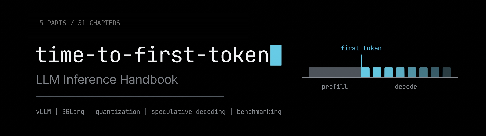

<p align="center">
  
</p>

[](https://github.com/tdccccc/time-to-first-token/actions/workflows/pages.yml) · [在线阅读（GitHub Pages）](https://tdccccc.github.io/time-to-first-token/)

# LLM 推理工程：原理与方法

面向系统工程师、算法工程与 AI Infra 学习者的 **大语言模型推理图文技术读物**。全书以「先算清账、再看机制、最后归因」为主线，配以 **35 张机制架构与数据流矢量图**、统一数学公式（KaTeX）和可对照的工程脚本，从底层硬件 Roofline 一路贯通至推理引擎架构、CUDA/Triton 算子优化与国产 AI 芯片适配。

- **在线阅读**：[tdccccc.github.io/time-to-first-token](https://tdccccc.github.io/time-to-first-token/)
- **统一教材算例口径**：以 **NVIDIA A100 80GB SXM**（312 TFLOPS FP16 / 2 TB/s / 脊点 156 FLOP/B）与 **H100 80GB SXM**（989.5 TFLOPS FP16 / 3.35 TB/s / 脊点 295 FLOP/B）配 **Llama-3.1-8B**（16 GB, 128 KiB/tok）与 **Qwen3-8B**（16.38 GB, 144 KiB/tok）贯穿全书；国产芯片篇以 **华为昇腾 Ascend 910B（64 GB）** 与 `vllm-ascend` 为主线展开。

---

## 全书结构（5 篇 23 章 + 2 横切区）

| 板块 | 章节 / 页面 | 核心主题 |
|---|---|---|
| **第一篇 · 性能直觉与测量方法** | [第 1–4 章](docs/chapters/chapter-01.md) | Roofline 与三区间直觉、模型显存与计算账本（M/F/R、GQA/MLA/MoE）、推理度量与压测方法、Profiling 时间线归因 |
| **第二篇 · 推理引擎与部署优化** | [第 5–11 章](docs/chapters/chapter-05.md) | vLLM V1 架构与 PagedAttention、SGLang RadixAttention 前缀复用、可观测性与容量拐点、量化原理（W4A16/W8A8/SmoothQuant/FP8）、投机解码与长上下文 KV 淘汰、TensorRT-LLM 与三引擎横评、生产架构（PD 解耦 / 自动扩缩容 / 成本路由） |
| **第三篇 · 算子与底层 Kernel 优化** | [第 12–17 章](docs/chapters/chapter-12.md) | GPU 执行模型与 GEMM 四版阶梯、Triton 编程模型（1D → 2D GEMM）、Fused Attention 与 Online Softmax、量化 Matmul（W8A8 vs W8A16）、FlashAttention 2/3 与 CUTLASS 导读、自定义算子接入推理引擎（vLLM `CustomOp` 与 Amdahl 归因） |
| **第四篇 · 国产芯片适配（以昇腾为例）** | [第 18–22 章](docs/chapters/chapter-18.md) | 国产芯片全景与五层软件栈、昇腾部署与 `vllm-ascend` 插件机制、CANN 分层与 AscendC 流水线、算子覆盖分析与回退定位、跨芯片算子迁移（CUDA/Triton → Ascend 与 FlagGems 边界） |
| **第五篇 · 跨芯片综合方法论** | [第 23 章](docs/chapters/chapter-23.md) | 跨芯片配对精度回归（McNemar 检验）、性能五步归因闭环、A100 vs Ascend 910B 完整示范分析报告与系统论文精读法 |
| **进阶专题库（横切区）** | [专题 A–E](docs/topics/advanced-architectures.md) | 前沿混合/稀疏架构拆账（Qwen3.5/3.6/DeepSeek/Gemma 4）、大规模集群 PD 与 Mooncake KV 池、端侧与浏览器运行时、各章核心论文精读档案、主流国产芯片生态速查 |
| **参考手册与工具箱（横切区）** | [速查表与参考](docs/toolkit/hardware-models.md) | 硬件规格与模型账本速查表、测量口径与对比分析方法、可运行工程脚本与配置参考、术语表、阅读进度 |

---

## 仓库目录导览

```text
docs/
├── index.md                      # 站点首页
├── chapters/chapter-01..23.md    # 23 章主线一章一文件源稿
├── topics/                       # 5 篇深度进阶专题
├── toolkit/                      # 硬件/模型速查、测量口径与工具配置参考
├── colophon.md                   # 来源、贡献与 CC BY 4.0 许可说明
├── original-README.md            # 上游英文原文留档
└── modules/                      # 配套可运行工程脚本与算子示例代码
    ├── part1-foundations/scripts/   # OpenAI 流式压测脚本与 Mock SSE 服务
    └── part3-operators/examples/    # 4 版 CUDA GEMM、Triton 量化 Matmul、vLLM CustomOp 插件包
assets/figures/                   # 35 张自制高信息密度架构与数据流 SVG 图
tools/                            # 站点组装、术语自动悬浮注解与严格验收脚本
tests/                            # 单元测试（构建、暂存、站点链接、压测脚本与算子代码契约）
```

---

## 本地构建与预览

仓库使用 MkDocs + Material 主题构建，并内置链接、锚点、配图、术语表与代码契约的自动化校验：

```bash
# 安装文档构建依赖
pip install mkdocs-material

# 1. 运行全量单元测试
python3 -B -m unittest discover -s tests -v

# 2. 构建静态站点（启用 --strict 零警告检查）
bash site-build.sh

# 3. 校验全部 23 章、5 专题、工具箱、配图与站内链接
python3 -B tools/check_site.py

# 本地启动开发服务器实时预览
bash site-build.sh serve
```

---

## 来源与许可

本仓库起源自上游英文开源路线图 [patchy631/time-to-first-token](https://github.com/patchy631/time-to-first-token)（英文原文留档于 [docs/original-README.md](docs/original-README.md)），并在此基础上进行了面向中文技术读者的全面结构重写、图文可视化升级，以及算子优化、国产芯片适配与跨芯片工程方法论扩展。

内容沿用上游的 [Creative Commons Attribution 4.0 International (CC BY 4.0)](https://creativecommons.org/licenses/by/4.0/) 协议发布；更多出处与引用说明见 [docs/colophon.md](docs/colophon.md)。
